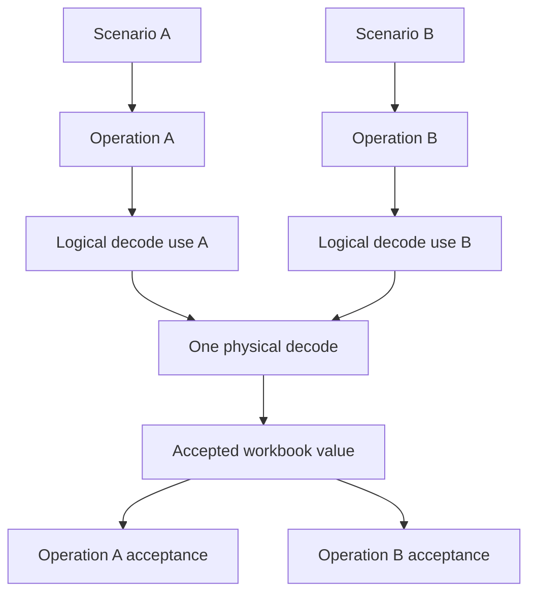
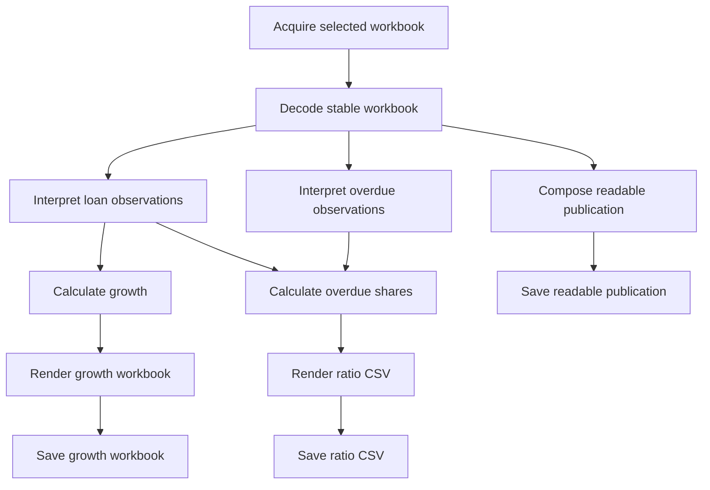

# Strategy Box: Commands, Operations, Scenarios and Cascades

**Date:** 2026-11-24. **Subject:** callable hierarchy, functional contracts, domain specialization, composition, shared execution, external invocation and semantic ownership. **Status:** research and proposed target model; code-shaped examples and package arrangements are prospective, not shipped APIs.

Strategy Box should expose **four levels of meaning through one composition and execution system**. A command performs a bounded technical procedure. An operation composes commands to establish a standardized functional result. A scenario composes operations to accomplish a recognizable purpose. A cascade composes complete scenarios to accomplish a broader purpose. Every level has explicit inputs, outputs and completion conditions, and every public level can be invoked directly. The decisive architectural distinction is between this logical hierarchy and the physical work that realizes it: a single technical procedure can satisfy several logical uses without merging their purposes, qualifications or effects.

This research develops that model as a coherent design proposal. It recommends visible command bodies for operations, source-neutral operation contracts with explicit domain bindings, preserved semantic scopes during compilation, and conservative sharing of equivalent work. It also explains what direct Python use can promise, how to organize definitions without competing registries, and which implementation boundaries require further development. The requested hierarchy is the design premise; exact identifiers, interfaces, storage and rollout remain proposed realizations. Illustrations are synthetic and carry no claims about published economic data.

## Contents

1. Architectural conclusions — the commitments that make the four levels useful.
2. Four levels and their boundaries — what each level means and when it deserves an identity.
3. Commands as technical procedures — explicit I/O, resources and useful granularity.
4. Operations as standard functional results — semantic atomicity and meaningful universality.
5. Domain specialization — methods, profiles and bindings without multiplying the hierarchy.
6. A practical capability vocabulary — example commands and exact operation contracts.
7. Scenarios as purposeful compositions — goals, parameters, outputs and reuse.
8. Cascades as coordination of scenarios — cross-scenario dependencies and aggregate results.
9. Contracts across all levels — values, qualifications, effects and acceptance.
10. Relation to the data route — processing roles and composition levels as separate dimensions.
11. From invocation to physical work — compilation, dynamic expansion and retained meaning.
12. Shared work and optimization — equivalence, pooling, coalescing, caching and batching.
13. Shared resources and value lifetime — ownership, readers and bounded retention.
14. Concurrent execution — one coordinator with independent logical consumers.
15. Failure, retry and cancellation — preserving successful work and unresolved effects.
16. External invocation and Colab — immediate calls, declared compositions and custom operations.
17. Canonical ownership in the repository — one definition system and a clear documentation route.
18. A complete worked cascade — three purposes sharing acquisition and workbook decoding.
19. Other operating paths — local inputs, multiple sources, analytical methods and rerendering.
20. Progress and notifications — explaining logical outcomes and physical work truthfully.
21. The implementation boundary that must change — exposing technical composition under operations.
22. Alternatives and counterexamples — where apparently simpler models lose meaning.
23. Acceptance situations — observable criteria for later implementation.
24. Development sequence and final decisions — a concrete route to the proposed model.
25. External sources — primary support for specific technical claims.

## 1. Architectural conclusions: four meanings, one execution model

### 1.1. The hierarchy describes promises at different scales

The proposed hierarchy is not a four-level menu and not a requirement for four nested runners. It distinguishes the promises made by reusable work.

A technical decoder promises a representation of workbook structure. An extraction operation promises a dataset satisfying a declared interpretation and coverage contract. A reporting scenario promises an analytical result assembled from appropriate operations. A reporting cascade promises a coordinated set of scenario results and any explicitly required cross-scenario product.

The higher-level promise cannot be inferred merely from the successful return of the lowest-level procedure. Correctly decoded cells can still contain an unsupported layout. Correctly extracted tables can still lack a required period. Several individually valid reports can still fail to form the consistent package the cascade requested.

| Code | Recommended decision | Functional consequence |
| --- | --- | --- |
| DEC01 | Reserve Command for a technical procedure with explicit I/O. | An external user request is called an invocation or request, even when it selects a cascade. |
| DEC02 | Define Operation by a standard functional result. | Publisher names and table coordinates belong to bindings and profiles unless they change the actual contract. |
| DEC03 | Express an operation through a declared command body. | Planning can inspect common technical work inside different operations. |
| DEC04 | Define Scenario by a recognizable purpose and required outputs. | A scenario is a reusable executable composition, with presentation supplied separately. |
| DEC05 | Define Cascade by coordinated scenario contracts. | It references complete scenarios and preserves their independent outcomes. |
| DEC06 | Allow direct invocation of every public level. | A single command does not require a permanently registered dummy operation, scenario and cascade. |
| DEC07 | Use one composition language and one execution system. | Nested definitions lower into common work while retaining their semantic boundaries. |
| DEC08 | Keep logical demand separate from physical execution. | One physical command can satisfy several consumers with different acceptance and cancellation states. |
| DEC09 | Share work only under an explicit equivalence and eligibility contract. | Identical names, URLs or output bytes alone cannot justify every optimization. |
| DEC10 | Give each meaning one canonical owner. | SDK, application and machine descriptions project the same definitions instead of maintaining parallel lists. |
| DEC11 | Keep analytical interpretation explicit. | Universality preserves units, periods, coverage and methodological distinctions. |
| DEC12 | Treat completion as fulfillment of declared obligations. | Produced values, saved artifacts and delivered notifications remain separately assessable. |

These codes are document navigation aids. They do not prescribe runtime enum members or additional approval machinery.

### 1.2. The central relationship remains visible after optimization

The engine should be able to explain a continuous relationship:

- which purpose the caller selected;
- which operations establish that purpose;
- which commands realize each operation;
- which concrete work was executed or reused;
- which accepted values and effect receipts fulfill each promise.

An optimizer may reduce physical work. It must preserve this explanatory relationship. A cascade containing three scenarios can use one workbook acquisition without becoming one scenario; two extraction operations can use one decoded workbook without becoming the same extraction.

The most important design consequence is therefore **preserved meaning under shared execution**. Composition, reuse, progress, cancellation and external invocation all follow from that requirement.

### 1.3. The design supports both small and large uses

A notebook reading one supplied workbook needs a small local execution scope and ordinary returned values. A host serving multiple concurrent requests needs a shared coordinator, resource accounting and retained result handles. A durable service additionally needs persistent run and effect state.

The four semantic levels remain the same across these profiles. Their existence does not require a server, a database, a message broker or an application process for each direct call. Stronger operational guarantees appear where a real consumer requires them.

## 2. Four levels and their boundaries: responsibility determines classification

### 2.1. Definitions of the four levels

| Code | Level | Question answered | Typical input | Typical output |
| --- | --- | --- | --- | --- |
| LEVEL01 | Command | Which technical procedure should execute? | Material, grid, table, request description or managed resource reference. | Technical value, qualified procedure result or effect receipt. |
| LEVEL02 | Operation | Which standard functional transition should be completed? | Inputs satisfying an exact functional contract, plus an admitted binding. | A reusable result with defined meaning, coverage and qualifications. |
| LEVEL03 | Scenario | Which recognizable task should be accomplished? | Task parameters and available materials or analytical inputs. | The selected task result and its completion assessment. |
| LEVEL04 | Cascade | Which broader purpose requires coordinated scenarios? | Scenario inputs, shared selections and cross-scenario conditions. | A coherent package or collection of scenario results and aggregate assessment. |

A command may be computationally complex. An operation may use one command. A scenario may use one operation when it introduces a separately useful purpose, parameterization or completion contract. A cascade's significance comes from coordinating scenario contracts, not from exceeding a task-count threshold.

This prevents artificial layers. Automatically giving every command a matching operation and scenario would multiply names without adding meaning.

### 2.2. A command is technical; an operation is functionally complete

Consider the difference between dividing two numbers and calculating an analytical share.

The command `numbers.divide` can specify numeric types, denominator treatment and a returned quotient. It establishes a technical calculation under those conditions. A standard operation `calculate.share` additionally requires compatible numerator and denominator populations, period alignment, units, key relationships, permitted missingness and a percentage convention. It returns a qualified analytical result.

Those extra requirements are not decorative metadata. Without them, a numerically correct division can produce a misleading statistic. The operation owns the functional promise; its commands perform the relevant checks and calculations.

The same distinction applies outside economics. A byte-copy command can perform one transfer. An operation preserving original material promises that the retained artifact corresponds to the declared material identity and that its storage boundary has been confirmed.

### 2.3. A scenario is executable purpose, with presentation kept separate

A scenario such as “prepare the selected bank-office history” specifies its source selection, required time coverage, extraction and integration choices, desired outputs and handling of unavailable issues. It is useful from a notebook, a command-line client or an application.

A title, icon, menu category or form is a presentation of that scenario. Several presentations can refer to the same definition. A machine descriptor is likewise a projection, not another independent interpretation of the task.

An analytical assumption named “baseline scenario” has a different meaning: it can be an input value or model dimension. It should not automatically become an execution Scenario. Use an explicit qualifier when both concepts appear in the same interface.

### 2.4. A cascade coordinates results that remain independently useful

“Prepare the monthly banking package” can reference scenarios preparing lending dynamics, office-network changes and a combined product. Each scenario can also run independently. The cascade supplies shared period and revision policies, maps outputs to subsequent scenario inputs and states which results are required.

A catalog folder containing those three scenarios is only a collection until it has an executable contract. A schedule for running the cascade is an automation definition. A months-long organizational assignment is a broader work lifecycle. These concepts can refer to the same cascade while retaining different meanings.

### 2.5. Semantic, scheduling and transactional boundaries differ

| Code | Boundary | What it establishes | Consequence |
| --- | --- | --- | --- |
| BOUND01 | Technical procedure | A coherent command-level action and its I/O. | Internal helper calls can remain private implementation details. |
| BOUND02 | Semantic result | The operation, scenario or cascade has fulfilled its promised meaning. | Several physical steps can contribute to one accepted result. |
| BOUND03 | Scheduling region | Work that can usefully receive resources and an execution attempt. | Several commands may be fused or one integral command may perform many internal steps. |
| BOUND04 | Transaction | An effect owner's actual all-or-nothing guarantee. | A semantic operation does not automatically provide rollback across destinations. |
| BOUND05 | User purpose | A requested combination of outputs and effects. | A result can be technically produced while the requested save remains unresolved. |

The normal authoring structure is command bodies inside operations, operation calls inside scenarios, and scenario calls inside cascades. Reusable subscenario structure may be nested where useful. An operation body ultimately references commands and structural command recipes; a scenario references operations and explicitly reusable subscenarios; a cascade references scenarios. Structural reuse preserves these body rules, and definition references remain acyclic. No mandatory empty wrapper is needed for a direct lower-level call.

## 3. Commands as technical procedures: explicit interfaces without an interpreter for every helper

### 3.1. What earns a public command

A procedure deserves a public command contract when independent calling, composition, reuse, resource management or diagnosis has practical value. Its technical purpose must be understandable without opening the source code.

Examples include obtaining a response body, reading a stable file snapshot, decoding a workbook, selecting a table region, applying a declared column mapping, evaluating a bounded numerical procedure, encoding a document, and committing a prepared artifact through a storage provider.

Internal loops over cells, temporary variable assignments and the scheduler's private bookkeeping remain implementation. Registering them would turn composition into an expensive imitation of the programming language.

| Code | Granularity question | Good indication | Counterexample |
| --- | --- | --- | --- |
| GRAN01 | Can a caller supply the input independently? | A workbook material can be supplied from local storage. | An internal loop counter requires undocumented surrounding state. |
| GRAN02 | Is the output useful at a stable boundary? | A closed immutable workbook snapshot can feed several consumers. | A partially mutated parser buffer has no declared reading contract. |
| GRAN03 | Does independent management help? | One acquisition can be reused after interpretation fails. | Scheduling every cell conversion adds overhead without useful control. |
| GRAN04 | Are effects and resource needs identifiable? | A network call and a storage commit have clear boundaries. | A function secretly performs arbitrary network, file and notification work. |
| GRAN05 | Can the procedure be maintained as a contract? | Inputs, errors and result meaning are documented and testable. | Its only definition is an incidental private helper name. |

A command is not necessarily a shell command. Most useful Stratbox commands will be typed Python procedures behind stable public definitions.

### 3.2. Minimum command contract

A command definition needs an identifier, a concise purpose, named input and output contracts, meaningful parameters, a procedure binding and a description of applicable effects and resources. Conditions such as replayability, nondeterminism, mutation and cancellation are included when they affect composition.

This does not mean every call must construct a large metadata dictionary. Typed declarations and the execution context can collectively carry the contract. A simple pure table projection can have a short signature. A remote write requires a more substantial effect contract because its consequences are more substantial.

Conceptually:

```text
command: workbook.decode
input: material with stable content
parameters: decoding profile
output: immutable WorkbookSnapshot + decoding findings
resources: parser capacity and bounded working storage
effects: none outside declared temporary execution storage
```

This is an illustrative declaration, not an existing importable API. If the chosen decoder exposes a live workbook reader instead, the output must say so and supply an explicit lease contract. The two outputs have different sharing and lifetime properties.

### 3.3. Explicit I/O includes facts and effects

A command returning no ordinary data can still have an explicit output: a receipt, a check report or a qualified status. “Write returned normally” is a weak description of an effect; the command should expose the boundary the provider actually confirmed.

A validation command can return a report describing passed conditions, failed conditions and scope. It must distinguish successful execution of the validation procedure from a favorable validation finding. Likewise, a source-check command can execute successfully and report that adequate freshness evidence is unavailable.

The technical output should preserve enough meaning for the receiving operation to make its own admission decision.

### 3.4. Resources and values need different output contracts

A command preparing source access can return a managed access reference. That reference identifies a capability, scope, generation and lifetime. It is not an ordinary immutable dataset and should not give each consumer uncontrolled ownership of the underlying session.

For ordinary HTTP use, obtaining a suitable connection is often a resource-manager responsibility rather than an explicit graph command. A separate preparation command becomes useful when preparation has independently meaningful cost, expiry, authentication state or failure behavior.

Similar reasoning applies to database snapshots, temporary writers and archive readers. A resource reference is explicit I/O, but it carries ownership and use constraints.

### 3.5. Technical does not mean devoid of domain algorithms

A technical procedure may implement a specialized parser or solver. “Technical” describes its bounded procedural responsibility, rather than a prohibition on subject knowledge anywhere below operations.

Prefer generic commands configured by admitted rules when that is sufficient. A domain-owned command is appropriate when a specialized procedure has an independently useful contract that generic mechanisms cannot express economically. Its applicability and required references remain explicit.

A source interpreter must not conceal discovery, acquisition, saving and notification inside one supposedly atomic parse command. Conversely, an integral coupled solver can remain one command when its internal iterations have no useful independent result contract. The criterion is a meaningful boundary, not the number of source files or lines of code.

## 4. Operations as standard functional results: universality with exact meaning

### 4.1. The operation is the basic functional building block

An operation supplies a complete, standardized answer to a recurring functional need. It composes technical procedures and establishes postconditions on their combined output.

For acquisition, the useful result is a material with a recoverable identity and acquisition qualification. For extraction, it is structured data satisfying the declared schema and interpretation. For calculation, it is a derived result with an explicit method and input basis. For rendering, it is a representation of an already defined semantic result. For saving, it is a retained artifact and the provider's confirmation.

A scenario can use these results without reconstructing each technical procedure. This is the reason to preserve a separate operation level.

### 4.2. Universality belongs to the contract, not to an empty signature

The family `extract` is useful for classification. It is not enough to define one callable `extract(Any) -> Any`. A planner cannot check meaningful links through such a contract.

An exact operation can instead declare `extract.observations`: supported material plus an admitted extraction binding produces an observation dataset and an extraction report. Its result contract preserves the measure, period, unit, source coordinates, value status and coverage needed by consumers.

The operation can be parameterized by an admitted schema. Before a receiving task executes, that schema must be known or resolved through a declared inspection boundary. A parameterized contract is still constrained; it is not an invitation to return arbitrary payloads.

| Code | Concept | Responsibility |
| --- | --- | --- |
| OP01 | Operation family | Organize related functional responsibilities, such as extraction or calculation. |
| OP02 | Exact operation | Specify one reusable transition with checkable inputs, outputs and guarantees. |
| OP03 | Operation method | Realize that transition through an admitted command body or integral procedure. |
| OP04 | Operation binding | Select the applicable method, profile, schema and references for the subject. |
| OP05 | Operation invocation | Apply the resolved contract to particular inputs and effective parameters. |

Only OP02 is a hierarchy level. The other rows describe classification, realization or use.

### 4.3. A standardized result can still preserve source-specific information

Universality does not require identical columns for every source dataset. A standard operation protocol can return different admitted series schemas while retaining the common guarantees required of source extraction.

For example, an office-network dataset and a fiscal expenditure dataset can have different keys, periods and measures. Both can be produced under an extraction operation that requires explicit schema, source fidelity, coverage and value-status treatment. A later integration operation handles admitted correspondences between source meanings.

The design should standardize what must be explicit, not flatten away every difference in the inputs.

### 4.4. Operation bodies are compositions of commands

The term “sequence” should mean a coherent dependency-ordered procedure. Independent commands may run in parallel; a condition can select one admitted branch; a bounded map can process several members. The operation's external result remains one functional promise.

Illustratively, an extraction operation can:

1. obtain a stable workbook representation from its supplied material;
2. identify the selected table under a declared layout profile;
3. reshape cells while retaining meaningful source coordinates;
4. interpret periods, labels, units and value statuses;
5. verify the promised dataset conditions;
6. return admitted observations and their extraction findings.

Acquisition is a separate operation when the extractor already accepts a supplied material. The dependency is on a usable input, not on a compulsory download performed during the same run.

### 4.5. Semantic atomicity preserves useful internal results

An extraction operation has a coherent semantic success boundary. A failed interpretation does not erase the fact that workbook decoding succeeded. That technical result may remain reusable by a corrected method or another consumer, provided its lifetime and identity allow reuse.

The operation result can expose selected intermediate outputs when useful. Routine internals can stay available only through diagnostics. Public intermediate ports should be deliberate contracts, since consumers may begin relying on them.

Semantic completion also differs from transactionality. If an operation includes a requested external effect, earlier accepted values and confirmed effects survive a later failure. A rollback guarantee exists only where a competent provider supplies it.

### 4.6. New exact operations require a meaningful new contract

A different publisher, sheet coordinate or file extension usually calls for another binding, profile or command method. A different analytical result or general acceptance/effect promise can justify a distinct exact operation. Source-specific constraints, thresholds and coverage requirements remain bindings or contract parameters when the operation already declares those variations.

Examples:

- changing the header row while preserving the same output contract: profile;
- using a different parser algorithm for the same guarantee: method;
- reading a new file format into the same material contract: provider or command realization;
- producing feasibility bounds instead of ordinary point estimates: a distinct exact calculation contract;
- committing a complete multi-artifact release instead of saving one file: a distinct effect contract.

This keeps the operation vocabulary finite enough to understand without forcing unrelated work behind one empty verb.

## 5. Domain specialization: selecting how a standard operation is realized

### 5.1. The domain supplies knowledge the generic engine cannot derive

The domain knows what a publication contains, which layout edition applies, how labels define indicators, what periods and units mean, and which source revisions can be compared. It can also own analytical methods requiring specialized knowledge.

The generic operation supplies the functional contract. The domain binding selects a realization that can satisfy that contract for the selected subject. The planner connects the resolved procedures and inputs; the runtime manages their execution.

For a table with cumulative fiscal values, a domain profile can identify the cumulative interpretation. A command may decode and reshape the cells perfectly. Only the admitted interpretation can establish whether subsequent subtraction produces a valid interval flow.

### 5.2. A binding connects several independently meaningful choices

| Code | Binding coordinate | Question answered | Example |
| --- | --- | --- | --- |
| BIND01 | Subject and selection | Which source content is being interpreted? | A publication group and selected issue. |
| BIND02 | Representation and edition | Which material/layout conditions apply? | XLSX with an admitted header edition. |
| BIND03 | Exact operation | Which result contract must be fulfilled? | Extract qualified observations. |
| BIND04 | Method or command recipe | Which procedure realizes that contract? | Decode, reshape, interpret and validate. |
| BIND05 | Profile | Which admitted rules configure the method? | Header coordinates and period-token rules. |
| BIND06 | Reference inputs | Which shared identities or classification editions are used? | An explicit territory edition. |
| BIND07 | Output schema and qualifications | What will be returned and what uses are supported? | An identified source-series schema with declared coverage. |

A binding is not a fifth composition level. It is a resolved relationship between an operation and its applicable realization.

### 5.3. The smallest sufficient specialization is preferable

Use a profile when the algorithm is unchanged and only declared rules differ. Use a method when the same functional promise needs another algorithm. Use a command graph when several technical boundaries deserve visibility. Use a distinct operation only when the external promise changes.

This arrangement avoids a separate operation definition for every source-table-format combination. It also avoids a huge generic handler whose switches encode every publisher.

A domain command can implement a genuinely specialized technical procedure. Its definition still participates in the common catalog and its output is checked against the enclosing operation's contract. This is controlled extension of the vocabulary, rather than an escape from standard operation semantics.

### 5.4. A generic method-dispatch command must not hide useful composition

One tempting implementation is a universal command `method.apply` that calls an arbitrary domain handler. It is acceptable for an integral algorithm whose internal work is intentionally opaque. It is insufficient for an acquisition-and-parsing pipeline whose common commands should be shared.

The operation method should therefore expose either an admitted command graph or a clearly declared integral leaf. A recipe can be authored through Python builders; it does not require YAML. What matters is that planning receives an inspectable structure before the relevant work is dispatched.

Acquisition that forms part of an operation recipe appears as a declared command boundary. Managed acquisition services can additionally pool resources and coalesce compatible requests, but their use does not make a hidden procedure visible to the planner. A binding for an extraction operation whose contract accepts supplied material cannot add an undeclared acquisition fallback.

### 5.5. Binding resolution must govern execution

Description, preparation and execution should use one resolution path. Changing an applicable method binding should change the inspected plan without modifying the SDK or adding another publisher-specific condition to the compiler.

Resolution can depend on source, content group, format, layout edition, supplied representation and requested result. A deeper namespace is not automatically a better match. Equally applicable conflicting candidates need explicit precedence or an ambiguity result.

Some information becomes known only after inspection. The initial plan can declare an inspection command and a bounded set of admissible continuation methods. The selected continuation is then checked before admission. Dynamic resolution remains part of the same contract system.

### 5.6. Standard operations retain authority over acceptance

A specialized method cannot weaken the operation's promised coverage or silently add effects. It may produce a qualified partial value if the operation contract permits that value, but each receiving consumer decides whether the qualification is sufficient.

A profile that changes only coordinates can remain compatible. A profile that changes observation meaning, aggregation perimeter or interpretation of missing values may require another schema edition or method qualification. “It fits the same Python type” is inadequate evidence of substitutability.

The operation therefore remains universal in a substantive sense: its promised transition is stable, and specialization is constrained to realizations that fulfill that promise.

## 6. A practical vocabulary: examples rather than a universal mandatory checklist

### 6.1. Representative command families

The examples below are prospective technical contracts. They illustrate where reusable procedures can live; they are not a requirement to create every listed command or freeze these identifiers.

| Code | Illustrative command | Explicit input | Explicit output | Main boundary |
| --- | --- | --- | --- | --- |
| CMD01 | `http.exchange` | Resolved request and scoped access. | Response metadata, completed body or qualified transport failure. | One declared exchange policy, including any supported redirects. |
| CMD02 | `file.snapshot` | Accessible path/reference and stability policy. | Fixed material snapshot and reading evidence. | A path becomes usable content. |
| CMD03 | `material.digest` | Stable material reader. | Digest and byte-length evidence. | Exact declared byte boundary. |
| CMD04 | `archive.members` | Stable container and selection. | Member materials and container relationships. | Selected member extraction. |
| CMD05 | `workbook.decode` | Workbook material and decode profile. | Stable workbook representation and findings. | Physical interpretation of the format. |
| CMD06 | `table.select` | Stable table/grid and structural selection. | Selected table with coordinate mapping. | Structural subset. |
| CMD07 | `table.reshape` | Table and explicit reshape rules. | Transformed table and coordinate relationships. | Shape transformation. |
| CMD08 | `fields.interpret` | Selected cells and admitted interpretation rules. | Typed fields and interpretation findings. | Tokens acquire declared types and meanings. |
| CMD09 | `schema.check` | Typed value and explicit conditions. | Scoped check report. | Conditions are assessed, not assumed. |
| CMD10 | `keys.match` | Source keys and a reference edition. | Matches and unresolved correspondences. | Edition-qualified identity mapping. |
| CMD11 | `series.change` | Aligned numerical series and numerical policy. | Numerical differences or rates. | Bounded mathematical procedure. |
| CMD12 | `model.solve` | Admitted model and solver settings. | Solution/bounds and solver status. | Integral numerical method. |
| CMD13 | `document.encode` | Prepared document model and format profile. | Completed document material. | Representation production. |
| CMD14 | `artifact.commit` | Prepared material and destination transition. | Provider-qualified effect receipt. | Actual storage or publication boundary. |

The names describe responsibility, not compulsory physical modules. A decoder may expose several independent commands only when their boundaries are useful. A large specialized solver may remain one command even though its implementation spans many modules.

### 6.2. Representative exact operations

| Code | Illustrative operation | Standard functional result | Typical command responsibilities |
| --- | --- | --- | --- |
| OPER01 | `discover.items` | A qualified inventory under an explicit selection scope. | Request/read an inventory, interpret entries, qualify membership. |
| OPER02 | `acquire.material` | Usable material linked to the selected source observation. | Exchange/read, establish identity, validate expected material. |
| OPER03 | `load.dataset` | A restored dataset satisfying its saved contract. | Read, decode, verify schema and restoration context. |
| OPER04 | `extract.observations` | Source observations with schema, interpretation and coverage. | Decode, select, reshape, interpret, check. |
| OPER05 | `render.publication` | A reading-oriented representation with explicit content coverage. | Decode relevant structures, compose readable content, encode. |
| OPER06 | `integrate.observations` | Data under declared common identities and mappings. | Match references, transform admitted dimensions, assess unresolved rows. |
| OPER07 | `compare.revisions` | Differences between comparable versions of a selected scope. | Align keys, compare values/statuses, qualify coverage and changes. |
| OPER08 | `calculate.growth` | Qualified growth between compatible periods. | Admit coordinates, align periods, calculate, qualify results. |
| OPER09 | `calculate.share` | Qualified ratios under a defined numerator/denominator relationship. | Match dimensions, check admissibility, divide and format measure metadata. |
| OPER10 | `calculate.bounds` | Bounds and evidence classes under an admitted constraint model. | Prepare/check the model, solve, qualify and project. |
| OPER11 | `view.dataset` | A defined analytical selection or table layout on a pinned basis. | Select, join or aggregate under explicit rules. |
| OPER12 | `render.product` | A representation of an admitted view or document model. | Build format components and encode the product. |
| OPER13 | `save.artifact` | A retained artifact with the promised storage confirmation. | Stage prepared material, verify its identity, commit and obtain the receipt. |
| OPER14 | `ingest.dataset` | A destination-qualified dataset revision. | Validate destination contract and perform its admitted transition. |
| OPER15 | `publish.release` | A coherent externally available result set. | Verify members and commit the publication boundary. |
| OPER16 | `validate.dataset` | A scoped assessment of declared dataset conditions. | Apply the selected checks and assemble a qualified report. |

Storage encoding can preserve a supplied logical value under an explicit codec; constructing a new analytical representation remains rendering. A small caller uses only the applicable operations. Source monitoring, original retention, readable conversion, analytical calculation and publication are independent choices connected by contracts.

### 6.3. Operation coverage is supplied by direct, shared or composed realization

A domain need not duplicate a neutral saver, decoder or ratio procedure. It supplies the bindings and domain conditions needed to use the shared implementation correctly.

Coverage should distinguish implemented capabilities, exact delegation to shared capabilities, missing applicable work and substantively inapplicable stages. Runtime readiness adds another dimension: an implemented method may lack its required provider in one environment.

A family name alone is not executable coverage. Conversely, a domain can have complete coverage of a responsibility through a shared standard operation without a publisher-specific wrapper function.

### 6.4. Control requests and surface actions sit beside the hierarchy

Requests to describe definitions, prepare plans, submit work, inspect runs or cancel execution belong to the control plane. Similar verbs applied to source materials, datasets or models can name commands or operations; the target and result contract determine their role.

Opening a file in a desktop viewer is a surface action. It can consume an artifact result without becoming part of the portable analytical cascade. Sending a notification is an explicit delivery effect when requested; it does not belong inside every parser.

This keeps the callable hierarchy focused on reusable work while giving applications appropriate control and presentation.

## 7. Scenarios as purposeful compositions: reusable analytical and operational tasks

### 7.1. A scenario owns a purpose that can be assessed

A scenario connects operations because their results jointly accomplish a recognizable task. That purpose may be analytical, preparatory, operational, diagnostic or publication-oriented.

Examples include preparing a regional lending comparison, updating a source-series history, checking a publication for revisions, rebuilding a workbook from retained data, or validating the completeness of a reporting package. Fundamental analytical questions are an especially useful organizing principle, but they are not the only legitimate one.

The definition needs a statement of the result the caller can expect. “Run these six operations” describes its mechanism; “produce a comparable two-period table for the selected bank perimeter” describes its purpose.

| Code | Scenario element | Required meaning |
| --- | --- | --- |
| SCEN01 | Purpose | The recognizable task accomplished by the composition. |
| SCEN02 | Inputs | Supplied values and explicit acquisition requirements. |
| SCEN03 | Parameters | Period, subjects, source selection, method choices and output selection. |
| SCEN04 | Operation calls | References to exact operations with their bindings. |
| SCEN05 | Connections | Named value handoffs and explicit control conditions. |
| SCEN06 | Outputs | Which results are externally usable and what each establishes. |
| SCEN07 | Completion obligations | Required outputs, coverage, checks and requested effects. |
| SCEN08 | Partial-result policy | What remains useful when some obligations fail. |
| SCEN09 | Execution restrictions | Applicable resource, cancellation and retry conditions. |

These fields describe responsibility. A lightweight scenario can express them through a small typed definition rather than a separate document for every field.

### 7.2. Compose results, not merely a list of function calls

Suppose an operation acquires a material and another extracts observations. The connection should identify the first operation's material output as the second operation's material input. The dependency follows from that value reference.

An unrelated `depends_on` list says only that one step follows another. It does not establish which value crosses the boundary or whether the value is compatible. Explicit control dependencies remain useful when an effect, check or ordering condition matters independently of dataflow.

A scenario with several inputs should name their roles. A ratio needs a numerator and denominator. A revision comparison needs a baseline and candidate. An unordered collection of tables cannot safely substitute for those roles.

### 7.3. Purpose determines required and optional work

A scenario preparing a numerical comparison may require two admitted datasets and a calculation. A preview chart may be optional. Saving the comparison becomes required when the selected scenario promises a saved product.

Required effects must survive output pruning even if no later calculation reads their receipts. The scenario's obligations are roots of the plan alongside its returned data.

An optional branch failure should remain visible without automatically invalidating an independently completed required output. A failed required branch prevents full success, even when every other branch completed. These are purpose-level decisions that cannot be derived from the final Python handler's return value.

### 7.4. Parameters bind deliberately across operations

Scenario-level parameters should map to operation parameters explicitly. A period selection can be shared, while individual operations may require additional context. For example, an output period can require earlier observations as calculation inputs.

A scenario should not pass one unrestricted dictionary to all operations and hope they interpret common keys consistently. Defaults, fixed conditions and permitted overrides need a declared precedence. The resolved plan records the effective values.

Runtime ceilings inherited from a larger composition remain ceilings. A nested operation can request a narrower resource budget or deadline, but it cannot silently acquire an additional independent worker pool or reset a parent's finite attempt budget.

### 7.5. Scenario reuse is by reference

A reusable scenario definition can serve several callers and several cascades. Its identity does not belong to one enclosing definition. Two calls to the same scenario with different inputs remain two logical occurrences.

The definition graph is therefore a network of references. A particular invocation can be displayed as a tree of occurrences. Physical shared work is a graph that may cross branches of that tree.

This distinction is essential for repository organization: one canonical scenario definition can appear in multiple thematic catalogs without being copied into each folder or cascade.

### 7.6. Structural composition is not another business level

Sequence, parallel branches, map, collect, conditional selection and port wiring arrange existing calls. They do not automatically deserve a command, operation or scenario identity of their own.

A collect that merely gathers completed scenario references is structural. An analytical integration that resolves conflicting populations and calculates a combined result has substantive meaning and belongs in an operation used by an appropriate scenario.

The common graph language can therefore remain expressive without adding another permanent semantic level for every control pattern.

## 8. Cascades as coordination of complete scenarios

### 8.1. The cascade preserves independently useful scenario contracts

A cascade references scenario definitions and binds their inputs, outputs and shared conditions. It does not copy their internal commands into a new handwritten procedure.

For example, a banking overview cascade can coordinate:

- a scenario preparing lending dynamics;
- a scenario preparing office-network changes;
- a scenario preparing a comparable macroeconomic context;
- an assembly scenario producing the selected overview tables.

The assembly scenario has its own meaningful result. Mere wiring between existing scenario ports remains structural and needs no artificial assembly wrapper.

A cascade can also be organized by publisher, frequency, reporting period, maintenance responsibility or output destination. The shared criterion should be explicit because it determines membership and completion.

### 8.2. Cascades can be independent collections or dependent compositions

| Code | Cascade form | Example | Relevant contract |
| --- | --- | --- | --- |
| CAS01 | Independent result set | Prepare several source-specific datasets for inspection. | Required members and per-scenario outcomes. |
| CAS02 | Shared prerequisites | Several scenarios use one publication inventory or material. | Separate logical needs with compatible shared work. |
| CAS03 | Dependent scenarios | A product scenario consumes outputs from data-preparation scenarios. | Named scenario ports and receiving conditions. |
| CAS04 | Analytical assembly | Several domain results feed a common analytical product. | Period, perimeter, mapping and completeness rules. |
| CAS05 | Conditional coordination | A revision assessment determines whether a refresh scenario is needed. | Qualified condition and explicit skipped-work meaning. |

The same underlying composition model supports all these forms. “Cascade” does not mean that every scenario must wait for the preceding scenario in a linear list.

### 8.3. Whole-scenario identity does not force a whole-scenario barrier

A scenario can expose an output when that output's acceptance conditions are satisfied, at a declared milestone, or only after the complete scenario succeeds. The contract chooses the appropriate rule.

Suppose a data-preparation scenario exposes an accepted dataset and also generates an optional preview. A downstream product can use the dataset while the preview renders. If the producing scenario instead promises a coherent multi-table release, consumers must wait for the release-level acceptance boundary.

A downstream result produced from an early accepted output does not erase a later failure of another required obligation in the producing scenario. The cascade still reports that required failure. Output readiness and aggregate completion are different facts.

This preserves the meaning of “whole scenarios” without recreating opaque sequential boxes.

### 8.4. Explicit membership and selectors are both useful

A cascade can list exact scenario references or resolve a selector such as “all applicable published scenarios for this source group.” A selector needs a declared scope and selection rule.

Before dispatching those scenarios, the selection resolves to a concrete membership manifest. A later catalog change affects a later invocation, not the interpretation of an already admitted run.

This catalog selection differs from runtime discovery of source materials. The first selects scenario definitions; the second discovers input members and expands admitted work. Both need closure and scope, but they have different owners.

A selector that resolves to no scenarios can be a valid empty selection or an unmet nonempty requirement. The cascade's contract decides which.

### 8.5. Cascade success follows its required goals

A cascade result should expose each scenario's qualified outcome, the aggregate requested outputs, failed or blocked obligations, and separately unsettled effects.

It should also state the consistency basis of a combined result. “All scenarios completed” does not prove that all data use the same reference period or publication vintage. A coherent product can require a common period and explicitly tolerate different publication dates; another product may intentionally show the latest available value of each series with visible freshness.

Parallel finish order never establishes analytical precedence. A slower old issue must not become current solely because its scenario completed last.

### 8.6. A schedule creates occurrences of a cascade

Foreground/background execution, manual invocation, a periodic trigger and a machine-originated request are execution modes or origins. They are not different cascade types.

A host may admit parallel occurrences, queue them, join an existing equivalent run, skip a duplicate occurrence or replace a pending one under a declared policy. This whole-run decision differs from sharing a command between otherwise independent runs.

If a new request joins an existing run, the request and its relationship to that run remain recorded. If two runs remain separate while sharing one acquisition, both retain independent purposes and completion conditions.

## 9. Contracts across the hierarchy: explicit values and meaningful acceptance

### 9.1. Common contract structure, different body rules

All four kinds benefit from common identity, named ports, parameters, applicability, effects, result qualification and definition revision. Their bodies differ.

| Code | Kind | Body | Completion boundary |
| --- | --- | --- | --- |
| BODY01 | Command | A declared technical implementation with its invariants. | Procedure output and effects assessed under the command contract. |
| BODY02 | Operation | A command composition plus functional acceptance conditions. | Standard functional promise fulfilled. |
| BODY03 | Scenario | Operation references, optional reusable subscenario structure and task conditions. | Requested task obligations fulfilled. |
| BODY04 | Cascade | Scenario references and structural wiring. | Required coordinated scenario outcomes and aggregate obligations fulfilled. |

A common catalog should preserve these distinctions rather than use one enormous definition class with many unrelated nullable fields.

A reference can identify kind, identifier and definition revision. An invocation adds concrete values, unresolved output references, bindings and effective parameters. A plan resolves what is known and declares permitted expansion. A run records actual events and results.

### 9.2. Four categories enter a call

The system should distinguish:

1. **Data inputs:** materials, tables, observations, model inputs and reference datasets.
2. **Semantic parameters:** selections, formulas, interpretation choices and output policies that affect meaning.
3. **Realization binding:** the admitted method, profile and exact contract instance.
4. **Execution context:** resource access, cancellation, deadlines, observation and output ownership.

A destination is an effect target. An output format is a representation choice. These may be exposed as ordinary request parameters for convenience, but their identity roles remain distinguishable.

Undeclared global variables make reproducibility and sharing unreliable. Result-sensitive settings must become explicit in the effective binding or execution evidence.

### 9.3. A port states both content and use semantics

An input/output type alone cannot tell the runtime whether a value may be shared or retained.

| Code | Value-use class | What consumers need to know |
| --- | --- | --- |
| USE01 | Immutable reusable value | Identity, content contract, availability and reading access. |
| USE02 | Isolated mutable value | Who owns mutation and how other consumers are protected. |
| USE03 | Single-consumer or replayable stream | Ordering, replay, closure, failure and backpressure rules. |
| USE04 | Resource lease | Owner, scope, generation, expiry, concurrency and release responsibility. |
| USE05 | Effect receipt | Intended transition and the actual confirmation boundary. |
| USE06 | Qualified collection | Member identities, closure, omissions and coverage. |

An immutable workbook snapshot can be shared. A live reader with a changing cursor requires controlled use or separate readers. A digest identifies bytes but does not make an inaccessible file readable.

Local Python can use rich native objects. Cross-process or durable handoff additionally requires a supported representation and access mechanism. The public contract should expose that actual readiness.

### 9.4. Compatibility includes more than shape

Planning can check nominal types, known schemas and declared effects. Runtime admission checks facts that require actual values: a required sheet exists, keys are unique, selected periods are present, units align, and the input bundle satisfies the method.

For analytical work, compatible columns do not establish compatible populations. A long table can contain a stock, a cumulative flow or a monthly flow under the same column names. Appropriate domain checks are required at the consuming operation boundary.

A contract can describe expected coverage and permit a qualified subset. The result must report actual coverage; it cannot inherit completeness merely from the request.

### 9.5. Produced values become accepted outputs through a defined boundary

A command can produce a candidate value, close its writer and report findings. The execution system checks required output ports, stable availability, active attempt authority and the relevant contract before exposing accepted outputs.

Operation acceptance additionally assesses the functional result. Scenario and cascade acceptance assess their purposes. These assessments can be coordinator rules or structural acceptance steps; they need no extra worker merely to wait for child completion.

The model should distinguish acceptance of an individual output from success of its enclosing scope. Independently useful outputs can be admitted when their contract permits it, while an incomplete required output keeps the whole scope from claiming full success.

When the contract couples several outputs, their availability is published as one acceptance group. Observations whose qualification depends on an extraction report become ordinary operation outputs only after that report, qualification and required retention are established. Earlier independently usable outputs require an explicitly declared acceptance boundary of their own.

### 9.6. Different consumers can accept the same output differently

One extraction can produce a dataset covering nine of ten selected tables. An exploratory consumer may accept it with a visible omission; a complete total may reject it.

The physical output retains one factual coverage assessment. The consumers retain different receiving conditions and logical outcomes. Sharing its production must not rewrite either policy.

Similarly, one consumer can accept an already retained material while another requires a fresh observation. A common newly obtained result can satisfy both only if their permitted actions, freshness and access requirements are compatible. A cache-tolerant offline request does not thereby authorize a network request.

### 9.7. A result has several independent axes

Execution phase, logical outcome, data qualification and effect knowledge should remain separately inspectable.

A command may be running; an operation may be waiting for its final acceptance; a dataset may be complete for the requested selection; a save may have an unknown outcome. A single global status cannot represent all four facts accurately.

An operation can also successfully establish an unfavorable finding: incompatible periods, infeasible constraints or no eligible source items. The contract determines whether that finding is the requested result or an unmet prerequisite for later work.

## 10. Relation to the data route: composition level and data readiness are independent

### 10.1. Data roles describe what a result is ready for

The processing route distinguishes source originals, reading-oriented publications, source extracts, integrated data and products. Those roles describe the use prepared by a result.

Command, operation, scenario and cascade describe the scale and meaning of callable work. The two classifications must remain separate.

A technical command can return a table at several processing roles. A standard operation can transform a source extract into integrated data. A scenario can end at a preserved original, an extraction report or a rendered product. A cascade can coordinate scenarios with different output roles.

| Code | Dimension | Examples | Question answered |
| --- | --- | --- | --- |
| AXIS01 | Callable level | Command, operation, scenario, cascade. | What scale of promise is being invoked? |
| AXIS02 | Processing role | Original, readable, extract, integrated, product. | What use is this result prepared for? |
| AXIS03 | Qualification | Reported, derived, reconstructed, partial, unresolved. | What does the content establish? |
| AXIS04 | Representation | Bytes, workbook snapshot, typed table, file, database relation. | How can it be read? |
| AXIS05 | Lifetime | Caller-owned, session-retained, temporary, durable. | How long is it available and who retains it? |
| AXIS06 | Execution state | Waiting, running, completed, blocked, cancelled. | What is happening to this invocation? |

The same physical bytes can have several qualified uses. For example, a publisher CSV can be preserved as an original and admitted as a source dataset after validation. Those uses do not require duplicated files, but their interpretation remains explicit.

### 10.2. The reference route is not a compulsory ladder

Readable conversion and numeric extraction can be parallel branches from one material. Calculations can consume source-local or integrated data when their contracts permit it. A product can be rendered from a supplied compatible view.

A scenario beginning with retained extracts should not reacquire and re-extract merely to traverse familiar stages. A direct command call should not create missing operations just to fill all hierarchy levels.

The actual route is the dependency closure of the requested result, the supplied inputs and the admitted recipes. This keeps both the data model and the callable hierarchy flexible without making them vague.

### 10.3. Acquisition and restoration answer different questions

Acquisition obtains material from a selected source observation or caller-specified origin. Loading restores an already retained value under its saved contract. Reading a file is a technical procedure that can support either responsibility.

A network URL, a local path and a network-disk path are locators. The extraction input is stable material or an explicitly stable reader. The provider can differ while the required material contract remains common.

A restored extract needs its schema, interpretation and qualification, not only a CSV decoder. A retrieved original needs its declared byte boundary and source-use context, not an invented analytical schema.

### 10.4. Derived data and validation can occur at several boundaries

Calculation is not one mandatory storage rung after integration. A same-series change can be computed before persistent ingestion. A reconstruction can require a broad source bundle while producing a narrow projection. A model fit can consume a pinned analytical snapshot.

Validation accompanies each useful boundary and can also be requested as its own operation. Technical decoding, semantic interpretation, analytical comparability and destination availability require different checks.

The hierarchy therefore gives the route reusable callable pieces while the route gives those pieces useful input and output meaning.

## 11. From invocation to physical work: lowering preserves contracts and purposes

### 11.1. Any public kind can be the root

An invocation selects a command, operation, scenario or cascade and supplies its inputs and conditions. The root kind is recorded directly.

A single command can become a one-node work plan. An operation introduces its command body and functional acceptance. A scenario introduces operation occurrences. A cascade introduces scenario occurrences and their relationships.

This common preparation route does not manufacture permanent higher-level definitions around a smaller request.

### 11.2. Preparation is a sequence of semantic decisions

| Code | Preparation step | Result |
| --- | --- | --- |
| PREP01 | Resolve the selected definition and effective request. | Exact root identity, inputs, parameters and requested obligations. |
| PREP02 | Resolve catalog selectors and known bindings. | Concrete definition membership and applicable method/profile choices. |
| PREP03 | Identify supplied values and eligible retained inputs. | Valid entry points that can cut off upstream work. |
| PREP04 | Select the required dependency closure. | Necessary data, checks and effects; unrelated optional branches excluded. |
| PREP05 | Expand scenarios, operations and command recipes. | Logical occurrences and visible technical work. |
| PREP06 | Check links, output promises and permitted effects. | Rejection of incompatible composition before the affected work starts. |
| PREP07 | Plan compatible sharing and resource use. | Physical producer nodes with explicit logical consumers. |
| PREP08 | Preserve acceptance boundaries and dynamic-expansion rules. | An inspectable plan whose meaning survives execution. |
| PREP09 | Admit the run under the chosen execution profile. | A run handle or an actionable admission result. |

These steps can be interleaved when some contracts become known only after inspection. The invariant is that each dispatched fragment has passed the applicable checks and that its expansion has an explicit origin.

### 11.3. Three structures need to survive compilation

The definition reference graph records reusable components. The logical occurrence graph records what each invocation needs. The physical work graph records actual producer work after eligible sharing.

A scope tree can be a convenient projection of logical occurrences. It cannot replace the many-to-many consumer relationships of shared physical work.



The diagram shows responsibility and use relationships, not the temporal order of every event. Each operation can contain additional commands. A shared producer has one physical execution history while both logical consumers remain identifiable.

### 11.4. Lowering needs a correspondence map

Every physical command occurrence should be traceable to the logical calls it serves. Conversely, each logical command use should identify how its requested result was obtained: newly produced, joined while in flight, supplied from an eligible completed result, skipped under a condition, or blocked by a missing prerequisite.

Acceptance conditions remain attached to their operation or composition scope. Flattening removes unnecessary execution nesting; it must not remove postconditions, effect obligations, parameter scope or error policy.

The optimizer should also retain a concise explanation of significant transformations: a material acquisition shared because observation and access contracts matched, or a decoder kept separate because profiles differed.

### 11.5. A graph description must expose the intended technical boundaries

A compiler cannot safely recover arbitrary hidden Python behavior by inspecting function names. If two opaque handlers both open the same workbook internally, their common procedure is invisible unless an explicitly shared service happens to detect it.

Declared operation bodies make those boundaries available for planning. An operation implementation can use trusted Python graph builders, typed declarative files or another admitted authoring mechanism. These are authoring choices over the same composition model.

CWL 1.2.1 provides an external example of typed workflow inputs and outputs, explicit step links and nested workflows. It supports the general feasibility of contract-based composition; it does not determine Strategy Box's four semantic levels or require adoption of the CWL runtime. [E01]

### 11.6. Dynamic discovery refines the plan through admitted expansion

A publication index may reveal an unknown set of materials. A workbook inspection may identify its layout edition. A selected collection may require several pages of discovery.

The plan can declare those expansion points, eligible continuation definitions, limits and closure rules. Accepted observations add concrete tasks through the same admission path as initial tasks. Existing execution history remains fixed.

Dynamic expansion must preserve inherited resource ceilings, source context, command contracts and required outcomes. A dynamically discovered network command should receive the same shared access and accounting as a command present from the beginning.

### 11.7. The planner need not infer arbitrary analytical methodology

The first useful planning system can resolve declared recipes and compatible bindings. It need not search all possible transformations or guess a methodology from matching column names.

An exact call requires its explicit inputs. A goal-oriented request can permit preparation of missing prerequisites from registered routes. If two methods imply different economic interpretations, the planner needs an explicit selection policy or a returned ambiguity.

Preparation is useful when it explains the route and missing requirements. It becomes misleading when it hides methodological decisions behind an apparently convenient universal command.

## 12. Shared work and optimization: preserve equivalence and each consumer's obligations

### 12.1. Several different optimizations are involved

“Combine duplicate commands” is a useful objective, but it covers distinct mechanisms.

| Code | Mechanism | What is shared or changed | Necessary qualification |
| --- | --- | --- | --- |
| SHARE01 | Implementation reuse | Several calls use one maintained procedure. | Their results remain separate unless execution reuse is also justified. |
| SHARE02 | Resource pooling | Suitable transport, access or parser resources. | Resource compatibility and lifecycle are explicit. |
| SHARE03 | Common-subgraph elimination | Equivalent work visible in the same plan. | Required meaning, conditions and effects are preserved. |
| SHARE04 | In-flight coalescing | Compatible concurrent demands attach to one producer. | Join eligibility, lifetime and independent consumers are managed. |
| SHARE05 | Completed-result reuse | An accepted earlier value serves a later demand. | Identity, freshness, qualification and availability remain sufficient. |
| SHARE06 | Blob deduplication | Equal physical bytes occupy shared storage. | Logical origin and source uses stay distinct. |
| SHARE07 | Provider batching | Several different requests use a supported combined transport call. | Per-request results, errors, access and snapshot meaning are preserved. |
| SHARE08 | Execution fusion | Adjacent compatible procedures run in one scheduling region. | Observable outputs, checks, effects and numerical semantics remain valid. |

These mechanisms can cooperate. They should not be implemented as one unqualified “same key means skip” rule.

### 12.2. Equivalence is stronger than matching a name

For a deterministic command over fixed inputs, a candidate equivalence key can include:

- exact command contract and implementation identity;
- input value identities or verified content identities at the required semantic boundary;
- resolved profiles, references and result-sensitive settings;
- normalized meaningful parameters;
- compatible observation, state and access scope;
- conditions that constrain whether and when execution is permitted.

A key proposes a match. Eligibility checks establish whether the shared output may serve the specific consumers.

Dask's delayed API distinguishes pure calls from impure calls and uses consistent keys for eligible pure calls, while procedures depending on changing state require different treatment. This is a useful external illustration of why procedure naming alone cannot establish reusable work. [E02]

### 12.3. Equal numerical content can still have different semantic uses

Two publishers can distribute identical bytes. Blob storage can share those bytes. Source-use records must still identify which publication each consumer used.

Two observation tables may contain equal numbers while differing in source vintage or qualification. A pure arithmetic kernel may be reusable if its numerical inputs and relevant settings match, but the enclosing operation must preserve each consumer's actual input basis and lineage.

The safe decomposition is to share the genuinely equivalent technical result and retain distinct semantic wrapping or acceptance where required. Merging the complete source-bound analytical result would overstate equivalence.

### 12.4. Shared acquisition needs a pre-acquisition identity

Before downloading, the result content may be unknown. Acquisition equivalence therefore depends on the intended observation: method, resolved locator, body, relevant headers, representation, provider/access scope and freshness or immutable-version conditions.

A content digest learned after two completed downloads cannot retroactively save those transfers. Different URLs can share a transfer only if a valid equivalence or common immutable object identity is already established.

A mutable local or network-disk file has the same issue. Equal paths do not prove equal snapshots. The reader needs an appropriate stability contract or must identify the actual material obtained.

### 12.5. HTTP safety, idempotency and representation identity are different

HTTP method idempotency describes the intended server effect of repeated requests. It does not promise that a later response has the same content or that two analytical observations can be merged. Conditional requests and validators concern a selected representation; a 304 response requires the corresponding retained body for downstream use. [E03]

RFC 9111 permits collapsing requests only when the resulting response can legitimately serve the requests involved. Its cache-matching rules also account for request fields named by Vary. These protocol constraints support conservative request sharing, rather than URL-only equivalence. [E04]

The Strategy Box inference is narrower and explicit: an acquisition key must preserve the observation and representation requirements relevant to the selected provider. General semantic sharing also considers requirements beyond HTTP caching, such as a consumer's pinned analytical vintage.

### 12.6. Pooling does not mean one request or one socket

Several operations can use one managed source-access context and a reusable connection pool. They can still need several distinct requests and several concurrent connections.

HTTPX documents that a Client maintains a connection pool and can reuse underlying connections across requests. That supports scoped transport reuse, without implying that all requests to one site should collapse into one exchange. [E05]

Source access should be prepared once within its actual generation and lifetime when preparation is required. Expiry, credentials, cookies, provider configuration or an observation policy can require another scope. A global mutable session for unrelated consumers is not the intended abstraction.

### 12.7. In-flight sharing has a producer and explicit consumers

One producer performs the physical command. Each logical consumer records its interest and receiving conditions. The first consumer may trigger execution, but it should not become the permanent owner of the producer's lifetime.

Go's singleflight package illustrates a bounded duplicate-call suppression mechanism: calls for the same in-flight key receive the original execution's result. Strategy Box needs additional consumer-specific policy, value lifetime and qualification around that basic pattern. [E06]

A consumer joining later must satisfy the producer's observation and lifetime conditions. An incompatible new demand starts separate work or receives an explicit diagnostic. It cannot silently redefine an attempt already running.

### 12.8. Different requirements can sometimes share a stronger result

Exact request equality is sufficient in some cases but is not the only possible relationship. One fresh acquisition can sometimes satisfy both a freshness-sensitive consumer and a consumer permitting retained data.

That is a satisfaction relation: one produced result meets both contracts. It is not a universal rule to take the “strictest” option. A cache-tolerant offline consumer may forbid new network work. A bounded-cost consumer may reject a broader request. A different vintage requirement can make “fresher” analytically wrong.

The initial implementation should prefer exact equivalence and explicitly admitted satisfaction rules. General inference over policies would add complexity and could silently change what the caller requested.

### 12.9. Effectful commands require separate reasoning

Two saves to different destinations are separate obligations even if they write identical bytes. Two notifications can be intentionally distinct. Equal command IDs and payloads do not establish one intended effect.

An idempotency key can identify repetition of the same intended destination transition when the provider supports that contract. It differs from sharing a pure computation and from merging two independently requested effects.

A shared acquisition can feed separate private staging writers. Its transfer is shared; each destination commit and receipt remain visible. An uncertain write is reconciled against the competent destination before an unsafe repetition.

### 12.10. Ordering and conditional execution constrain optimization

A read before a write and a read after that write can observe different states despite identical arguments. Their state epoch or effect ordering must prevent unsafe merging.

A command under an unselected condition must not be eagerly executed merely because a similar command appears elsewhere. Sharing can use an independently permitted producer, but it must not create an effect or acquisition for a consumer whose contract forbids that action.

Common-subgraph elimination must also preserve dependency acyclicity and resource feasibility. Rewriting two similar nodes into one can be invalid if it introduces an ordering contradiction or changes the required snapshot.

### 12.11. Batching and fusion are optional, stronger transformations

Provider batching combines different requests through an admitted backend interface. It requires correct mapping back to each request, compatible observation semantics, bounded size and a defined response to partial failures. A website offering several unrelated pages does not thereby support one batch request.

Fusion reduces scheduling or data-copy overhead by running adjacent commands together. It must preserve externally used intermediate values and contractual checkpoints. It cannot move an external commit ahead of a required validation or change a numerical method's result.

The initial target can support explicit common producers, pooling and conservative coalescing first. Batching and fusion should be added for measured workloads and declared equivalences, not assumed from the four-level model.

### 12.12. Explain both sharing and non-sharing

Useful plan explanations include:

- one workbook acquisition serves two scenarios under the same pinned observation;
- decoding is shared, while interpretation differs by profile;
- requests stay separate because one requires another freshness observation;
- calculation is reused, while two requested saves remain distinct;
- a mutable reader cannot be shared under its current use contract.

These explanations help users trust the optimization and help maintainers diagnose missed opportunities. They should describe concrete reasons, not merely expose opaque hash values.

## 13. Shared resources and value lifetime: ownership survives the producing call

### 13.1. A resource is shared within a declared scope

A managed access context, connection pool, database snapshot or parser resource has an owner and a lifetime. Operation and scenario nesting should not create a new resource instance whenever the same capability is requested.

A resource scope can distinguish provider configuration, access generation, permitted use, concurrency and expiry. Compatible callers can share its preparation. Unrelated scopes remain separate even when they reach the same host.

The resource manager should explain acquisition, reuse, expiry and release. It can prepare a resource lazily when the first eligible command needs it. An explicit preparation command is useful only when that preparation has an independently meaningful procedure and outcome.

### 13.2. Accepted values need an owner beyond the handler stack

A command can return before all dependent operations have consumed its output. The value must therefore remain available under an explicit owner.

A workable lifecycle is: allocate staging, produce, close, check, accept, retain for demand, provide readers, optionally save durably, and release when the obligations end. Failed staging does not become an ordinary accepted value.

The operation's completion does not automatically end the lifetime of every command output. Another operation may share a decoded workbook; a caller may still hold a result; an interrupted effect may require retained staging for reconciliation.

### 13.3. Future demand and active reading differ

A known future consumer needs the value retained before it runs. An active reader additionally needs a stable reading view while it uses the value.

These responsibilities can be represented by demand references and reading leases, or equivalent mechanisms. Moving a value from memory to temporary storage can preserve logical identity if the representation remains contract-compatible. It must not invalidate an active reader.

An open dynamic-expansion scope can retain the specific accepted values that its declared continuation may still consume. That retention ends when the relevant continuation closes and its concrete consumer demands have been registered. It does not pin every result in the session.

A local notebook can implement much of this through ordinary object ownership. Larger shared sessions need explicit accounting because material may cross tasks and occupy substantial temporary storage.

### 13.4. Branching requires a mutation rule

Sharing a table is safe only under its use contract. Suitable choices include immutable snapshots, isolated copies, copy-on-write or a declared exclusive mutation lease.

A downstream transformation normally establishes a new logical value. Reusing physical buffers is an implementation optimization; it must preserve earlier values for consumers entitled to read them.

A shared mutable workbook reader with one cursor is a resource, not a universally reusable value. Separate readers over the same stable material may be preferable to sharing the reader itself.

### 13.5. Large materials require bounded handling

A common acquisition can stream into managed storage, establish its identity, and then expose stable readers. Buffering an entire large response solely to support coalescing can defeat the resource model.

Single-use streams require special treatment. Multiple consumers need supported replay, buffering or an explicit multicast protocol with backpressure and late-failure semantics. The initial model can use completed materials and bounded chunk readers where that satisfies actual consumers.

The number of queued files is not a byte budget. Accounting should include active parser memory, retained results, staging and pending consumers.

### 13.6. Returned results have an explicit availability promise

A convenience call can return a detached native value, a session-bound handle, a leased temporary artifact or a durable artifact. The caller must be able to distinguish them.

Closing an internal convenience scope must not invalidate a result promised to remain usable. If a result requires the session to stay open, the interface states that requirement and provides a way to detach or retain it.

Permanent storage and process-restart recovery are separate stronger promises. A temporary file, plan serialization or in-memory catalog entry does not establish either by itself.

## 14. Concurrent execution: one coordinator, several purposes

### 14.1. The shared execution scope is explicit

A session can coordinate several runs, their resources and eligible shared work. A direct command uses the same command contract within a small local scope. A long-lived application can retain a session for several user and scheduled requests.

Separate sessions do not automatically share a global budget or cache. Machine-wide coordination requires a competent owner that actually spans those sessions. Calling the same facade class twice does not provide that guarantee.

### 14.2. Readiness is assessed before worker dispatch

A command is ready when its required values are accepted, control conditions permit execution, receiving policies are satisfied and resource capacity can be granted.

Waiting for an input, a shared producer, a retry delay or a scope acceptance condition should normally occupy coordinator state rather than a scarce worker. A worker is reserved for actual technical execution.

Python documents that tasks waiting on other futures in a constrained thread pool can deadlock. This supports keeping ordinary dependency waiting and structural composition outside worker bodies. It does not prohibit synchronous I/O in workers when that is the chosen backend. [E07]

### 14.3. Composite scopes do not run private executors

An operation, scenario or cascade contributes tasks, policies and acceptance rules. It does not launch another executor merely to wait for its children.

The same coordinator can keep a logical operation open while some commands have completed and another waits. Shared physical producers can serve consumers in different scopes. Scope summaries are computed from those facts.

This is the operational meaning of one engine for four levels.

### 14.4. Resource ceilings compose across nesting

The runtime should account for network concurrency, CPU work, parser capacity, retained material, temporary storage and conflicting writers at the scope where the real constraint applies.

Nested maps share aggregate expansion and resource limits. Ten local windows of ten tasks must not be assumed to satisfy a global limit of ten. A source-specific connection limit and a session-wide material budget constrain the same physical work through different resources.

A task whose minimum demand cannot fit any permitted capacity needs an explicit diagnostic or an admitted alternative. It should not remain indefinitely labeled as merely waiting.

### 14.5. Fairness prevents large cascades from swallowing small work

A historical backfill can contain thousands of command occurrences. An interactive preview may need only one material and one extraction. A shared scheduler should admit work fairly enough that the preview can proceed under available capacity.

Simple bounded admission across runs may be sufficient initially. Priorities and more complex scheduling should follow actual workloads. The semantic requirement is independent request identity and explainable resource waiting.

### 14.6. Logical counters and physical counters remain separate

One acquisition may satisfy three operation inputs. Physical request count is one; logical dependencies satisfied are three. A retry increases physical attempts without inventing another selected publication.

The coordinator should maintain both views. Combining them into a single task count would make progress and resource savings difficult to interpret.

## 15. Failure, retry and cancellation: preserve valid results and unresolved obligations

### 15.1. Failure belongs to the boundary that failed

A command failure concerns its technical procedure. An operation failure concerns its standard result. A scenario or cascade failure concerns its required purpose.

These relationships are causal, not interchangeable. If a common acquisition fails, several downstream operations can be blocked by one root cause. The system should not report independent parsing failures for commands that never ran.

Conversely, a technical command can succeed while operation admission rejects its output for insufficient coverage or incompatible meaning.

| Code | Situation | Meaningful outcome |
| --- | --- | --- |
| FAIL01 | Material acquired; workbook interpretation fails. | Acquisition remains available; extraction is unfulfilled. |
| FAIL02 | Decoder returns valid cells; required sheet is absent. | Technical decoding succeeded; the requested extraction contract failed. |
| FAIL03 | Shared input is complete; one consumer rejects its qualification. | Physical work succeeds; that consumer's logical result is rejected. |
| FAIL04 | Required scenario output is missing; optional preview succeeds. | The scenario remains incomplete or failed according to its contract. |
| FAIL05 | Product exists; destination acknowledgment is lost. | The product remains usable; the save effect is unknown. |
| FAIL06 | One scenario fails independently of others. | Other eligible scenarios can complete under the cascade policy. |

### 15.2. Retry the appropriate work, not automatically the whole hierarchy

A failed command can be retried against the same admitted inputs when its failure class is retryable and its effect policy permits another attempt. Determinism supports result equivalence; it does not by itself authorize repetition. An operation retry can reuse successful technical prerequisites if their identity, availability and snapshot guarantees remain valid.

Replaying the entire operation is unsafe when earlier commands may have committed effects. Replaying a whole scenario can also reacquire a changed latest source and silently alter the analytical basis. The retry policy must specify whether it continues the same evaluation or requests a new one.

A new attempt retains its logical purpose but has a distinct physical attempt identity. Its staging and acceptance authority are also distinct.

### 15.3. Shared consumers may have different retry policies

One consumer may allow no retries; another may allow a bounded retry. The runtime should preserve both contracts.

After the first failure, the first consumer can terminate while the second remains attached to an eligible retry, if that producer protocol is declared. An implementation that cannot represent this distinction should keep those work groups separate.

Budgets across transport, command, operation and scenario layers must be accountable. Each layer independently retrying three times can multiply attempts unexpectedly. The target should have one clear owner for each repeated physical action and an explicit aggregate ceiling.

### 15.4. Cancellation withdraws demand and records observed consequences

Cancelling a command use detaches that consumer. Cancelling an operation, scenario or cascade withdraws the relevant descendant demands and stops further admission under its policy.

A shared producer continues while another eligible consumer still needs it. If every consumer withdraws, the runtime requests cancellation where supported and cleans up only after actual readers and effects permit it.

Cancellation does not undo confirmed external effects. A timeout on waiting for a result does not prove that a worker stopped. Python Future cancellation and timeout behavior likewise distinguish pending work from already running work. [E07]

### 15.5. Late attempts cannot replace accepted current outputs

An old attempt can return after a later attempt has been admitted or a consumer has cancelled. The acceptance boundary checks whether it is still the admitted attempt of the physical work. Acceptance authority belongs to that work attempt, not to the first logical consumer. Cancelling one consumer does not revoke that authority while the producer remains admitted for others. The accepted physical output and each consumer's logical outcome are recorded separately.

Revoking that authority does not physically terminate a thread or reverse a remote write. Resource accounting and effect reconciliation must continue until the actual situation is known.

Overlapping retries should be an explicit supported policy, with separate accounting and effect protection. They are not an automatic consequence of a short caller timeout.

### 15.6. Partial success needs an explicit reusable boundary

A collection can contain completed, failed, omitted and unavailable members. Its membership closure and semantic coverage are separate.

A scenario can retain complete partitions and identify remaining work. A coupled analytical calculation may require the whole admitted bundle; partial reuse then depends on the method's actual independence conditions.

“Reuse what succeeded” is a useful principle only when the reused values remain valid for the intended snapshot and receiving contract.

### 15.7. Recovery depends on the execution profile

A surviving in-process session can continue from its retained values and state. Recovery after process loss requires persisted inputs, effective definitions, accepted results and effect evidence to the degree promised by the host.

The portable core should supply contracts for those boundaries. The application owns durable work lifetime, schedules, user history and restart guarantees.

A failed notification can be retried separately from a completed data-processing graph. A save with unknown outcome requires destination reconciliation rather than a blind claim that either failure or success occurred.

## 16. External invocation and Colab: every level is a legitimate entrance

### 16.1. Public calling is independent of default interface emphasis

A desktop interface may emphasize scenarios and cascades because they match everyday tasks. An expert interface may expose commands and operations. A notebook should be able to invoke all four public kinds without importing private implementation files.

The core contract should not force every caller through a user-facing scenario. It should also not make an ordinary public command call equivalent to arbitrary private handler execution.

Public availability means a declared stable callable with a known contract. A machine or remote adapter exposes the subset for which it has working schemas, providers and codecs. Direct Python can retain richer local types.

### 16.2. One facade can offer four views of one catalog

The following is a proposed interface shape, not existing Stratbox syntax:

```python
with StrategyBox(...) as box:
    technical = box.commands.invoke(
        "workbook.decode",
        inputs={"material": supplied_material},
        parameters={"profile": "cells-with-coordinates"},
    )

    extracted = box.operations.invoke(
        "extract.observations",
        inputs={"material": supplied_material},
        binding="demo.credit-layout",
        parameters={"periods": ["2026-09", "2026-10"]},
    )

    analysis = box.scenarios.run(
        "banking.prepare_dynamics",
        inputs={"observations": extracted.outputs["observations"]},
        parameters={"period": "2026-10"},
    )

    package = box.cascades.run(
        "banking.prepare_overview",
        parameters={"period": "2026-10"},
    )
```

The four views resolve definitions through the same catalog and converge on the same preparation and execution path. A neutral `invoke(DefinitionRef(...), ...)` can coexist with those convenience methods.

Each call returns the requested level's qualified result. The command result does not pretend to be a complete analytical scenario. A directly invoked operation exposes its functional result and can make technical detail available on request.

### 16.3. Immediate command use is a complete legitimate mode

A notebook can invoke a file-snapshot command, pass its output to a workbook decoder, and inspect the returned workbook structure. It can then use selected values in ordinary Python.

A sequence of eager calls is executed as the calls arrive. Shared session resources and eligible retained results can still help. The runtime cannot inspect undeclared future statements or retroactively collapse requests already executed.

If the user calls low-level implementation functions outside managed invocation, those functions can remain usable under their own documented signatures. General graph-level sharing, resource coordination and scope observation apply only to work actually admitted through the corresponding execution path. This is an explicit guarantee boundary, not a reason to prohibit ordinary Python.

### 16.4. A custom operation can be temporary and local

A user can compose commands into a local operation with a declared result contract. It need not first become a repository file or a globally installed catalog entry.

The following prospective declaration illustrates the functional structure:

```yaml
kind: operation
id: local.extract_selected_table
inputs:
  material:
    contract: stable-workbook-material
parameters:
  layout:
    contract: admitted-layout-profile
  output_schema:
    contract: admitted-table-schema
commands:
  - id: decode
    command: workbook.decode
    inputs:
      material: input.material
    parameters:
      profile: cells-with-coordinates
  - id: select
    command: table.select
    inputs:
      workbook: decode.workbook
    parameters:
      layout: parameter.layout
  - id: interpret
    command: fields.interpret
    inputs:
      cells: select.table
    parameters:
      rules: parameter.layout
      schema: parameter.output_schema
  - id: check
    command: schema.check
    inputs:
      value: interpret.table
    parameters:
      schema: parameter.output_schema
outputs:
  table: interpret.table
  findings: check.report
acceptance:
  required:
    - table satisfies the bound output schema
    - requested selection has the declared coverage
    - check.report satisfies the required conditions
```

This is an explanatory schema, not a claim that these YAML keys are implemented. Preparation must resolve the contract parameters and references to concrete types and admitted rules.

A local definition can later be saved and reused. Publishing it in the supplied catalog is a separate maintenance action. Structural validity does not prove that a user's analytical method is correct or sufficiently general to become a standard operation.

### 16.5. Declaring a graph enables broader optimization

A declared operation body lets the planner see all known command dependencies before dispatch. A declared scenario or cascade adds opportunities across operation and scenario boundaries.

For the notebook example, two extraction operations can share the same workbook decode when the actual technical contract and profiles match. An eager call that already decoded the workbook can instead supply that accepted value if the operation's declared entrance supports it.

The interface should make eager values and future output references visually distinguishable. A reference to `decode.workbook` is a planned dependency; it is not yet a returned workbook.

### 16.6. Inputs can cut off earlier work at an admitted entrance

Supplying a material can eliminate acquisition. Supplying an admitted dataset can eliminate extraction in a scenario that supports a dataset entrance. Supplying a prepared view can eliminate unchanged analytical work for rerendering.

The operation definition decides whether an internal technical result is an allowed public input. A caller cannot inject an arbitrary intermediate object and silently skip required acceptance. A supported alternate entrance declares the conditions it must satisfy.

This gives useful flexibility without turning every private intermediate into a permanent public API.

### 16.7. The same contract serves application and machine consumers

A protocol adapter can describe a capability, prepare a supported plan, submit it and return a run or result reference. It should project the canonical definitions and outcomes rather than create another machine-only hierarchy.

Large data remain values or artifacts with bounded previews. A protocol acknowledgment establishes request acceptance, not analytical completion. A durable host can keep a run available after client disconnection; a direct notebook execution has the lifetime its local profile actually promises.

Windows, future mobile surfaces and other clients can share these meanings while supplying different interfaces, local storage and lifecycle integration.

### 16.8. Direct execution should remain proportionate

A single pure command need not allocate a durable journal, serialize a plan to disk or start a remote task service. It can use an in-memory execution scope with the same input/output and acceptance rules.

Richer contracts become visible where they matter: shared work, retained large values, effects, independent cancellation, dynamic collections or durable recovery. This keeps the lowest-level API useful rather than making every small call ceremonial.

## 17. Canonical ownership in the repository: one navigable hierarchy

### 17.1. Unification means one owner per meaning

The requirement that the hierarchy stay coherent is best satisfied by one definition and discovery system, one composition path and one execution path.

It does not require moving every parser, HTTP provider and numerical method into one enormous directory. Implementations should remain with their functional owners. The public catalog supplies stable references and explains how those implementations realize the hierarchy.

A neutral namespace such as `capabilities` is the recommended target for the shared definition system because it naturally contains all four kinds. This is a proposed organization, not a claim about existing package placement.

### 17.2. Proposed ownership map

| Code | Proposed owner | Responsibility |
| --- | --- | --- |
| OWN01 | `src/stratbox/capabilities/` | Common callable-definition schemas, stable references and canonical discovery across callable kinds. |
| OWN02 | `capabilities/commands/` | Public technical command definitions and their implementation bindings. |
| OWN03 | `capabilities/operations/` | Standard operation definitions, command recipes and functional acceptance. |
| OWN04 | `capabilities/scenarios/` | Supplied reusable scenario declarations and operation references. |
| OWN05 | `capabilities/cascades/` | Supplied cascade declarations and scenario membership rules. |
| OWN06 | `src/stratbox/composition/` | Shared graph model, expansion, binding checks, planning and optimization. |
| OWN07 | `src/stratbox/core/execution/` | Session coordination, physical work, values, effects and result state. |
| OWN08 | Functional mechanisms under `core/` | Transport, formats, storage and other reusable command implementations. |
| OWN09 | `src/stratbox/domains/` | Source knowledge, specialized methods, profiles and subject bindings. |
| OWN10 | `src/stratbox/shared/` | Shared data contracts, reference semantics and cross-domain types. |
| OWN11 | `src/stratbox/sdk/` | Convenient public Python access over the canonical catalog and executor. |
| OWN12 | Application-owned user storage | User-created compositions, schedules, interface presets and durable work state. |

The map states ownership, not a compulsory directory for each individual definition. Large collections can be segmented by functional family or domain within their owner. External extensions contribute through the same contracts and discovery mechanism without having their implementation copied into the core tree.

### 17.3. One catalog can have several typed views

The command, operation, scenario and cascade views should be filters and typed interfaces over one canonical resolution mechanism.

They can share identity, references, ports and discovery fields while keeping kind-specific body schemas. Browsing metadata should remain lazy: asking what a solver operation requires should not import every numerical backend.

Catalog indexes and search projections can be generated. They are not new semantic owners. Source declarations can remain in their own namespace while their binding references are resolved by the same capability system.

### 17.4. Avoid duplicate declarations of the same fact

The following patterns would undermine coherence:

- one operation definition in YAML, another in an SDK list and a third in a desktop menu;
- a scenario storing copied command bodies instead of references to operations;
- a source declaration describing one method while a hidden compiler branch selects another;
- a machine-tool schema silently changing an operation's required inputs;
- package import order deciding which conflicting definition wins.

The owner of a contract should be clear. Other forms should be generated projections, exact references or independently justified presentation metadata.

A physical source file can supply both a typed Python declaration and an authored recipe when that is convenient. The requirement is a single authoritative meaning, not a universal preference for YAML over Python.

### 17.5. Public addresses should expose kind and purpose

A capability can be addressed through an explicit kind and identifier. A source-oriented shorthand can resolve to a bound operation or scenario request, but the resolved kind must be inspectable.

For example, `publisher.series.extract` may be a convenient binding address for `extract.observations`, not an additional universal operation. A named report task can be a scenario. An institution-wide refresh can be a cascade when it coordinates scenario contracts.

Names should help navigation without becoming a string-parsing language that secretly determines dependencies. Display titles and localizations remain separate from stable references.

### 17.6. Documentation should explain the hierarchy at one entry point

The maintained documentation should eventually have one self-contained architectural explanation of the four levels, one usage route for direct calls and local composition, and exact reference material generated from definitions where practical.

That architecture explanation should state:

- the definition and input/output promise of each level;
- which kinds may appear in each body;
- how domain bindings specialize standard operations;
- how logical scopes relate to shared physical work;
- which invocation guarantees differ between direct, local-session and durable-host profiles;
- where definitions, implementations and user-created compositions belong.

Current-behavior documentation should describe only implemented interfaces. Target design can be labeled as such without making users infer status from an example's appearance. Research supports design work; ordinary users should be able to understand maintained documentation independently.

### 17.7. The repository boundary stays portable

Reusable definitions, analytical methods and local composition belong in the portable library. Application surfaces own presentation, editing, schedules, deployment choices and their stronger persistence promises.

AppDock remains an external integration environment. Starting an application through it does not move portable command semantics or the analytical compiler into the platform.

The proposed organization therefore concentrates the callable hierarchy while preserving the functional boundaries needed for notebooks, applications and future clients.

## 18. A complete worked cascade: three purposes, shared material, separate results

### 18.1. The example fixes its assumptions

All source names and figures in this section are synthetic. The example demonstrates contracts and composition, not published banking statistics or a measured performance result.

One workbook contains a loan-stock table, an overdue-stock table and explanatory publication content. The cascade selects a fixed workbook observation W and the same admitted decode profile for all consumers. No eligible cached value exists at the beginning, and the illustrated execution has no transport failure.

The requested cascade has three scenarios:

| Code | Scenario | Required result |
| --- | --- | --- |
| DEMO-S1 | Prepare loan dynamics | A two-period growth table and a confirmed saved workbook. |
| DEMO-S2 | Prepare overdue shares | A current-period ratio table and a confirmed saved CSV. |
| DEMO-S3 | Prepare the readable publication | A coverage-qualified readable representation and a confirmed saved Markdown file. |

The common selection deliberately supplies the same two-period loan dataset to S1 and S2. S2 then uses its current-period part. This is a chosen input contract, not an optimizer silently widening a request.

### 18.2. The scenario definitions reference standard operations

S1 acquires the material, extracts loan observations under a binding, calculates growth, prepares a view, renders a workbook and saves it.

S2 acquires the same selected material, extracts loan and overdue observations under their respective bindings, calculates shares, prepares a view, renders a CSV and saves it.

S3 acquires the same selected material, renders a readable publication under a coverage profile and saves it.

The cascade references those complete scenarios and supplies the common observation and period policy. Each scenario can also be invoked independently with those inputs or an admitted equivalent entrance.

### 18.3. Different operations expose common command work

The acquisition operation contains a request command, material-identity work and acceptance of the obtained material. Each extraction contains workbook decoding followed by its own selection and interpretation.

The readable-publication operation uses the same broad workbook snapshot in this example. Its later content transformation differs from numeric extraction.

A simplified physical graph after eligible sharing is:



This diagram abbreviates command details and acceptance boundaries. The logical operation and scenario occurrences remain recorded even where the graph shows one shared physical producer.

### 18.4. A bounded count illustrates what is actually saved

The following count covers only five selected command responsibilities. It is not the total number of commands in the cascade.

| Code | Selected technical responsibility | Logical command uses | Physical executions under the stated assumptions |
| --- | --- | ---: | ---: |
| COUNT01 | Obtain the selected workbook body | 3 | 1 |
| COUNT02 | Calculate its material digest | 3 | 1 |
| COUNT03 | Decode the workbook into the identical admitted snapshot contract | 4 | 1 |
| COUNT04 | Select the identical two-period loan table | 2 | 1 |
| COUNT05 | Run the identical loan-table schema check | 2 | 1 |
| COUNT06 | Total for these five responsibilities | 14 | 5 |

There are four decoder uses because S1 has one extraction, S2 has two extractions, and S3 needs a reading-oriented transformation. Nine duplicate executions in this selected subset are avoided. The count describes the proposed plan transformation; it is not a throughput benchmark.

If the readable converter requires a different decode contract, its decode stays separate. If S2 chooses a narrower loan selection, table selection and checks may stay separate even while acquisition and compatible decoding remain shared.

### 18.5. The arithmetic needs operation-level meaning

Assume the extracted loan data contain:

| Synthetic bank | Previous period | Current period | Current overdue stock |
| --- | ---: | ---: | ---: |
| A | 600 | 648 | 32.4 |
| B | 400 | 432 | 21.6 |
| Total | 1,000 | 1,080 | 54 |

All values use the same synthetic unit and stock perimeter. The total is calculated from the two banks, and its derivation is explicit.

The growth operation obtains `(1080 / 1000 - 1) × 100 = 8%`. The share operation obtains `54 / 1080 × 100 = 5%`.

Technical division can produce those numbers. The operations establish why those divisions are admissible: matched periods and perimeters, compatible units, known membership, and a declared denominator policy. An extra aggregate row must not be added again to the two banks.

### 18.6. Operation and scenario acceptance remain separate

The shared workbook decoder can succeed while the overdue extraction fails because a required column is missing. In that case:

- the growth scenario can still complete if its inputs and required effects succeed;
- the readable scenario can complete under its own coverage contract;
- the ratio scenario remains unfulfilled;
- the cascade reports the unmet required scenario instead of claiming a complete package.

If the overdue dataset is partial, the share operation applies its receiving policy. It cannot retain the displayed 5% result by treating an unavailable amount as zero.

A common technical output therefore does not imply common semantic success.

### 18.7. Shared acquisition does not merge the saves

The growth workbook, ratio CSV and readable publication have separate destinations and content contracts. They produce three separate save obligations and receipts.

If one save acknowledgment is lost, the corresponding scenario retains a usable produced document and an unresolved storage outcome. The other saves remain confirmed. The cascade's aggregate result states which publication obligation is unsettled.

One physical source acquisition does not make destination effects transactional as a group.

### 18.8. Cancellation tests the ownership model

Suppose S1 is cancelled while the workbook acquisition is still running. S2 and S3 still need the selected material, so the shared producer continues. S1's logical demand is detached and its outcome remains cancelled.

If S2 later rejects its extraction, S3 can still consume the accepted workbook snapshot. Cleanup waits until actual readers and retained result obligations end.

The user can inspect one physical acquisition history, three logical acquisition uses and the separate scenario outcomes. This is the intended combination of efficiency and truthful explanation.

### 18.9. Repeated use can take a shorter route

A later request for the same numerical table in another workbook style can begin from its retained semantic view. A later readable-publication request can reuse W if its observation and retention conditions remain acceptable.

A request for a new live observation is different. It may share the connection pool but require another source check or transfer. The earlier result remains historically identified rather than silently relabeled as newly observed.

## 19. Other operating paths: the hierarchy supports different entry points and purposes

### 19.1. Local workbook processing in Colab

A caller supplies a workbook from local or mounted storage. A file-snapshot command establishes stable material; a standard extraction operation consumes it with the appropriate binding; a scenario can calculate and render the selected output.

The network route is absent because the necessary input is already available. A local path alone does not establish stability or publisher provenance. The result preserves what is actually known about its origin and reading boundary.

A custom operation can expose selected technical steps for experimentation. Later promotion into a shared catalog requires an explicit maintained contract, not merely a saved notebook cell.

### 19.2. One institution, several publication groups

A cascade can coordinate scenarios for several source groups. A common discovery command or operation can supply a qualified publication inventory. Each group applies its own selection and interpretation.

Some groups use the same workbook; others require different URLs or formats. Shared access and pooling help all compatible requests. Transfer coalescing applies only to equivalent acquisitions. The source name alone cannot determine which files may be merged.

An institution-wide selector records the scenario definitions included in the run. Each discovery result separately records its source-material membership and coverage.

### 19.3. Several sources, one analytical question

A scenario preparing an analytical ratio can use operations bound to two different publishers. Before calculation, it must establish compatible period, population, units, geography and revision policy.

Integration may be a standard operation inside that scenario. If several scenarios consume the same integrated result, integration can belong to a separately useful preparation scenario referenced by a cascade.

Grouping by analytical purpose is therefore independent of publisher grouping. The definition catalog can support both views through references and metadata rather than copying formulas.

### 19.4. Coupled reconstruction or seasonal adjustment

A broad reconstruction model can require national, district and regional constraints even when the output is one region. The command body exposes independently useful preparation, input checks and effect boundaries, while the coupled numerical solver can remain integral.

A narrow output selection does not establish independence of the computation. Likewise, a multivariate model cannot be replaced by independent per-series calls merely because a map operator is available.

The operation contract states the method's input scope and result qualification. Scenarios choose the analytical purpose and desired projection. Cascades coordinate those results with other scenarios.

### 19.5. Rerendering a retained product basis

A scenario can load a compatible analytical view, render it with a new style and save the result. Unchanged extraction and calculation remain outside the selected dependency closure.

This is a strong practical test of standard operation boundaries. If every presentation change requires reacquisition, the useful transitions are still hidden inside an oversized scenario or operation.

Storage serialization that preserves a value under a codec remains distinct from producing a new user-facing representation.

### 19.6. Source monitoring and historical backfill

A monitoring occurrence inspects a declared source scope and compares it with the appropriate baseline. A backfill occurrence processes explicitly historical issues. Both can use the same operations and commands.

Their meanings differ. First local observation is not proof of a newly published issue. A parser correction can require new extraction from unchanged material. A new destination can require a save even when another destination is current.

A cascade may run live and historical scenarios together, but source-transition identity, current-selection policy and notification eligibility remain explicit.

## 20. Progress and notifications: explain logical purpose and physical effort

### 20.1. Four semantic levels need one coherent observation model

A user should be able to start with the cascade outcome, inspect a scenario, inspect one operation and then inspect its technical commands. Default presentation can remain concise, with technical detail expandable.

Each view should refer to the same underlying occurrences and accepted results. A UI grouping by source and another grouping by processing stage must not invent different totals or outcomes.

Useful status includes the reason for waiting: missing input, resource capacity, shared producer, retry delay, required effect reconciliation or unresolved membership.

### 20.2. A shared command has several logical uses

A single physical producer can serve several scopes or runs. Its activity should be recorded once, with use links from its consumers.

W3C PROV distinguishes data entities, activities, derivations and responsible agents. That supports separating an output's lineage from the hierarchy of user requests. Strategy Box can preserve those distinctions without adopting a particular graph database or serialization. [E08]

OpenTelemetry allows span links within and across traces. A telemetry adapter can use those links to describe shared work with several causal consumers; the engine's consumer and result records remain the authority for execution meaning. [E09]

### 20.3. Progress has an explicit measure

| Code | Measure | Example | What it does not establish |
| --- | --- | --- | --- |
| PROG01 | Logical obligations satisfied | Two of three required scenario results accepted. | Number of physical downloads. |
| PROG02 | Physical work | One request served three acquisition uses. | Completion of the receiving scenarios. |
| PROG03 | Collection processing | Twelve of fourteen selected issues terminal. | Fourteen successful issues or complete historical coverage. |
| PROG04 | Material transfer | Bytes transferred against a known size. | Successful interpretation or publication. |
| PROG05 | Required effects | Two saves confirmed; one outcome unknown. | Analytical rejection of already produced values. |
| PROG06 | Observation coverage | Some diagnostic events were dropped. | Failure of the underlying data transformation. |

A percentage should name its denominator. During open discovery, the final count may be unknown. Showing discovered and completed counts is more truthful than repeatedly presenting an invented total.

Retries affect physical attempts and traffic. They do not create new logical source members. Sharing satisfies several logical needs while accounting the physical cost once.

### 20.4. Facts should be emitted at the boundary where they become true

A material-acquired fact follows accepted acquisition. A dataset-ready fact follows its declared dataset availability. A product-saved fact requires the promised storage confirmation. A cascade-completed fact summarizes its required scenario obligations.

A successful workbook decode does not by itself establish source-data readiness. A rendered chart does not establish delivery. A persisted log does not certify the economic meaning of a value.

These boundaries let subscribers request relevant outcomes without receiving every technical command event.

### 20.5. Notifications are independent consumers of qualified facts

A source-revision alert can occur before product generation. A product-ready alert waits for its promised publication boundary. A failure alert refers to the failed obligation and can include one shared root cause with several affected scopes.

Notification preparation, handoff acceptance and downstream delivery have separate outcomes. A failed handoff can be retried without repeating successful analytical work.

Repeated observation of the same accepted source transition should not automatically create another update alert. Conversely, a later transition returning to earlier bytes remains a new transition even if material storage can reuse the old blob.

### 20.6. Optional observation and durable obligations have different guarantees

A notebook can use transient progress and returned results. A durable service promising eventual notifications needs a recoverable relation between the accepted business fact and its delivery obligation.

High-frequency progress can be summarized or coalesced. Required terminal outcomes and delivery obligations need the retention guarantees of their profile. Slow observers should not block the coordinator's ability to process completions and cancellation.

The four-level hierarchy does not require every command event to become a permanent notification. It supplies the structure needed to choose meaningful observations.

## 21. The implementation boundary that must change: commands become visible below operations

### 21.1. A public command layer is more than renaming existing operations

The established operation/scenario/cascade execution path provides an important foundation: one facade, explicit composition and a shared local execution session. The additional requirement is a distinct public technical contract and a declared operation body.

In the examined Stratbox 0.24.0 path, `CompiledTask.operation_id` identifies executable leaves, and `ExecutionSession._execute` resolves an operation handler. These concrete boundaries explain why adding a `commands` directory alone would be insufficient. Technical procedures hidden inside that handler would still be unavailable to general graph planning.

The relevant behavior is directly expressed by `composition/models.py::CompiledTask`, `composition/compiler.py::compile_workflow`, and `core/execution/session.py::ExecutionSession._execute` under `src/stratbox/`. The proposed extension changes what those roles can describe, while retaining one execution path.

### 21.2. Transport sharing is a foundation, not complete command composition

Shared network infrastructure can recognize compatible requests below operation handlers. That can save transfers while the enclosing operations remain opaque.

General command-level sharing requires the planned technical boundary and logical consumer relationships. It can then share decoding, table transformations or other eligible work in addition to transport.

The current distinction between compile-time explicit sharing and network-level sharing is therefore useful to preserve conceptually. The target extends it with one visible command work model; it should not create another independent cache or runner inside every operation.

### 21.3. Classify existing capabilities by actual responsibility

Existing callable entries can span technical procedures, standard transitions, domain-bound realizations and convenience compositions. Their current names cannot decide their target role.

An implementation migration should inspect each contract:

- a bounded technical procedure becomes a command;
- a standard functional promise becomes an operation;
- a source-specific realization becomes a method/profile binding where its promise remains standard;
- a multi-operation task becomes a scenario;
- coordinated independently useful tasks become a cascade.

Useful coverage, data meaning and proven behavior should survive. Historical counts and accidental naming should not constrain the clean target.

### 21.4. Preserve existing evidence and result qualification

The target should extend named ports, source use, method identity, effects and qualified results down to command composition. It should not replace rich results with a generic success flag simply to make all levels look uniform.

Operation acceptance remains a real boundary after lowering. Command success supplies evidence for it; it does not automatically settle it.

Direct operation calls and composed operation calls must use the same effective contract and method selection. Otherwise the new command layer would create divergent behavior between notebooks and larger scenarios.

### 21.5. This research does not establish delivered runtime guarantees

The proposed public command API, automatic cross-operation command sharing and target package arrangement are design results. Their correctness must be demonstrated through the acceptance situations below when implemented.

Local graph execution does not by itself establish durable recovery, cross-process scheduling or remote artifact availability. Those guarantees belong to explicit execution profiles and need their own evidence.

## 22. Alternatives and counterexamples: simpler-looking models can hide essential differences

### 22.1. Competing arrangements

| Code | Alternative | Useful property | Limitation | Disposition |
| --- | --- | --- | --- | --- |
| ALT01 | Plain functions and handwritten scripts only | Very flexible local experimentation. | Common discovery, qualified composition and shared work remain ad hoc. | Preserve direct Python use; add declared contracts for managed reuse. |
| ALT02 | One name for every callable | Small vocabulary. | Technical procedures and standard functional promises become difficult to distinguish. | Keep four explicit semantic kinds with shared infrastructure. |
| ALT03 | Four independent registries and runners | Each level can evolve separately. | Repeated contracts, divergent state and nested resource management. | Use typed views of one definition and execution system. |
| ALT04 | One operation per publisher table | Straightforward source-specific dispatch. | Repeated standard behavior and a rapidly expanding catalog. | Use constrained standard operations with domain bindings. |
| ALT05 | One universal `execute(data, options)` | Minimal public signature. | Real contracts move into hidden switches and untyped payloads. | Preserve exact operation contracts within families. |
| ALT06 | Opaque scenario handlers | Easy to wrap existing scripts. | Common internal commands and intermediate recovery boundaries remain hidden. | Declare visible composition at useful boundaries. |
| ALT07 | Every helper becomes a scheduled command | Maximum apparent detail. | Catalog noise, overhead and unnecessary intermediate lifetimes. | Curate commands by independent technical usefulness. |
| ALT08 | A rigid mandatory linear route | Easy default diagram. | Supplied inputs, independent branches and short rerendering paths are forced through irrelevant work. | Use the reference route as a capability map. |
| ALT09 | Share everything with the same URL or name | Simple cache key. | Incorrect observation, representation, method and effect equivalence. | Use complete identities and per-consumer eligibility. |
| ALT10 | All scenarios wait for full predecessors | Simple aggregate ordering. | Independent accepted outputs cannot progress early. | Declare output-release barriers explicitly. |

These alternatives are compared by their consequences for the requested semantics, not by unmeasured performance claims.

### 22.2. Counterexamples that clarify the boundaries

A single function that downloads, parses, saves and sends a message does not become a technical command merely because it has one name. It contains independently meaningful input and effect boundaries.

A twenty-step mathematical solver can be one command if the steps form one integral method and no independently useful external value is promised between iterations.

A source-specific profile changing a header row does not require another operation. A change from reported observations to inferred bounds changes the result promise and can require another exact contract.

Two equal command bodies can still represent different intended effects. Two different operation bodies can still share one pure technical prefix.

A scenario that returns a calculation and a cascade that coordinates saved products have different completion criteria even if the same numerical data appear in both.

These counterexamples support the hierarchy through actual meaning, rather than through the number or spelling of its constituents.

## 23. Acceptance situations: observable criteria for implementation

The following are proposed acceptance situations, not executed product tests. Their purpose is to make the design falsifiable through useful behavior.

### 23.1. Public boundaries and composition

| Code | Situation | Required observation |
| --- | --- | --- |
| AC01 | Invoke one public command from a clean Python session. | It accepts declared inputs and returns its technical result without a GUI or dummy permanent higher-level definitions. |
| AC02 | Build a temporary custom operation from commands. | The local definition can be prepared and run without repository registration. |
| AC03 | Invoke the same operation directly and inside a scenario. | Effective input/output semantics, method selection and acceptance are equivalent. |
| AC04 | Put one scenario in two cascades. | Both reference the same definition while maintaining separate call occurrences. |
| AC05 | Invoke one scenario twice with different parameters. | Its occurrences remain distinct; definition identity alone does not merge them. |
| AC06 | Attempt an operation body containing a scenario call. | Kind-specific composition rules reject the invalid hierarchy. |
| AC07 | Supply a valid material to extraction. | No undeclared acquisition fallback appears. |
| AC08 | Supply a retained view for rerendering. | Unchanged extraction and calculation are absent from the required closure. |
| AC09 | Select one output while an unrelated branch lacks an input. | The unused branch imposes no concrete runtime requirement. |
| AC10 | Request a save whose receipt is not read by later dataflow. | The save remains a completion obligation. |

### 23.2. Standardization and domain binding

| Code | Situation | Required observation |
| --- | --- | --- |
| AC11 | Bind two source layouts to one standard operation. | Exact schemas and profiles resolve without duplicating the operation's functional promise. |
| AC12 | Replace an admissible method binding. | The prepared command body changes without an SDK or compiler publisher switch. |
| AC13 | Supply equally applicable conflicting methods. | Preparation returns explicit ambiguity unless a declared precedence resolves it. |
| AC14 | Discover a layout only after material inspection. | An admitted continuation resolves dynamically through the same contract and resource checks. |
| AC15 | A method returns the right Python type but wrong units or coverage. | Operation or receiving-input admission catches the semantic mismatch. |
| AC16 | A specialized method adds a hidden save or network action. | Its declared operation/effect contract does not admit that change. |
| AC17 | Request a narrow projection of a coupled model. | Required computational inputs remain intact. |
| AC18 | Use a custom operation with structurally valid but incorrect analysis. | The system reports structural validity without claiming scientific correctness. |

### 23.3. Sharing, resources and effects

| Code | Situation | Required observation |
| --- | --- | --- |
| AC19 | Two distinct operations use an identical immutable workbook decode. | One eligible physical producer serves both logical uses. |
| AC20 | Two requests use the same URL but different significant headers or bodies. | They remain distinct unless an explicit provider equivalence applies. |
| AC21 | Two calls require different fresh observations. | An earlier response is not silently reused. |
| AC22 | A cache-tolerant offline call accompanies a fresh online call. | Sharing preserves the offline call's action restrictions. |
| AC23 | The same bytes have two source origins. | Physical storage can be shared while logical source uses remain distinct. |
| AC24 | A read appears before and after a state-changing write. | Optimization preserves the observation-order distinction. |
| AC25 | A command occurs only under an unselected condition. | Optimization does not introduce its otherwise absent effect. |
| AC26 | Shared acquisition feeds two destination saves. | The transfer can be shared; both effects and receipts remain accountable. |
| AC27 | One shared consumer is cancelled. | Remaining consumers retain the producer and values they need. |
| AC28 | Consumers have incompatible retry policies. | Policies remain independent or work is separated explicitly. |
| AC29 | A shared result is a mutable reader or single-use stream. | Consumption follows its lease/replay contract instead of assuming immutable sharing. |
| AC30 | A large source body is shared. | Declared memory/staging limits still apply. |
| AC31 | Nested maps expand new work. | Aggregate limits and shared access preparation apply to all admitted tasks. |
| AC32 | A command finishes after cancellation or supersession. | It cannot overwrite a current accepted result without valid attempt authority. |

### 23.4. Semantic completion and observation

| Code | Situation | Required observation |
| --- | --- | --- |
| AC33 | A decoder succeeds but required extraction content is missing. | Technical success does not become operation success. |
| AC34 | One consumer accepts a partial dataset and another requires completeness. | The shared value keeps one factual qualification; logical outcomes differ. |
| AC35 | A scenario exposes an early output and later fails another required obligation. | Downstream output use follows the contract, while scenario/cascade failure remains visible. |
| AC36 | A common prerequisite fails. | One physical root cause is related to all blocked uses without invented executions. |
| AC37 | A save reply is lost. | Effect uncertainty is retained and reconciled independently of produced data. |
| AC38 | An optional observer or notification consumer fails. | Business results remain qualified by their own contracts. |
| AC39 | Discovery finishes with fewer periods than requested. | Closed membership does not imply complete analytical coverage. |
| AC40 | A completed result is returned from a convenience call. | Its promised lifetime survives the call or its session-bound limit is explicit. |
| AC41 | One transfer serves three logical uses. | Physical traffic is counted once and three satisfied dependencies remain visible. |
| AC42 | The user performs eager calls with undeclared future work. | The system promises only reuse and coordination it can actually observe. |
| AC43 | A catalog selector changes after a cascade run starts. | The admitted scenario membership remains identifiable. |
| AC44 | A source transitions from A to B and later back to A. | Reusable bytes do not erase the distinct source transitions or notification semantics. |

### 23.5. The first integrated demonstration should cross boundaries

A convincing first realization should combine a supplied local input, two standard operations sharing a command, two scenarios with independent outcomes, a cascade-level product obligation and an interrupted effect or cancelled consumer.

That example tests the interaction of contracts, sharing and semantic completion. A collection of isolated dataclass tests would not establish the same behavior.

Verification can remain proportional: target the affected contracts and real failure boundaries, using local deterministic fixtures where suitable. Product tests are required when runtime behavior changes, not as a ceremony for publishing this research.

## 24. Development sequence and final decisions

### 24.1. Build a complete vertical slice before expanding the catalog

| Code | Step | Concrete outcome |
| --- | --- | --- |
| IMPL01 | Fix the four meanings and body rules. | One vocabulary and common definition references, with exact kind-specific composition. |
| IMPL02 | Select a small useful command set. | Material reading/acquisition, stable decoding, table interpretation, checking and one explicit commit boundary. |
| IMPL03 | Define standard operation contracts over those commands. | A complete extraction, one calculation and a save with clear acceptance. |
| IMPL04 | Resolve domain realization through canonical bindings. | Two different layouts use the same functional operation without hidden dispatch. |
| IMPL05 | Lower the operation body into the common plan. | Command visibility, retained operation acceptance and exact correspondence to logical uses. |
| IMPL06 | Add conservative shared work. | Shared acquisition and decoding with independent consumers, cancellation and qualified reuse. |
| IMPL07 | Expose all four public invocation levels. | Immediate calls, temporary local definitions and declared scenario/cascade execution. |
| IMPL08 | Complete the integrated demonstration. | A coherent end-to-end result with failure and effect cases. |
| IMPL09 | Reclassify and expand existing capability coverage. | Useful behavior moves to the proper kind or binding without parallel compatibility machinery. |
| IMPL10 | Add stronger execution profiles where required. | Measured batching/fusion, durable hosting and remote interchange with explicit guarantees. |

The sequence is a proposed implementation route. Publishing it does not itself implement the runtime or certify those acceptance situations.

### 24.2. Concrete decisions recommended now

The four-level hierarchy is sufficiently clear to serve as the common design vocabulary. Commands are public technical procedures; operations are standard functional contracts; scenarios and cascades own purposeful composition at different scales.

Operation universality is bounded by an explicit applicability class. Domain methods and profiles instantiate that contract. They enter execution through declared command boundaries and preserve the operation's guaranteed result.

The logical hierarchy survives lowering. The physical work graph can share eligible procedures, but operation, scenario and cascade acceptance remain independently assessable.

One canonical capability catalog, one composition mechanism and one execution system are the recommended organization. Typed public views, generated documentation and application projections serve different users without creating competing meanings.

Direct command calls and temporary custom operations are first-class uses. Their guarantees remain honest about what work is actually visible to the session and compiler.

### 24.3. Choices that should remain bounded implementation decisions

Exact class names, declaration syntax and package segmentation can be finalized against the first integrated implementation. These choices should not reopen the four semantic responsibilities.

The initial reuse policy can be conservative and exact. More general satisfaction relations, batching, fusion and incremental streams require specific consumers and evidence.

Operation-family granularity should be tested against real examples. A few exact contracts are more useful than a large catalog of empty verbs. Missing domain coverage remains visible rather than being filled with nominal wrappers.

Resource accounting should state its enforcement strength. Estimated memory usage is useful, but it differs from a hard isolated-process ceiling. Durable recovery and remote access similarly require actual providers and tested behavior.

### 24.4. The governing design principle

A command makes a technical procedure reusable. An operation makes its combined result dependable under a standard contract. A scenario makes operations useful for a recognizable purpose. A cascade coordinates those purposes while preserving their separate results.

The common engine connects these meanings to actual work. It can share resources and equivalent commands, use supplied intermediate values, overlap independent branches and retain useful outputs after partial failure. Its correctness depends on preserving the relationship between each request, its required meaning, the physical work performed and the evidence supporting its result.

## 25. External sources: primary support for bounded technical claims

The architecture, classifications, examples and recommendations are the research's synthesis. The following primary sources support the specific technical statements cited in the text. They do not prescribe the complete Strategy Box architecture or establish that the proposed interfaces are implemented. Documentation was consulted on 2026-11-24.

| Code | Primary source | Specific supported claim |
| --- | --- | --- |
| E01 | [Common Workflow Language, Workflow Description 1.2.1](https://www.commonwl.org/v1.2/Workflow.html), workflow inputs/outputs, WorkflowStep and SubworkflowFeatureRequirement. | Typed workflow links and nested workflows are established composition mechanisms; used in section 11.5 as a bounded external analogy. |
| E02 | [Dask delayed API](https://docs.dask.org/en/stable/delayed-api.html), pure calls and task keys. | Pure calls can receive consistent keys; changing-state procedures require different treatment. Used in section 12.2. |
| E03 | [RFC 9110: HTTP Semantics](https://www.rfc-editor.org/rfc/rfc9110.html), sections 8.8, 9.2.2, 13 and 15.4.5. | Method idempotency concerns intended server effects; validators concern representations, and 304 supplies no replacement body. Used in section 12.5. |
| E04 | [RFC 9111: HTTP Caching](https://www.rfc-editor.org/rfc/rfc9111.html), sections 4 and 4.1. | Request collapsing requires a response usable for the relevant requests; Vary affects cache matching. Used in section 12.5. |
| E05 | [HTTPX: Clients](https://www.python-httpx.org/advanced/clients/), connection pooling and client lifetime. | A managed Client can reuse connections across distinct requests. Used in section 12.6. |
| E06 | [Go singleflight package](https://pkg.go.dev/golang.org/x/sync/singleflight), Group.Do and duplicate call suppression. | Equivalent keyed in-flight calls can share one execution's result. Used in section 12.7 as a bounded mechanism analogy. |
| E07 | [Python 3.11: concurrent.futures](https://docs.python.org/3.11/library/concurrent.futures.html), ThreadPoolExecutor and Future. | Worker waits can deadlock constrained pools; cancellation and wait timeouts do not establish termination of already running work. Used in sections 14.2 and 15.4. |
| E08 | [W3C PROV-DM Recommendation, 30 April 2013](https://www.w3.org/TR/2013/REC-prov-dm-20130430/), entities, activities, derivation and responsibility. | Data lineage and processing responsibility have distinct conceptual roles. Used in section 20.2. |
| E09 | [OpenTelemetry Tracing API](https://opentelemetry.io/docs/specs/otel/trace/api/), specifying links and Link. | Span links can relate causal work within or across traces. Used in section 20.2. |
