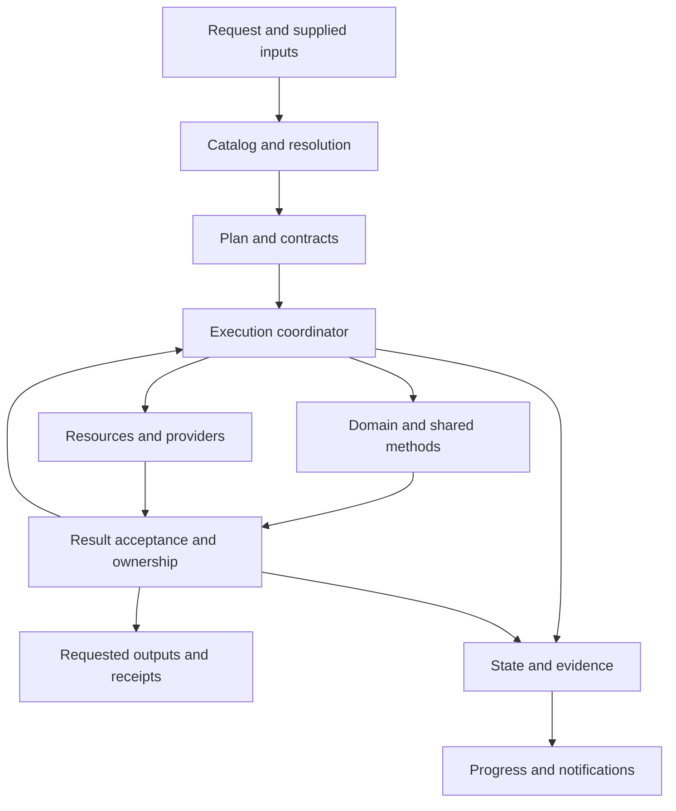
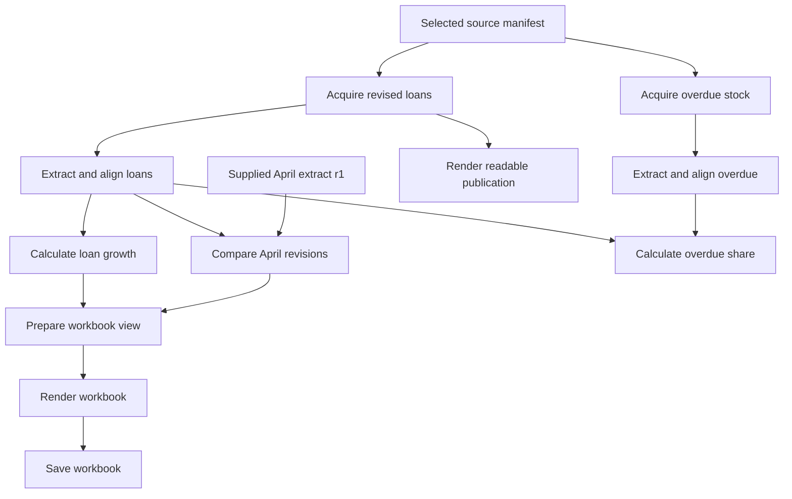

# Strategy Box: The Functional Model of the Analytical Engine

**Date:** 2026-11-24. **Subject:** analytical core, executable capabilities, domain specialization, data contracts, composition, concurrent execution, result ownership, effects and observability. **Status:** research synthesis and proposed target architecture; implementation observations are limited to Stratbox 0.24.0 as examined on this date. Illustrative contracts and examples are explicitly prospective.

The emerging Strategy Box engine turns an explicit analytical request into **usable, qualified results through a visible graph of meaningful operations**. Its central responsibility is to connect what is requested, what inputs and methods are appropriate, what work is necessary, what actually happened, and what the resulting data and receipts establish. The strongest architectural direction is one portable execution model for individual operations, scenarios and cascades, specialized by domains through declared methods and profiles. A notebook can use this model for one supplied workbook; a host application can use it for many concurrent requests and stronger persistence guarantees.

The research recommends treating **acceptance of a result for further use** as a central boundary of the engine. A returned object becomes a usable output only after its contract, qualifications, source context and any effects required by that output's own contract have been assessed. This creates a coherent connection between domain semantics, dependency scheduling, material lifetime, truthful progress and notifications. Stratbox 0.24.0 already supplies substantial catalog, typed handoff, local graph execution and evidence mechanisms. General goal preparation, complete declarative method selection, managed value lifetime and durable hosted recovery require further work. The target below describes those responsibilities without claiming that their full realization is already delivered.

## Contents

1. The engine's purpose — the useful outcome and the meaning of completion.
2. The functional structure — how the core's responsibilities fit together.
3. The essential vocabulary — definitions, requests, plans, tasks and results.
4. Capability discovery — what the registry must explain and determine.
5. Operations and atomicity — choosing meaningful units of work.
6. Data, roles and representations — what moves through the engine.
7. Standard action families — reusable transitions and their boundaries.
8. Input and output contracts — from a declared port to an accepted result.
9. Domain specialization — how general actions acquire precise subject meaning.
10. Planning — the smallest sufficient route to a requested outcome.
11. Scenarios and cascades — reusable composition with one execution model.
12. Concurrent execution — one coordinator for many admitted requests.
13. Shared sources and work — the precise meaning of preparing access once.
14. Result ownership — memory, temporary material, references and retention.
15. Analytical semantics — periods, units, revisions, missingness and comparability.
16. Identity and reuse — what can safely remain valid after change.
17. Collections and streams — membership, completeness and bounded expansion.
18. Failure and control — partial results, retry, cancellation and recovery.
19. Persistence and external effects — what saving and publication establish.
20. Observability and notifications — explanations derived from execution truth.
21. A worked analytical example — revised data, shared work and two-input calculations.
22. Other operating paths — supplied files, source monitoring and complex analytics.
23. Core and application boundaries — notebooks, hosts, clients and machine access.
24. Implemented foundation and remaining gaps — qualified current-to-target assessment.
25. Development priorities and acceptance situations — how to realize the model coherently.
26. Architectural conclusions and open choices — the decisions this research recommends.
27. External references — primary support for specific technical claims.

## 1. The engine's purpose: a requested result with an explainable basis

### 1.1. The primary unit of value is a fulfilled analytical request

A user can ask for an original publication, a selected table, an integrated history, a calculated indicator, a workbook or a source-change assessment. These requests have different completion criteria. The engine's common job is to make the requested outcome explicit and carry out the necessary transitions under their contracts.

For example, “extract the regional table from this supplied workbook” is fulfilled when the selected typed data and extraction qualifications are available. “Save the regional report” additionally requires a confirmed destination result. “Notify me when the source changes” requires a qualified source transition and a separately accountable notification handoff. A successful parser call alone settles only one part of those larger obligations.

A useful conceptual request therefore contains:

| Code | Request coordinate | Functional meaning |
| --- | --- | --- |
| REQ01 | Subject | The source, dataset, series, publication group or analytical object to work with. |
| REQ02 | Goal or exact action | The desired output, or the specific transition the caller has chosen. |
| REQ03 | Supplied inputs | Already available materials, datasets, references or model inputs. |
| REQ04 | Selection | Periods, subjects, territories, measures and publication members included in the request. |
| REQ05 | Method choices | Admitted interpretation, analytical method and meaningful parameters. |
| REQ06 | Acceptance conditions | Required coverage, permitted qualifications and output availability. |
| REQ07 | Requested effects | Saving, ingestion or delivery that forms part of the requested outcome. |
| REQ08 | Execution policy | Resource limits, deadlines, continuation and retry conditions. |

A simple call can express these coordinates through a typed function signature and defaults. A larger composition needs an inspectable request and resolved plan. They are different sizes of the same functional problem.

### 1.2. Completion has several independent meanings

The engine should answer four questions separately: did the execution finish; were the requested outputs obtained; what do those outputs establish; and which external effects are confirmed? A host may additionally assess whether a longer user objective has been accepted or closed.

An operation can successfully determine that two series are incomparable. A reconstruction can complete with bounds rather than an identified point. A report can be rendered successfully while its save remains uncertain. These are useful, precise outcomes when the contract requested them. They become misleading only when compressed into an undifferentiated success flag.

### 1.3. The core is both analytical and operational

The domain side understands publications, measurements, mappings and methods. The common execution side understands dependencies, available values, resource limits, attempts and effects. Their connection is the operation contract.

This connection explains why a scheduler by itself is insufficient: it cannot determine whether a cumulative flow can serve as a monthly flow. It also explains why a collection of good parsers is insufficient: they cannot independently settle shared work, downstream readiness, cancellation or which outputs fulfill a composed request.

The desired engine preserves both forms of competence. Domain methods supply subject meaning; the common runtime makes their use coordinated, observable and reusable.

## 2. The functional structure: six connected responsibilities

### 2.1. A map of the engine

The following structure describes responsibilities, rather than prescribing six services or repositories.

The return edge from accepted results to the coordinator means that new tasks become eligible when their actual inputs are ready. The observation branch explains activity from the same execution facts. It does not introduce a separate authority for success.

### 2.2. What each responsibility owns

| Code | Responsibility | Questions it answers | Principal output |
| --- | --- | --- | --- |
| CORE01 | Capability catalog and resolution | What can be done, for which data, by which method, under which conditions? | Resolved capability and its obligations. |
| CORE02 | Composition and planning | Which actions and dependencies are sufficient for this request? | Checked plan with explicit requested outputs and effects. |
| CORE03 | Execution coordination | What can run now, with which resources, and what happens after completion or failure? | Task and run state, attempts and scheduling decisions. |
| CORE04 | Domain and shared computation | What does the material mean, and how should the declared transformation be performed? | Produced values, findings and domain qualifications. |
| CORE05 | Values and effects | Which outputs are admitted, where can they be read, who needs them, and what was committed? | Accepted value references and qualified effect receipts. |
| CORE06 | Observation and notification | How can callers inspect the work and receive relevant confirmed facts? | Snapshots, events, diagnostics and notification obligations. |

Transport, formats, storage and numerical backends are mechanisms used by these responsibilities. They deserve reusable interfaces, but their presence does not define the analytical outcome. An HTTP provider supplies material; a source adapter identifies its publication meaning. A workbook reader exposes cells; a domain extractor interprets the table.

### 2.3. One canonical meaning can have several convenient surfaces

The Python facade, a form in an application and a machine tool can expose the same capability differently. The facade helps a caller discover, prepare, submit, inspect, cancel and retrieve. It should delegate the meaning of operations and results to canonical contracts.

The catalog must therefore be available beneath the facade. Domains and the executor should be able to use operation definitions without depending on a client convenience layer. A user interface can add titles, presets and activity grouping while preserving the canonical input and output meaning.

### 2.4. Two scales of core remain useful

“Stratbox core” can mean the whole reusable analytical library, including domains. Within that library, the execution core is the domain-neutral machinery. The distinction is useful: publisher-specific rules belong to the library while remaining outside the generic coordinator and planner.

This gives a stable dependency direction: shared contracts and neutral mechanisms support operations; domains specialize analytical behavior; composition connects declared capabilities; the SDK exposes convenient access; applications choose environment and user-facing policies. Physical module placement should follow those responsibilities.

## 3. The essential vocabulary: enough distinctions to explain actual work

### 3.1. A small semantic model

| Code | Term | Meaning | Distinct from |
| --- | --- | --- | --- |
| DEF | Definition | A reusable description of an operation or composition. | A particular execution. |
| FAMILY | Action family | A navigational class such as extraction or calculation. | An exact callable contract. |
| METHOD | Method | The algorithm implementing a precise transition. | A source selection or UI title. |
| PROFILE | Profile | Admitted rules configuring a method for particular data. | Arbitrary unchecked keyword arguments. |
| BIND | Binding | The applicable method/profile choice for the selected subject and contract. | A mere catalog label. |
| REQUEST | Request | The caller's chosen action or goal, inputs, selection and conditions. | A promise that execution has started. |
| PLAN | Plan | Resolved tasks, dependencies, scopes, outputs and effect obligations. | Observations of what happened. |
| RUN | Run | One admitted execution of a plan. | A scenario definition or future schedule. |
| TASK | Task | One logical occurrence of an operation or structural step in a plan. | The operation's reusable ID. |
| ATTEMPT | Attempt | One physical try to perform the work serving one or more logical tasks. | A new analytical request. |
| VALUE | Value | A typed result with meaning, identity, qualification and access. | Its file path or a display preview. |
| ARTIFACT | Artifact | A retained, addressable materialization with the promised restoration context. | A temporary value automatically. |
| RECEIPT | Receipt | A scoped statement about an observed acquisition, use, write or handoff. | A universal proof of correctness. |
| SCOPE | Scope | A meaningful grouping of tasks for parameters, policy, progress and outcomes. | A worker pool. |

These terms need separate identities only where a consumer, lifetime or failure boundary requires them. A single-operation run can embed its plan and task records. A helper that reads one cell does not need an independent catalog entry.

### 3.2. Logical needs and physical work are different

Two runs can need the same immutable material. Each has its own logical dependency and outcome, while the actual download may happen once. The common runtime can represent that physical work through a `shared_work_id`, with separate consumer links.

This technical shared work must remain distinguishable from a host application's longer-lived user work item. The latter may span several runs and have review or acceptance criteria. Neither requires a new public term if existing records can preserve the distinction.

### 3.3. Definition, plan, run and attempt have different stability

A definition can be reused many times. A plan resolves the effective choices for one intended execution. A run records actual progress. A retry creates another attempt of the physical work while retaining its admitted purpose and inputs, unless the caller explicitly requests a new evaluation. Several logical tasks may refer to that attempt when they share the same physical work.

Changed defaults should affect subsequent preparation. They should leave an earlier run's effective parameters intact. The same principle applies to source editions, mapping rules and accepted partial-result policies.

## 4. Capability discovery: the registry must explain executable possibilities

### 4.1. Discovery should answer an analytical question

The useful question is “what can I do with this source or value?” A flat list of function names answers only a small part of it. A capable catalog should describe applicable actions, exact input requirements, resulting values, qualification limits, method choices and requested-effect possibilities.

For a regional statistical workbook, the caller might discover that physical cell extraction is available, reviewed economic alignment covers selected layouts, and a particular analytical calculation requires a different input bundle. These are different coverage statements. The existence of one calculation somewhere in the publisher domain does not imply that every publication supports it.

### 4.2. Separate the facts the registry owns

| Code | Catalog fact | Its responsibility |
| --- | --- | --- |
| CAT01 | Source | Identify a logical publication series and how its issues and materials are addressed. |
| CAT02 | Content group | Address a meaningful collection, table or series within that source. |
| CAT03 | Selection | Define a bounded set of source members, such as all eligible workbooks in a declared period. |
| CAT04 | Operation | State an exact input/output transition and its execution/effect contract. |
| CAT05 | Method/profile | Identify admitted interpretation and algorithm choices. |
| CAT06 | Binding | Connect a selected subject to the applicable operation realization. |
| CAT07 | Template or recipe | Describe reusable relationships between operations and substitution points. |
| CAT08 | Readiness | Assess whether the selected route can run with the available inputs and environment. |

These are logical roles. A source-local binding can be embedded in its source declaration; a broadly reused recipe can have its own record. Duplicating the same fact across handwritten lists and procedural dispatch should be avoided.

### 4.3. Hierarchical names are convenient addresses

An expression such as `cbr.escrow.all.extract` can be a convenient human address. Its semantic interpretation should resolve to a structured request: a subject, a bounded selection and a requested action. The spelling of the dotted name should not determine the dependency graph.

`all` means all members of a declared selection scope. It does not mean all historical publications from the institution. `all-excel` can select Excel materials without deciding which extraction method fits every selected workbook. The selected members become a manifest with explicit closure and coverage properties.

An address without an action should ordinarily describe the object and its possibilities. A default action is appropriate only when the catalog explicitly assigns one and the facade makes its effect visible.

### 4.4. Support, applicability and readiness are different answers

The catalog should distinguish implemented, delegated through an exact shared capability, planned, unsupported for the selected case, and inapplicable for a substantive reason. Runtime readiness is another assessment: an implemented method may lack a required provider or supplied reference in this environment.

The current `OperationCatalog` already separates metadata, typed and executable admission. Metadata inspection avoids importing optional analytical implementations. This is a sound functional foundation: asking what exists should be cheaper and less demanding than running it. The target extends that discipline to goal preparation and exact source-bound method selection.

### 4.5. A declaration becomes authoritative by affecting execution

A binding must determine the method or subgraph visible in the resolved plan. Changing an admitted profile should change the applicable behavior or produce a compatibility error. A registry that describes one route while a separate publisher switch constructs another route has two competing sources of meaning.

The decisive acceptance case is straightforward: replace a method binding with a compatible alternative; inspect the prepared plan; verify that the selected alternative is present; execute it through the same runtime. No SDK or generic compiler edit should be necessary for that substitution.

## 5. Operations and atomicity: meaningful units with useful boundaries

### 5.1. An operation is a managed semantic transition

An operation transforms admitted inputs into declared outputs or establishes a scoped fact or effect. Its boundary should be independently useful for calling, validating, reusing, retrying, observing or allocating resources.

Examples include acquiring one selected material, extracting a reviewed source table, aligning observations, calculating a ratio from two admitted inputs, rendering a prepared view, and saving a completed document. A calculation that internally iterates thousands of times can still be one operation when those iterations have no useful external contract.

### 5.2. Three kinds of atomicity must be kept separate

| Code | Atomicity | Meaning | Example |
| --- | --- | --- | --- |
| AT01 | Semantic | The transition has a coherent independently useful outcome. | Extract a table under a source contract. |
| AT02 | Scheduling | The unit can be assigned resources and have its own attempt. | Run one numerical model. |
| AT03 | Transactional | A destination establishes an all-or-nothing commit within its guarantee. | Commit one database transaction. |

A semantic operation can perform several transport requests. A scheduling unit can contain several internal steps. Neither implies an atomic transaction over a file, a database and an external notification service.

### 5.3. Expose a graph when the boundaries matter to consumers

Acquisition, extraction, comparison and saving often deserve separate tasks because they have different inputs, resources, reuse opportunities and failure paths. Hiding them inside a single handler prevents the runtime from reusing a successful acquisition after extraction fails or overlapping independent work.

An integral method remains appropriate when splitting would expose implementation details without improving control. A coupled solver, an archive reader with a shared cursor, or a carefully defined streaming write can have one scheduling boundary. Its declared results and receipts still explain the separate facts established inside that boundary.

### 5.4. Families, exact operations and methods have different cardinalities

“Extract” is a family. Extracting physical spreadsheet cells and extracting economic observations are different contracts. Two parsers can implement one exact contract; one parser can accept several admitted profiles. A single source can expose several operations. These relationships prevent operation counts from becoming an architectural objective.

The target is complete applicable capability coverage. Reusing an existing neutral save operation can satisfy a domain's persistence need. A domain does not need another handwritten saver merely to fill a coverage matrix.

## 6. Data, roles and representations: what the engine carries

### 6.1. Every value has several independent dimensions

| Code | Dimension | Example | Question answered |
| --- | --- | --- | --- |
| VAL01 | Logical type | Material, table, series, model, report or document. | What kind of value is this? |
| VAL02 | Semantic contract | Loan stock by bank at a stated date and perimeter. | What does its content mean? |
| VAL03 | Processing role | Original, source extract, integrated data or product. | What use is it prepared for? |
| VAL04 | Representation | Bytes, a table reader, an in-memory object or an encoded snapshot. | How can it be consumed? |
| VAL05 | Qualification | Selected coverage, unresolved mappings, reported or derived values. | What claims and uses are justified? |
| VAL06 | Availability | Session memory, retained artifact or accessible remote location. | Where and for how long can it be read? |

A CSV extension answers part of VAL04. It does not answer the remaining questions. A valid integrated dataset can exist in memory. An XLSX can be an original publication or a generated product. A long table can remain source-specific and semantically incompatible with another long table.

### 6.2. Five data roles describe use rather than a mandatory ladder

| Code | Role | Established use |
| --- | --- | --- |
| ROLE01 | `originals` | Inspect the acquired publisher material at the declared byte boundary. |
| ROLE02 | `readable` | Read publication content, structure, tables and qualifications. |
| ROLE03 | `extracts` | Address selected source content under a typed source-specific contract. |
| ROLE04 | `integrated` | Use admitted common identities, dimensions and semantic relationships. |
| ROLE05 | `products` | Consume an analytical view, report, chart, workbook or service result. |

These roles can be used with environment-specific directory names. A native publisher CSV can fulfill an original role and an admitted source-dataset role through different qualified uses of the same material. Readable conversion and numeric extraction can be parallel branches. A product can start from an already supplied integrated value.

A calculation can occur wherever its input contract is satisfied. Derived qualification therefore spans several roles instead of forming an obligatory additional rung.

### 6.3. A common protocol preserves diverse values

The value vocabulary should accommodate source items, materials, physical grids, typed source tables, observation datasets, series collections, scalars, domain reports, models, documents and receipts. The common part is identity, contract, qualification, provenance and access. The payload remains appropriate to its type.

An `ExtractionReport` and a `ModelFitReport` are different contracts. A generic map of named outputs is useful inside a dispatcher, provided its members are checked against exact port definitions. A universal untyped metadata dictionary cannot carry the entire analytical meaning.

### 6.4. Logical values, physical blobs and retained artifacts differ

A value identifies an admitted result. A blob identifies particular bytes representing it. An artifact adds a retained address and restoration obligations. Different logical materials may share the same bytes while retaining distinct publication uses. One logical table may have several valid physical encodings.

Apache Arrow's columnar specification separates schema metadata from record-batch buffers. This is a useful example of separating a data contract from its physical content; it does not provide Strategy Box's economic semantics or require Arrow as the only representation. [E01]

## 7. Standard action families: a vocabulary of transitions

### 7.1. The vocabulary organizes capabilities, not a fixed pipeline

The following families are a recommended functional vocabulary. Exact operation IDs and domain methods remain more specific. Administrative commands such as submit, cancel and describe live alongside these actions, with different control responsibilities.

| Code | Family | Functional transition | Typical result |
| --- | --- | --- | --- |
| ACT01 | `discover` | Establish which source items are available within a declared scope. | Qualified source-item collection. |
| ACT02 | `inspect` | Establish availability, change or layout evidence within a declared scope. | Qualified inspection findings. |
| ACT03 | `select` | Fix the chosen source or collection membership. | Selected collection with an explicit scope. |
| ACT04 | `acquire` | Obtain selected external material. | Material and acquisition evidence. |
| ACT05 | `load` | Restore a previously retained value under its contract. | Readable, admitted value. |
| ACT06 | `save` | Retain a completed value at a selected destination. | Artifact reference and storage receipt. |
| ACT07 | `unpack` | Expose selected container members with their relationships. | Member materials and container lineage. |
| ACT08 | `extract` | Interpret source structure into a declared typed representation. | Grid, source table or observations, plus findings. |
| ACT09 | `transform` | Apply an explicitly defined change of form or representation. | New value with transformation lineage. |
| ACT10 | `integrate` | Reconcile dimensions, meaning, revisions and history under declared rules. | Integrated data and unresolved correspondences. |
| ACT11 | `compare` | Establish differences between suitably comparable inputs. | Layer-qualified comparison report. |
| ACT12 | `validate` | Assess a named set of conditions within a declared scope. | Validation report and any admitted qualification. |
| ACT13 | `calculate` | Derive new analytical values under a method. | Derived table, scalar, series, model or bounds. |
| ACT14 | `view` | Select and organize existing data under a pinned reading basis. | Prepared view and input version vector. |
| ACT15 | `render` | Create a requested readable or product representation. | Document, workbook, chart or presentation object. |
| ACT16 | `ingest` | Admit data into a destination's managed dataset state. | Destination revision and ingestion receipt. |
| ACT17 | `publish` | Make a completed result available through a declared publication boundary. | Publication reference and receipt. |

The exact lexical list is subordinate to these boundaries. A source-readable representation is a rendering responsibility. Preserving an original is a save with an original-material contract. Reading a retained extract is a load with that extract's restoration contract. Assembly and query remain useful exact responsibilities within admitted transformation, integration and view contracts; they need no additional top-level family merely to preserve a familiar verb.

### 7.2. Commonly adjacent actions still establish different facts

`acquire` answers what material was obtained. `extract` answers what selected content was interpreted. `integrate` answers how identities and measurements were aligned. `ingest` answers what a destination accepted. `render` answers which representation was produced. `save` establishes retained storage; `publish` establishes the requested external availability or handoff. These semantic promises remain distinct even when one adapter can perform both.

A convenience scenario can compose several of these actions. A deployment may use one adapter for two effect boundaries. The public result must preserve the actual guarantees without inventing a separate ceremony for every small operation.

### 7.3. The standard route is a map of permissible transitions

There is no universal requirement to pass through every family. A supplied table can enter at calculation. A retained model can enter at application or rendering. A source check can end with a comparison report. A method requiring two inputs waits for both, even when the rest of the route appears complete.

Dependency therefore means **availability of a suitable input or satisfaction of an explicit control condition**. “Extraction usually follows download” is a common route, while “this extractor requires an admitted material” is the actual contract.

## 8. Input and output contracts: four boundaries around one operation

### 8.1. Definition, task, prepared call and accepted result

| Code | Boundary | What becomes fixed or known |
| --- | --- | --- |
| IO01 | Operation definition | Input/output names, logical contracts, parameters, requirements and guarantees. |
| IO02 | Planned task | Chosen method/profile, input references, effective parameters and scoped policies. |
| IO03 | Prepared call | Actual admitted inputs, readable access and the execution resources needed by the handler. |
| IO04 | Produced and accepted result | Returned values are checked, qualified, owned and exposed to dependent tasks. |

Illustratively, an extraction task can name `get_material.material` as its future input. The handler runs only after that reference resolves to an admissible material reader. It returns observations and extraction findings. The runtime checks those outputs and then makes the accepted ports available.

The labels are a conceptual model. They do not assert that classes with these exact names already exist.

### 8.2. Keep data, semantic parameters and execution context separate

A useful conceptual call is `execute(action, inputs, parameters, method, context)`. Inputs are the data being consumed. Parameters define the requested semantic transformation. The method binding identifies the admitted implementation and profile. Context supplies cancellation, resource/provider access, observation and output ownership.

For a ratio calculation, numerator and denominator are two named inputs. Period selection, zero-denominator treatment and accepted missingness are semantic parameters. Worker count and progress subscription are execution concerns. A numerical method may identify some execution settings as material to reproducibility; that exception is declared explicitly.

### 8.3. Compatibility has several layers

A port connection needs compatible logical type and schema. The consumer may additionally require units, stock/flow meaning, period alignment, source scope, coverage, reference editions and qualifications. Some checks are possible from definitions; others require the actual values.

Static planning should reject impossible links. Runtime admission should inspect conditions that become known after acquisition or interpretation. Neither stage should pretend to establish conditions outside its evidence. A structural JSON schema is useful but cannot alone establish economic comparability.

### 8.4. Result acceptance makes downstream use legitimate

The handler's return is a candidate output. Acceptance checks required ports, value types, completed writers, source-use obligations, qualification policies and effect evidence belonging to that output contract. A calculation table can remain accepted and usable when a later save or publication has an unknown outcome. A rejected output remains diagnostically useful but is not silently presented to an ordinary consumer as a valid input.

Acceptance need not mean another copy of the data. It can mean closing a writer, validating its contract and transferring ownership of the completed representation. A consumer receives a stable value reference or a prepared typed object with a declared reading lifetime.

A pure function can remain simple inside this envelope. The runtime boundary provides coordination and evidence without turning every internal helper into a managed operation.

### 8.5. Partial output acceptance is explicit

An attempt that does not fulfill the whole task may still produce explicitly admitted partial outputs when the operation contract describes that possibility. The result must identify which subset is usable, which checks passed and what remains absent. Each receiving input decides whether that qualification is sufficient.

For example, a source preview might accept nine of ten independent tables with a coverage report. A total requiring all ten must wait, fail or request a different policy. A single global `allow_partial` switch cannot adequately express both consumers' requirements. A completed, qualified partial value is distinct from unfinished staging. The initial target profile accepts one coherent group of outputs from an attempt; independently usable products should usually be separate tasks. Incremental acceptance of several output groups requires its own declared protocol.

## 9. Domain specialization: precise meaning inside a common protocol

### 9.1. The domain supplies the interpretation the runtime cannot infer

A domain knows how a publisher identifies issues, where the table begins, what a header qualifies, which periods a column covers, which codes represent missing values and how revisions supersede prior observations. The common engine arranges the work, checks declared boundaries and records its outcomes.

For example, an extractor for a Ministry of Finance publication may need row-specific fiscal periods and units. A banking-form extractor may need account channels, subject namespaces and a layout edition. A Rosstat index table may contain annual, quarterly and monthly values together. Reusing a workbook reader is appropriate; imposing one economic interpretation on those layouts is not.

### 9.2. Choose the smallest kind of specialization that fits

| Code | Difference between cases | Appropriate specialization |
| --- | --- | --- |
| SPEC01 | Same algorithm, different admitted sheet or header coordinates. | A profile. |
| SPEC02 | Same exact input/output meaning, different parsing algorithm. | Another method behind the contract. |
| SPEC03 | Different independently useful preprocessing step. | An additional operation in the recipe. |
| SPEC04 | Different data dependencies or useful stage structure. | A domain-owned subgraph or recipe. |
| SPEC05 | Different logical result, guarantees or economic meaning. | A distinct exact operation contract. |
| SPEC06 | Same semantics, different storage or transport environment. | A provider binding. |
| SPEC07 | Same analytical result, different product appearance. | A rendering profile. |

This classification avoids both duplicated pipelines and a universal handler with dozens of source-specific flags. It also gives the catalog a clear explanation for why a particular implementation was chosen.

### 9.3. Specialization is checked at the external boundary

A template slot can accept an operation or a subgraph if its external ports and guarantees satisfy the slot's contract. Replacing one operation with three steps must preserve the promised output contract, source-use requirements, permitted effects and policy scope.

The planner should make inherited policies explicit. A retry budget that was appropriate for a pure leaf is not automatically suitable for every effectful step in its replacement subgraph. A source binding cannot disappear merely because the new implementation is composed. The resulting plan records where each condition applies.

### 9.4. Applicability is richer than the deepest namespace

A method can depend on source, content group, format, layout edition, period range and supplied representation. The most deeply nested name is not necessarily the most suitable method. Two equally applicable candidates require an explicit precedence rule or an ambiguity diagnostic.

Defaults can be resolved through a declared sequence: template defaults, family rules, source-specific rules and permitted request overrides. Fixed conditions remain fixed. The prepared plan exposes the effective choice rather than leaving the handler to rediscover it from global configuration.

### 9.5. The reference layer supplies shared meaning without absorbing domains

Bank identities, territorial editions, classification references and date conventions can be shared across domains. Their use is explicit and edition-qualified. A geography name match establishes an identity correspondence within its contract; it does not decide that two published aggregates have the same perimeter.

The domain chooses the applicable shared reference and qualifies unresolved mappings. The runtime records the dependency. This keeps a reference update capable of invalidating precisely the computations that used it.

## 10. Planning: the smallest sufficient route to a requested outcome

### 10.1. Exact execution and goal preparation are two entrances

An exact operation call says: perform this transition on these inputs. Its missing-input response should explain what is absent. A goal request says: obtain this output using the allowed sources, methods and effects. A preparation service may construct missing prerequisites from registered recipes.

Both entrances should converge on the same checked task and result model. The exact call stays predictable; the convenient goal request gains controlled assistance. A missing explicitly supplied local file should remain a missing local input unless the request permits another acquisition route.

In this research, “prepare a goal” is a proposed capability. It is broader than the existing compiler's validation of an explicitly supplied graph.

### 10.2. Preparation proceeds from obligations to dependencies

| Code | Preparation decision | Result |
| --- | --- | --- |
| PLAN01 | Resolve the subject and requested outputs/effects. | A precise set of obligations. |
| PLAN02 | Inspect supplied values and available retained results. | Candidate inputs with their contracts and qualifications. |
| PLAN03 | Select applicable methods and recipes. | A bounded set of admissible ways to satisfy the obligations. |
| PLAN04 | Construct the dependency closure. | Only the work required by the selected route. |
| PLAN05 | Check required inputs, environment capabilities and limits for that closure. | Readiness or actionable missing requirements. |
| PLAN06 | Bind effective parameters, identities and dynamic expansion rules. | An inspectable execution plan. |
| PLAN07 | Admit the run under the selected execution profile. | A run handle or an explicit admission outcome. |

Definitions can be validated for structural integrity independently. Concrete runtime inputs should be required only for the selected dependency closure. Otherwise an unused analytical branch can block a simple material preview because a solver or unrelated input is unavailable.

### 10.3. Suitable existing values cut off upstream work

If the request supplies the correct material, acquisition is unnecessary. If it supplies an admitted source extract, extraction is unnecessary. If it supplies a prepared view, rendering can begin there. Suitability includes actual availability, meaning, revision and accepted coverage, not merely a matching type name.

This is a key reason to expose intermediate results. The same contracted values serve interactive analysis, recovery, incremental recomputation and external orchestration.

### 10.4. Required effects are roots of the plan too

A request for a saved workbook has at least two obligations: a document of the requested content and a confirmed save at the requested boundary. Output pruning must preserve the save even if no later calculation reads its receipt. The same principle applies to required validation reports, retained originals and destination ingestion.

Effects should therefore be explicit requested outputs or explicit completion obligations. A planner that retains only ordinary dataflow ancestors can otherwise remove the very effect the user asked for.

Optional observers and discretionary previews should not silently become completion requirements. The request identifies which obligations determine its outcome.

### 10.5. Dynamic discovery is a declared continuation of the plan

Publication inventories, archive members and layout editions may become known only during execution. The initial plan can contain bounded expansion points: what can be discovered, which admitted recipe will be applied, what limits hold, and how membership closes.

As discovery pages or portions are accepted, the coordinator records their actual members and creates child tasks through the same admission path as initial tasks. Already admitted materials can be processed while further discovery continues. Membership closure is required when a final collector or completeness claim depends on the entire set. Existing task history remains fixed. Expansion is an authorized refinement of a declared template, rather than an arbitrary rewrite of the already executed plan.

A newly discovered incompatible layout produces a qualified unsupported member or preparation failure. It does not authorize unrestricted code generation or an unrelated fallback method.

### 10.6. The planner need not solve unrestricted analytical planning

The first useful planner can choose from declared recipes, exact contracts and explicit bindings. General search over every conceivable transformation introduces ambiguity, cost and hidden methodological decisions. It should be added only for a demonstrated analytical need.

A good plan explains why each task is present, which supplied value removed an upstream task, why a method applies, and which unresolved condition remains. That explanation is more valuable than an impressive graph that the caller cannot verify.

## 11. Scenarios and cascades: reuse the same execution model

### 11.1. Three useful levels of composition

An operation establishes one managed transition. A scenario connects transitions to fulfill a recognizable task, such as preparing a regional lending workbook. A cascade connects scenarios and any necessary bridging operations to fulfill a broader task, such as updating several source families and producing a combined analytical package.

These levels improve authorship, reuse and presentation. They use one underlying graph semantics. A scenario can be embedded in another scenario without requiring an additional execution engine.

### 11.2. Four structures answer four different questions

| Code | Structure | Purpose |
| --- | --- | --- |
| STRUCT01 | Subject hierarchy | Navigate institutions, sources, families, groups and selections. |
| STRUCT02 | Dependency graph | Determine which values and conditions each task needs. |
| STRUCT03 | Scenario scopes | Preserve reusable task boundaries, parameters, policies and summaries. |
| STRUCT04 | Activity projection | Show understandable work such as obtaining, processing, calculating and delivering. |

Resource claims form an additional coordination relationship over the actual tasks. None of these structures can be reconstructed reliably from the order of dotted names or the vertical order of rows in a UI.

A shared material can feed two scenario scopes. A single activity group can contain tasks from several sources. A UI can present all source acquisition together while individual extraction begins as soon as its own material is ready.

### 11.3. Structural steps arrange work without consuming a worker

Map, collect, conditions and scope aggregation are coordinator responsibilities when they merely arrange execution. A scenario does not occupy a thread while its children run. A collect step waits for the admitted membership policy, rather than blocking a worker on child futures.

Finite retries are an attempt policy. Bounded iterative algorithms remain inside their meaningful analytical operation. A persistent source watcher creates later run occurrences; it does not need an endless cycle inside a finite dataflow graph.

### 11.4. A composition owns a result contract

A scenario's outputs identify the usable products of the composition and its required effects. Its outcome follows those obligations. An optional branch failure can be reported without invalidating an independently fulfilled required output. Failure of a required branch prevents a full-success claim even if the final handler returned normally.

Nested scopes can report progress and support scoped cancellation. Their rules must have explicit precedence. A subgraph should not acquire an unlimited private retry budget or override a parent resource ceiling through nesting.

### 11.5. Composition preserves useful intermediate boundaries

Flattening a scenario into one execution graph is compatible with preserving scope names, output ports and diagnostic relationships. The execution engine can schedule leaf tasks efficiently while callers still see “source update” and “report preparation” as meaningful units.

The retained scopes are explanatory and policy boundaries. Their existence should earn its cost through reuse, separate outcomes or independently useful control.

## 12. Concurrent execution: one coordinator for many requests

### 12.1. The shared session is an execution scope

A session can accept several runs and coordinate their workers, network access, parsers, memory, temporary material and event delivery. Runs retain separate identities, requested outputs and cancellation state. A session is not necessarily a user login, an operating-system process or a durable host namespace.

A notebook can create one session for its analysis. An application can keep one session for many user and scheduled requests. Independent sessions require an additional shared resource authority if they must obey a common machine-wide limit. Creating a facade per run cannot by itself establish global coordination.

### 12.2. Readiness and resource admission are separate

A task is eligible for dispatch when its declared predecessors have settled as required, its input values pass receiving conditions, its guard permits execution, its cancellation/deadline policy allows it, and the necessary resources can be reserved.

The coordinator distinguishes waiting for inputs from waiting for capacity. A worker receives a prepared call after these decisions. An input wait, a retry delay or waiting for another shared producer should not occupy a scarce worker solely to poll for readiness.

Dask's scheduler documentation illustrates this separation: the scheduler tracks the task graph and asks workers to execute when dependencies become available. This supports the general scheduling principle, without selecting Dask as Strategy Box's runtime. [E02]

### 12.3. A scheduling cycle has a clear purpose

Conceptually, the coordinator repeatedly accepts new run requests; processes completed attempts; accepts or rejects their outputs; updates dependency readiness; expands admitted collection templates; reserves resources for eligible work; dispatches prepared calls; and updates qualified snapshots.

Long-running handlers perform actual I/O or calculation in workers. Slow notification delivery and expensive observation consumers also stay outside the coordinator. Control operations and worker-completion signals need a reliable path even when diagnostic buffers are full.

This division keeps the decision loop responsive while allowing domain methods to remain ordinary synchronous code where appropriate.

### 12.4. Resource accounting must follow the real constraint

| Code | Resource | Appropriate accounting |
| --- | --- | --- |
| RES01 | Workers | Actual running attempts, including a synchronous operation still in flight. |
| RES02 | Network | Active requests and source-specific connection/rate limits. |
| RES03 | CPU | Coordinated outer tasks and inner numerical-library or solver threads. |
| RES04 | Parser capacity | Expensive format readers and their working memory. |
| RES05 | Retained values | Live values held for pending consumers or returned result handles. |
| RES06 | Temporary storage | Staged and spilled bytes, including abandoned material awaiting safe cleanup. |
| RES07 | Writers | Conflicting destination keys or publication scopes. |
| RES08 | Plan expansion | Admitted items and child tasks across nested maps. |
| RES09 | Observation/delivery | Bounded event buffers, journal obligations and notification work. |

A count of ten files does not bound their byte size. An estimate is useful for admission but differs from an enforceable process memory ceiling. General Python code can allocate outside a declared estimate; stronger isolation needs a capable worker backend and measurements.

### 12.5. Backpressure applies across stages and nesting

When extraction or storage is saturated, acquisition should slow rather than accumulate an unbounded material backlog. Map windows should count active child chains and their retained materials. Nested maps share an aggregate expansion budget, so each locally small window cannot multiply into an unexpectedly large global workload.

The runtime should release a worker during retry delay and reserve again before the next attempt. It should retain the data genuinely needed for continuation. Releasing a worker and discarding a needed input are different operations.

### 12.6. Fairness is part of usable multitasking

A long backfill and an interactive preview can run in the same session. Bounded fairness across runs and resource classes prevents one large map from monopolizing every slot. An initial implementation can use round-robin admission or a small number of explicit priorities; the semantics matter more than a sophisticated algorithm.

The scheduler must still avoid starvation of a large task whose legitimate resource claim requires several units. A temporary shortage differs from a minimum demand exceeding the entire possible quota. A task that can never fit must receive an explicit diagnostic or use an admitted alternative execution mode, rather than wait indefinitely. The system should explain why a task is waiting and which resource is limiting it. Performance policy should be based on actual contention and measured workloads.

### 12.7. Worker waits can create both inefficiency and deadlock

Python documents deadlock risks when a thread-pool task waits on another future in the same constrained pool. This is one reason to resolve ordinary graph dependencies before dispatch and to keep structural orchestration outside workers. [E03]

Synchronous I/O is still a supported implementation choice: a worker may be occupied by a real network operation. The avoidable case is an additional follower worker doing no independent work while waiting for the same producer. Runtime-level shared dependencies should remove that extra occupancy.

## 13. Shared sources and work: prepare once within a precise scope

### 13.1. One coordinated access contour can contain many connections

The phrase “connect to the source once” expresses a useful goal: avoid repeatedly setting up the same access and retrieving the same shared material when several source groups need it. Its realization has several independent layers.

| Code | Sharing layer | What is shared | What remains separate |
| --- | --- | --- | --- |
| SHARE01 | Access preparation | Authentication/session preparation within a declared access generation. | Independent authorization and consumer scope. |
| SHARE02 | Transport pool | Reusable connections and transport lifecycle. | Distinct requests and observation times. |
| SHARE03 | Common discovery | A source index or issue manifest used by several groups. | Each group's interpretation and selection. |
| SHARE04 | In-flight work | One producer for equivalent concurrent demands. | Each logical task's dependency and outcome. |
| SHARE05 | Completed-result reuse | An available admitted result matching a later request. | New run identity and its effects. |
| SHARE06 | Physical storage | Identical blobs stored once where appropriate. | Logical provenance and retained artifact identities. |

A pool can use multiple connections to achieve allowed concurrency. A public source may need no distinct access-preparation operation. The goal is coherent lifetime and resource use, rather than a universal `connect()` step before every graph.

### 13.2. Equivalence includes observation intent

A material retrieval key can include method, exact locator, relevant headers/body, provider and access scope, representation choice, and an explicit freshness or immutable-content identity. Equal URL strings are insufficient when one request asks for a new observation and another permits reuse of an earlier one.

Conditional HTTP requests and validators concern a selected representation. A `304` response refers the client to its retained representation and supplies no replacement body. These protocol facts support efficient acquisition; they do not establish that all economic facts or downstream products are unchanged. [E04]

If the corresponding retained material is absent, a downstream parser still needs actual bytes. The execution route must obtain them under the request's acquisition policy.

### 13.3. Physical acquisition and logical source use have different records

One workbook can contain several content groups; one source group can use several workbooks. The acquisition receipt records the actual retrieval. Each consumer adds a source-use relationship explaining how that material serves its source, issue, table and input role.

The runtime should preserve one physical receipt and several logical uses. Rewriting the receipt's source identity for each consumer would corrupt its history. Conversely, merging source coordinates because bytes match would erase legitimate provenance distinctions.

### 13.4. Shared work is owned by the runtime, with explicit consumers

The first consumer can cause a producer to start, but the producer's lifetime should belong to the shared-work owner. Later equivalent consumers attach dependencies. Cancelling one consumer detaches its need; the remaining consumers retain their claim on the producer.

Consumer deadlines and the producer's own allowed lifetime are distinct. A late consumer must not silently extend a bounded producer forever. The shared-work contract should state join eligibility, freshness, cancellation and retention conditions.

The waiting consumer remains in scheduler state until the result is available. It receives its own qualified result link after acceptance. This preserves truthful per-run progress without performing or charging the physical acquisition multiple times.

### 13.5. Sharing a large material must preserve bounded transfer

A shared download should be able to write into a managed staging destination, establish a completed material and then supply readers. Reading the entire response into an unbounded buffer merely to implement sharing defeats the resource model.

A parser that requires random access waits for a completed seekable material. A parser that explicitly supports incremental input can use a streaming contract with final integrity and late-failure rules. Several consumers of a single-use stream require buffering, durable replay or coordinated multicast; a normal immutable-value reference does not provide those properties automatically.

## 14. Result ownership: the lifetime of data is part of execution

### 14.1. Accepted values need an owner independent of the producing function

After a handler returns, other tasks or the caller may still need its output. The runtime must know who owns that value, which representations can be read, what retains it and how cleanup becomes safe.

The target lifecycle is: reserve or allocate staging; produce; close the writer; check the contract; accept a stable value; retain it for consumers; provide reading access; optionally create a durable artifact; release unused transient representations. A failed staging object does not enter the normal accepted-value namespace.

### 14.2. Demand retention and active reading are different

A future consumer needs the value to remain available even before it starts. An active reader additionally needs its current representation to remain stable while reading. These can be represented as a demand pin and a read lease, or by another mechanism with the same guarantees.

A value can move from memory to a temporary file while retaining its logical identity, provided the codec preserves its contract. An active read lease prevents that move from invalidating a reader mid-operation. The physical placement is runtime state; the admitted value's meaning remains fixed.

### 14.3. Branching requires a mutation rule

Two branches should not silently mutate the same table. The default can be immutable consumption, copy-on-write, isolated copies or explicit exclusive ownership for a declared mutating operation. The policy must fit the representation and be observable at the boundary.

A transformation ordinarily creates a new logical value. Reusing the same physical storage internally is acceptable only if it preserves the earlier value's promised lifetime and prevents other consumers from observing unexpected changes.

### 14.4. Returning a result creates a retention obligation

The caller needs to know whether a result is a detached owned value, a live session reference, a leased temporary artifact or a durable retained artifact. Closing a session cannot silently invalidate an output that was promised to remain usable afterward.

A live result handle may retain memory or temporary storage. Resource reporting should distinguish active-run usage, all live result usage, reusable cache usage and durable storage. A limit on active-run results is useful but should be labeled with that scope.

### 14.5. Durable restoration is a stronger contract

A retained artifact needs sufficient content and interpretation to restore its useful boundary: schema identity, semantic context, source uses, qualifications and supported decoding. A serialized plan alone does not retain its inputs, execution state or external receipts.

Persistence can be lightweight for a simple saved dataset. Full process-restart recovery additionally requires the task and effect state promised by that execution profile. Neither a temporary spill file nor an in-memory run record establishes that stronger guarantee.

### 14.6. Cleanup follows actual consumers

Transient results can be released when no accepted plan, live handle, active reader, recovery obligation or retention policy requires them. Persistent artifacts follow their storage owner's policy. Uncertain publication staging may require reconciliation before deletion.

A general domain parser should not delete source material simply because its own function has finished. The common owner has the complete consumer picture and can make the appropriate lifecycle decision.

## 15. Analytical semantics: the engine carries meaning as well as values

### 15.1. A statistical observation needs a recoverable interpretation

For the intended use, the system must preserve the subject, measure, period, unit, scale, perimeter, dimensions, value status and provenance. Dataset-level definitions can carry shared context efficiently; every row need not repeat a large metadata object.

Stratbox already has concrete `SubjectRef`, `MetricRef`, `PeriodRef`, `Observation` and `ObservationBatch` contracts under `shared.data`. They establish useful distinctions, including reported/derived/reconstructed values and separate missingness statuses. Exact analytical admission remains with the domain method and its input contract.

### 15.2. Normalizing shape does not establish comparability

A long table is a convenient representation. Reshaping a workbook into `period`, `measure`, `value` columns does not settle stock versus flow, accounting perimeter, cumulative versus individual periods, geographic scope or methodological breaks.

A valid cross-source operation requires an explicit compatibility relation or transformation. Currency rescaling is different from currency conversion; both are different from consolidating legal entities. A canonical territory label can be shared while source-specific aggregate membership remains distinct.

### 15.3. Multiple clocks must remain visible

| Code | Time coordinate | Meaning |
| --- | --- | --- |
| TIME01 | Observation date or interval | When the measured stock or flow applies. |
| TIME02 | Publication time | When the publisher released the issue, when known. |
| TIME03 | Available-information time | When the information was legitimately available to the analysis. |
| TIME04 | Acquisition time | When this system observed or obtained the material. |
| TIME05 | Revision/vintage | Which published or accepted edition supplies the values. |
| TIME06 | Reference validity | When an identity, territory or classification mapping applies. |
| TIME07 | Execution time | When the computation or write occurred. |

A slow task finishing last cannot decide which source edition is newest. A download date cannot substitute for the official state date of an office-network table. A historical forecast evaluated with later revisions must disclose the changed information basis.

### 15.4. Missingness and qualification survive every stage

Zero, blank, dash, withheld, unavailable and not applicable have different meanings under source conventions. A missing denominator must not become zero; a zero denominator must not become an invented percentage. An empty discovery result must retain its scope and the fact that discovery succeeded or failed.

Published totals remain distinguishable from newly calculated sums. Reported figures, exact re-expressions, derived measures, reconstructed bounds and model estimates retain their respective lineage and qualification. Rendering should preserve material limitations in both the underlying result and its visible presentation.

### 15.5. Multi-input analytics requires an admission bundle

A ratio calculation needs compatible numerator and denominator coordinates. A change calculation needs comparable periods and revision policy. A weighted rate needs admissible weights. A regional total needs nonoverlapping membership; adding national, district and regional rows would usually double count.

The model should declare join keys, multiplicity, required coverage and mismatch behavior. An accidental many-to-many join can create plausible-looking values while multiplying source rows. Input admission must check the relationships relevant to the method.

### 15.6. Complex analysis can use the same operation system

Seasonal adjustment consumes a suitable regular series with an explicit method and missing-period policy. SORS-style reconstruction consumes a complete qualified input bundle and can return bounds, feasibility and evidence classes. Model-based forecasting consumes a pinned information basis, assumptions and an admitted model; it returns a qualified forecast or conditional scenario. A manually specified forecast can instead begin with explicit analyst inputs and consistency rules, without requiring a fitted model.

These examples extend the analytical payload and domain requirements, while using the same scheduling and value protocol. An optimizer's internal iterations need not become graph nodes. A forecast result does not automatically authorize a business decision. A narrow output selection does not justify narrowing a coupled model's required inputs.

## 16. Identity and reuse: preserve the distinctions that control change

### 16.1. Several identities serve different decisions

| Code | Identity | What it distinguishes |
| --- | --- | --- |
| ID01 | Logical source and issue | Which publication object is being addressed. |
| ID02 | Material content | Which exact acquired or generated bytes are involved. |
| ID03 | Logical value and semantic contract | Which admitted result is being consumed. |
| ID04 | Method/profile/reference basis | Which interpretation and computational rules apply. |
| ID05 | Computation | Which admitted inputs and meaningful parameters define reusable work. |
| ID06 | Run, task and attempt | Which request and actual execution occurrence are observed. |
| ID07 | Effect | Which intended destination transition must be confirmed. |
| ID08 | Source transition | Which accepted change followed which earlier state. |
| ID09 | Notification obligation | Which fact is owed to which subscription under its policy. |

These are purpose-specific identities rather than a demand for manually maintained version numbers everywhere. Public operation IDs can remain unversioned. Semantic schemas, retained formats, reference editions and used implementation identities still need enough distinguishability to reject incompatible reuse.

### 16.2. Computational identity reflects meaningful dependencies

A computation key should cover the exact admitted inputs, effective semantic parameters, method/profile basis and references actually used. A destination can belong to an effect identity rather than the mathematical value identity. Progress settings should not invalidate a deterministic calculation.

An implementation fingerprint is useful evidence of code change. It cannot independently prove mathematical equivalence, full dependency capture or determinism. Source-AST hashing alone cannot infer the effects of undeclared resources, environment-sensitive code or nondeterministic algorithms. Those conditions remain part of the method contract and execution qualification.

### 16.3. Reuse has several separate forms

Algorithm reuse calls common code. Common-subexpression sharing avoids duplicate equivalent work inside a plan. In-flight sharing joins simultaneous compatible demands. Cached-result reuse accepts a previously completed value. Blob deduplication stores equal bytes efficiently. Effect idempotency controls repetition at a destination boundary.

A key suitable for one purpose may be unsuitable for another. Two reports can reuse a numerical table while requiring two separate saves. Two source observations can share old bytes while representing different accepted transitions. Byte equality alone cannot decide the complete lineage or notification outcome.

### 16.4. Change should invalidate only affected dependencies

| Code | Change | Work ordinarily required |
| --- | --- | --- |
| CHANGE01 | New source material or relevant facts. | Compare, interpret and recompute affected descendants. |
| CHANGE02 | Improved extractor with retained original available. | Re-extract and update dependent results. |
| CHANGE03 | Changed mapping/reference used by alignment. | Re-align and recompute consumers of the affected meaning. |
| CHANGE04 | Changed formula or analytical parameters. | Recalculate and rebuild dependent views. |
| CHANGE05 | Changed view selection. | Rebuild the view from suitable admitted data. |
| CHANGE06 | Changed rendering style. | Rerender the existing semantic view. |
| CHANGE07 | New destination or missing destination version. | Save, ingest or publish the existing eligible value. |
| CHANGE08 | Changed subscription. | Reassess eligible facts under the subscription's replay policy. |

The three governing questions are source change, processing need and destination readiness. An unchanged source can still require substantial useful work. A new source observation can require no new computation if the requested result remains valid under its complete contract.

### 16.5. Freshness is relative to the request

A “latest” alias should resolve to an explicit selection or observation policy. A reproducible report records the actual source and reference versions used. A cached value is usable only if it still exists, remains readable and satisfies the new consumer's requirements.

The currentness of a value can change while its historical identity remains fixed. A withdrawn or superseded result can remain necessary to explain an earlier report. Retention and current-selection policies should preserve that distinction.

## 17. Collections and streams: completeness is a contract

### 17.1. A collection preserves membership and per-item outcomes

A collection is a value whose contract identifies member type, stable keys, meaningful ordering and closure. Its manifest records selected, produced, failed, omitted and unavailable members as appropriate. Returning only the successful values can conceal a required missing member.

A keyed collection also prevents completion order from changing result order or revision precedence. Duplicate keys require a defined resolution rule. A repeated download of the same issue is not automatically another independent observation.

### 17.2. Closed membership and complete coverage are different

A discovery operation can finish with twelve found files while the requested thirteen-month history remains incomplete. A workbook extractor can finish every selected sheet while some requested measures remain unavailable. Conversely, a deliberately selected two-period output can be complete for its narrow request.

The model should preserve at least the requested scope, discovered membership, membership closure, processing outcomes and semantic coverage. “All tasks finished” establishes technical completion of the admitted work. Full analytical coverage requires a domain-specific expected set or another defensible completeness rule.

### 17.3. Fan-in has an explicit acceptance rule

A collector can require every member, accept a qualified subset, or form independently complete partitions. A later calculation can impose stricter conditions than the collector. An optional diagnostic attachment can tolerate an absent member while a denominator dataset cannot.

Membership closes at a declared boundary. The final integration or publication step must not advance a complete current version while required members are still unknown. Incremental publication is valid when the destination and consumer explicitly support partitioned completeness.

### 17.4. Three uses of the word stream should remain distinct

Network streaming transfers bytes incrementally. Table chunking reads a finite dataset in blocks. An operational data stream produces values over time, potentially without a known end. Long-form tabular shape is independent of all three.

A real stream contract needs ordering, replayability, backpressure, cancellation, terminal/integrity signaling and late-error semantics. That protocol is also needed for a finite value consumed before its producer completes. Processing an entirely accepted material M1 while acquiring M2 is ordinary pipelined task execution; reading unfinished M1 is a different acceptance contract. A finite `Collection[T]` processed through map does not automatically supply stream guarantees. A general runtime can initially support completed finite materials and bounded chunk readers, adding early-consumption streams when actual consumers need them. Open-ended streams are one further case.

### 17.5. Empty results retain their meaning

A successful bounded discovery can validly find no eligible issues. A failed file read cannot be converted into that same empty result. A selection that intentionally excludes everything can return an empty collection with its selector. A required nonempty analytical input should fail its receiving condition.

The consumer should see why the result is empty and what scope was inspected. This is more useful than a generic “no data” message.

## 18. Failure and control: preserve useful results and unresolved obligations

### 18.1. Separate phase, outcome, qualification and knowledge of effects

| Code | Axis | Example states | Question answered |
| --- | --- | --- | --- |
| STATE01 | Execution phase | Waiting for input, waiting for resource, running, retry delay, finalizing, terminal. | Where is execution in its lifecycle? |
| STATE02 | Logical task/run outcome | Succeeded, partial, failed, cancelled, blocked, or an aggregate disposition required by the runtime. | What obligations did this logical task or run fulfill? |
| STATE03 | Data qualification | Complete selection, missing measures, unresolved mappings, reconstructed bounds. | What can the returned value support? |
| STATE04 | Effect knowledge | Confirmed, confirmed absent/failed, or unknown within a defined scope. | What is established about an external change? |
| STATE05 | Consumer acceptance | Accepted, rejected or awaiting assessment under the user's criteria. | Does the result fulfill the broader purpose? |

Logical outcome is assessed for the affected consumer. A shared physical producer can succeed while one of its logical consumers is cancelled. A blocked task can have no physical attempt at all. The proposed model keeps effect uncertainty independently addressable. A current API may additionally expose an aggregate `unknown` outcome; that projection should retain the underlying effect facts. Scientific uncertainty about a reconstructed value is another qualification with a different remedy.

### 18.2. Failure categories should suggest the appropriate next action

| Code | Situation | Appropriate response |
| --- | --- | --- |
| ERR01 | Required supplied input is absent. | Explain the missing input; prepare an allowed acquisition route only if requested. |
| ERR02 | Source temporarily unavailable. | Preserve the failed check and apply bounded source-specific retry when appropriate. |
| ERR03 | Layout or schema is unsupported. | Keep the acquired material; require an admitted interpretation. |
| ERR04 | Period, unit or perimeter is incompatible. | Reject the analytical link or apply an explicitly selected bridge. |
| ERR05 | Only an admitted subset is complete. | Return a qualified partial value where the contract permits it. |
| ERR06 | Resource budget is exhausted. | Return a bounded failure or supported incomplete method result; retain usable prior outputs. |
| ERR07 | Required destination outcome is unknown. | Reconcile the addressable effect before unsafe repetition. |
| ERR08 | Optional observation or delivery fails. | Preserve business truth and report the observation/delivery problem separately. |

A parser bug should not be hidden by a fallback that invents empty observations. A validation failure should not be treated as a transient network problem. Classifying failures by their consequences improves both human diagnosis and machine continuation.

### 18.3. Retry belongs to an explicit execution policy

A retry creates a new physical attempt with a recorded reason. The policy checks actual effect state, admitted retryable failures, remaining time and attempt budgets. A deterministic computation with fixed inputs is different from a write whose first result is uncertain.

Transport, operation and composition retry layers must share an accountable budget or have explicitly composed limits. Otherwise three attempts at each of three levels can multiply into twenty-seven physical tries. Retry delay releases worker capacity while preserving required state and inputs.

The target acceptance protocol checks that an attempt still has the right to commit its outputs. A late return from an earlier attempt cannot replace the accepted manifest or the current result selected for a later attempt. Ordinarily a new attempt starts after actual completion or confirmed termination of its predecessor. Revoking commit rights does not establish that the old computation or its remote effect has stopped; any explicitly supported overlapping attempts require separate resource and effect accounting.

### 18.4. Cancellation is a request followed by observed consequences

Cancellation stops future admission for the affected consumer and signals running methods at supported checkpoints. A handler may still be completing an I/O request or a commit. Already confirmed effects remain confirmed. A shared producer continues when another legitimate consumer still needs it.

A waiting timeout is a limit on the caller's wait. It does not prove that a thread stopped. A worker reservation remains occupied until actual completion or a stronger backend guarantee establishes termination. Resource and effect handling must use those facts rather than the UI's impatience.

### 18.5. Failure propagates through actual dependencies

A missing required output blocks its consumers. Independent branches can continue under the run policy. A deliberate guard skip has its own reason; it is not a fabricated successful execution. A consumer accepting partial inputs evaluates the actual subset and qualifications.

The final run outcome is an assessment of its requested obligations. A successful optional preview cannot compensate for a missing required workbook. A failed optional notification does not invalidate a completed calculation, although a request explicitly requiring delivery remains unfulfilled in that respect.

### 18.6. Recovery begins with facts that survived

A local in-process continuation can use surviving values and task state. Recovery after process loss requires retained inputs, plan/effective choices, completed results, attempt state and addressable effect evidence to the degree promised by the host profile.

The recovery owner first determines what actually completed and what remains unknown. It then reuses valid results, reconciles uncertain effects and schedules eligible remaining work. Fetching today's `latest` during recovery can create a new evaluation; it cannot silently replace the input basis of the interrupted one.

## 19. Persistence and external effects: confirm the requested boundary

### 19.1. Producing, retaining and publishing are distinct achievements

A completed table can be consumed immediately. A rendered workbook can be returned as bytes. A save can establish a retained file. Ingestion can establish a dataset revision in a managed store. Publication can establish availability to another consumer or channel.

The same provider can implement several of these responsibilities, but each result states the boundary actually confirmed. A local file receipt does not establish remote availability. A received message does not establish that it was read or accepted analytically.

### 19.2. Effect identity follows the intended destination transition

An effect should identify the destination scope, intended object or version, payload and applicable conditional/idempotency policy. A retry attempt has a new execution identity while referring to the same intended effect where appropriate.

Equal calculation outputs do not make two requested destinations interchangeable. Reusing a computation must preserve both requested save obligations. A receipt from an earlier action can establish the current destination state only when the receiving contract and actual state support that reuse.

### 19.3. Staging protects publication from unfinished content

A writer can prepare bytes, close and verify them, then ask the destination to commit the declared transition. The application can expose the result only at the guarantee it actually obtained. A failed staging write remains an incomplete attempt, while a completed partial dataset can be a legitimate artifact under a partial-data contract.

A multi-file product needs a release manifest or another coherent publication rule when consumers require all members together. Separate file writes alone do not provide atomic publication of the whole product.

### 19.4. Destination coordination is separate from source chronology

A conditional write can prevent an unexpected concurrent replacement. A domain revision policy determines which source edition is appropriate as current. Both are necessary when an older run may finish after a newer one.

For a database-backed multi-query product, the reading basis also matters. PostgreSQL documents that successive Read Committed statements may see different committed states, whereas Repeatable Read uses a transaction snapshot. A pinned version vector or suitable snapshot is therefore needed for the product's promised consistency. [E05]

### 19.5. Unknown effects are addressed through reconciliation

If a destination commits and its reply is lost, the caller can know that execution was interrupted while remaining uncertain about the write. Reconciliation inspects the intended target, version, key or other competent evidence. It records the finding without pretending the earlier uncertainty never existed.

The architecture does not promise universal exactly-once effects across unrelated destinations. It can promise controlled submission, idempotent behavior within supported scopes and honest reconciliation. HTTP's method-level idempotency concerns the intended server effect of repetition; it is not a transaction guarantee for a whole analytical workflow. [E04]

### 19.6. A durable obligation requires durable coordination

When a host promises that every committed dataset update will eventually generate a notification, it needs a recoverable relationship between the accepted update and the notification obligation. A transactional outbox, a committed event source or reconstructible publication history can provide such a relationship under a specific implementation contract.

A best-effort progress callback cannot establish that promise. The appropriate mechanism depends on the destination and failure profile. The simple notebook profile remains valid without persistent notification machinery.

## 20. Observability and notifications: explanations of the same execution truth

### 20.1. Events describe facts at defined boundaries

The engine should expose why a method was selected, why a task is waiting, which material was shared, what the handler produced, why an output was admitted or rejected, and what a destination confirmed. These explanations make the graph understandable to users and machine clients.

Events supplement authoritative state and results. A missed progress event should not cause a completed task to disappear. A pretty terminal message should not create success without a valid result. A reconnecting consumer obtains a state snapshot and a positioned continuation where the profile supports it.

### 20.2. Correlation and lineage answer different questions

Correlation connects session, plan, run, scope, task, attempt, item, shared work and effect occurrences. Lineage connects source material, interpreted values, references, transformations and products. A task's generation of a value relates the two.

W3C PROV distinguishes entities, activities, derivation and responsible agents. This provides a conceptual foundation for that separation, without requiring Strategy Box to use RDF or a graph database. [E06]

Shared physical work can have several logical consumers. OpenTelemetry span links illustrate how causally related work can be associated across traces without pretending it has only one ordinary parent. A telemetry adapter can use that mechanism; the engine's actual consumer and result relationships remain authoritative. [E07]

### 20.3. Five confirmations should remain distinguishable

| Code | Confirmation | What it establishes |
| --- | --- | --- |
| CONF01 | Execution outcome | The qualified result of an attempt, task or run. |
| CONF02 | Domain fact | An admitted finding such as a source revision or completed dataset scope. |
| CONF03 | Effect receipt | What the storage, ingestion or publication owner confirms. |
| CONF04 | Journal acknowledgment | What execution evidence the journal retained under its guarantee. |
| CONF05 | Notification handoff/delivery | What the receiving consumer or downstream channel acknowledges. |

A calculation can establish CONF01 and CONF02 before any save. A save can establish CONF03 while an optional journal is degraded. Reliable delivery requires its own accounted obligations. These are related claims with different owners.

### 20.4. Progress has a measure and a denominator

Logical progress counts requested members or obligations. Physical work counts actual downloads, bytes, attempts or computations. If one download serves three requests, the physical count is one while three logical dependencies can become satisfied.

While membership is expanding, the total may remain unknown. A UI should show discovered and completed counts rather than fabricate a stable percentage. Once the set closes, a percentage can use an explicit measure: members processed, bytes transferred or weighted obligations. Reaching one hundred percent processed does not imply one hundred percent successful.

Examples of meaningful messages include “12 of 14 selected materials processed; one failed; one waiting,” “membership discovery still active,” and “calculation ready; save outcome under reconciliation.” These messages preserve the distinction between activity, data readiness and effect knowledge.

### 20.5. Activity groups are projections, not scheduling barriers

An interface can group activity into discovery, acquisition, interpretation, integration, calculation, presentation, storage and delivery. It should show only work present in this run. Several groups can be active at once because tasks become ready from their actual dependencies.

The same run can also be viewed by source or scenario. Both projections refer to the same task identities. Switching the view should never create different outcome counts or duplicate shared physical work.

### 20.6. Notifications subscribe to qualified facts

A source-change notification can trigger before database ingestion. A dataset-ready notification waits for the specified dataset availability. A product-published notification waits for publication. Run completion is another topic. These meanings should be chosen deliberately.

The notification contour selects eligible facts, forms a bounded intent, records its dispatch identity and performs a configured handoff. Initial capture, historical backfill, source revision and method-driven recomputation have different meanings. Repeated observation of the same accepted transition should not automatically create another logical alert.

Preparation, consumer acceptance, downstream delivery and reading retain separate statuses. Notification failure can be retried or reconciled without re-running a successful analytical graph.

### 20.7. Observation must remain bounded and recoverable at its promised level

High-frequency progress can be coalesced. Terminal facts and required notification obligations need stronger accounting. Slow consumers should not block the execution coordinator. Buffers, journal segments, cursors and retention should expose their limits and any known gaps.

Acknowledgment belongs to the identified consumer and obligation. A UI acknowledgment does not release a journal record still required by another mandatory consumer. The retention owner uses the relevant consumer checkpoints and policy when releasing records.

A record retained in process memory can support reconnecting within that process. Surviving a process restart requires a durable source. The engine should advertise the actual observation profile instead of implying persistence from the existence of an event API.

## 21. A worked analytical example: revisions, sharing and two-input calculations

### 21.1. The example and its three requests

All names and numbers in this section are synthetic. They demonstrate the proposed contracts and are not statistics from any real publisher.

A source provides loan-stock publications for banks A and B and an overdue-stock table. Three requests arrive in one session: prepare and save a workbook containing total loan growth and an April revision comparison; calculate the overdue share; and produce a readable representation of the revised loan publication. Both analytical requests require the same measurement perimeter, bank set and May observation date. All three requests admit the same source observation, revision and acquisition scope, permitting shared acquisition of the revised loan material.

| Code | Material | Source content | Unit and interpretation |
| --- | --- | --- | --- |
| DEMO01 | `loans-r1` | April: A = 110, B = 200. | RUB million; first loan-stock edition. |
| DEMO02 | `loans-r2` | April: A = 115, B = 200. May: A = 120, B = 220. | RUB million; explicitly ordered successor revising April and adding May. |
| DEMO03 | `overdue-r1` | May: A = 6,000,000, B = 11,000,000. | RUB; overdue stock under the same admitted perimeter. |

The source contract explicitly establishes `loans-r2` as the successor. Neither arrival order nor the filenames themselves establish that precedence. The request selects latest admitted revised values for current analysis. An already admitted April extract from `loans-r1` is supplied for the revision comparison; its provenance preserves the first-edition basis.

### 21.2. Preparation resolves the actual obligations

The workbook request needs an admitted two-period loan dataset, the supplied April first-edition extract, growth and revision-comparison results, a rendered workbook and a save receipt. The overdue-share request needs May overdue and total-loan stocks with matched coordinates and compatible scale. The readable-publication request needs `loans-r2` material and a faithful representation contract.

The planner can place a common discovery result and the `loans-r2` acquisition before all relevant branches. If the material is already supplied and satisfies the freshness and identity policy, it begins with that input. `loans-r1` is needed for the explicit revision comparison; it is unnecessary for a current calculation whose accepted `loans-r2` already contains both requested periods and all required revision context.

This example shows that preserving useful history does not require every future calculation to reread all historical editions. The requested evidence and available admitted values determine the actual dependency closure.

### 21.3. The graph exposes shared prerequisites and independent products

The arrows carry contracted values, not just sequencing. The readable branch can progress while the overdue input is still being obtained. The ratio waits for both analytical inputs; the revision comparison waits for the admitted first-edition extract and the revised April values. Saving is required only by the workbook request in this example.

### 21.4. Extraction and integration preserve different facts

Extraction records the published numbers, units, bank labels, periods and source edition. Integration maps bank identities and chooses the explicitly requested revision policy. Rescaling overdue values from rubles to RUB million creates an exact declared representation change with lineage.

The accepted loan history for this request is April total `115 + 200 = 315` and May total `120 + 220 = 340`. The former April total `110 + 200 = 310` remains part of the earlier edition. It is available to the revision comparison and to a historical-vintage analysis.

The engine must retain the distinction between “April was revised by 5” and “May grew by 25 relative to revised April.” They concern different axes of change.

### 21.5. The derived results are reproducible

| Code | Calculation | Result | Required qualification |
| --- | --- | --- | --- |
| NUM01 | Revised April total | 315 RUB million. | Banks A and B, loan stock, revised edition. |
| NUM02 | May total | 340 RUB million. | Same bank set, measure and perimeter. |
| NUM03 | Absolute monthly change | 25 RUB million. | May minus revised April. |
| NUM04 | Relative monthly change | `(340 / 315 - 1) × 100 = 7.9365079…%`. | Unrounded calculation; presentation can show 7.94%. |
| NUM05 | May overdue total | 17 RUB million. | Exact rescaling of the two source amounts. |
| NUM06 | May overdue share | `17 / 340 × 100 = 5%`. | Compatible denominator and complete two-bank coverage. |
| NUM07 | April revision | `315 - 310 = 5` RUB million. | Comparison of two editions of the same April scope. |

Combining May from `loans-r2` with April from `loans-r1` gives `(340 / 310 - 1) × 100 = 9.677419…%`. That is an explicitly mixed-vintage calculation, admissible only if the request selects that policy. It is not a reconstruction of information available before `loans-r2`: in this example May first appears in that edition, so May growth is unavailable at an earlier information cutoff. The request's vintage policy determines both the usable basis and the result label.

### 21.6. The runtime supplies concrete control

One physical `loans-r2` acquisition can satisfy several logical needs. The session accounts its bytes once, records the separate source uses and holds the material until its readers finish. Each analytical task gets its admitted inputs and effective method parameters. The outputs become eligible for later tasks only after their contracts pass.

The workbook request is complete after the requested save is confirmed. The ratio request can finish earlier with an accepted scalar or table. The readable-publication request has its own coverage assessment. These results remain separately inspectable even if the application displays them under one larger cascade.

### 21.7. Failure variants test the model

| Code | Changed condition | Correct consequence |
| --- | --- | --- |
| CASE01 | Overdue material is temporarily unavailable. | Growth and readable work can finish; the ratio waits or fails according to its deadline. |
| CASE02 | Bank B's overdue amount is withheld. | The full two-bank ratio is unavailable; a completed partial input cannot silently produce a whole-scope 5% claim. |
| CASE03 | The loan revision order is unknown. | Preserve both editions and require an explicit selection; arrival time cannot resolve the conflict. |
| CASE04 | The loan acquisition is shared and one request is cancelled. | Detach that request; continue the producer for remaining consumers. |
| CASE05 | Workbook save reply is lost. | Preserve the accepted table and rendered workbook; reconcile the save and qualify the workbook request's outcome. |
| CASE06 | The destination already holds the requested document under a sufficient matching receipt/state. | Reuse the eligible retained-document state according to the destination contract; do not pretend a new write occurred. |
| CASE07 | A new rendering style is requested. | Reuse the prepared semantic view and rerender; earlier acquisition and arithmetic stay valid. |
| CASE08 | A historical report asks for information available before `loans-r2`. | April can use the first-edition basis. May was not yet available, so May growth is unavailable at that cutoff; a mixed-vintage calculation cannot fill that historical gap. |

The example demonstrates the engine's central promise: different callers can share the useful work while retaining the exact meaning and completion conditions of their requests.

## 22. Other operating paths: the same core at different scales

### 22.1. A supplied workbook in Jupyter

A caller supplies a workbook, chooses an admitted extraction profile and requests a selected table. The plan begins with a prepared material. Extraction returns the table and findings. The caller can inspect the native typed result directly, calculate from it or save a snapshot later.

No network step is needed. No durable job service is needed. The same operation and result checks still apply. A missing local workbook remains an explicit missing input, rather than a silent switch to an online source.

### 22.2. A recurring source monitor

A host creates occurrences according to its schedule. Each run inspects a bounded source scope, compares it with a qualified baseline and performs the selected processing or publication. The baseline, dataset destination and notification subscriber have separate checkpoints.

A source revision can trigger reprocessing. An unchanged source can still require a parser update or publication to a new destination. First local observation and historical backfill remain distinct from a newly published live issue. Disabling the schedule affects future occurrences; already admitted work follows its own control policy.

### 22.3. A Rosstat mixed-frequency table

The extractor can preserve annual, quarterly and monthly observations from the source layout. The selected profile establishes period interpretation, units and source statuses. Integration resolves identities and qualifications. A derived monthly calculation requires its actual input basis; quarterly or cumulative data cannot be substituted by matching a label.

A requested regional product can select its output rows after the required interpretation and validation. The engine coordinates the common mechanics while the domain owns the scientific decision about which transformations are valid.

### 22.4. A multi-publication reconstruction

A reconstruction method may require national, district and regional constraints even when the caller requests one region. Preparation identifies the full input bundle and reference editions. The solver operates as an integral analytical method and returns feasibility, bounds and evidence-qualified values.

The view can be narrow while the model is broad. Missing required constraints produce an incomplete or rejected model admission. Independent periods can be parallelized when the method establishes their independence; a shared aggregate can prevent a seemingly obvious partition.

### 22.5. An analyst edits a model or forecast document

A host can treat the analyst's input document as a revisioned source of explicitly selected parameters and values. A run pins the revision it used. Its outputs identify that revision, any model basis and the information cutoff. Primary manual inputs remain distinct from derived values; contradictory manually entered totals, rates or constraints produce a visible consistency finding instead of silent overwriting. A manual forecast may use calculation and validation without fitting a model.

If the analyst changes the document while a calculation is running, the old result remains valid for its old input revision. The host can retain it historically and prevent it from automatically becoming the current preview for the new revision. This is the same separation of logical values, execution occurrence and current selection used for publisher revisions.

The analytical core returns a qualified result or forecast. The application owns editing, autosave, current-document selection and any decision or acceptance workflow. The general engine therefore supports future analyst tools without absorbing their entire user interaction model.

### 22.6. A product is rebuilt from a retained view

A caller restores a prepared view and asks for a differently formatted workbook. Restoration checks the view's schema and context; rendering produces new bytes; saving confirms the requested destination. Source discovery, extraction and unchanged calculations are outside the needed graph.

This short route is a direct test of whether operations are genuinely reusable. If obtaining a new workbook always forces the entire acquisition pipeline, important boundaries remain hidden.

## 23. Core and application boundaries: one semantic engine, several deployment profiles

### 23.1. Allocate responsibility by lifetime and meaning

| Code | Responsibility | Core/library role | Application or environment role |
| --- | --- | --- | --- |
| BOUND01 | Analytical semantics | Source interpretation, mappings, calculations and qualification. | Select the user purpose and accepted use policy. |
| BOUND02 | Capability definitions | Canonical contracts, bindings and reusable recipes. | Curate visible capabilities, presets and presentation. |
| BOUND03 | Portable execution | Compile and run local graphs, coordinate session resources, return qualified results. | Choose session lifetime, deployment and workload policy. |
| BOUND04 | Durable user work | Supply reusable execution and evidence contracts. | Own retained requests, schedules, occurrences, review and recovery authority. |
| BOUND05 | Data access and effects | Neutral ports and result/receipt semantics. | Bind actual stores, credentials, destinations and access scope. |
| BOUND06 | Result retention | Value lifetime mechanisms and codecs where supported. | Set durable storage, retention and sharing policy. |
| BOUND07 | Observation | Events, result snapshots, correlation and evidence qualification. | Retain and present history under the deployment guarantee. |
| BOUND08 | Machine/client access | Discoverable capabilities and typed result semantics. | Protocol server, client connections and bounded result access. |
| BOUND09 | Installation and process lifecycle | Remain portable under supplied runtime contracts. | Manage application activation and integration with the external platform. |

The portable graph runtime belongs in the reusable library. A durable application host can use it while owning broader lifetimes and authority. This resolves the apparent conflict between direct Python use and a future persistent multi-client service.

### 23.2. Three profiles make the guarantees explicit

The direct profile runs a call or graph within the caller's process and returns usable values. The local application profile maintains session coordination, user-visible history and retained artifacts according to its actual storage implementation. The durable host profile adds persistent run state, restart recovery, schedules and independently connected clients.

A remote worker profile adds another transport, placement and failure boundary. It should be introduced through actual codecs and reference accessibility, rather than assumed from an in-process graph's existence.

These profiles can share semantic contracts while having different operational guarantees. A process-local result lease cannot serve as a remote storage promise.

### 23.3. AppDock remains an external integration boundary

Strategy Box can be launched and integrated through AppDock. The Strategy Box application remains responsible for the meaning of its requests, domain results and user-facing execution state. Platform process health can inform operational diagnosis without deciding whether an analytical report succeeded.

The core uses neutral providers and execution contracts. Concrete activation, installation and external platform interfaces belong to the appropriate application adapter and its verified integration contract. This research assigns no new responsibilities to the external platform.

### 23.4. Machine access should expose the same admitted capabilities

A desktop-owned MCP adapter can discover operations, prepare a supported request, submit it, inspect state and retrieve bounded results or artifact references. The model interprets a goal; the registered methods perform the admitted data transformations. The same runtime can serve human and machine callers.

MCP tool definitions support named tools, input schemas, optional output schemas and structured results or resource links. These protocol facilities can project the catalog and result contracts. They do not themselves establish domain planning, durable task ownership or artifact retention. [E08]

A long-running tool can return a host-owned run reference when the adapter supports that interaction. A protocol acknowledgment remains distinct from the qualified analytical result. Large tables should be accessible through bounded previews and typed references rather than repeatedly copied into a model's context.

A hosted submission profile should also define a scoped `client_request_id` and effective-payload match. Repeating the same submission after a lost response resolves to the existing run; reusing its identifier for a different effective request produces a conflict. Submission idempotency belongs to the host and differs from a leaf-operation retry or an external effect's idempotency key.

### 23.5. Client portability follows semantic contracts

Windows, a future Android client and other surfaces can share request meanings, result descriptions and control semantics. Their interfaces, local file access and lifecycle integration can differ. A remote client does not need to embed the full Python analytical runtime simply to inspect a host-owned run.

The useful reusable segment is therefore a clear client contract and application semantics. Native presentation remains the surface's responsibility. This keeps the core independent while allowing new clients to consume the same analytical work.

## 24. Implemented foundation and remaining gaps in Stratbox 0.24.0

### 24.1. The local execution foundation already has substantial meaning

As examined on 2026-11-24, `StrategyBox.invoke`, `run` and `submit` converge on the composition compiler and `ExecutionSession`. Explicit scenarios and cascades become one graph. Several runs share a coordinator, worker pool and resource ledger. Structural composition does not allocate another pool merely to wait for children.

Named input and output handoff is implemented through `PreparedInput`, `ProjectedOutput`, `PlanOutputRef`, `ResultReference` and `bind_request`. The runner applies bound result-admission policies, accounts computation and effects, and constructs a qualified `OperationResult`. Domain contracts already preserve substantial source and observation semantics.

This is a working architectural foundation. The remaining work should strengthen its single path from definition to plan to accepted result, while removing alternative hidden decision paths.

### 24.2. A qualified current-to-target map

The implementation terms in this table identify the behavior supporting each bounded statement; they are not a proposed new package layout.

| Code | Functional responsibility | Observed 0.24.0 position | Required refinement |
| --- | --- | --- | --- |
| GAP01 | Common public execution route | `StrategyBox` delegates to compilation and a lazily created session. | Preserve the route when adding goal preparation and machine access. |
| GAP02 | Several requests share resources | `ExecutionSession._coordinate` and `_advance` coordinate runs through one pool and ledger. | Extend measured scheduling and accounting as workloads require, retaining separate run obligations. |
| GAP03 | Typed handoff | `project_output` and `bind_request` assess declared contracts, outcomes and qualifications. | Formalize a general accepted-value protocol and placement/lifetime ownership. |
| GAP04 | Operation finalization | `runner.run` and completion resolution preserve actual receipts and uncertain effects. | Retain this distinction while improving independently addressable output acceptance. |
| GAP05 | Explicit graph composition | `compile_workflow` flattens scopes, validates links and supports maps/collections. | Add bounded goal-to-recipe preparation without creating another executor. |
| GAP06 | Declarative source method selection | Source binding admits and parameterizes selected operations; source workflow builders still choose publisher branches and exact operation IDs. | Make the canonical binding/template path determine the chosen method and graph. |
| GAP07 | Selected-output dependency closure | The compiler can prune a valid supplied graph; general pruning follows full flattening and input checks. | Determine the needed closure before requiring unrelated runtime inputs and capabilities. |
| GAP08 | Expandable versus integral operations | Built-in expansion/disposition maps enforce the distinction. | Register trusted expansion and integral disposition with the capability owner, keeping the compiler generic. |
| GAP09 | Dynamic task admission | Maps create admitted body instances; session network preparation is initiated from the initially visible HTTP tasks. | Apply the same provider/resource preparation to initial and newly expanded tasks. |
| GAP10 | Shared network work | Session transport pooling and in-flight sharing exist. Followers can wait inside `SharedHttpTransport._exchange`. | Represent follower waiting above worker admission; preserve bounded acquisition for large shared bodies. |
| GAP11 | Retained-result accounting | Active-run retained values are charged; completed result ownership can continue after reservations are released. | Distinguish active-run budget, live result retention and actual process memory limits. |
| GAP12 | Scope policies | Scope identity and summaries exist; richer independent nested execution policies are limited. | Define inheritance, cancellation and failure aggregation when a scope needs independent behavior. |
| GAP13 | Durable recovery | Saved values and plan codecs exist; session state and spill lifetime are process-local. | Add a host-owned durable state/effect recovery profile where promised. |
| GAP14 | Machine interchange | Python catalog coverage is broader than explicitly registered wire codecs. | Expose supported typed adapters incrementally with honest per-operation readiness. |
| GAP15 | Observability and notification | Orchestration events, bounded capture and run notification topics connect to existing notification state/handoff mechanisms. | Make durable source retention and acknowledgments explicit for any stronger delivery promise. |

### 24.3. The registry gap is functional, not cosmetic

`source_workflow()` still selects publisher-specific builders. Those builders can assign concrete operation IDs procedurally. Later source binding checks the selected operation's applicability and obligations, which is useful, but differs from selecting the implementation through the declared template and slots.

The target is one resolution path for description, preparation and invocation. Domain-owned recipes can remain Python implementations when that is appropriate. Their bindings and expansion must be declared, inspectable and consumed by the same compiler. Moving code between folders without changing that decision path would leave the substantive gap intact.

The same principle applies to integral-versus-graph classification. A generic compiler should enforce a registered contract rather than maintain an expanding list of publisher-specific composite IDs.

### 24.4. Current types should not be relabeled as stronger guarantees

The current processing vocabulary contains fifteen stage categories. The seventeen action families proposed in section 7 are a clarified functional classification; they are not already the current enumeration. A migration should preserve exact action contracts and update affected declarations intentionally.

Current `DataContract` compatibility is nominal and edition/role-aware, with explicit alternatives. This is useful typed admission. A richer semantic compatibility predicate requires actual metadata and domain checks; changing a class name cannot supply it.

Current result acceptance relies on declared return types, trusted result policies and named-port projection. The proposed staged production, coherent acceptance groups and value/placement ownership extend that mechanism. They should be introduced as concrete contracts with verified transitions.

### 24.5. Local continuity and durable recovery have different limits

Returned native values can outlive session closure while the caller retains them. Private spill material can remain available through the result owner's lifetime. Neither establishes a supported recovery protocol after process loss. An encoded plan preserves its definition and resolved choices only to the degree implemented by its codec; it does not preserve a running task or settle an external write.

The local shared-pool, output-pruning and quota-failure paths have bounded synthetic execution evidence. That evidence supports those local behaviors only. Live publisher correctness, comprehensive failure recovery, remote execution and actual downstream delivery require their own validation. The article makes no full test-suite, deployment or durable-recovery certification.

## 25. Development priorities and acceptance situations

### 25.1. Develop one coherent route before multiplying declarations

The highest-value sequence is to close the single semantic path from catalog to execution and accepted results. Additional sources then inherit the same mechanics instead of requiring more special dispatch or orchestration code.

| Code | Priority | Concrete outcome | Why it comes here |
| --- | --- | --- | --- |
| STEP01 | Canonical capability resolution | Exact action, method/profile, recipe and expansion are resolved from authoritative declarations. | Establishes what will actually execute. |
| STEP02 | Goal preparation and dependency closure | Supplied inputs cut off upstream work; unrelated branches impose no runtime requirements; requested effects remain obligations. | Makes convenient requests predictable and efficient. |
| STEP03 | Unified initial/dynamic admission | Every task gets the same input, source, provider and resource preparation. | Prevents semantic and resource differences caused by graph shape. |
| STEP04 | Accepted-value ownership | Coherent output admission, mutation policy, retention and reading lifetime are explicit. | Gives dependencies a stable, usable object. |
| STEP05 | Shared-work scheduling and backpressure | Followers wait without redundant worker occupancy; maps and large acquisition obey aggregate bounds. | Makes multitasking effective under real contention. |
| STEP06 | Qualified completion and effect recovery | Requested obligations, partial outputs and uncertain writes aggregate correctly. | Connects execution to the result promised to the caller. |
| STEP07 | Human and machine projections | SDK/UI/protocol views expose the same state, results and limits. | Makes existing semantics accessible without a second engine. |
| STEP08 | Stronger persistence profiles | Durable runs, schedules and notifications are introduced where a host promises them. | Adds the required operational lifetime without burdening all direct calls. |

These are architectural priorities, not instructions to modify production code as part of this research. Their scope is a clean target model; historical API compatibility does not dictate the design. Historical data meaning and retained evidence still need coherent interpretation.

### 25.2. The first vertical realization should exercise real boundaries

A useful first complete slice is one source with several content groups, a shared source index, two material representations, typed extraction, a two-input calculation and a saved product. It should support both a supplied local input and source acquisition, plus an independent second run in the same session.

This slice is valuable because it tests the interactions among CORE01–CORE06, rather than proving each class in isolation. A subsequent source with a genuinely different layout or analytical contract tests whether specialization works without changes to the generic compiler.

### 25.3. Acceptance situations define the intended behavior

The following are proposed acceptance situations. They do not assert a passed product test.

| Code | Situation | Required observable behavior |
| --- | --- | --- |
| ACCEPT01 | Extract from a supplied valid material. | The plan requires no new acquisition. |
| ACCEPT02 | Render from a retained compatible view. | Unchanged extraction and calculation stay outside the plan. |
| ACCEPT03 | Select one output from a definition whose unrelated branch lacks a solver or input. | Only the selected closure's runtime requirements apply. |
| ACCEPT04 | Request a saved product whose receipt is unused by later calculations. | Pruning preserves the save obligation. |
| ACCEPT05 | Replace a source's admitted method binding. | The prepared graph visibly uses that method without an SDK/compiler edit. |
| ACCEPT06 | Replace a slot with a compatible subgraph. | External ports and inherited source/effect/resource policies remain valid. |
| ACCEPT07 | Resolve two equally applicable methods without a precedence rule. | Preparation reports ambiguity. |
| ACCEPT08 | Discover an unsupported layout at runtime. | The member receives an explicit diagnostic; an unrelated parser is not selected silently. |
| ACCEPT09 | Execute nested scenarios with one worker. | Structural orchestration completes without waiting-worker deadlock. |
| ACCEPT10 | Run a large backfill and a small preview together. | Shared limits hold and the small request receives bounded admission opportunity. |
| ACCEPT11 | Add HTTP tasks solely through a dynamic map. | They receive the same shared provider preparation and limits as initial tasks. |
| ACCEPT12 | Join two compatible consumers to one acquisition. | One physical transfer is recorded; both logical dependencies are satisfied. |
| ACCEPT13 | Cancel one shared consumer. | Remaining consumers retain the producer and accepted material they need. |
| ACCEPT14 | Request a fresh observation at a mutable URL. | An incompatible old observation is not reused merely because the URL matches. |
| ACCEPT15 | Acquire a large shared material. | Bounded staging/backpressure remains effective under the declared profile. |
| ACCEPT16 | Expand nested maps. | Aggregate task/material limits hold across the whole session. |
| ACCEPT17 | Mutate data in one downstream branch. | Another consumer's accepted input remains unchanged. |
| ACCEPT18 | Close a producing scope while a valid reader remains. | Its promised material stays readable until the reader releases it. |
| ACCEPT19 | Return a completed partial collection. | Membership, failures and usable scope remain inspectable. |
| ACCEPT20 | Discover fewer periods than the requested expected history. | Closed discovery does not claim full historical coverage. |
| ACCEPT21 | Encounter dash, zero, withheld and missing values. | The source-specific distinctions survive interpretation and calculation admission. |
| ACCEPT22 | Combine overlapping aggregate rows. | The analytical method rejects or explicitly accounts for overlap. |
| ACCEPT23 | A source revises a prior period. | Revision comparison and period change retain separate meanings. |
| ACCEPT24 | An older run completes after a newer current edition. | Conditional publication and revision policy prevent accidental regression. |
| ACCEPT25 | A save outcome becomes unknown after a valid calculation. | Calculation outputs remain usable; the exact save obligation enters reconciliation. |
| ACCEPT26 | Cancel or time out a running write. | The system preserves actual worker occupancy and effect knowledge until settled. |
| ACCEPT27 | Fail an optional observer. | Business truth remains intact and capture degradation is visible. |
| ACCEPT28 | Fail a required notification handoff after successful data publication. | Delivery can be retried or reconciled without repeating the data transformation. |
| ACCEPT29 | Change only the rendering profile. | Numerical results and their source basis remain reusable. |
| ACCEPT30 | Lose the process under a durable-host promise. | Retained state permits qualified recovery; unsupported guarantees are reported explicitly. |
| ACCEPT31 | A machine tool returns a run handle. | Later inspection exposes the same qualified state and result as the human interface. |
| ACCEPT32 | An analyst changes a document while its prior revision is calculating. | The late result stays attached to its input revision and cannot silently replace the new revision's current result. |

### 25.4. Measure the behavior that matters

Useful operational measures include queue wait by cause, active tasks versus declared capacity, physical source requests versus logical consumers, peak retained/staged bytes, time to release cancelled work, task expansion backlog, reusable-result hit qualification, unresolved effect age and notification obligation backlog.

These measures explain effectiveness and remaining constraints. A raw operation count or test count cannot establish that the engine preserves semantic correctness. A low count of unknown effects is also not intrinsically good if uncertainty was misclassified as success.

### 25.5. Verification should be proportional to the changed contract

Contract-level unit checks are useful for exact ports, schemas, admission and policy inheritance. End-to-end examples are necessary for shared resource ownership, output acceptance and completion. Failure injection is necessary for uncertain destination outcomes and promised restart recovery.

A research-only change does not require product test execution. Implementation should validate the relevant boundaries as they are changed and avoid multiplying tests that merely restate a dataclass or repeat the same happy path.

## 26. Architectural conclusions and remaining choices

### 26.1. Decisions recommended by this research

| Code | Recommendation | Practical meaning |
| --- | --- | --- |
| DEC01 | Define the engine by requested qualified outcomes. | Completion is assessed against outputs and effects the request actually requires. |
| DEC02 | Make result acceptance a central transition. | Produced values become consumable through a checked, owned boundary. |
| DEC03 | Keep one canonical capability-resolution path. | Description, preparation and execution agree on the chosen method and graph. |
| DEC04 | Separate exact invocation from assisted goal preparation. | Both entrances share execution while retaining predictable input/effect semantics. |
| DEC05 | Treat the standard route as permitted transitions. | Existing suitable inputs can begin at any justified point. |
| DEC06 | Specialize through methods, profiles and recipes. | Domains supply subject meaning without entering the generic scheduler. |
| DEC07 | Give scenarios and cascades one composition model. | Scope and reuse remain visible without nested runtimes. |
| DEC08 | Coordinate multiple runs in a declared shared session. | Worker, source and material limits apply across concurrent requests. |
| DEC09 | Separate logical demand from physical work. | Shared acquisition saves resources while preserving each consumer's identity. |
| DEC10 | Own result lifetime explicitly. | Memory, staging, reading leases and returned handles have clear responsibility. |
| DEC11 | Preserve semantic identity through transformation. | Units, periods, perimeters, revisions, missingness and inference strength remain recoverable. |
| DEC12 | Confirm effects at their actual boundary. | A computed value, saved artifact and delivered notification are distinct achievements. |
| DEC13 | Derive all progress and notification projections from qualified facts. | UI, logs and machine adapters cannot invent execution truth. |
| DEC14 | Add durable profiles through an application owner. | Direct library use remains lightweight while stronger hosts own stronger promises. |

The table codes throughout this article are local navigation aids. They are not proposed runtime identifiers, mandatory enums or a new governance layer.

### 26.2. Choices that still need concrete consumer-driven resolution

| Code | Open choice | Recommended starting position | Evidence that should decide further detail |
| --- | --- | --- | --- |
| OPEN01 | How much automatic goal planning to support. | Registered recipes and explicit compatibility, with explainable alternatives. | Real requests that cannot be expressed economically through those recipes. |
| OPEN02 | Exact accepted-value and reader APIs. | Small typed references, coherent acceptance groups and explicit owner lifetime. | Local table, large workbook, branching and retained-result examples. |
| OPEN03 | Semantic compatibility predicates. | Nominal schemas plus explicit domain predicates and transformations. | Representative multi-source calculations and rejected counterexamples. |
| OPEN04 | Independent nested policy scope. | Root limits with explicit scoped restrictions where needed. | A real nested scenario requiring different failure or cancellation behavior. |
| OPEN05 | Resource enforcement depth. | Honest estimates/accounting with bounded known operations. | Measured memory/CPU pressure and a justified isolation backend. |
| OPEN06 | Fresh observation and cross-run sharing policy. | Explicit observation identity and access scope; conservative joins. | Live monitoring, simultaneous product requests and publisher revision behavior. |
| OPEN07 | Durable run and artifact storage. | One competent host owner with tested commit/recovery behavior. | Required restart guarantees, volume and deployment constraints. |
| OPEN08 | Early-consumption and open-ended streams. | Completed finite collections and bounded readers first. | A real consumer needing production-time reading, replay, watermarks or incremental publication. |
| OPEN09 | Machine-adapter coverage. | Advertise only admitted schema/codec paths. | Actual client contracts and long-running result-access needs. |
| OPEN10 | Domain coverage depth. | Complete applicable responsibility through direct, shared or composed methods. | Reviewed publication layouts, analytical use and precise unsupported cases. |

These choices concern realizations of the common semantic model. They do not require reopening the distinction between source material, qualified data, computation, effect and observation.

### 26.3. The durable architectural idea

Strategy Box's common engine should maintain a continuous, inspectable relationship between **a requested outcome, the appropriate data and method, the work actually performed, and the qualified result available to the next consumer**.

That relationship provides the basis for simple direct calls and large cascades alike. It lets domains become more capable without forcing every caller to reconstruct their pipelines. It lets the runtime share work and recover useful results without losing separate source meanings or user obligations. It also gives applications and AI clients an honest account of what is available, what is still required and which next action is justified.

## 27. External references: bounded primary support

The following sources support the specific technical claims identified by E01–E08 in the text. The architecture, vocabulary, examples and development recommendations are this research's synthesis. None of these sources independently validates the complete Strategy Box design. Documentation was consulted on 2026-11-24; version-specific references below are examples of established contracts, rather than a selection of runtime dependencies.

| Code | Primary reference | Specific supported claim and use |
| --- | --- | --- |
| E01 | [Apache Arrow 18.1: Arrow Columnar Format](https://arrow.apache.org/docs/18.1/format/Columnar.html), schema and record-batch messages. | Schema metadata and physical data buffers are separately described. Used in section 6.4 to explain representation boundaries. |
| E02 | [Dask Distributed: Scheduler State Machine](https://distributed.dask.org/en/stable/scheduling-state.html), overview. | The scheduler tracks dependencies and dispatches eligible work to workers. Used in section 12.2 for the dependency/readiness separation. |
| E03 | [Python 3.11: concurrent.futures](https://docs.python.org/3.11/library/concurrent.futures.html), ThreadPoolExecutor and Future. | Waiting on another future inside a constrained thread pool can deadlock; a wait timeout does not itself stop running work. Used in section 12.7. |
| E04 | [RFC 9110: HTTP Semantics](https://www.rfc-editor.org/rfc/rfc9110.html), sections 8.8, 9.2.2, 13 and 15.4.5. | Validators/conditional requests concern selected representations, 304 supplies no replacement body, and method idempotency concerns intended server effects. Used in sections 13.2 and 19.5. |
| E05 | [PostgreSQL 18: Transaction Isolation](https://www.postgresql.org/docs/18/transaction-iso.html), Read Committed and Repeatable Read. | Successive Read Committed queries can see different committed states; Repeatable Read uses a transaction snapshot. Used in section 19.4. |
| E06 | [W3C PROV-DM Recommendation, 30 April 2013](https://www.w3.org/TR/2013/REC-prov-dm-20130430/), entities, activities, derivation and responsibility. | Data entities, processing activities and derivation/responsibility relationships have distinct roles. Used in section 20.2. |
| E07 | [OpenTelemetry: Traces](https://opentelemetry.io/docs/concepts/signals/traces/), span links. | Causally related spans can be linked across traces. Used in section 20.2 for shared-work observation. |
| E08 | [Model Context Protocol, 2025-11-25: Tools](https://modelcontextprotocol.io/specification/2025-11-25/server/tools), tool definitions and structured content. | Tool input/output schemas, structured results and resource links support typed machine projections. Used in section 23.4; actual adapter support remains capability-dependent. |
