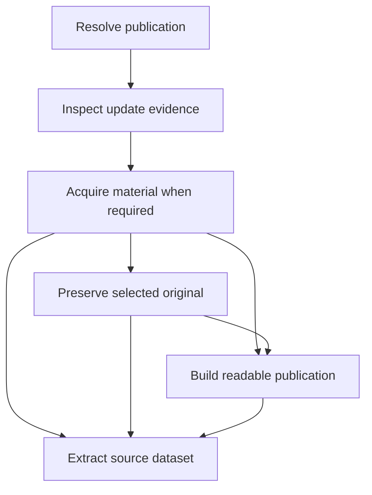
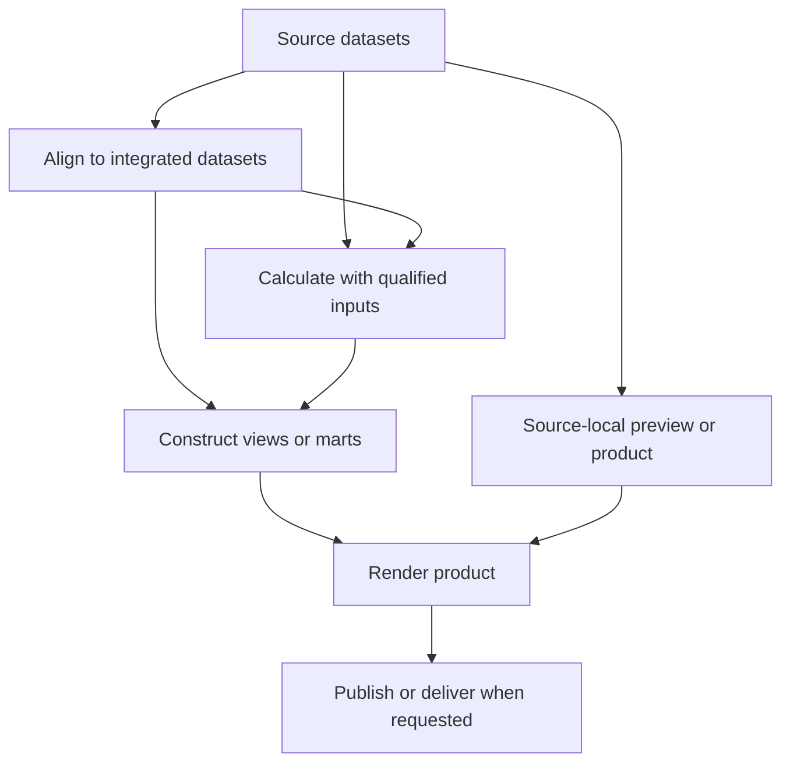
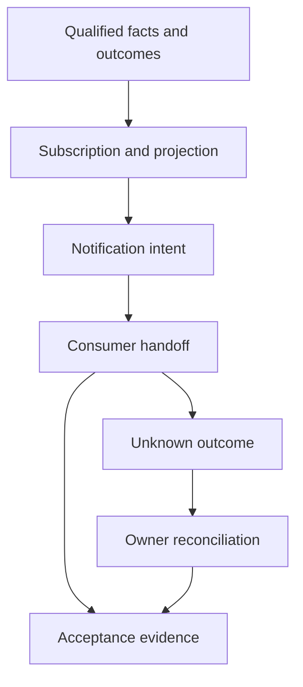

# Strategy Box: Composable Data Processing, Artifact Roles and Execution Contracts

**Date:** 2026-11-22. **Scope:** external statistical publications, complete domain operation surfaces, integrated analytical data, calculations, products, parallel execution, observability, optional notifications and autonomous AI interaction through a desktop-owned MCP interface. **Status:** architecture research and proposed target model; implementation and physical naming remain separate decisions.

Strategy Box should expose a common processing model from an external publication to a usable data product. The model consists of independently callable operations connected through explicit input and output contracts. Each domain should ultimately expose its complete applicable processing contour, while each consumer selects only the operations and results required for its task. The five artifact roles developed in Tabularium provide a useful foundation: original publisher material, readable publication, source dataset, integrated dataset, and data product. This research extends that foundation with acquisition and update decisions, calculations at several boundaries, concurrent execution, optional observation and notification services, and machine-discoverable operations for autonomous AI work through the desktop surface.

The central recommendation is to standardize **what each transition means and what its result establishes**, while allowing different sources, storage systems and execution environments to compose different routes. The requested direction establishes the purpose of this research. Names, detailed contracts and implementation sequencing below are recommendations for finalization, rather than claims that every described capability already exists or that product code changes follow automatically.

## Contents

1. Architectural decisions — the common concept and its practical commitments.
2. Four independent dimensions — operations, artifact roles, qualification and storage.
3. Functional terminology — one-word technical names and environment-specific aliases.
4. Processing graph — the full route, branches, entry points and dependency rules.
5. Source resolution and update detection — requests, baselines and qualified novelty.
6. Acquisition and original preservation — exact material, transient use and retention.
7. Readable publications — faithful conversion for AI and human inspection.
8. Source datasets — typed extraction, series contracts and selective coverage.
9. Integrated datasets — common addressing, dictionaries and explicit semantic mappings.
10. Calculations and SORS — derived data, inference and reproducible computational scope.
11. Views and data products — querying, presentation, rendering and delivery.
12. Operation contracts — independent requests, results and complete per-domain stage coverage.
13. Consumer composition — environment responsibilities and autonomous AI through MCP.
14. Parallel execution — task partitions, bounded resources and coordinated publication.
15. Versions and reuse — identities, cache validity and selective recomputation.
16. Failure and recovery — partial work, uncertain effects and safe resumption.
17. Observability — execution events, domain facts, receipts and observation coverage.
18. Notifications — subscriptions over qualified facts and independent delivery.
19. Lifecycle and storage — retained artifacts, temporary material and checkpoints.
20. Worked scenarios — representative paths through the model.
21. Alternatives and boundary challenges — competing designs and their consequences.
22. Design acceptance scenarios — concrete conditions for a coherent implementation.
23. Finalization and implementation sequence — settled direction and bounded open choices.
24. External references — primary sources supporting specific technical claims.

## 1. Architectural decisions: a common route built from independent operations

### 1.1. The route describes capabilities available to every consumer

The complete reference route is: resolve an external publication; inspect available update evidence; acquire its material; optionally preserve an original; optionally produce a readable publication; extract typed source datasets; align heterogeneous datasets into an integrated data model; perform relevant calculations; construct a view or other data product; and optionally publish or deliver it. Calculations, validation, observation and notification can attach at several boundaries.

This is a reusable description of responsibilities, rather than a prescribed number of files, network requests or database transactions. A consumer may request one operation, several connected operations, or the complete route. Calling an operation with suitable existing inputs should be sufficient to obtain its documented result.

| Code | Proposed architectural commitment | Practical consequence |
| --- | --- | --- |
| A01 | Individual operations are the basic callable units. | Parsing a supplied workbook requires the workbook and extraction parameters, rather than a preceding live download. |
| A02 | Artifact roles express processing readiness and integration scope. | File extension and directory name alone cannot determine a material's role. |
| A03 | Readable conversion and source extraction are independent capabilities. | A workbook can produce both a readable publication and source datasets, or only either result. |
| A04 | Source dataset contracts are local to a series and its schema editions. | Different datasets can expose different columns, shapes and dimensions. |
| A05 | Integration provides shared addressing and compatible query contracts. | Consumers avoid rebuilding source-specific joins and dictionary mappings for each product. |
| A06 | Economic equivalence requires an explicit mapping or derivation. | Similar labels can coexist as separate constructs when their definitions differ. |
| A07 | Calculation and presentation operations declare their required input contract. | They can run before a persistent database exists when an appropriate dataset is supplied. |
| A08 | Persistence and external publication are explicit effects. | Producing bytes, saving a local file and publishing a remotely available version establish different results. |
| A09 | Parallel execution preserves semantic dependencies and publication boundaries. | Independent downloads overlap; a dependent computation waits for its required input set. |
| A10 | Update evidence, processing need and destination readiness are separate states. | An unchanged source can still require a parser rerun or delivery to a new destination. |
| A11 | Observability accompanies operations; notifications consume selected qualified facts. | A normal calculation works with its result alone; subscribing consumers obtain relevant events. |
| A12 | Applications own task composition, schedules and deployment choices. | The same business operation can serve a notebook, desktop application or scheduled worker. |
| A13 | Each domain ultimately exposes its full applicable operation contour. | An unused stage remains a target capability; actual usage and implementation completeness are different dimensions. |
| A14 | Machine consumers discover the same semantic operations through typed contracts. | An AI client can plan stage-level work through a desktop MCP interface without reconstructing business logic. |

### 1.2. Universality comes from contracts with bounded responsibility

A universal operation has a precise responsibility and a sufficiently general interface. A universal acquisition primitive handles transport and material evidence; a domain operation identifies the relevant publication and its release semantics. A universal table primitive can select typed rows; a domain operation decides whether a particular statistical subtotal may be added to another one.

Combining these responsibilities in reusable compositions is useful. Requiring one all-purpose function with switches for download, conversion, parsing, calculations, export, saving and messaging would obscure the meaning of each intermediate result. Convenience compositions should retain the same underlying operation contracts and return accessible intermediate outcomes where useful.

## 2. Four independent dimensions: operation, artifact role, qualification and storage

### 2.1. Operations describe actions; artifacts describe usable results

| Code | Dimension | Question answered | Examples |
| --- | --- | --- | --- |
| D01 | Operation | What action is requested? | Acquire, convert, extract, align, calculate, query, render, publish. |
| D02 | Artifact role | What use has the material been prepared for? | Original, readable publication, source dataset, integrated dataset, product. |
| D03 | Qualification | What does the material or claim establish? | Reported value, reconstructed value, partial extraction, validated mapping, unknown effect. |
| D04 | Materialization and location | How is the result represented and where is it available? | Bytes, stream, typed table, local file, object reference, database relation. |

A single CSV can be a publisher original, an extracted source dataset, an integrated export or a rendered product. Its role depends on its origin, transformations and contract. A typed in-memory table can already satisfy an integrated dataset contract even when it has never been inserted into a persistent database.

The roles can overlap when the same material genuinely satisfies several contracts. A native publisher CSV might be preserved byte-for-byte and admitted as a source dataset after validation. Those are two qualified uses of one material, rather than a requirement to create duplicate files. A generated CSV with different values or layout receives its own identity.

### 2.2. Five artifact roles and their boundaries

| Code | Artifact role | Capability established | Boundary |
| --- | --- | --- | --- |
| R01 | Source original | Inspection of the acquired publisher-distributed material in its native form. | Original preservation concerns unchanged material, with the acquisition boundary stated. |
| R02 | Readable publication | Faithful inspection of publication text, structure, tables, notes and context. | AI readability provides convenient access, rather than stable series-level records. |
| R03 | Source dataset | Algorithmic use under a named series-specific, edition-aware schema. | Fields retain their source-specific meanings and coverage. |
| R04 | Integrated dataset | Shared addressing, typing, dictionaries and queryable relationships across admitted data. | Integration preserves differences and qualifies mappings. |
| R05 | Data product | A selection, table, chart, report, API result, workbook or other usable output. | The product declares its inputs, calculation basis and intended presentation. |

Derived data are an additional qualification that can attach to a dataset or product. Calculation is therefore an operation family across the graph, rather than a compulsory sixth storage rung. Validation is similarly a responsibility of each transition and can also be exposed as an independent operation.

## 3. Functional terminology: one-word technical names and local atmosphere

### 3.1. Recommended working vocabulary

The recommended working identifiers for technical catalogs are **`originals`, `readable`, `extracts`, `integrated`, and `products`**. Each is one word. Their descriptions explain the role more fully; operation and artifact contracts preserve the exact meaning. This vocabulary is a candidate for finalization, with particular attention to whether `readable` feels natural in everyday use.

Naming can vary by environment while the roles remain shared. Tabularium can retain the atmospheric `scrolls` and `flakes`; desktop-managed and organization-managed data catalogs can use functional technical names. A common architecture does not require every environment to adopt the same physical directory names.

| Code | Role explained | One-word technical identifier | Meaning of the existing metaphor |
| --- | --- | --- | --- |
| T01 | Source originals | `originals` | Originals: selected native source material. |
| T02 | Readable publications | `readable` | Scrolls: faithful publication representations convenient for AI inspection. |
| T03 | Source datasets | `extracts` | Flakes: predictable source-series data and assertions. |
| T04 | Integrated datasets | `integrated` | The common analytical data model, whether persistent or transient. |
| T05 | Data products | `products` | Views, marts, exports, reports, charts and service results. |

The suggested identifiers are role-oriented catalog labels. They do not prescribe Python package paths, database schemas or a renaming migration. The single-word preference concerns naming; explanatory prose can use the full functional descriptions where needed.

### 3.2. Alternatives for readable publications

| Code | Candidate | Strength | Ambiguity or cost |
| --- | --- | --- | --- |
| N01 | `readable` | Names the reading-ready property directly and includes text, tables and context. | An adjective; its contract must specify AI-oriented publication readability. |
| N02 | `documents` | Familiar technical noun, broad enough for complete publications. | Native PDFs are documents too; the processing role needs a clear definition. |
| N03 | `transcripts` | Suggests a faithful transcription of source content. | Often associated with speech and can imply conversion even for directly admitted HTML. |
| N04 | `representations` | Technically accurate for source-faithful forms of a publication. | Also applies to extracted tables and rendered products. |
| N05 | `publications` | Familiar noun with a clear source/publication orientation. | Can include untouched originals and produced reports. |
| N06 | `texts` | Short, intuitive and convenient for textual material. | Understates tables, charts, layout and other meaningful structure. |
| N07 | `scrolls` | Distinctive and already recognizable in the corpus. | Requires an explanation of its function in a technical environment. |

`readable` is the leading functional candidate because it names the capability gained. `documents` is the strongest conventional noun if noun-based naming is preferred. In either case, the role is a faithful publication representation preserving context and structure for AI inspection, also useful to people and search. The label alone does not claim verified completeness.

### 3.3. Alternatives for source datasets

| Code | Candidate | Strength | Ambiguity or cost |
| --- | --- | --- | --- |
| N08 | `extracts` | Names the extraction responsibility and separates the result from integrated data. | The contract must require typed, series-local structure rather than arbitrary fragments. |
| N09 | `datasets` | Familiar technical noun, broad enough for several related tables. | Also applies to integrated and derived data. |
| N10 | `parsed` | Clearly indicates a processing state. | Parsing alone can yield a syntax tree or irregular tables without a usable series contract. |
| N11 | `observations` | Precise for published values and factual assertions. | Too narrow for hierarchical source tables and accompanying structural records. |
| N12 | `tables` | Familiar and concise for statistical extraction. | Includes many later-stage results and excludes other machine-operable source structures. |
| N13 | `flakes` | Distinctive and established in the corpus. | Requires an explanation of series-local typing and source fidelity. |

`extracts` is the leading technical candidate. `datasets` is a useful noun-based alternative if its local source-series scope is firmly defined. The result can comprise several typed tables, dimensions, labels and source-status records. A directly acquired publisher dataset can be admitted to this role after contract validation, even when no physical conversion is needed.

### 3.4. Naming profiles share role identity rather than literal paths

| Code | Shared role | Tabularium naming | Leading technical catalog candidate | Noun-based alternative |
| --- | --- | --- | --- | --- |
| NP01 | R01: untouched source material | `originals` | `originals` | `originals` |
| NP02 | R02: reading-ready publication | `scrolls` | `readable` | `documents` |
| NP03 | R03: typed series-local data | `flakes` | `extracts` | `datasets` |
| NP04 | R04: common integrated model | Downstream integrated environment. | `integrated` | `database`, only for actual database storage. |
| NP05 | R05: views and delivered outputs | Downstream product environment. | `products` | `products` |

`derived` is an additional useful one-word label when an application needs a distinct collection for calculation results. It expresses qualification and lifecycle, rather than an obligatory position after integration. `views` can name a narrower product collection when its content really consists of views; `products` covers reports, workbooks, charts and other outputs together.

The names of directories and artifact-role metadata are separate. A configured mapping from a known role to a storage location is sufficient; neither a global directory-renaming exercise nor a mandatory translation service is implied. The research leaves final lexical choice open while preserving the semantic contracts regardless of naming profile.

## 4. Processing graph: the full route and legitimate short paths

### 4.1. Acquisition can feed readable conversion and extraction independently

The graph shows permitted dependencies. A probe can resolve the request without acquisition when the requested result is only a qualified source check. Readable conversion and direct extraction can run in parallel against the same admitted material. An extraction through a readable representation is useful when that representation is the best available input; direct native extraction is preferable when it better preserves table structure and numerical precision.

### 4.2. Calculations and products attach according to their input contract

The normal shared route for reusable cross-source analytics uses the integrated data contract. A notebook may construct that contract in memory; a service may expose it through a database. A source-local preview, same-series comparison or workbook export can consume source datasets directly. A cross-source report still needs the required alignment and comparability rules even if its execution plan combines alignment, calculation and rendering in one transient run.

### 4.3. Entry points and dependency closure

| Code | Supplied input | Requested result | Required work |
| --- | --- | --- | --- |
| G01 | Source address and baseline | Availability or update assessment | Resolve and inspect; acquire only if evidence requires bytes. |
| G02 | Source address | Preserved original | Acquire, validate material identity and save to the chosen destination. |
| G03 | Local original | Typed source dataset | Read the material and extract the selected content. |
| G04 | Supplied readable publication | Source dataset | Extract with representation-qualified lineage. |
| G05 | Source datasets | Integrated selection | Align admitted fields and identities; a persistent database is optional. |
| G06 | Complete computational input bundle | SORS result | Admit the bundle and run the domain calculation. |
| G07 | Admitted dataset or query snapshot | Chart or workbook | Construct the view and render the chosen product. |
| G08 | Existing qualified event stream | Selected notifications | Evaluate subscriptions and perform requested handoffs. |

For an explicitly requested composite task, dependency closure means resolving only the prerequisites needed for its requested outputs. Independent operations accept already available inputs and return a missing-input or incompatible-contract diagnostic when necessary. Automatic acquisition, saving, publishing or messaging belongs to a composition that explicitly declares those effects.

## 5. Source resolution and update detection: evidence before a binary answer

### 5.1. A request is a transport mechanism inside a source operation

Source resolution establishes publisher, series, issue, asset and retrieval route as far as the source permits. It can inspect a landing page, an API inventory, a known URL, a supplied file or an existing catalog. A logical discovery operation may issue several network requests; a local operation can issue none. This makes an HTTP request useful as a reusable primitive, while keeping publication semantics with the source owner.

The practical reference order is **resolve → inspect inexpensive update evidence → acquire if necessary → establish material and data differences**. Some sources provide sufficient metadata to avoid a download. Others require the body before any meaningful update conclusion can be drawn. A conditional GET can combine the inspection and acquisition paths in one exchange.

RFC 9110 defines validators and conditional requests, including responses that let a client reuse a stored representation. This supports an optional traffic-saving probe; the protocol does not establish whether an economic observation changed. [E01]

### 5.2. Three separate questions govern subsequent work

| Code | Question | Comparison basis | Example |
| --- | --- | --- | --- |
| U01 | What changed at the source? | Qualified inventory, acquired material or extracted facts. | A historical issue has revised numbers. |
| U02 | What processing is required? | Input identity, method, schema, references and requested selection. | The source is unchanged but the extraction method changed. |
| U03 | What is ready at this destination? | Confirmed destination state and requested publication contract. | One consumer has the new version while another still needs ingestion. |

An update result should identify its layer: inventory, transport validator, original bytes, document structure, source facts, method, representation or destination. Byte equality is strong evidence about the exact compared bytes. Byte inequality can reflect metadata or layout changes. A facts comparison can establish unchanged extracted observations only within its admitted schema and coverage.

### 5.3. Update vocabulary and evidence strength

| Code | Conceptual state | Evidence required | Meaning for execution |
| --- | --- | --- | --- |
| U04 | Initial observation | A first accepted local baseline. | Establish history; notification policy decides whether to announce it. |
| U05 | New issue | Qualified prior absence and present issue identity in a comparable inventory scope. | Process the newly admitted issue. |
| U06 | New asset | Qualified appearance of another asset within an existing issue. | Process the asset and affected issue outputs. |
| U07 | Revised version | Different material or qualified facts for the same issue/asset identity. | Recompute dependent results as required. |
| U08 | Unchanged at a named layer | Comparable baseline and candidate, with adequate evidence at that layer. | Reuse only the results whose other dependencies remain valid. |
| U09 | Indeterminate | Missing, inaccessible, incompatible or insufficient baseline evidence. | Return the uncertainty; continue only under an explicit task policy. |
| U10 | Unavailable or check failed | Acquisition, discovery or transport evidence of failure. | Preserve the last confirmed state and report the failed check. |

These are conceptual distinctions; a concrete operation may encode them through its own typed result. Initial observation alone establishes first local knowledge, rather than the publication's first historical appearance. An inaccessible prior inventory cannot prove absence. A failed request cannot establish an unchanged source.

### 5.4. Baselines, validators and source races

A baseline belongs to a declared source scope and comparison contract. Source transitions, processing checkpoints, database ingestion checkpoints and notification checkpoints have separate owners. Updating one global `last_seen` value immediately after download would lose work if extraction or publication then failed.

A transport validator is associated with the selected representation and relevant request context. A `304` response supplies no replacement body; downstream processing needs access to the corresponding retained material. When that material is unavailable and bytes are required, the composition must arrange a full acquisition. A weak validator or modification date should retain its protocol qualification rather than being treated as a cryptographic identity. [E01]

If discovery and acquisition observe different source states, the acquired material is identified by what was actually received. The source adapter qualifies or rejects a mismatch when the advertised issue/version is essential. Multiple assets can require an issue manifest or a consistency rule; simultaneous acquisition times alone cannot prove a coherent source release.

## 6. Acquisition and original preservation: material first, retention by purpose

### 6.1. Acquisition returns material and evidence of the acquisition boundary

An acquisition operation returns bytes, a bounded stream or a material reference with identity and acquisition metadata appropriate to the source. Relevant evidence includes requested and resolved origin, source issue/asset identity, acquisition time, media type, length, digest, and transport qualification. Unavailable facts remain unavailable.

The exact-byte claim applies to the declared source material boundary. HTTP transfer framing or content encoding may be removed by a transport adapter; the resulting publisher file bytes need a clearly identified boundary. A publisher ZIP and an extracted member have separate identities and an explicit container/member relationship. Re-saving a parsed workbook produces a transformed artifact.

### 6.2. Acquire and preserve are separable operations

| Code | Policy | Appropriate use | Result availability |
| --- | --- | --- | --- |
| O01 | Transient acquisition | Immediate parsing when long-term source retention adds little value. | Available only during the declared material lifetime. |
| O02 | Selected original preservation | Complex workbooks, expensive retrieval or revision-sensitive evidence. | Available through a confirmed retained material reference. |
| O03 | Streaming to a chosen store | Large source files that exceed the in-memory profile. | Available after the relevant write is confirmed. |
| O04 | Caller-supplied material | Offline notebook or application-provided file. | Available under the caller's access and lifetime contract. |

Saving an original changes its location and storage qualification while preserving its bytes. A save result identifies the actual stored revision and its observed integrity. Remote publication, recoverability after a crash and local read-back are separate guarantees supplied by the relevant storage owner.

Large inputs should be handled through bounded transfer, temporary material or streaming when supported. A streaming download does not imply that every parser can stream the format: some workbooks and archives require seekable material. Such requirements belong in the operation's declared input and resource contract.

## 7. Readable publications: faithful access to publication content

### 7.1. Readability is a content contract

A readable publication preserves the source content needed to inspect its meaning: headings, narrative, tables, units, periods, footnotes, qualifications, chart labels and relationships. Markdown and suitable HTML are useful carriers. An XLSX or JSON file is technically parseable, yet may require a reading-oriented representation to expose context conveniently to an AI consumer.

Readable conversion can return a full publication or an explicitly scoped representation. Its coverage states which pages, sheets, sections or elements are represented and what remains unresolved. A partial transcription cannot claim full-publication completeness. Chart descriptions distinguish visible values from approximate readings; inaccessible or ambiguous content remains identified.

### 7.2. Conversion and structured extraction have separate quality criteria

| Code | Criterion | Readable publication | Source dataset |
| --- | --- | --- | --- |
| Q01 | Organizing purpose | Preserve publication context and structure for inspection. | Expose fields and records under a stable series contract. |
| Q02 | Typical validation | Coverage, transcription fidelity, tables, notes and reading order. | Types, grain, keys, source values, statuses and schema edition. |
| Q03 | Preferred input | Native material or an admitted source representation. | The material with the strongest extraction fidelity for this series. |
| Q04 | Main risk | Omitted context or incorrectly transcribed content. | Incorrect field meaning, missing records or silent normalization. |

An AI-assisted converter records the material and conversion profile used, relevant model/settings where supplied, and qualified coverage. Its output remains a representation requiring appropriate verification. Reproducible input identity does not promise identical generative output. An ordinary source parser should use a deterministic native path when suitable; an AI-reading intermediate is requested for its distinct utility.

## 8. Source datasets: typed series contracts with explicit selection

### 8.1. Source extraction establishes predictable local structure

A source dataset exposes the selected published data in a form that algorithms can address without repeatedly interpreting the publication layout. Its contract identifies the publication series, schema edition, record grain, tables, fields, types, keys, units, periods, statuses, ordering where meaningful, and extraction coverage.

Uniformity means that compatible releases of one dataset can be processed under an explicit contract. A schema evolution or methodological break remains visible through editions and mappings. A bank-by-region table, a legal-entity table and a population workbook can be valid source datasets with radically different schemas.

| Code | Contract element | Required semantic content when relevant |
| --- | --- | --- |
| S01 | Dataset and schema identity | Stable series identity and the edition defining the fields. |
| S02 | Grain and keys | What one record represents and which dimensions distinguish records. |
| S03 | Source construct | The publisher's indicator, population or financial/statistical concept. |
| S04 | Typed values and literals | Exact numeric/text types, original token where needed, and source value status. |
| S05 | Time and perimeter | Stock date, flow interval, capture date, geography and organizational scope. |
| S06 | Units and scale | Currency, magnitude, quantity kind and reported precision. |
| S07 | Extraction selection | Requested and produced sheets, fields, periods, territories or other partitions. |
| S08 | Coverage and validation | Complete/partial scope, omissions, unknown elements and checks actually performed. |
| S09 | Lineage | Exact input material, table/cell locator when needed, method and reference editions used. |

These are sufficiency requirements by use, rather than a demand that every CSV repeat a large metadata object on each row. A dataset-level contract, side metadata, typed result and source references can collectively provide the required meaning.

### 8.2. Selection and validation scope are independent

A caller may request a complete publication, one table, selected sheets, a group of indicators or one geography. The output records the requested selection and the actual materialized coverage. If a parser validates an entire workbook and returns only the requested industry rows, its validation scope is full and its output scope is selected. If it reads and checks only selected sheets, its validation claim is correspondingly narrower.

Selection is also a resource optimization. It can reduce output materialization without necessarily reducing source acquisition or workbook scanning. An operation should expose that distinction rather than promising that every narrow selection gives a proportionally cheaper execution.

### 8.3. Source fidelity includes missingness and formula meaning

Source extraction preserves zero, blank, dash, missing, withheld and not-applicable states as the source contract requires. Unknown source labels are retained or reported through a qualified diagnostic. Trimming, reshaping and aliases are acceptable when their meaning and reversibility are explicit; imputing values or resolving a genuine construct difference is a calculation or mapping responsibility.

Formula-bearing source cells may require both formula lineage and cached values. A parser qualifies what it actually read or evaluated. A computed value produced by the parser cannot silently become a publisher-reported literal merely because it occupies the same position in the extracted table.

### 8.4. Source-local datasets can be useful before integration

Typed datasets support compatible-edition comparisons, source-local calculations, quality checks, previews and operational alerts. A monitoring consumer can compare successive releases while a separate consumer performs database ingestion later. Each comparison identifies its actual common coverage and qualifies schema, unit, perimeter or methodology changes.

## 9. Integrated datasets: one queryable data model with preserved meaning

### 9.1. Separate semantic alignment from loading into a particular database

Integration has two independently useful responsibilities:

1. **Align:** map admitted source records into shared identities, dimensions, types and relationships, while retaining the original constructs and values.
2. **Ingest/materialize:** write that aligned result into the consumer's chosen database, file collection or other queryable store and confirm the resulting destination state.

Alignment can return an in-memory integrated batch. Ingestion can accept an already aligned batch. An integrated data service can expose both responsibilities through one convenient command while keeping their evidence and failure boundaries distinct. This lets the same semantic integration serve a notebook and a persistent analytical platform.

The common plane is a coherent data model and query contract. Its physical implementation can use a long observation table, several related fact tables, dimensions, specialized relations and source-specific attachments. A long-form grid is useful for many statistical indicators; forcing every hierarchy, narrative assertion or source-specific relationship into one scalar table would lose information.

### 9.2. Shared identities and dictionaries qualify the join

| Code | Integration responsibility | Required distinction |
| --- | --- | --- |
| I01 | Subjects | Legal entity, banking group, statistical population and source-specific subject. |
| I02 | Geography | Region identity, edition, composite territory and aggregate perimeter. |
| I03 | Classification | Code, hierarchy, edition and domain-specific aggregation membership. |
| I04 | Measures | Construct definition, stock/flow/ratio nature, currency, unit, scale and precision. |
| I05 | Periods | Observation date or interval, cumulative basis, publication date and revision vintage. |
| I06 | Source versions | Publisher, series, issue, asset and exact revision used. |
| I07 | Values and statuses | Reported values, missingness, source flags and separately identified derived results. |
| I08 | Mapping rules | Mapping edition, scope, qualification and unresolved correspondences. |
| I09 | Relationship grain | One-to-one, many-to-one or other relationships and their aggregation implications. |

A geography name resolver can associate a published label with a known territory. It cannot by that association alone establish that two statistical aggregates cover the same population. A canonical bank identifier can connect legal-entity records without making legal-entity and consolidated-group assets interchangeable.

### 9.3. Mapping classes prevent silent harmonization

| Code | Mapping class | Example | Permitted interpretation |
| --- | --- | --- | --- |
| M01 | Identity correspondence | An edition-qualified source code directly names the shared subject. | The same identity in the stated scope. |
| M02 | Qualified correspondence | Two labels refer to associated territories with a documented perimeter difference. | An explicit relationship carrying that limitation. |
| M03 | Re-expression | Millions of rubles expressed as rubles through an exact declared scale. | A reproducible transformed value linked to the reported value. |
| M04 | Analytical derivation | Currency conversion, deflation, consolidation or reconstruction. | A separate derived result with method and inputs. |
| M05 | Unresolved correspondence | A historical classification lacks a defensible bridge. | Retain the source record and exclude or qualify the unsupported join. |

The integration result identifies accepted mappings and unresolved records. A strict consumer can reject incomplete required mappings; an exploratory consumer can retain unmapped records with explicit status. Source values remain accessible in either profile.

### 9.4. Query convenience does not erase analytical boundaries

A reusable query interface should support the dimensions actually admitted by its dataset: subject, measure, period, geography, classification, source, version and qualification. Selecting a common measure name is insufficient when perimeters or methodologies differ. An analysis can request comparable segments or select a qualified bridge rather than concatenating every similarly labeled row.

Database loading handles duplicate ingestion, corrections and supersession under stable keys. A correction for an existing issue has a distinct revision identity. The current-selection policy and the historical/as-of view are explicit. The contract can use immutable versions with current pointers or another storage model that preserves the version distinctions required by its consumers.

## 10. Calculations and SORS: derived data at the boundary that has sufficient inputs

### 10.1. Computation is a reusable operation family

A calculation accepts data satisfying its declared semantic and coverage requirements. It can consume a source dataset, several jointly admitted datasets, an integrated batch or a pinned database query. Its result may be another dataset, parameters, bounds, a comparison, diagnostics or a product-ready table.

| Code | Calculation class | Typical input | Qualification of output |
| --- | --- | --- | --- |
| C01 | Same-series change | Comparable releases with defined periods. | Derived difference or growth rate. |
| C02 | Explicit aggregation | Components with compatible grain, units, perimeter and membership. | Derived subtotal with component lineage. |
| C03 | Alignment-dependent calculation | Several datasets admitted to a common model. | Derived result with mappings and input-version vector. |
| C04 | Reconstruction | Published constraints, reference editions and model assumptions. | Inferred result, bounds and evidence class. |
| C05 | Statistical estimation or forecasting | Qualified observations and an identified method/scenario. | Estimate or forecast with uncertainty and vintage. |
| C06 | Validation calculation | Data and a defined consistency rule. | A qualified check result, rather than a replacement source value. |

Whether a calculation precedes or follows persistent ingestion is an execution choice. The operation still requires all of its semantic dependencies. A database is helpful for reusable input selection; its presence does not validate an otherwise unsupported formula.

### 10.2. SORS is a domain computation with a complete input contract

SORS reconstruction is a useful stress case because it combines several published cuts, classification references, rounding assumptions and coupled constraints. It should be callable on an admitted source bundle without requiring an unrelated full ecosystem database. An integrated data service can also construct the same admissible bundle from a pinned query.

| Code | SORS boundary | Contract |
| --- | --- | --- |
| SR01 | Source admission | Identify all required source tables, exact versions, periods, units, portfolios and reference editions. |
| SR02 | Model construction | Declare variables, aggregation/partition relations, nesting, rounding intervals and applicable constraints. |
| SR03 | Deterministic derivation | Record which conclusions follow from admitted source facts and model relations. |
| SR04 | Feasibility and optimization | Return qualified solver status, bounds, objective settings and numerical tolerances. |
| SR05 | Result qualification | Separate source-published, identified, inherited, preferred, selected and unresolved outcomes as the method requires. |
| SR06 | Projection | Produce the requested region/industry/metric slice with its evidence and coverage. |
| SR07 | Integration or publication | Admit the derived result into a separate qualified relation or product; preserve source observations. |

The architecture specifies these distinctions without choosing a new SORS inference method. A point selected by an optimization objective can be useful while the underlying quantity remains nonunique. A value identified at publication precision differs from an exact latent amount. A successful workbook render says nothing additional about inference strength.

### 10.3. Computational input scope can exceed output scope

A consumer requesting one region may still need constraints involving federal districts, national totals, other regions and nested portfolios. Output selection therefore cannot automatically become solver-model selection. A narrow computational model is valid only when the domain method establishes that the omitted relations cannot affect the requested result or when the changed scope is explicitly part of the method.

Parallel SORS execution is possible across proven-independent model components, independent periods under a one-period method, or admitted independent target evaluations against a fixed model. Shared aggregates can couple apparently separate regions or industries. Partitioning by filename or target label alone cannot establish independence.

An iterative solver or deterministic fixed-point loop belongs inside the computation's bounded execution. It returns a new qualified result or an explicit incomplete status. This leaves the outer processing graph acyclic for a given input version while supporting repeated internal inference passes.

### 10.4. Derived results retain their own identity and lineage

A reconstructed dataset identifies the complete input-version vector, method, model/reference editions, significant parameters, solver/runtime settings needed for reproducibility, and result qualification. Resource termination and uncertainty are reported. Missing solver capability, infeasibility, unboundedness and time exhaustion have distinct meanings.

Derived records can coexist with reported records in the same physical database, provided their identities and qualifications remain distinguishable. A downstream view can deliberately select reported-only, identified reconstructions or a broader accepted inference tier. It records that choice so a user can recover why a displayed value was included.

## 11. Views and data products: separate selection, presentation and delivery

### 11.1. Product construction has several reusable responsibilities

| Code | Responsibility | Result | Independent use |
| --- | --- | --- | --- |
| V01 | Query/select | Typed rows or a pinned query result. | Supply data to an external analytical tool. |
| V02 | Construct view or mart | Defined axes, measures, filters, joins and calculation rules. | Return a pivot or reusable analytical relation. |
| V03 | Render | Workbook, chart specification, image, document or other representation. | Return bytes or a renderable object without saving it. |
| V04 | Save/materialize | Confirmed file or relation revision. | Retain an existing product at a chosen destination. |
| V05 | Publish/deliver | Owner-qualified publication or handoff receipt. | Make an existing product available through a configured channel. |

These responsibilities can be exposed through several operations or a justified composite operation. Their separation lets a desktop consumer render a returned table itself, a notebook obtain a finished workbook, and a service materialize a mart while another service presents it.

### 11.2. Products declare their input level and reproducibility scope

A source-local preview may use R03 directly. A shared cross-source mart uses R04 or explicitly performs the required alignment before constructing its result. A view over reconstructed values declares the admitted inference qualifications. A readable publication can also support text-oriented products, such as source search or an AI context selection, without pretending to be an integrated numeric dataset.

The product identity includes relevant input versions or a dataset snapshot, selection, calculation method, accepted data qualifications and presentation profile. A presentation-only change can require rerendering without re-extraction. A calculation change can require view reconstruction without reacquisition. Saving to a new destination can reuse the same rendered bytes.

### 11.3. Stable product snapshots under concurrent updates

A multi-source view records the versions actually selected, including differing reference periods and vintages. A reporting product can require all components to satisfy a declared readiness rule; an operational dashboard can permit explicitly labeled partial freshness. Both policies are valid when their contract states what users will see.

For a multi-query database product, the database adapter must provide a suitable snapshot or immutable version selection. PostgreSQL's Read Committed isolation can expose different committed states to successive statements, while Repeatable Read uses a transaction snapshot. This is why a generic instruction to read the latest data is insufficient for reproducible multi-query reporting. The appropriate isolation, revision selection and conflict policy remain adapter decisions. [E04]

## 12. Operation contracts: portable calls and complete domain operation surfaces

### 12.1. The basic contract describes semantic work

| Code | Contract dimension | Minimum meaning |
| --- | --- | --- |
| OPR01 | Logical operation identity | Stable operation ID, request/result contract version and method version where applicable. |
| OPR02 | Input admission | Accepted material or dataset roles, schemas, qualifications and required coverage. |
| OPR03 | Selection and parameters | Explicit source issue, periods, fields, output selection and method settings. |
| OPR04 | Returned value | Typed domain result, accessible artifacts and qualifications. |
| OPR05 | Input lineage | Exact materials, datasets, references and parent computations actually used. |
| OPR06 | Effects | Declared destination actions and their separately qualified receipts. |
| OPR07 | Resource behavior | Network, memory, disk, CPU/solver, time and concurrency needs or ceilings. |
| OPR08 | Cancellation and retries | Checkpoints, interruption semantics and conditions for safe retry or reconciliation. |
| OPR09 | Observation | Invocation correlation, stages and bounded event/result projections. |
| OPR10 | Partial-result policy | Which subsets are independently usable and how unfinished work is identified. |

The intended carrier is the established typed operation/result approach: `OperationResult` for the invocation result, `ExecutionContext` for execution dependencies and observation, and material/dataset/computation contracts for values and lineage. These concepts should be extended only for demonstrated missing responsibilities. This research does not introduce a competing universal runner, durable job manager or new mandatory schema framework.

### 12.2. Semantic parameters and execution settings have different identities

A period, mapping edition, formula, rounding policy or selected inference tier can change the meaning of a result and belongs in computation identity. A destination address belongs in an effect's scope, rather than automatically changing the mathematical dataset identity. Worker count is usually an execution setting; when a solver's reproducibility or termination behavior depends on it, that setting must also be recoverable in execution evidence.

Observation preferences belong to the execution connection. Notification subscriptions belong to their own consumer scope. A business operation should not accumulate channel-specific flags such as messaging enabled, desktop toast mode or recipient chat ID.

### 12.3. Convenience compositions retain visible boundaries

A capture operation can combine acquisition and extraction because the resulting typed dataset is a common request. A receive-and-save operation can combine transfer and confirmed storage because streaming requires that composition. An end-to-end report command can resolve several operations and return the product plus a stage summary.

Each composition declares its effects and dependency policy. It preserves the meaning of component outcomes, including successful independent artifacts and unresolved publication effects. A consumer can still choose direct acquisition, parsing, calculation or rendering when that is all it needs.

### 12.4. A portable handoff carries identity, accessibility and lifetime

Small results can cross an in-process boundary as typed objects. Larger materials can cross process or task boundaries through references identifying the material, its revision, media/schema contract and available access mechanism. A raw path is meaningful only to workers that share that filesystem and scope.

For durable or remote composition, a reference also needs a lifetime and retention promise sufficient for its dependent task. A streaming result declares whether it is replayable or single-use and which owner closes it. Typed table objects that allow mutation require an immutable snapshot, an owned copy or boundary identity checks before reuse.

### 12.5. The processing model determines domain operation architecture

The complete route is also a target design for domain operation surfaces. A domain should provide independently callable operations for every applicable stage, including stages its current consumer does not request. Current usage determines the selected execution path; it does not determine the ideal completeness of the domain.

The target is a full applicable contour for every domain. Implementation can proceed in increments, but unsupported applicable stages remain visible development gaps. A stage is inapplicable only because of the domain's actual semantics, rather than because no current application calls it.

| Code | Target stage family | Domain-specific responsibility | Reusable neutral responsibility |
| --- | --- | --- | --- |
| DS01 | Resolve/discover | Publication identities, issue selection, asset inventory and source routes. | Request execution and generic inventory carriers. |
| DS02 | Inspect/compare update state | Source novelty, edition compatibility and scope of compared facts. | Material comparison primitives and baseline/result carriers. |
| DS03 | Acquire material | Select and qualify the correct source asset. | HTTP or supplied-source transport, streaming and byte identity. |
| DS04 | Preserve/read original | Associate the material with its source issue and use it later. | Confirmed save, retained material references and bounded reads. |
| DS05 | Produce readable publication | Preserve the publication's meaningful structure, labels and qualifications. | Conversion facilities and reusable reading carriers. |
| DS06 | Extract source datasets | Source-specific tables, schemas, grain, units, statuses and selection. | Native-format parsing primitives and typed data carriers. |
| DS07 | Read retained extracts | Re-admit a saved source dataset under its schema and qualification. | Storage access, decoding and integrity checks. |
| DS08 | Compare releases | Compatible source observations, changed coverage and source-specific findings. | Comparison envelopes, identities and structural helpers. |
| DS09 | Align/integrate | Map domain constructs, identities, dimensions and editions into the common model. | Shared reference interfaces and integrated batch contracts. |
| DS10 | Ingest/materialize | Supply the admitted domain batch and its version semantics. | Destination-specific transactional or conditional publication. |
| DS11 | Calculate | Applicable domain formulas, reconstruction, aggregation and qualified analytical methods. | Execution, resource controls and computation lineage. |
| DS12 | Construct views | Domain-relevant dimensions, selections, measures and output structure. | Generic query, selection and pivot facilities. |
| DS13 | Render products | Source/domain-specific workbook, table, chart or other presentation profiles. | Rendering primitives and representation carriers. |
| DS14 | Save/publish outputs | Identify what a domain dataset/product publication means. | Scoped storage/publication effects and receipts. |
| DS15 | Validate and expose facts | Domain checks and stage-qualified facts across the contour. | Invocation events, diagnostics and optional observation facilities. |

The rows are architectural operation families, rather than assertions about existing API names or a requirement for exactly fifteen functions. One family may need several operations, and one declared composition can cover a useful combination. The independent calls required for stage-level reuse still need to exist.

Notification preparation and handoff form a reusable cross-domain consumer contour. Each domain supplies the facts and schemas needed for its applicable topics; it does not need a duplicate messaging subsystem. A domain's full operation surface remains usable when no subscriber is configured.

### 12.6. Completeness is semantic coverage, with shared implementation allowed

A full domain contour does not require copying HTTP, storage, conversion or rendering code into every domain. A stage can be implemented by its domain owner, delegated to a registered shared operation with sufficient domain metadata, or composed from explicit owners whose contracts establish the complete transition. The caller must have an unambiguous callable route and the information needed to use it.

Grouping namespaces are distinct from exact business owners. A source-file collection owner can hand an acquired publication to its registered dataset owner for interpretation. That delegation establishes coverage only when the consumer can resolve the intended owner and compatible input contract; a vague instruction to parse the file elsewhere leaves a gap.

| Code | Coverage state | Interpretation |
| --- | --- | --- |
| CV01 | Implemented | The domain-owned operation establishes the stage contract. |
| CV02 | Implemented through shared/delegated capability | A resolvable existing operation or declared composition establishes the contract with the required domain binding. |
| CV03 | Planned or missing | The stage applies but a complete callable implementation is absent. This remains a target gap. |
| CV04 | Inapplicable with reason | The responsibility has no meaningful instance for this domain's actual subject and boundary. |

Runtime availability and task selection are separate dimensions. A fully implemented operation can lack a required provider in one environment. An available operation can be unused in one run. Neither condition changes its implementation-coverage state. A stub returning empty success or an entry in a future plan cannot establish implementation completeness.

### 12.7. Machine discovery needs stage and artifact semantics

The operation catalog should let a caller resolve domain ownership, operation identity/version, stage family, input/output roles and schemas, accepted qualifications, selection parameters, required capabilities, possible effects, partial-result policy and execution limits. Relationships to useful composites and to preceding/following compatible operations help route construction without prescribing one fixed workflow.

Coverage metadata can additionally expose missing applicable capabilities for engineering work. Such entries must be clearly distinguished from executable operations. An AI-facing callable catalog advertises what the host can actually invoke, together with any runtime conditions; planned capabilities remain inspectable as planning information rather than callable tools.

Machine-readable descriptions and codecs should be derived from the same admitted operation definitions used by ordinary clients. A separate handwritten AI-only catalog would drift as domain interfaces evolve. Where a public operation lacks a machine contract needed for the intended AI use, that deficiency remains an explicit readiness gap.

## 13. Consumer composition: execution profiles and autonomous AI through MCP

### 13.1. Core and consumer responsibilities

| Code | Responsibility | Reusable Strategy Box capability | Executing consumer |
| --- | --- | --- | --- |
| B01 | Domain semantics | Source interpretation, extraction, analytical rules and result qualification. | Selects the task and requested outputs. |
| B02 | Neutral infrastructure | Transport/storage interfaces, format primitives, execution and resource contracts. | Supplies providers and environment configuration. |
| B03 | Integration | Reusable mappings, reference interpretation and typed integration operations. | Chooses the destination schema/service and persistence policy. |
| B04 | Composition | Independently callable operations and useful bounded composites. | Owns durable task graph, scheduling, placement and restart policy. |
| B05 | Observation | Structured events, domain facts, receipts and qualified projections. | Chooses collection, retention and inspection interfaces. |
| B06 | Notifications | Topic/subscription evaluation, structured intent and handoff contracts. | Chooses subscriptions, recipients, channel adapters and presentation. |
| B07 | Data products | Reusable view/calculation/rendering methods. | Chooses the interface, destination and distribution lifecycle. |

Portable business logic should stay with its semantic owner. A workflow file or notebook can compose operations without becoming the only implementation of a source parser. Applications can supply environment-specific providers while calling the same business contract.

### 13.2. Representative execution profiles

| Code | Consumer | Typical selection | Optional infrastructure |
| --- | --- | --- | --- |
| P01 | Tabularium | Capture or preserve selected source artifacts and source datasets. | Repository publication, scheduled capture and selected operational alerts. |
| P02 | Google Colab or Jupyter | Read supplied files, parse, calculate and render within a session. | Persistent checkpoints, user-selected stores and in-session progress. |
| P03 | Desktop surface | User-selected acquisition, analysis, previews and exports. | Background tasks, local history and explicit user-facing notifications. |
| P04 | Scheduled data worker | Discover changes, acquire, extract, align and publish confirmed revisions. | Durable orchestration, bounded concurrency, checkpoints and subscriptions. |
| P05 | Airflow or another orchestrator | Execute individually addressable stages with pinned inputs. | Distributed workers, external artifact storage and retry policies. |
| P06 | Downstream analytical application | Query integrated snapshots and construct products. | Database/service adapters and application-specific presentation. |

The minimum supported profile is a direct operation call with supplied inputs and an ordinary returned result. Persistent database, durable journal, scheduler, notification subscriber and remote channel are added according to the task.

### 13.3. Distributed tasks exchange stable references

Airflow's primary guidance emphasizes repeatable task results, fixed input partitions and small inter-task messages that reference larger externally stored materials. That supports version-pinned handoffs in this model. It does not require Strategy Box to depend on Airflow or turn its data contracts into orchestration-specific objects. [E02]

An application may submit a request for a final product, a list of stage results or only a publication check. A composition records the resolved dependency set and returns the requested values with an honest outcome for each relevant stage. Requesting selected notifications separately avoids coupling business results to a messaging configuration.

### 13.4. Desktop-owned MCP is the intended AI interaction surface

The intended personal-use architecture places an MCP server in stratbox-windows, with the desktop application launched and integrated through AppDock. An external AI client discovers and invokes Strategy Box capabilities through that server. The server is an application adapter over the same domain operations, artifact contracts and execution results used by other consumers.

This is a target interaction architecture, rather than a claim that the server or the complete autonomous workflow is already implemented. AppDock remains the external launch/integration boundary. Source interpretation and calculations remain in Stratbox core/domain owners; desktop task state, artifact access and protocol handling belong to the application surface.

| Code | Responsibility | Natural owner |
| --- | --- | --- |
| AI01 | Interpret the user's analytical goal and select a useful route. | AI client, informed by machine-readable operation contracts. |
| AI02 | Discover and invoke tools; project requests/results to the protocol. | Windows-owned MCP adapter. |
| AI03 | Admit inputs and execute source/domain semantics. | Stratbox operation owners. |
| AI04 | Coordinate long-running work, parallelism, cancellation and recovery. | Desktop application/runtime, using portable core execution contracts. |
| AI05 | Retain and expose artifacts, bounded previews and task status. | Application artifact/task services and their selected providers. |
| AI06 | Launch and integrate the desktop surface in its managed environment. | AppDock's established external integration boundary. |

MCP tools provide discoverable names, descriptions and input schemas, and can expose an output schema with structured results. This supports a protocol adapter that preserves operation contracts. The protocol's tool interface alone does not supply domain dependency planning, artifact retention or a durable processing scheduler. Those responsibilities remain explicit in the application design. [E06]

### 13.5. Autonomous work needs a discoverable, resumable operation loop

| Code | AI action | Information or capability the system supplies |
| --- | --- | --- |
| LOOP01 | Discover suitable domains and operations. | Searchable/paginated catalog with stages, schemas and available capabilities. |
| LOOP02 | Inspect existing inputs and reusable results. | Artifact roles, versions, coverage, qualifications and accessible references. |
| LOOP03 | Select the necessary route and request effects. | Explicit dependencies, selections, resource bounds and destination contracts. |
| LOOP04 | Start independent work or submit a declared composition. | Typed invocation or application task handle with correlation. |
| LOOP05 | Inspect progress and intermediate results. | Bounded status, stage outcomes, artifact references and observation coverage. |
| LOOP06 | Continue after a missing input or classified failure. | Actionable structured diagnostics and the remaining-work set. |
| LOOP07 | Obtain or publish the requested product. | Final result qualification and the relevant save/publication receipt. |
| LOOP08 | Resume after an interrupted client session. | Retained task/artifact identity and authoritative effect state where the profile promises recovery. |

The AI can adapt its route to the request: reuse an extract, skip readable conversion, request a SORS projection, or render an existing view. Data transformations and computations run through the selected typed operations. The model does not need to reproduce parser code or infer unreported execution outcomes from prose.

The host validates inputs and dependencies against actual contracts. Independent model-issued calls share the same resource and publication coordination as any other tasks. If several AI requests target an identical computation or destination transition, reuse and idempotency follow the established identity rules rather than the client's phrasing.

### 13.6. Machine results preserve business truth and control context size

The machine-facing result projects operation identity, invocation/task correlation, outcome, diagnostics, input/result versions, coverage, qualifications, artifact references and effect states. Protocol-level success does not turn a partial or unknown business result into full success. A named output schema must preserve the distinctions needed to choose the next action.

Large workbooks, tables, publications and solver diagnostics remain artifacts. The client can request bounded previews, selected rows, metadata or the full material through an appropriate artifact-access interface. This keeps autonomous work practical as the catalog and data history grow. MCP tools may return resource links; mapping application artifacts onto those links is an adapter choice. [E06]

Short operations can return their result directly. Long operations need an application-owned task identity and a way to inspect status, obtain results and request cancellation under the operation's actual interruption semantics. Any protocol-native task mechanism is an optional mapping selected against the negotiated protocol/client capabilities. Durable recovery belongs to the task owner, rather than being inferred from an open connection.

MCP progress notifications describe request execution and are optional. They differ from domain subscriptions announcing a source revision or published product. A missed progress notification cannot decide the business outcome; a client can obtain authoritative state through the task/result interface. The adapter can project the existing observation stream without creating an independent source of execution truth. [E07]

## 14. Parallel execution: preserve independence, bound resources and coordinate commits

### 14.1. Four forms of concurrency

| Code | Form | Example | Condition |
| --- | --- | --- | --- |
| PAR01 | Across sources or issues | Acquire independent monthly files concurrently. | Source limits and shared resource budgets are respected. |
| PAR02 | Across processing boundaries | Parse issue A while issue B downloads. | Inputs are available and queues have bounded capacity. |
| PAR03 | Within an operation | Extract independent sheets or render independent workbooks. | The parser/renderer and input objects permit that access. |
| PAR04 | Across consumers | Several destinations consume one immutable dataset version. | Each consumer has its own progress and effect state. |

Each operation declares enough about its resource needs and provider capabilities for a host to choose a useful execution policy. A single-worker profile remains valid. Parallelism is a capability, rather than a requirement that every call create a worker pool.

### 14.2. Dependency-aware scheduling and fan-in

The host schedules an operation when its admitted input set is ready. Independent branches can overlap. A calculation with several required tables waits for a consistent version-pinned bundle. Optional inputs are explicitly optional; arrival of only some required inputs is an incomplete task state.

A join/fan-in rule specifies which partitions are expected, how duplicates are treated, whether omissions are allowed, and when the aggregate result can be published. A completed partition can be retained while another fails, provided the aggregate result advertises the missing partition or waits for full completion according to its contract.

### 14.3. Bound the whole system, rather than each pool in isolation

| Code | Resource | Proposed coordination rule |
| --- | --- | --- |
| RB01 | Network | Global and per-source in-flight limits, request-rate policy and bounded response size. |
| RB02 | Memory | Bound active parsers and queued material by estimated/observed bytes as well as item count. |
| RB03 | Temporary storage | Reserve or limit staging capacity and account for material retained by dependent tasks. |
| RB04 | CPU | Coordinate outer workers with inner parser, solver and numerical-library workers. |
| RB05 | Database/storage | Bound connections and writers; use destination-supported commit semantics. |
| RB06 | Retries | Share deadlines and attempt limits across nested transport and orchestration retries. |
| RB07 | Event handling | Bound buffers, journal segments, subscriber batches and pending intents. |

Backpressure means acquisition slows or pauses when downstream processing or storage lacks capacity. A queue of filenames can be small while the retained bytes are very large; accounting should follow the resource actually at risk. An operation's declared limits and the host's aggregate limits must compose into an enforceable ceiling or an explicitly weaker guarantee.

### 14.4. Threads, processes and asynchronous interfaces are deployment choices

The same semantic operation can be scheduled through threads, processes, an asynchronous adapter or external workers when its input/provider contracts permit it. Python's executor documentation distinguishes threads from processes, documents serialization and importability constraints for process workers, and warns about nested future waits that can deadlock. A notebook therefore needs a compatible worker strategy rather than an unconditional process-pool assumption. [E03]

Mutable workbook, table, transport-session or solver instances should be shared only under their actual concurrency guarantees. Passing immutable material to isolated parser instances is a useful default design choice. Distributed handoffs prefer stable material references over live workbook objects or open file handles.

### 14.5. Parallel completion order must not change publication meaning

Results have stable partition identities and a defined merge/order policy. Completion time does not determine issue chronology or revision precedence. A slower worker processing an older revision must not replace a newer current revision merely because it finishes last.

| Code | Shared destination | Required publication approach |
| --- | --- | --- |
| PC01 | Immutable artifact namespace | Unique identity or conditional create; verify an existing equivalent artifact before treating it as reuse. |
| PC02 | Mutable current pointer | Conditional update against the expected revision and an explicit source-version selection rule. |
| PC03 | Database dataset version | Transactional version admission and a separately governed current-selection policy. |
| PC04 | Shared repository branch | A coordinated publisher commits selected artifacts against the observed branch head. |
| PC05 | One output workbook | One owner assembles and commits the workbook, or isolated workers return components for assembly. |
| PC06 | Notification destination | Idempotent logical handoff and attempt-specific reconciliation under the channel contract. |

A local lock coordinates only its participants. Several machines require a destination-supported conditional write, transactional coordination or another competent shared owner. If source revisions have no authoritative order, preserve both versions and qualify current selection rather than inventing chronology from worker timestamps.

### 14.6. Cancellation preserves confirmed work

Cancellation stops admitting new tasks and propagates to running operations at their declared checkpoints. It does not retract confirmed external effects. A worker that has begun a publication needs a known outcome or a recorded need for reconciliation. Dependent computations wait, cancel or return a qualified incomplete state according to the task policy; unrelated successful partitions remain discoverable.

## 15. Versions and reuse: identify the work that actually changed

### 15.1. Several identities answer different questions

| Code | Identity | Question answered |
| --- | --- | --- |
| ID01 | Source series / issue / asset | Which logical publication component is this? |
| ID02 | Material digest and size | Which exact acquired or generated material was used? |
| ID03 | Source transition | Which accepted state change followed which baseline? |
| ID04 | Dataset and schema edition | Which collection and field meanings do these records implement? |
| ID05 | Dataset version | Which input/method/result manifest defines this dataset state? |
| ID06 | Computation | Which operation, inputs, method, references and significant parameters define this work? |
| ID07 | Product profile | Which view, rendering rules and options define this output? |
| ID08 | Invocation / attempt | Which actual execution is being observed? |
| ID09 | Effect / publication transition | Which destination action is being confirmed or reconciled? |
| ID10 | Subscription / dispatch | Which logical event is owed to which configured consumer? |

Invocation time and correlation IDs distinguish executions. They should not invalidate an otherwise identical deterministic computation. Conversely, identical result bytes do not erase differences in source provenance or input qualification. Two publishers can distribute identical bytes while remaining distinct sources.

### 15.2. Reuse requires identity, accessibility and admissibility

A reusable result must match the requested computation and remain available under the consuming task's access and qualification requirements. A digest in a cache index establishes neither the presence of the bytes nor their suitability for the consumer. Mutable in-memory inputs must be sealed, copied or revalidated at the reuse boundary.

A useful computation identity includes admitted input versions, operation and method versions, semantic selection, mapping/reference editions, relevant parameters, and the output profile where applicable. Volatile settings belong only where they materially affect reproducibility. An expensive calculation can be reused while a new presentation profile is rendered from its result.

Generative conversion and numerical methods with nondeterministic behavior need qualified reproducibility. The exact retained result has a material identity; a request fingerprint can identify its generation conditions without promising that rerunning those conditions produces identical bytes. Rendering can similarly contain volatile workbook metadata unless a deterministic profile controls it.

### 15.3. Selective recomputation follows the dependency graph

| Code | Change | Earliest ordinarily affected responsibility | Reusable preceding work |
| --- | --- | --- | --- |
| RC01 | Source body changes | Material comparison, then relevant conversion/extraction. | Prior versions remain historical inputs. |
| RC02 | Extracted facts remain equal after a byte revision | Source revision evidence changes; downstream reuse depends on its provenance contract. | An unchanged value calculation may be reused with an explicit lineage relationship. |
| RC03 | Extraction/schema method changes | Source extraction and its dependents. | Retained source material. |
| RC04 | Shared mapping or reference edition changes | Alignment or any calculation using that edition. | Source datasets whose extraction did not depend on it. |
| RC05 | Calculation parameters change | Calculation and dependent views. | Compatible source/integrated inputs. |
| RC06 | View selection changes | Query or view construction. | Existing admitted datasets and applicable computations. |
| RC07 | Rendering profile changes | Rendering. | Semantic view data. |
| RC08 | Destination changes or lacks a version | Save, ingest or publish to that destination. | Qualified reusable material. |
| RC09 | Subscription changes | Event eligibility and handoff state under the new subscription revision. | Business datasets and products. |

An unchanged-source decision therefore cannot short-circuit all downstream work. A task compares the requested outputs with the artifacts and confirmations already available for that consumer.

### 15.4. Source revisions and removals remain historical facts

A source can move from bytes A to B and later back to A. Material identity identifies the repeated bytes; transition identity preserves that the later acceptance is another source state following B. A publication alert may concern the transition even when a reusable material already exists.

A missing issue in a later inventory can mean removal, route change, a limited discovery window or a failed check. The source operation qualifies what its inventory coverage supports. A confirmed withdrawal or correction can invalidate current selections; it does not convert historical observations to zero or erase their provenance.

## 16. Failure and recovery: resume from confirmed boundaries

### 16.1. Operation outcome and domain assessment are independent

A successful comparison operation can return an indeterminate update assessment because no suitable baseline exists. A successful SORS inspection can return a qualified infeasibility finding if that is the operation's documented result contract. A task can intentionally omit a stage because the requested result does not depend on it. These states should retain their own vocabulary rather than being squeezed into one success flag.

| Code | Situation | Correct contract-level interpretation | Recovery |
| --- | --- | --- | --- |
| F01 | Transport check fails | Failed check; last source state remains separately known. | Retry under the source policy or report unavailability. |
| F02 | Baseline cannot be read | Comparison indeterminate. | Restore a baseline or proceed under an explicit initial/uncertain-state policy. |
| F03 | Parsing fails after confirmed acquisition | Acquisition result retained; extraction failed. | Reuse the input and rerun extraction after the cause is resolved. |
| F04 | Some independent batch items fail | Qualified per-item results; partial aggregate only when its contract allows it. | Retry failed or unattempted items. |
| F05 | A required input table is absent | Computational input admission fails or remains incomplete. | Supply the missing table; preserve admitted independent inputs. |
| F06 | Destination commit response is lost | Effect unknown. | Ask the destination owner to reconcile the exact action. |
| F07 | Database publication succeeds; message handoff fails | Data publication confirmed, notification pending or failed. | Resume notification work without rerunning business processing. |
| F08 | Optional observer drops events | Business result remains qualified by its own result/receipts; capture is degraded. | Report observer health and recover evidence where supported. |
| F09 | Another publisher changes the current revision | Conditional-write conflict. | Reinspect destination state and source-selection policy. |
| F10 | Resource budget ends computation | Explicit incomplete/failed/cancelled result according to the operation contract. | Resume a supported checkpoint or rerun from retained inputs with revised resources. |

### 16.2. Retry computation and reconcile effects differently

A deterministic pure calculation with pinned inputs is ordinarily safe to repeat. A request that may have committed a file, database transition or handoff requires destination-qualified effect handling. A timeout does not prove that the effect failed.

An idempotency key identifies the intended destination transition under its owner's scope. It is separate from the invocation ID of a retry. Receipts from unrelated invocations are not automatically interchangeable; reconciliation needs evidence from the competent effect owner binding the exact action, payload and destination.

The model promises controlled repetition according to each effect contract. It does not infer universal exactly-once execution across HTTP, a filesystem, a database, repository publication and a messaging service. Where publication and an event obligation must survive a crash together, the destination can provide a transactional outbox or an equivalent recoverable boundary.

### 16.3. Checkpoints advance at the boundary they represent

| Code | Checkpoint owner | Advances after |
| --- | --- | --- |
| CP01 | Source baseline owner | A source state is accepted under its comparison and history contract. |
| CP02 | Extraction task | The required source dataset and its material reference are available for continuation. |
| CP03 | Integration destination | The dataset revision or declared partition commit is confirmed. |
| CP04 | Product publisher | The requested product version is confirmed at its destination. |
| CP05 | Notification preparation | The accounted event prefix and resulting obligations are committed under the subscription contract. |
| CP06 | Notification handoff | The consumer confirms acceptance, or an unknown attempt remains explicitly unresolved. |

These are separate checkpoints, even when a small application keeps them in one state store. A task should not mark all work complete because it fetched a new source version.

### 16.4. Resume from available artifacts and explicit remaining work

Recovery needs a bounded description of expected work, completed results, failed items, unattempted items and unresolved effects. A small notebook can keep that description in memory. A long-running or distributed application persists enough state and input references to survive its declared failure model.

When a task restarts, it verifies retained input identities and confirmations before reuse. Re-running discovery against a mutable latest endpoint may produce a different task; the original attempt remains bound to its recorded inputs. Successful independent artifacts can be reused without relabeling an earlier failed or cancelled invocation as successful.

## 17. Observability: qualified facts across the processing graph

### 17.1. Observability is a cross-cutting facility

Every operation returns its business result and receipts through its normal call contract. An optional observer can collect execution events and bounded projections. A domain owner can also expose qualified facts about source transitions, datasets, computations and publications. This enables monitoring and notification at the boundary where the relevant fact becomes known.

| Code | Record or evidence | Establishes | Distinct from |
| --- | --- | --- | --- |
| OBS01 | Execution event | A reported start, stage, progress point or terminal invocation outcome. | A confirmed destination effect. |
| OBS02 | Domain fact | A domain-qualified assertion with scope, identity, version and lineage. | A human-readable message. |
| OBS03 | Material/effect receipt | What the competent acquisition, storage or publication owner confirms. | Persistence of the event describing it. |
| OBS04 | Journal receipt | The journal write under its actual storage guarantees. | Correctness of the underlying economic observation. |
| OBS05 | Capture assessment | Observed completeness or loss within a named event scope. | Completeness of the source publication or task output. |
| OBS06 | Consumer checkpoint | Which event positions or artifacts the consumer has accounted for. | A global source version applicable to every consumer. |

### 17.2. Correlation follows executions; lineage follows data

Execution correlation identifies a run, step, invocation, attempt and causal event where applicable. Data lineage identifies materials, dataset versions, mappings, calculations and products. They intersect when an invocation generates an artifact, but neither substitutes for the other.

W3C PROV distinguishes entities, activities, responsible agents and derivation relationships. That provides a useful conceptual reference for separating data identity from processing and responsibility. Strategy Box can preserve the required relationships through its typed receipts and manifests; adopting RDF, a graph database or the full PROV vocabulary is optional. [E05]

Parallel event streams need scoped ordering. Local sequence numbers can order one invocation; journal positions can order one registered partition. Wall-clock timestamps alone do not provide a reliable total causal order across workers. Domain transition links and admitted input versions provide the relevant relationships.

### 17.3. Business facts retain stage-specific meaning

| Code | Fact category | Example of its actual assertion |
| --- | --- | --- |
| DF01 | Publication discovered | A named issue or asset was present in a qualified inventory observation. |
| DF02 | Material acquired | Exact material was received with stated acquisition qualification. |
| DF03 | Source change assessed | A comparison found a named-layer transition against a qualified baseline. |
| DF04 | Dataset produced | A named schema and selection were extracted with stated coverage. |
| DF05 | Calculation completed | A method produced a qualified result from an identified input set. |
| DF06 | Dataset/product published | Its destination owner confirmed the stated revision/transition. |
| DF07 | Quality finding | A defined rule observed a stated anomaly or inconsistency within its scope. |

Repeated inspection of the same fact produces another observation, rather than automatically creating another logical update. The domain fact or transition identity and the observation identity therefore have different purposes.

### 17.4. Optional capture and durable event obligations are different profiles

A direct caller can rely on its returned result with no journal. A notebook can add transient progress capture. A service can persist qualified journal records and expose resumable streams. Observer failure in an optional profile degrades capture while the business result retains its own outcome.

A consumer that promises durable update notifications must arrange a recoverable fact/publication boundary. Feeding a best-effort progress stream into a message sender cannot establish that every committed update will eventually be announced. A durable profile uses an authoritative event source, a recoverable outbox, reconstruction from committed destination state, or another explicitly qualified mechanism.

This distinction allows simple calls to remain simple while dependable scheduled services obtain stronger guarantees where they need them. Observability does not become an unconditional pre-action requirement for all data processing.

### 17.5. Bounded observation preserves the useful contract

Events expose structured identities, stage status, counters, coverage and bounded references. Large tables, source documents and full solver results belong to the result/artifact channel, with event references where useful. Long-running consumers bound event buffers, partition journals, paginate readers and retain only the history required by their task.

Observation coverage is explicit. Missing or summarized events cannot prove that no change or failure occurred. A capture completeness claim names the scope and evidence supporting it; it remains separate from source-dataset completeness.

## 18. Notifications: subscriptions over qualified observations and facts

### 18.1. Notifications follow the observability boundary

The notification contour consumes registered, qualified event/fact records from the observability interface. It selects a topic, filters a declared scope, constructs a structured notification intent, and hands it to the configured consumer. The consumer presents it or uses its chosen external channel.

The minimal profile can use a closed in-process observation snapshot. A resumable profile uses durable positions, state and destination-qualified handoff. A consumer requesting only a returned table or workbook requires neither profile.

### 18.2. Consumers choose the relevant boundary

| Code | Subscription interest | Eligible basis | Example message meaning |
| --- | --- | --- | --- |
| NT01 | Source availability | Qualified discovery/check fact. | A publication is available at the inspected source. |
| NT02 | Source revision | Qualified source transition. | The source material or comparable facts changed. |
| NT03 | Dataset readiness | Confirmed source/integrated dataset result at the promised availability boundary. | The selected dataset version is ready for use. |
| NT04 | Calculation result | Qualified method result and accepted inference status. | The requested reconstruction completed with stated coverage. |
| NT05 | Product publication | Owner-confirmed destination publication. | A named report/workbook/dashboard revision is available. |
| NT06 | Failure or anomaly | Qualified operation outcome or domain rule finding. | A check failed or a defined threshold was crossed. |

A source-update alert can precede database integration. A product-ready alert waits for product publication when that is what it promises. There is no single universal updated event that correctly covers every consumer request.

### 18.3. Subscription selection and analytical enrichment

A subscription identifies topic and version, source/dataset scope, filters, projection, route, delivery policy and replay/initial-state treatment where needed. The projection is a bounded structured view of eligible facts. A consumer can request one region, dataset, outcome category or product without receiving all technical events.

If an alert includes a same-series difference or growth rate, that value comes from a declared calculation or comparison using compatible inputs. The source dataset preserves reported values; the notification references the derived comparison and qualifies its periods and method. A missing baseline, changed perimeter or zero denominator produces a qualified alternative rather than an unqualified percentage.

### 18.4. Preparation, acceptance and final channel delivery are separate

Notification preparation records the event it accounted for and any resulting intent. Handoff acceptance establishes what the receiving consumer accepted. External transport acceptance, delivery and reading depend on evidence that the downstream channel can actually provide.

A durable profile couples cursor advancement with persisted notification obligations, uses stable logical dispatch identity, and reconciles an unknown handoff before blindly repeating it. Several subscribers have independent checkpoints; a paused subscriber must not block unrelated business processing or another subscriber's delivery.

A changed subscription revision affects eligibility and admission according to its contract. Historical replay is explicit and bounded. Notification service events are excluded from ordinary notification triggers, preventing a send operation from recursively notifying about itself.

### 18.5. Initial load, backfill and revisions require deliberate message semantics

An initial capture is ordinarily useful as a baseline. A historical backfill is useful data work. Neither automatically means newly published today. Subscription policy decides whether to announce initial state or backfill, while live new issues and revisions retain their own transition semantics.

A correction to a prior issue can be important even if the latest reference period is unchanged. The event names the revised issue/version; a consumer decides whether it needs the correction, a refreshed product, both or neither.

## 19. Lifecycle and storage: materialize where it serves a consumer

### 19.1. Persistence is independent at every useful boundary

| Code | Result boundary | Possible materialization | Reason to retain |
| --- | --- | --- | --- |
| ST01 | Acquired original | Native file or object with material identity. | Revision inspection and later re-extraction. |
| ST02 | Readable publication | Markdown, suitable HTML or another reading carrier. | AI inspection, search and publication context. |
| ST03 | Source dataset | Typed object, CSV, columnar file or dataset collection. | Repeated source-local use and portable ingestion. |
| ST04 | Integrated dataset | In-memory relations, database, analytical files or service-managed snapshot. | Shared query and cross-source product construction. |
| ST05 | Derived dataset | Qualified relation or artifact with calculation lineage. | Expensive reconstruction and reproducible analytical selection. |
| ST06 | Product | Workbook, chart, report, API response or materialized view. | User access, reuse and publication. |
| ST07 | Execution/consumer state | Bounded checkpoint and effect records. | Restart, reconciliation and notification obligations. |

Saving every intermediate artifact is optional. Retaining enough material to support a promised restart or future verification is required by that particular task's recovery contract. A remote URL and digest document an origin but cannot guarantee that the historical bytes remain retrievable.

### 19.2. Lifetime must cover dependent work

A temporary file remains available until its dependent operations have completed or acquired their own retained copy. A result handed to a remote task needs shared access and a retention promise beyond the producer process. A notebook session's in-memory object has session scope unless explicitly persisted.

Cancellation and cleanup respect unresolved effects and pending consumers. Orphaned staging files can be collected through the storage owner's policy after it establishes that no active task still needs them. A general parser should not choose unrelated cleanup or retention policy for the host.

### 19.3. Segmentation follows actual growth

High-volume artifacts can be partitioned by stable series, issue/version and logical extraction partition. Journals can use bounded writer/stream partitions and immutable segments. Indexes are rebuildable navigation aids where appropriate; they do not replace source or dataset identity.

An implementation should add only metadata and registries that serve an actual responsibility. Typed results, dataset-level metadata, existing receipts and destination records can jointly provide the contract. A universal mandatory manifest file beside every object, a mirrored directory tree for every stage and a central service for every invocation are unnecessary prerequisites.

### 19.4. Product readiness has a declared publication boundary

A generated workbook is ready to return as bytes when rendering succeeds. It is ready at a local path after confirmed save. It is ready to linked consumers after the selected publication owner confirms availability. A consumer-facing ready fact states which of these boundaries it refers to.

For a report requiring several artifacts, the publisher admits a complete release manifest or another atomic selection boundary before advancing its current pointer. If a product intentionally allows partial availability, the product contract identifies that state and the missing components.

## 20. Worked scenarios: the same model supports different useful paths

### 20.1. Representative routes and requested outputs

| Code | Task | Selected route | Deliberately optional responsibilities |
| --- | --- | --- | --- |
| EX01 | Preserve a complex statistical XLSX | Resolve, acquire, validate identity, save original. | Readable conversion, extraction, integration and notification. |
| EX02 | Build a full AI-readable publication | Acquire/read original, convert, verify coverage, return/save readable publication. | Source datasets and database. |
| EX03 | Monitor a daily source table | Acquire/check, extract source dataset, compare, publish dataset, emit selected facts. | Archived original and readable publication. |
| EX04 | Inspect a local workbook in Colab | Read supplied material, extract selected data, calculate, render workbook. | Live discovery, source monitoring and persistent integration service. |
| EX05 | Build a cross-source analytical mart | Align source datasets, ingest or admit an integrated snapshot, query/calculate, construct product. | Readable conversion where source extraction is already available. |
| EX06 | Run SORS for selected output cuts | Admit full required source bundle, reconstruct, qualify, project, render or integrate derived results. | Unrelated ecosystem datasets and notification. |
| EX07 | Rebuild a report after a style change | Read admitted view result, render with new profile, save/publish if requested. | Acquisition, extraction and unchanged calculations. |
| EX08 | Deliver existing update events | Read qualified event source, evaluate subscription, prepare and hand off intents. | Business reprocessing. |
| EX09 | Autonomous AI builds a selected report through MCP | Discover domain operations, inspect existing artifacts, invoke missing applicable stages, observe tasks and retrieve the product. | Repeating available work or routing every call through a complete workflow. |

### 20.2. Daily source capture with an early useful alert

A scheduled consumer inspects a source table, acquires the required material and extracts its series-local records. The comparison qualifies source facts and coverage against the relevant prior release. The dataset publisher confirms the stored version. A subscription requesting published-dataset updates can now receive a message, while an integration consumer independently admits the dataset into its own database.

If the subscription instead asks only whether the source changed, its eligible event can occur earlier and its wording refers to that earlier fact. A database-ready subscription waits for its destination confirmation. The graph provides all three choices without modifying the source parser for each recipient.

### 20.3. A selected SORS workbook in a notebook

The notebook supplies the required source files or dataset bundle and an explicit reference edition. Source admission verifies the required input scope. SORS computes under its declared constraints and returns bounds, evidence qualifications and unresolved outcomes. The caller selects one region or industry for the view and renders the familiar metric sheets.

The output filter does not discard national or cross-region constraints needed by the model. The workbook can be returned directly without a persistent database. If a later consumer wants the reconstructed results in an integrated store, a separate ingestion operation admits the same qualified derived dataset.

### 20.4. Parallel acquisition with a coherent report input set

A service acquires several independent issue assets concurrently. Each result identifies the actual material received. The fan-in operation verifies the required set and source compatibility rule, then seals an input-version vector. Extraction, calculation and rendering use that vector.

If the publisher replaces one asset during acquisition, the service qualifies the mismatch or repeats the affected consistency check. It does not silently label a mixed bundle as one authoritative release. If no stronger source release identity exists, the product names the actual selected versions and any relevant limitation.

### 20.5. Unchanged source, improved parser and a new destination

The source bytes match the retained baseline. A newer extraction method nevertheless requires another source dataset version. The worker reuses the original, reruns extraction, aligns affected data and updates the relevant products. A newly connected destination can require ingestion of that result even when other destinations already have it.

The task can emit a method-driven dataset-ready event while suppressing a false claim of a newly published source issue. This follows directly from separating source update, processing need and destination readiness.

### 20.6. Historical backfill alongside live capture

Backfill processes older issues through the same extraction and integration contracts as live work, with explicit issue identities and publication mode. A live worker can process a newer issue concurrently. Stable keys, conditional current selection and version-qualified ingestion keep the older completion from replacing the newer current result.

Subscribers can opt into historical completion events. Ordinary live-update subscriptions use their initial/replay policy and source transition semantics, so backfilled material does not become a flood of purported new publications.

### 20.7. AI reuses existing extracts to prepare an analytical workbook

An AI client receives a request for a selected regional report. Through the desktop-owned MCP interface it discovers the relevant domain, reads the extraction/integration and product contracts, and finds an existing compatible source dataset. It reuses that input, invokes the required alignment or calculation, constructs the requested view and renders the workbook.

For a long-running calculation, the application returns a task reference. The AI can inspect authoritative progress/state and later obtain the qualified result. On a classified failure, it sees the missing requirement or remaining work rather than an ambiguous free-text exception. If the user requested saving or publication, the AI obtains the relevant destination receipt before reporting that boundary as complete.

This example depends on complete applicable stage capabilities in the domain even though this particular run skips discovery, acquisition and readable conversion. A different request can call those stages directly through the same catalog and contracts.

## 21. Alternatives and boundary challenges: why the contracts need these distinctions

### 21.1. Competing organizing models

| Code | Candidate model | Useful property | Limitation for the requested ecosystem | Recommendation |
| --- | --- | --- | --- | --- |
| ALT01 | One mandatory linear pipeline | Easy to draw and explain. | Forces unnecessary conversion, storage and database work on direct callers. | Keep it as a reference route; execute a selected dependency graph. |
| ALT02 | One function with many optional stages | Convenient for one repeatable task. | Boolean combinations obscure prerequisites, intermediate results and effect outcomes. | Build bounded composites over independent contracts. |
| ALT03 | Artifact stages alone | Gives each stored collection a recognizable role. | Leaves requests, updates, calculations, concurrency and recovery underspecified. | Combine artifact roles with operation and execution contracts. |
| ALT04 | One universal table at extraction time | Simplifies the first shared query prototype. | Pushes source-specific mapping into every parser and risks losing grain/context. | Keep source-local extracts and integrate through explicit mappings. |
| ALT05 | Format-based folders | Easy to organize XLSX, CSV and Markdown. | The same extension can represent several different processing roles. | Treat format as metadata within a role. |
| ALT06 | Database before every calculation or output | Centralizes repeated analytical use. | Adds unnecessary persistence to local analysis, source alerts and reconstruction. | Require suitable input contracts; prefer integrated data for shared cross-source products. |
| ALT07 | Independent direct-to-report scripts | Quick for an isolated export. | Repeats source mappings and divergent analytical rules across products. | Reuse shared alignment and calculation operations. |
| ALT08 | Messaging inside source processors | Makes the first source monitor easy to build. | Couples extraction to channels, recipients and retry state. | Prepare notifications from qualified observability facts. |
| ALT09 | Distributed framework as the default foundation | Offers scheduling and worker infrastructure. | Burdens simple calls and can duplicate capabilities of host applications. | Keep portable contracts; let hosts supply orchestration. |
| ALT10 | One physical naming scheme everywhere | Produces identical-looking folder trees. | Conflates shared semantics with deployment preferences and corpus identity. | Allow one-word technical names and atmospheric local names for the same roles. |

### 21.2. Counterexamples that challenge apparently simple rules

| Code | Apparently simple rule | Counterexample | Required distinction |
| --- | --- | --- | --- |
| CH01 | Every XLSX is already machine-ready. | A workbook has merged headers, several periods and footnotes defining different perimeters. | Native format parsing versus typed series extraction. |
| CH02 | Every original must first become Markdown. | Native cell extraction preserves numeric types and formulas better for a structured workbook. | Readable conversion versus extraction. |
| CH03 | A changed hash means changed statistics. | Workbook metadata changes while selected observations remain equal. | Material change versus facts change and comparison coverage. |
| CH04 | An unchanged source requires no work. | A reference edition or parser correction changes the requested output. | Source update versus computation validity. |
| CH05 | The same region code means the same territory. | The statistical perimeter changes or includes a composite population. | Identity correspondence versus perimeter equivalence. |
| CH06 | One region output can use one region input. | National and district constraints affect its SORS bounds. | Computational scope versus projection scope. |
| CH07 | The last worker to finish has the latest data. | An older issue or revision takes longer to process. | Execution completion versus version precedence. |
| CH08 | A local path is a portable artifact reference. | The next task runs on another machine. | Locator versus accessible, retained material identity. |
| CH09 | A finished event proves that the file was published. | Only rendering finished; destination commit remains unknown. | Execution, material, effect and publication qualifications. |
| CH10 | A successful download establishes a new publication. | The issue is historical and is being seen locally for the first time. | Local baseline versus qualified source novelty. |
| CH11 | Retrying after a timeout is always safe. | The receiving owner accepted the first handoff before its reply was lost. | Unknown effect versus confirmed failure. |
| CH12 | Common column names make a unified economic series. | Stock and cumulative flow records both use a value column. | Shared structure versus comparable meaning. |

These challenges support the proposed boundaries through concrete failure modes. They do not require every small invocation to materialize a large state machine. The implementation profile adds state only where the selected task makes it necessary.

## 22. Design acceptance scenarios: conditions for a coherent implementation

The following scenarios are proposed architectural acceptance criteria. They describe what later implementations should demonstrate; this research does not claim that these scenarios were executed as product tests.

| Code | Scenario | Expected behavior |
| --- | --- | --- |
| AC01 | Parse a caller-supplied local workbook. | No source discovery or network request is required by the parsing contract. |
| AC02 | Request only original preservation. | Acquire and confirm stored source material without fabricated extracts or readable files. |
| AC03 | Request readable conversion only. | Return a faithful, coverage-qualified publication representation. |
| AC04 | Extract directly from native XLSX while also requesting readable output. | Both operations reuse the admitted material and retain independent outcomes. |
| AC05 | Admit a source-native CSV that already satisfies a series contract. | Validate its role without requiring a duplicate converted file. |
| AC06 | Process two extracts with very different schemas. | Both remain valid series-local datasets; integration uses their explicit adapters. |
| AC07 | Request only one industry while validating an entire workbook. | Output selection and validation scope remain separately recorded. |
| AC08 | Encounter a new schema edition. | Explicitly admit, qualify or reject the edition; preserve source differences. |
| AC09 | Encounter missing, withheld, dash and zero values. | Preserve the contract's distinctions through extraction and integration. |
| AC10 | Integrate two similarly named but incompatible measures. | Retain distinct meanings or an explicitly qualified mapping. |
| AC11 | Align data in a notebook with no database. | Return a usable integrated batch satisfying the same semantic contract. |
| AC12 | Ingest an already aligned version twice. | Avoid duplicate logical observations under the destination's idempotency contract. |
| AC13 | Run SORS for one output cut. | Admit the full required constraint scope and qualify inferred results. |
| AC14 | Stop SORS on resource exhaustion or unavailable solver capability. | Return the method's honest incomplete/status result; avoid fabricated successful inference. |
| AC15 | Render a workbook from an existing qualified dataset. | Reuse data/calculations and apply only the required view/render operations. |
| AC16 | A source validator says unchanged but its baseline bytes are unavailable. | Acquire full material when downstream work requires those bytes. |
| AC17 | Source bytes are unchanged but the extraction method changes. | Recompute affected extracts and dependent outputs. |
| AC18 | A source check fails. | Preserve failed-check/indeterminate semantics rather than returning unchanged. |
| AC19 | A byte revision leaves compared facts equal. | Retain both layer assessments and the actual facts comparison scope. |
| AC20 | Initial local observation or historical backfill occurs. | Keep its meaning distinct from newly published live data. |
| AC21 | Acquire many independent issues concurrently. | Respect global/per-source limits and bounded downstream capacity. |
| AC22 | An older revision finishes after a newer revision. | The current-selection policy prevents accidental regression. |
| AC23 | Several required issue assets are acquired across a source revision. | Qualify or reject a mixed bundle under its declared consistency rule. |
| AC24 | Several workers construct a shared report. | Fan-in verifies expected coverage and one owner confirms the final publication boundary. |
| AC25 | A process or worker fails after successful independent partitions. | Preserve reusable confirmed results and identify remaining work. |
| AC26 | A destination write has an uncertain result. | Reconcile the exact effect before an unsafe repetition. |
| AC27 | An optional event collector fails. | Keep the business result and expose degraded observation coverage. |
| AC28 | No notifications are configured. | Every requested business operation still returns its normal result. |
| AC29 | Subscribe only to a source-local update. | Prepare an eligible alert without waiting for unrelated integration. |
| AC30 | Subscribe to product readiness. | Require evidence at the promised product publication boundary. |
| AC31 | A message handoff succeeds but final external delivery is unknown. | Report the two stages separately. |
| AC32 | Several subscribers consume one qualified event. | Maintain independent progress, selection and handoff state. |
| AC33 | A source transitions A to B to A. | Reuse material where appropriate while preserving distinct source transitions. |
| AC34 | Use different directory names for the same roles. | Operation contracts remain portable across `scrolls`/`flakes` and technical catalogs. |
| AC35 | Construct a multi-query report during database updates. | Use a pinned version/snapshot policy and record the actual input-version vector. |
| AC36 | A derived result is ingested alongside reported data. | Preserve its method, input lineage and inference qualification in later views. |
| AC37 | A consumer never requests an applicable stage. | The stage remains part of the domain's target contour; usage does not redefine completeness. |
| AC38 | An applicable domain stage has no implementation. | Expose it as an engineering gap, rather than an executable capability or inapplicable stage. |
| AC39 | A domain stage is supplied by a shared operation. | Resolve the exact owner, compatible contract and required domain binding without duplicate business code. |
| AC40 | An AI client inspects a domain through MCP. | Discover actual callable stage operations, typed inputs/outputs and runtime conditions. |
| AC41 | An AI client reuses an existing extract. | Invoke calculation/view/render stages independently without mandatory reacquisition. |
| AC42 | A long-running AI-initiated task outlives its request connection. | Obtain status/results through the application task contract when that recovery profile is promised. |
| AC43 | A protocol call returns a business result with unknown effects. | Preserve the unknown business/effect qualification in the machine result. |
| AC44 | The AI requests a preview of a very large result. | Return bounded selected data and material references with coverage rather than an unbounded context dump. |

## 23. Finalization and implementation sequence: close semantics before physical choices

### 23.1. Direction captured by the research

The requested direction is sufficiently clear to serve as the architecture's foundation: complete applicable operation contours for every domain; independent stage calls and optional intermediate retention; readable publication and source extract roles; a shared integration model; calculations and product construction at suitable boundaries; parallel processing; observability across operations; and selective notifications for configured consumers. The same operation structure also supports the intended autonomous AI interaction through a Windows-owned MCP server in the AppDock-managed application environment.

The recommended refinement is to maintain a semantic contract at each transition and to distinguish that contract from physical storage and execution topology. This lets complete workflows and short direct calls share the same business logic.

### 23.2. Bounded choices remaining for finalization

| Code | Choice | Recommended starting point | When to decide the remaining detail |
| --- | --- | --- | --- |
| QF01 | One-word technical names | `originals`, `readable`, `extracts`, `integrated`, `products`; retain `scrolls`/`flakes` as local corpus names. | Finalize lexical preference before introducing or renaming data catalogs. |
| QF02 | Concrete source-series contracts | Separate source-local schemas with explicit editions and coverage. | When admitting each real dataset or extending its parser. |
| QF03 | Common integrated model | Shared observation identity and dimensions with related tables where needed. | Against representative measures, classifications and query needs. |
| QF04 | Integration persistence | The same semantic alignment can feed memory, files or a database. | When a consumer needs persistent shared queries or a service boundary. |
| QF05 | Public calculation/product interfaces | Independently callable typed operations with bounded useful composites. | When exposing a concrete method or product family. |
| QF06 | Concurrency limits and provider guarantees | Host-owned policy, explicit operation needs and aggregate budgets. | Against measured source, parser, solver and destination behavior. |
| QF07 | Durable publication/recovery profile | Confirmed destination transitions and resumable task references where required. | When a consumer promises restart or durable delivery. |
| QF08 | Notification topics and defaults | Stage-specific topics; quiet baseline/backfill as the starting operational policy. | When the actual consumer selects the fact and delivery promise it needs. |
| QF09 | Retention and checkpoint depth | Keep material needed by actual verification, reuse and recovery promises. | Against volume, cost and dependent-task lifetimes. |
| QF10 | Domain stage decomposition and delegation | Explicit coverage of the complete applicable contour, with missing stages visible. | When mapping each domain's exact owners and operation families. |
| QF11 | Desktop MCP projection | Reuse the admitted operation catalog and machine contracts; keep task/artifact lifecycle with the application. | When designing the desktop adapter and selecting a negotiated protocol/client profile. |

These choices refine implementation rather than reopening the core distinction between source evidence, source-local structure, integrated data and derived products. A preference for an ordinary noun such as `documents` in place of `readable` changes the catalog vocabulary while leaving the R02 contract intact.

### 23.3. A practical implementation sequence

| Code | Step | Concrete outcome |
| --- | --- | --- |
| IM01 | Finalize shared vocabulary and responsibility boundaries. | One role map and a concise definition of each operation family. |
| IM02 | Specify a small representative set of source contracts. | One native workbook, one direct HTML/JSON capture and one reading-oriented publication path. |
| IM03 | Expose independent transitions through existing operation conventions. | Acquire/read, convert where justified, extract, validate and compare with explicit results. |
| IM04 | Define shared integration through real analytical questions. | Edition-aware identities, mappings, query grain and an in-memory alignment path. |
| IM05 | Connect calculations and product operations. | A source-local comparison, a qualified SORS bundle and an integrated analytical product. |
| IM06 | Demonstrate bounded parallel composition and recovery. | Overlapping acquisition/extraction, stable fan-in, conditional publication and restart from retained inputs. |
| IM07 | Connect selected observation and notification profiles. | Result-only use, transient progress, and durable event/handoff where a real consumer needs it. |
| IM08 | Complete domain coverage and autonomous machine access. | Roll the full applicable contour across every domain, close visible stage gaps, and expose the admitted operations through the desktop MCP surface. |

The steps are an implementation ordering recommendation, rather than an instruction to execute a refactor as part of this research. Representative paths validate the model early; the target extends to the full applicable contour of every domain, including capabilities currently unused by consumers. Existing valid semantic contracts can satisfy it directly, and shared/delegated implementations avoid redundant code. The target can be implemented cleanly without introducing a parallel compatibility architecture.

## 24. External references: primary support for bounded technical claims

The design recommendations are this research's synthesis. The references below support the specific protocol and execution facts marked in the text; none establishes the whole Strategy Box architecture by itself.

| Code | Primary reference | Specific supported claim |
| --- | --- | --- |
| E01 | [RFC 9110: HTTP Semantics](https://www.rfc-editor.org/rfc/rfc9110.html), sections 8.8, 13.1 and 15.4.5. | HTTP validators, conditional requests and `304` reuse concern a selected representation; `304` provides no replacement body. Used in sections 5.1 and 5.4. |
| E02 | [Apache Airflow 3.4.0: Best Practices](https://airflow.apache.org/docs/apache-airflow/3.4.0/best-practices.html), Creating a task and Communication. | Retried tasks need repeatable inputs/results; fixed partitions and references to larger stored materials support distributed task handoffs. Used in section 13.3. |
| E03 | [Python 3.11: concurrent.futures](https://docs.python.org/3.11/library/concurrent.futures.html), ThreadPoolExecutor and ProcessPoolExecutor. | Threads and process executors have different execution constraints; process workers require serializable objects/importable main modules, and nested future waits can deadlock. Used in section 14.4. |
| E04 | [PostgreSQL 18: Transaction Isolation](https://www.postgresql.org/docs/18/transaction-iso.html), Read Committed and Repeatable Read. | Successive Read Committed statements can observe different committed snapshots; Repeatable Read uses a transaction snapshot. Used in section 11.3. |
| E05 | [W3C Recommendation: PROV-DM](https://www.w3.org/TR/2013/REC-prov-dm-20130430/), entities/activities, derivation and responsibility components. | Provenance distinguishes entities, activities, derivation and responsible agents. Used as a conceptual reference in section 17.2. |
| E06 | [Model Context Protocol, 2026-07-28: Tools](https://modelcontextprotocol.io/specification/2026-07-28/server/tools), tool definitions and structured content. | Tool discovery/invocation, input schemas, optional output schemas, structured results and resource links support a machine adapter over domain operations. Used in sections 13.4 and 13.6. |
| E07 | [Model Context Protocol, 2025-11-25: Progress](https://modelcontextprotocol.io/specification/2025-11-25/basic/utilities/progress). | Request progress notifications are optional protocol messages; they are distinct from durable domain-event subscriptions. Used in section 13.6, with concrete adapter behavior governed by its negotiated capabilities. |
