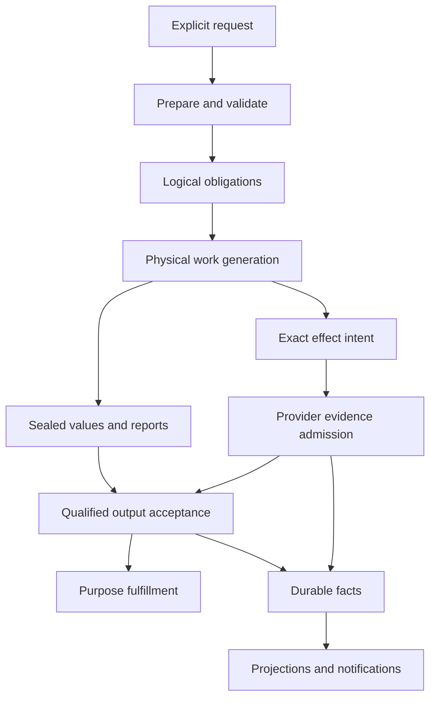
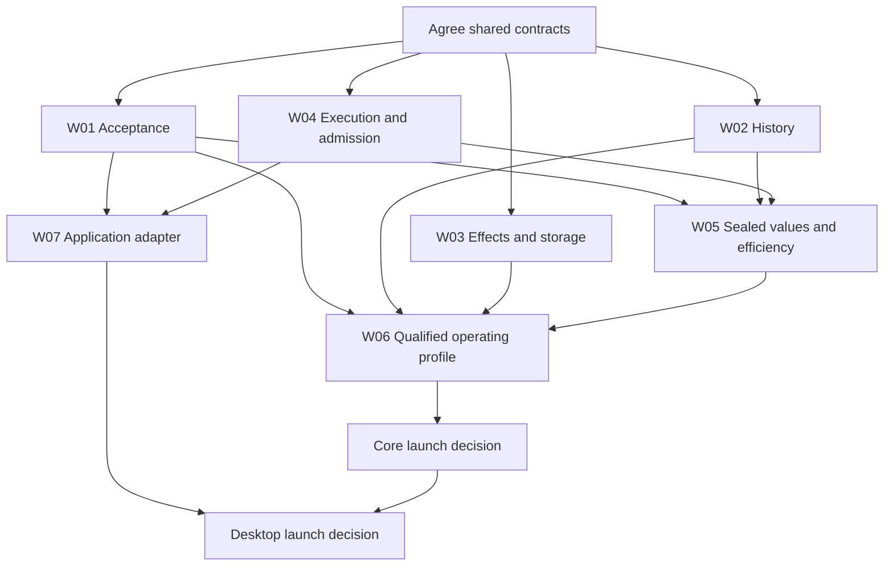

# Strategy Box: Operational Readiness — Architecture and Implementation Design

**Date:** 2026-11-27. **Status:** research and implementation design; candidate contracts and algorithms are prospective. **Implementation evidence:** Stratbox 0.26.0, commit `122db74ac1c3280a94580133d6e0ebfae61660dd`. **Scope:** core acceptance, history, ownership, execution, effects, persistence, performance, qualification and public SDK integration.

The recommended architecture completes the existing engine around explicit evidence and lifetime boundaries. One path should carry a request through preparation, admission, physical execution, qualified output acceptance, effect settlement and durable observation. The important changes are a candidate-preserving history representation, uniform acceptance and effect-evidence gates, generation-bound execution demand, recursively validated plans, and sealed owned values whose metadata can be reused without repeatedly inspecting their payloads. These changes address the verified defects while preserving the five current implementation owners.

This study makes the [functional model](strategy_box_operational_readiness_functional_model_2026-11-27.md) implementable through owner assignments, type sketches, algorithms, interruption cases and acceptance gates. Current behavior is identified explicitly. New names and code blocks describe candidate designs, rather than importable APIs. The proposed first persistent profile is one host with one coordinator and one journal writer; stronger sharing and platform guarantees require separate evidence. The design contains no new distributed scheduler, temporal database or per-publisher execution engine.

## Contents

1. Architecture decisions and responsibility map — the smallest coherent completion of the current engine.
2. Defects mapped to contracts and owners — changes justified by current behavior.
3. Output acceptance and obligation assessment — preserve reports, scientific results and member outcomes.
4. Historical candidates and resolved views — exact evidence, composition algorithms and portable persistence.
5. Sealed owned values and distinct identities — efficient reuse without trusting mutable content.
6. Physical generations, consumers and deadlines — sharing and cancellation with truthful lifetimes.
7. Recursive graph validation and atomic admission — one gate for prepared and expanded work.
8. Typed effect evidence and coherent durable state — acknowledgement, claims and recovery authority.
9. Destination fulfillment and process-lifetime guards — correct 304 reuse and crash-safe local coordination.
10. Journals, projections, retention and restore — sustainable persistent operation across independent owners.
11. Resource budgets and backpressure — bounded execution under realistic aggregate demand.
12. Scientific readiness and preflight — admit a concrete supported route.
13. SDK, application and provider boundaries — desktop adoption and portable future surfaces.
14. Clean cutover and persisted-state decisions — remove obsolete paths while preserving real evidence.
15. Implementation packages and dependency order — concrete changes and completion gates.
16. Behavioral and interruption verification — tests that establish the new guarantees.
17. Performance study and acceptance budgets — measured evidence, instrumentation and structural targets.
18. Operating-profile qualification — local persistence, shared processes and platform guarantees.
19. Release evidence and residual risks — the conditions for a defensible launch decision.
20. External sources — primary support for specific runtime, protocol and storage claims.

## 1. Architecture decisions and responsibility map

### 1.1. Retain the current five owners

| Code | Existing owner | Target responsibility | Boundary to preserve |
| --- | --- | --- | --- |
| OW01 | `src/stratbox/capabilities/` | Standard definitions, typed ports, obligations, preparation and checked graph structures. | No provider I/O or application scheduling in preparation. |
| OW02 | `src/stratbox/core/` | Admission, work generations, values, technical providers, effects, journals and recovery mechanisms. | No publisher formulas or desktop semantics in the coordinator. |
| OW03 | `src/stratbox/domains/` | Scientific methods, exact publisher rules, applicability and reviewed evidence scope. | No hidden download, save or notification inside interpretation. |
| OW04 | `src/stratbox/shared/` | Portable semantic values, history candidates, identity constituents, coverage and evidence descriptions. | No implicit provider access during pure transformations. |
| OW05 | `src/stratbox/sdk/` | Common discovery, preparation, invocation, submission and result access. | No independent execution or acceptance semantics. |

Within `core`, keep focused internal owners for admission, owned values, effect authority, observation and providers. Splitting a large implementation file is useful when it makes an invariant easier to own. A file split alone is not the architectural correction.

### 1.2. Maintain one route with separate evidence boundaries



The diagram describes responsibilities, not separately deployed services. A pure calculation can bypass the effect branch. A failed task can preserve a reported output without establishing an accepted analytical value. A durable effect can survive a later journal failure and requires a recovery observation through the same authority boundary.

### 1.3. Recommended architectural laws

| Code | Law | Implementation implication |
| --- | --- | --- |
| AR01 | Availability is distinct from acceptance. | Store output disposition and qualified origin explicitly. |
| AR02 | History is evidence plus a selected view. | Keep exact candidates after resolution, selection and serialization. |
| AR03 | A digest identifies content, not universal authority. | Separate payload identity, processing basis, accepted use and effect intent. |
| AR04 | Only active demand controls physical lifetime. | Attach consumers to an exact generation, never all historical work-key matches. |
| AR05 | Every admitted graph is structurally valid. | Reuse recursive validation at compiler, public plan and dynamic seams. |
| AR06 | External evidence must match its retained obligation. | Normalize and admit acknowledgement through one common effect boundary. |
| AR07 | Durable owners overrule stale local projections. | Refresh nonterminal state before authoritative decisions. |
| AR08 | Control transitions use bounded metadata. | Seal and measure payloads outside broad coordinator critical sections. |
| AR09 | Persistence claims include a recovery scope. | Retention, checkpoints, backups and provider guarantees are explicit. |
| AR10 | Scientific and platform readiness are scoped. | Admit only the route and environment supported by evidence. |

## 2. Defects mapped to contracts and owners

### 2.1. Correct the owning mechanism rather than every caller

| Code | Verified gap | Primary owners | Target correction |
| --- | --- | --- | --- |
| R01, R05 | Lost revision alternatives and equal-value provenance. | `shared/data/history.py`; `core/commands/observations.py`; `shared/data/selection.py`. | Normalize exact candidate bindings; preserve closure in merge and projection; resolve from candidates. |
| R02 | Failed or unknown diagnostics promoted by collection. | `core/execution/service.py`; `members.py`; `accepted_values.py`; `capabilities/model/contracts.py`. | Assess original logical obligations and explicit output dispositions; propagate the same assessment into projections. |
| R03 | Qualified 304 bypasses requested destination. | `core/commands/acquisition_http.py`; `artifacts.py`. | Route every readable acquired carrier through the same destination-fulfillment owner. |
| R04 | Reconciliation admits wrong intent/kind through aliases. | `core/commands/notifications.py`; `core/execution/service.py`; `effect_state.py`. | One typed evidence normalization and admission function for initial and later settlement. |
| R06 | Crashed writer leaves a directory sentinel. | `core/storage/filestore/local.py`; `core/storage/staging_ownership.py`. | Stable lock anchor with an OS-held lifetime; preserve mutation/proof uncertainty. |
| R07 | Completed result contaminates later deadline. | `core/execution/context.py`; `service.py`; `results.py`. | Exact work generation with active logical demand separate from result pins. |
| R08 | Nonterminal cache masks another service's confirmation. | `core/execution/service.py::lookup_effect`; `effect_state.py`. | Authoritative read-through before state-dependent decisions; state revision/claim contract for shared providers. |
| R09 | Nested prepared-plan cycle remains pending. | `core/execution/admission.py`; `service.py`; preparation/plan owners. | Recursive validation plus atomic publication of each expansion. |
| R10 | Repeated full value traversals incur material coordinator work. | `shared/data/values.py`; `shared/data/processing.py`; `core/execution/owned_values.py`; `accepted_values.py`. | Seal once, retain compact descriptors and incremental ownership accounting. |
| R11 | Desktop boundary targets an older core contract. | Current SDK and the application-side integration owner. | Direct SDK adapter and separate packaged application gate. |
| R12 | Persistent state has finite limits without a complete lifetime policy for every growing class. | Source-state, journal, effect and notification state owners. | Qualified retention classes, bounded maintenance and a validated recovery manifest. |

R01–R09 are the reproduced behavioral defects. R10 is measured performance evidence. R11 is a verified dependency/import boundary mismatch, without a complete Windows runtime audit. R12 is a persistent-operation design gap demonstrated by the current compaction scope, rather than a claim that a particular installation has already exhausted capacity.

### 2.2. Retain mechanisms whose meaning is already appropriate

Keep the current explicit command hierarchy, bounded admission counters, service lifecycle, result and staged ownership, journal-before-observer ordering, contiguous page validation, transactional outbox/projection updates, durable effect claims and cold receipt evidence. Their target role is sound. New internal contracts should replace inconsistent paths within these mechanisms, rather than create parallel authorities next to them.

## 3. Output acceptance and obligation assessment

### 3.1. Store the origin and disposition of an output

The existing `output.accepted` versus `output.reported` distinction should survive every composition. `PortContract.outcomes` can permit retrieval after failure, uncertainty or cancellation. That availability permission must not imply that the output fulfilled the producer's analytical promise.

Candidate internal records, with illustrative type names:

```python
@dataclass(frozen=True)
class OutputUse:
    value_id: str
    producer_run_id: str
    producer_scope_id: str
    producer_task_id: str
    producer_outcome: str
    disposition: Literal["accepted", "reported"]
    output_role: str
    acceptance_basis_id: str | None
    acceptance_fact_id: str | None


@dataclass(frozen=True)
class ObligationAssessment:
    obligation_id: str
    disposition: Literal[
        "fulfilled", "unfulfilled", "unknown", "excluded"
    ]
    eligible_outputs: tuple[OutputUse, ...]
    reports: tuple[OutputUse, ...]
    effect_ids: tuple[str, ...]
    findings: tuple[str, ...]
```

These records refine current accepted-value and member-result ownership. They should become one authoritative internal representation, not a second index beside an unchanged implicit acceptance path. The exact public shape can reuse existing `MemberOutcome` and report ports.

### 3.2. Use a pure assessment function

The common assessment input consists of the declared obligation, original selected member/scope, settled task outcomes, output uses, assessments, coverage and authoritative effect dispositions. Its output contains fulfillment and explanation. It performs no provider I/O.

Collection settlement should proceed as follows:

1. Start from the frozen selected membership and stable ordinals.
2. Obtain the member's logical producer/scope outcome, including independently completed earlier stages.
3. Separate accepted outputs from reports and currently readable retained references.
4. Require a qualifying accepted use for scientific/data fulfillment. A diagnostic consumer may consume a reported output as diagnostic evidence, preserving its original failed/unknown obligation.
5. Evaluate required effects using competent receipts, keeping unknown separate.
6. Apply all-required, eligible-subset or diagnostic policy explicitly.
7. Count eligible data members for data minimums, and publish every member's actual disposition.

Do not infer completion from successful reference resolution. A returned object only establishes availability. Do not infer stage availability merely from a command name and output name: the stage needs an accepted use with sufficient qualification. A retained original from an earlier successful task can remain available after interpretation fails.

### 3.3. Define report and subset semantics precisely

The ordinary analytical `items` output contains eligible values. An `outcomes` or report output preserves unsuccessful members and their diagnostics even when the aggregate data obligation fails. A diagnostic product can itself be accepted under a report-specific contract while continuing to describe failed work.

For an eligible-subset purpose, the aggregate can fulfill its declared subset contract. Its coverage record still shows the original selected membership and exclusions. A minimum of one accepted observation cannot be satisfied by one failed diagnostic. An optional call permits continuation; a later required obligation remains required.

### 3.4. Carry the rule into persistence and reuse

`accepted_values.py`, member construction, scope finalization and `core/observability/projections/source_state.py` should consume the same output-use meaning. An `output.reported` record cannot become a reusable scientific stage after projection or restoration simply because its payload resembles a dataset.

Preserve distinct accepted uses when the same payload serves several logical sources or purposes. Reuse its sealed bytes or rows, while keeping source authority, validation basis and effect obligations attached to the proper use.

## 4. Historical candidates and resolved views

### 4.1. Normalize the exact relation currently being lost

The current membership and revision structures do not consistently retain the complete member-to-exact-row relation. The recommended correction remains inside `shared/data/history.py` and the existing dataset contracts.

| Code | Candidate field group | Required meaning |
| --- | --- | --- |
| HC01 | Member content | Stable source/issue/asset/revision and exact content/semantic binding. |
| HC02 | Row payload table | Complete portable rows indexed by verified exact row identity. |
| HC03 | Candidate bindings | Candidate ID, member ID, coordinate ID, exact row ID and source ordinal. |
| HC04 | Ordering evidence | Qualified publication revision order or explicitly local observation order. |
| HC05 | Decisions | Selected and alternative candidate IDs, policy identity and unresolved findings. |
| HC06 | Active scope | Frozen admitted coordinates and the selection/view basis that produced them. |
| HC07 | Coverage and evidence horizon | Expected/missing membership and the retained vintage scope. |
| HC08 | Validation attachments | Competent certificates bound to exact rows and the applicable rule/method/build basis. |

`SourceDataset.rows` remains the materialized selected view. It is derived from the candidate ledger; it is not the only surviving carrier of history. Store exact row payloads once where identical, and keep small bindings for each original evidence occurrence. Flatten merged evidence rather than recursively embedding complete parent histories.

### 4.2. Distinguish content, occurrence and validation identities

A stable member content identity should not change merely because another validation certificate was added. Keep certificate attachments separate from content identity and choose those adequate for the requested validation goal.

A nominal issue can have several revisions. An ordering key therefore needs source, issue, a qualified revision discriminator and content binding, rather than only a list of issue labels. Publisher-provided revision evidence and local observation order have different qualifications.

An `A → B → A` observed content sequence can share the two A payloads while preserving the distinct observed transitions. Repeated checks of unchanged A do not automatically create new publisher revisions. Existing source-observation evidence should supply these relations; a new event-history service is unnecessary.

### 4.3. Make economic equality an explicit projection

The equality projection compares economic value and substantive qualifiers at a compatible grain. Exact source-row identity includes provenance. Avoid an expanding blacklist of arbitrary row fields: the semantic contract should classify relevant economic fields and recognized provenance fields, and treat unknown fields conservatively.

Two equal economic rows can therefore have different exact row IDs and candidate IDs. Coalescing display values preserves both bindings. An as-of view selects the exact candidate permitted by its cutoff, and validation checks that candidate's original witness. W3C PROV-DM supports separating the identity of entities and their derivation relations; the normalized ledger is the proposed local realization of that distinction. [E01]

### 4.4. Algorithms and invariants

**Candidate admission.** Validate grain, member coordinates, row shape, exact row identity, ordering evidence, certificate references and finite limits. Reject a conflicting payload under an existing identity. Original row ordinal preserves multiplicity when the source genuinely contains repeated rows.

**Strict merge.** Preserve the existing disjoint-visible-grain contract. Check scientific compatibility; union compatible member, row, candidate and evidence tables; retain each input's active scope and decisions; combine coverage with explicit source/asset/query scope. Overlapping visible observations require explicit revision resolution. Ordinary merge must never silently choose latest.

**Resolution.** For each active coordinate, select eligible candidates under the exact policy and evidence horizon. Equal economic values may coalesce while retaining all contributing candidate IDs. Conflicting values require competent order or remain ambiguous. Materialize rows from selected candidates; never associate one surviving row with all members sharing a coordinate.

**Projection.** Freeze the resulting coordinate set and record the query and view basis. Preserve candidates needed for those coordinates and the advertised later vintage operations. Re-resolution must respect active scope. A value-dependent filter is evaluated in its literal operation order; reapplying it to a different vintage is a new selection.

**Validation.** Check exact candidate-row witnesses and the new history's own requirements: semantics, policy, expected issues, coverage and unresolved conflicts. A per-issue certificate proves its original check, not the full aggregate.

Recompute view-specific coverage and findings for each resolution. A gap caused only by an earlier cutoff must not permanently contaminate a later view when retained evidence satisfies the later policy. Relevant source-level scientific limitations and genuinely missing evidence remain qualified at their own scope.

For compatible disjoint coordinate scopes, fixed policy and adequate retained evidence, require these semantic equivalences:

```text
resolve(merge(H1, H2), P)
    == merge(resolve(H1, P), resolve(H2, P))

resolve(resolve(H, P1), P2)
    == resolve(H, P2)
```

Equality here includes selected candidate provenance and coverage under the specified scope; caller-defined display ordering can remain distinct. A deliberate evidence-compaction operation can narrow the future query promise. Ordinary view resolution cannot do so silently.

### 4.5. Bound the whole evidence structure

Limits apply to members, candidates, unique row payload bytes, witness references, active coordinates and total portable size. One displayed row with a million historical alternatives consumes a million-candidate budget.

Index candidates by coordinate and admitted revision order. A straightforward implementation can resolve in a bounded grouping/sorting pass, with complexity determined by candidate count rather than repeated scans of every member for every row. Measure the actual implementation; avoid asserting a complexity improvement solely from a type redesign.

An inline normalized ledger is adequate for the initial correction. A later partitioned immutable representation can preserve the same semantics if volume requires it. External references require explicit hydration and availability handling before a pure resolver runs; pure resolution must not initiate hidden storage reads.

### 4.6. Portable persistence and scientific authority

Extend the existing canonical codec and dataset store to round-trip the new schema. Persist candidate identities, exact payloads, active scope, coverage and certificate references. Parser-native objects are optional acceleration or diagnostics, never the sole authority for restored history.

Restoration validates shape and identity, then resolves scientific authority from competent retained evidence or revalidation. A caller-constructed certificate does not grant authority. Unsupported lossy histories are rejected for claims they cannot support, or rebuilt from retained originals under an explicit new basis.

## 5. Sealed owned values and distinct identities

### 5.1. Give the existing value owner a compact descriptor

The current implementation repeatedly computes canonical fingerprints and value keys during input admission, sharing, accepted-use construction, output registration, result construction and memory accounting. Some of that work occurs while the coordinator is locked. The measured dataset traversal cost justifies replacing repeated inspection with a trusted owned descriptor.

Candidate internal shape:

```python
@dataclass(frozen=True)
class OwnedValueDescriptor:
    value_id: str
    exact_identity: str
    processing_identity: str | None
    type_id: str
    resident_bytes: int
    staged_references: tuple[object, ...]
    metadata_identity: str
```

The registry privately owns the payload, staged dependencies and lease counts. `value_id` is a service-owned handle whose authority comes from registry admission. A caller cannot create accepted authority by constructing a lookalike descriptor.

### 5.2. Seal external inputs under a bounded admission protocol

1. Inspect supported structure and a conservative footprint under depth, node and byte limits.
2. Reserve capacity for the actual simultaneous footprint, including the private snapshot while the caller's object still exists.
3. Detach the admitted value from mutable caller state.
4. Validate the detached structure and compute exact identity, required normalized processing identity and reachable resource metadata.
5. Recheck the reservation against the real measured footprint.
6. Atomically publish the owned descriptor and required pins, or release the provisional reservation.

A caller mutation during inspection cannot become accepted content through a stale estimate. The detached snapshot is the final authority for the admitted value. Enforce provisional reservations during bounded copying and normalization, including overlapping copies and temporary encoding structures. A final recheck alone cannot prevent exhaustion during allocation. Native shapes with unbounded allocation require a qualified copying/materialization contract, a suitable isolated limit or explicit rejection.

For worker outputs, keep provisional physical ownership while sealing and validating off the broad coordinator lock. Publish the accepted or reported owner before releasing the provisional owner. This closes the same lifetime gap as staged-byte sealing.

### 5.3. Recursive immutability is a real contract

A frozen dataclass can contain mutable dictionaries, object-array cells or a DataFrame. Memoization by Python object address, an arbitrary `.identity` property or `frozen=True` alone is insufficient.

For current mutable scientific carriers, retain a private sealed representation and supply a private working copy to methods that may mutate. A zero-copy read path is appropriate only where the actual payload and method contract enforce read-only access. Returning a mutable native object to a caller must not allow that caller to modify the registry's sealed content.

This protects ordinary in-process ownership and accidental mutation. It is not a sandbox against hostile Python code inside the same process. Strong isolation belongs to an admitted process/host boundary.

### 5.4. Compute each identity for its actual purpose

| Code | Identity | Include | Keep separate |
| --- | --- | --- | --- |
| IK01 | Byte identity | Complete length and digest. | Destination, acquisition time and logical use. |
| IK02 | Exact value identity | Canonical typed content and relevant semantic/provenance fields. | Ownership handles and mutable runtime caches. |
| IK03 | Processing basis | Consumed input identities, exact method/settings/parameters/reference/build basis. | Proven irrelevant polling timestamps or runtime handles. |
| IK04 | Accepted use | Producer/scope, contract, source use, qualification and acceptance fact. | Other uses of equal content. |
| IK05 | Work key | Eligible computational basis, provider and observation/shareability constraints. | A physical generation ID. |
| IK06 | Effect intent | Exact external promise, provider/destination/payload/preconditions and occurrence. | Unrelated code or display changes that would spuriously create a new effect. |
| IK07 | State revision | Mutable authority record's ordering within its ledger identity. | Product release versions and publisher revisions. |

The repository retains one package/build release basis. Runtime generations, source revisions, state revisions and portable encoding identifiers describe different facts; they are not independent product release schedules.

A normalized processing basis may omit a native object only when the method contract establishes that the retained semantic representation contains everything the method consumes. Otherwise, normalization would change computational equivalence.

### 5.5. Replace payload traversal in control paths

After sealing, attachment of another logical consumer should use descriptors, accepted-use records and pins. Ownership changes update stored byte counters and reachable-resource indexes. Status queries use bounded summaries. Do not rescan every live value to decide each dispatch or deep-copy every payload to construct a status snapshot.

A streaming canonical encoder/hasher can eliminate full temporary JSON trees and hexadecimal byte representations created solely for hashing. It must preserve the chosen typed distinctions: decimal values, missingness, ordering, key types, semantic metadata and exact row provenance. Changing canonical encoding requires an explicit identity-format cutover and rebuild policy.

The meaningful target is one exact identity pass per sealed representation and only the additional distinct identity passes demanded by real contracts. Certificate row witnesses can reuse verified row hashes from admission. Scientific checks, output materialization and a newly mutated value remain real work; the design does not promise that all future transformations are constant time.

### 5.6. Preserve durable acceptance while improving speed

Move large copying, hashing, canonicalization and provider access out of the broad coordinator critical section through reservation and recheck. Keep acceptance publication ordered after the required durable fact succeeds.

If journal I/O becomes a measured latency bottleneck, a bounded dedicated append owner can assign ordered acknowledgements. An output stays pending acceptance until its append is acknowledged under the configured guarantee. A fire-and-forget queue that returns success before persistence would weaken recovery. The initial identity correction does not require that additional journal redesign.

## 6. Physical generations, consumers and deadlines

### 6.1. Separate current work from retained results

Candidate internal records:

```python
@dataclass
class LogicalDemand:
    run_id: str
    task_id: str
    generation_id: str
    deadline: float | None
    cancelled: bool
    obligation_id: str


@dataclass
class WorkGeneration:
    generation_id: str
    work_key: str
    state: str
    demands: dict[tuple[str, str], LogicalDemand]
    future: object
    physical_budget: object
    attempt_deadline: float | None
```

The join index maps a shareability key to a live, joinable generation; a separate registry by generation ID owns every live physical execution. Completed-result ownership and completed-value reuse belong to separate indexes. When a later call requires new physical execution, it receives a new generation even if its work key is identical.

Mark a generation non-joinable before beginning physical cancellation or final settlement. A late consumer cannot revive a cancellation signal already delivered to the worker. If an eligible replacement generation starts with the same key, preserve the earlier generation's pins, claims and effect tracking until actual settlement. Replacement attempts remain subject to the command's replay and effect rules.

### 6.2. Attach demand to an exact generation

Under admission, validate the logical contract and actual input descriptors. Determine whether a live generation is compatible with the requested method, observation scope, providers and operational conditions. Attach the new demand and acquire its pins atomically. Record the exact generation in sharing facts.

At settlement, assess each consumer independently against its own contract. Remove its active demand when it no longer needs work. Keeping a `RunResult` open retains values, not execution demand. `CommandContext` obtains remaining time from its generation's active demands, never by scanning all runs with a matching key.

### 6.3. Deadline calculation is explicit and bounded

Within a generation, active consumers retain their own monotonic deadlines. Expiring one demand does not expire another. The physical opportunity can continue while a compatible active demand remains, subject to the command/provider's actual attempt deadline and service limits.

A legitimate live consumer with no logical deadline is different from a completed result with no deadline. A provider call issued with a fixed timeout cannot be extended retroactively by a late join. The late consumer either accepts that remaining opportunity, waits for an eligible later generation within its own budget, or receives an explicit incompatibility outcome.

A provider-specific timeout or resource cap is a real part of the physical attempt. Avoid making the first consumer's accidental lifetime the implicit lifetime of all shared work.

### 6.4. Cancellation waits for actual physical settlement where required

Cancellation prevents unstarted work and detaches logical demand according to the contract. When no active consumer remains, signal cooperative physical cancellation. Keep physical claims, readable input pins and effect tracking until the future actually settles.

Python 3.12 futures cannot cancel an already running callable, and executor shutdown distinguishes pending work from running work. [E02] Consequently, a timeout indication cannot be treated as proof that an external mutation stopped. Stronger termination requires a qualified isolated worker/provider and a recovery contract for effects at the interruption boundary.

The public result must distinguish cancellation requested, deadline expired, physical settlement and effect certainty. If physical evidence arrives after a logical deadline, retain that evidence with its actual timing; do not erase it or silently turn the timed-out purpose into ordinary on-time success.

## 7. Recursive graph validation and atomic admission

### 7.1. Use one validator for every graph entrance

Preparation and runtime admission should call the same pure structural validator on root graphs, directly supplied prepared plans, nested templates and bound expansion slices. The validator respects hierarchical namespaces and explicit captures.

| Code | Check | Required property |
| --- | --- | --- |
| GV01 | Task and scope identities | Unique within their namespace; valid parent relations. |
| GV02 | Dependencies | Known and acyclic, including edges implied by value references and guards. |
| GV03 | Ports and references | Existing producer/port, compatible role and valid capture. |
| GV04 | Obligations | Required outputs, checks and effects refer to valid tasks/scopes. |
| GV05 | Templates and branches | Valid parameters, captures, outputs, depth and internal graph. |
| GV06 | Expansion limits | Bounded node, object, depth, encoded-byte and fan-out limits. |
| GV07 | Resource feasibility | Valid claims that can fit the admitted provider/service capacities. |
| GV08 | Iteration | Explicit scientific or structural iteration bound; no ordinary dependency cycle. |

Python's `TopologicalSorter.prepare()` checks a supplied graph for cycles. [E03] Stratbox must supply the complete relevant dependency graph and reject the invalid plan as a whole; accepting the acyclic prefix of an invalid public plan would permit effects before admission was actually justified.

Mutually exclusive branch internals should be validated within their own declared hierarchy. A naive union of branch-local IDs can create false cycles. Cross-boundary captures should refer to declared template inputs and already represented parent dependencies, rather than arbitrary hidden ancestor lookups.

### 7.2. Validate without unbounded copying or partial insertion

Use the existing admission owner for a bounded inspection/reservation/snapshot/validation sequence. A malformed static plan fails before `run.admitted` and before effects start. Ordinary caller validation errors should leave unrelated admitted runs usable.

For dynamic expansion:

1. Under the coordinator lock, capture parent state, immutable bindings, generation identity and provisional capacity.
2. Outside the lock, bind and validate the finite slice using the same graph rules.
3. Under the lock, recheck parent version, cancellation, service state and capacity.
4. Publish all tasks, scopes, obligations and pins atomically, or publish none.
5. Release every provisional owner and reservation on rejection or cancellation.

An expansion error becomes a structured parent failure with retained diagnostics. It does not strand a partially inserted subgraph. A preparation worker must not synchronously wait for child work that requires the same exhausted worker capacity.

### 7.3. Verify the complete rejection behavior

The R09 regression case should assert more than an exception: zero child effects, no leaked counters/pins, no permanently pending nodes, a useful cycle diagnostic and continued usability of the service for another valid run. Include cycles introduced through parameters/guards and captures, not only explicit dependency tuples.

## 8. Typed effect evidence and coherent durable state

### 8.1. Normalize provider replies once, then admit them

The initial notification path and generic reconciliation currently interpret identity fields differently. The target is a provider adapter that normalizes native evidence, followed by one common admission function against the retained intent.

Candidate semantic envelope:

```python
@dataclass(frozen=True)
class EffectEvidence:
    effect_id: str
    effect_kind: str
    provider_scope: str
    intent_identity: str
    outcome: str
    evidence_kind: str
    evidence_identity: str
    observed_at: str
    provider_revision: str | None = None
    acknowledgement_level: str | None = None
```

The actual evidence body is typed and bounded by the provider contract. The common admission function receives the retained intent, required guarantee and normalized evidence; it returns a qualified confirmation, rejection, unresolved observation or conflict. It owns the transition into durable effect authority.

Initial delivery, implicit retry reconciliation and explicit reconciliation call this same function. Adapters must reject conflicting aliases such as different `effect_id` and `intent_id`; choosing the convenient alias is insufficient. Kind, provider/channel scope, destination or recipient scope, payload/intent identity and applicable preconditions all remain part of admission.

A competent adapter can establish some bindings through its actual request/response association; a provider need not echo every field literally. Merely copying expected identifiers into an otherwise unbound `status=confirmed` reply does not establish that association.

### 8.2. Evidence has different strengths

| Code | Evidence class | Can establish | Cannot establish by itself |
| --- | --- | --- | --- |
| EE01 | Direct identified acknowledgement | The provider's stated acceptance/completion level for the matching action. | A stronger delivery or human-reading guarantee. |
| EE02 | Identified action lookup | The provider's recorded outcome for the retained intent under its lookup guarantees. | Non-occurrence from an eventually consistent missing result. |
| EE03 | Verified current postcondition | Current bytes or another inspectable state match a declared ensure-state obligation. | Which actor caused an earlier transition. |
| EE04 | Verified causal transition | The provider proves the identified requested mutation under its preconditions. | Unrelated effects or later persistence forever. |
| EE05 | Unqualified or contradictory reply | Diagnostic evidence and a reason for unresolved/conflict state. | Confirmation authority. |

A storage receipt and a notification handoff use the same admission discipline but different sufficient-evidence contracts. A reply mismatch leaves the pending notification or effect intact. A pure calculation has no reason to participate in this external-effect protocol.

### 8.3. Preserve atomic claims and add coherent reads

`FileEffectState.begin()` already uses an atomic SQLite claim. Keep that mechanism. The immediate R08 correction is authoritative read-through for nonterminal cached receipts before retry, reconciliation or uncertainty decisions. Confirmed immutable receipts can be cached within their stable ledger scope, while present availability remains a separate provider observation.

For providers that advertise shared-process use, refine their atomic contract around the following meanings:

```text
read(effect_id, minimum_state_revision)
claim(intent, expected_state_revision)
settle(effect_id, claim_token, evidence, expected_state_revision)
```

The names are illustrative. The required properties are a provider-owned state revision, an atomic claim result containing current authority, a settlement token and compare-and-set or equivalent transaction semantics. A stale local cache cannot authorize a second mutation. TTL expiration is a performance policy, not a correctness proof.

SQLite serializes writers; a read transaction can continue seeing an earlier snapshot, and `BEGIN IMMEDIATE` can fail with `SQLITE_BUSY`. [E04, E05] Provider code must therefore use bounded transaction scopes, defined conflict handling and a fresh authoritative read when its decision requires newer state. Holding a long-lived read transaction and consulting it repeatedly does not provide freshness.

### 8.4. Scope claims and fencing honestly

A ledger claim token can prevent a stale worker from overwriting newer ledger state. It cannot stop a paused process from later mutating an unrelated external destination unless that destination checks a fencing token or equivalent conditional revision at the mutation boundary.

Consequently, distinguish local settlement fencing, provider-enforced conditional mutation and provider idempotency. Do not introduce automatic lease takeover that repeats an unknown action solely because its owner timed out. A new attempt must follow the command's replay rules and the actual provider guarantee.

HTTP's restriction on automatic non-idempotent retry illustrates the same constraint: retry requires an adequate semantic or non-application basis. [E06] The more general effect protocol is a proposed application of that principle, not a claim that HTTP semantics alone implement all providers.

### 8.5. Keep durable authority across journal failures

Effect receipt persistence and journal append are distinct commits. If the provider completed an effect but its receipt is missing, reconcile the persisted intent. If the receipt survived but the journal event did not, retain the receipt and publish a new qualified reconciliation fact.

That fact can restore the external-effect obligation. It cannot recreate missing scientific acceptance merely because a file exists. Scientific `output.accepted` requires surviving competent evidence or a fresh acceptance step under the applicable contract.

The outbox retires an intent only after matching sufficient confirmation is durably admitted. Explicit abandonment can close requested work as abandoned or unresolved; it must preserve identity evidence or a closed namespace marker while the original occurrence could otherwise be retried. Abandonment proves neither rejection nor delivery.

## 9. Destination fulfillment and process-lifetime guards

### 9.1. Route 200 and 304 through one storage owner

The `material_receive` correction should be structural:

```text
acquire a qualified readable carrier
    -> fulfill the requested retention destination
    -> return the carrier/reference and its actual receipt
```

Every supported carrier, including an immutable reference obtained through 304 reuse, enters the existing artifact-commit owner. That owner determines the canonical destination, provider scope, content identity and effect preconditions. It can reuse an exactly matching fulfilled obligation or stream the verified retained bytes to a new destination.

HTTP 304 concerns use of an applicable stored representation and contains no body; it establishes no local output destination. [E06, E07] The new destination therefore has its own receipt, while acquisition evidence records the current source observation. Neither receipt rewrites the historical source or retention evidence of the other.

An exact-match shortcut can exist inside the common fulfillment owner after it checks the whole obligation. Keeping a separate acquisition shortcut that returns any old reference would preserve the ambiguity behind R03.

### 9.2. Separate historical confirmation from current availability

A confirmed receipt records what was established at its effect boundary. A later missing or externally changed destination does not erase that historical fact. A current ensure-content request needs a present availability check appropriate to its contract.

If the destination was subsequently lost, an explicitly admitted repair uses a new fulfillment occurrence and current preconditions. It does not reuse a historical confirmed effect ID as permission to pretend that the new mutation already happened. Reconciliation of the original unknown attempt and recreation after later loss are distinct operations.

Changing a destination, required durability level or precondition can change the effect obligation while preserving the product's byte identity. The same physical value can therefore feed several independently accountable destination effects.

### 9.3. Replace existence-based ownership with a held OS lock

The current `LocalFileStore.guard_directory` creates an exclusive sentinel whose pathname survives abrupt process death. Replace that ownership test with an exclusive OS lock held by an open handle over a stable anchor.

Keep the shared anchor pathname and inode stable while participants may have it open. Normal release unlocks and closes the handle; it does not delete and recreate the anchor. Otherwise, an old waiter can hold one inode while another writer locks a new inode at the same pathname.

Linux `flock` is associated with an open file description and is released when the relevant descriptors are closed; its advisory and network-filesystem behavior requires qualification. [E08] Windows `LockFileEx` locks are released after handle closure or process termination, potentially with delay. [E09] The adapter should expose bounded busy/retry behavior rather than assume instantaneous reacquisition.

A small common locking primitive can serve both directory mutation guards and existing staged-directory ownership. Their cleanup rules remain distinct: qualified abandoned private stage directories can be removed; a shared coordination anchor stays stable.

### 9.4. Preserve the actual conditional-mutation guarantee

The guard coordinates participating writers. It does not automatically provide atomic compare-and-swap against arbitrary outside programs modifying the same file. Qualify the provider's conditional-write promise by its writer model and filesystem capabilities.

Within the admitted scope, check the expected destination revision and perform the mutation while holding the appropriate guard. Unsupported required guarantees fail before mutation. Lock contention reports busy or a bounded rejection; it does not imply source corruption or a completed effect.

A process kill after mutation but before durable transition evidence can still leave an unknown outcome. Source absence alone is insufficient proof of a move or delete. The lock correction improves recovery availability; it does not eliminate the mutation/proof window or establish universal power-loss durability.

## 10. Journals, projections, retention and restore

### 10.1. Preserve the existing cross-owner transaction boundaries

The journal records ordered facts. The source-state provider commits projection rows and its applied watermark atomically. Notification state commits subscription coverage and prepared intents together. Journal acknowledgement follows those commits. Effect state independently preserves intents and receipts.

| Code | Interruption cut | Recovery rule |
| --- | --- | --- |
| CW01 | Before durable effect claim | No action is authorized; admit a first attempt if still required. |
| CW02 | After claim, before known provider outcome | Preserve unknown; inspect or apply a sufficient replay guarantee. |
| CW03 | Provider completed, receipt persistence uncertain | Reconcile the retained intent against actual provider evidence. |
| CW04 | Receipt durable, journal fact absent | Preserve effect authority and record a new qualified reconciliation fact. |
| CW05 | Journal fact durable, projection behind | Replay a contiguous covered suffix. |
| CW06 | Projection committed, journal acknowledgement absent | Idempotent replay/acknowledgement under the committed watermark. |
| CW07 | Notification intents/cursor committed, acknowledgement absent | Recover the journal cursor through committed outbox coverage. |
| CW08 | Archive body written, index not updated | Preserve authoritative prior state; collect only a proven unreferenced object. |
| CW09 | Prune floor durable, physical deletion incomplete | Resume deletion from the committed floor without widening the claim. |
| CW10 | Recovery package lacks a required artifact or authority segment | Report incomplete restoration; do not synthesize lost acceptance. |

These rules deliberately avoid a fictitious transaction across an external provider, several databases and ordinary files. Each owner commits its own truth and exposes enough evidence for bounded reconciliation.

### 10.2. A current projection horizon is not a historical query

`minimum_applied_through` requests a current projection at least as fresh as a watermark. A projection applied through 150 can satisfy a minimum of 100. It does not thereby represent state as of sequence 100.

Publisher vintage order, locally observed publication order, journal acceptance order and projection freshness are separate axes. Exact historical projection snapshots require an explicit snapshot/history capability. A current-state index should report its actual horizon and scope rather than imply that capability.

### 10.3. Finish the retention policy for growing state

Current `SQLiteSourceState.compact()` prunes eligible ephemeral outputs; observations, persistent outputs, authority and retention links survive. This is safe but insufficient to keep indefinite polling within a fixed capacity. A small bounded verification with three unchanged observations reached the record limit on the fourth; compaction removed none, and the checkpoint/consumer remained behind the rejected page. The capacity protection worked as intended.

Target maintenance should classify all growth:

| Code | State | Maintenance condition |
| --- | --- | --- |
| MC01 | Live runs, values and readers | Release by exact ownership; enforce admission before further growth. |
| MC02 | Unacknowledged facts | Preserve for every registered protected consumer. |
| MC03 | Consumed journal history | Archive or prune only after replay/rebuild obligations permit it. |
| MC04 | Current source and accepted bases | Retain enough exact accepted context and artifacts for advertised reuse. |
| MC05 | Older source observations and candidates | Apply a declared hot/cold horizon; preserve advertised vintage and audit scope. |
| MC06 | Certificate/source/effect authority links | Remove only after all surviving references and recovery obligations are disposed of. |
| MC07 | Unknown effects and pending notifications | Resolve or close their retry namespace explicitly; never evict to simulate a never-attempted action. |
| MC08 | Terminal duplicate-suppression identities | Retain through the promised retry horizon or archive exact evidence. |

Repeated unchanged source checks can be represented economically in a current projection, but any promised historical check evidence still needs a declared retention location or horizon. “Unchanged” does not mean that all observation facts are interchangeable.

Use bounded pages, keyset continuation, small transactions and resumable checkpoints. Avoid a single unbounded JSON state object or a maintenance action that first materializes every historical record in memory. Protect a settlement/recovery reserve when storage is near capacity; stop new work before removing evidence still required by active obligations.

### 10.4. Extend the existing projection export into a recovery package

`SQLiteSourceState.export_checkpoint()` already uses the SQLite backup API and an integrity check. Existing tests restore its projection and certificate authority after journal pruning. Preserve that functionality.

The missing wider guarantee is a qualified **cross-owner recovery package**, consisting of an identified manifest and a coherent or explicitly recoverable cut across the projection, effect ledger, notification state, journal suffix and retained artifacts. The SQLite backup API supports a consistent database snapshot, including incremental copying; it does not make independent databases and artifact directories one atomic backup. [E10]

| Code | Manifest element | Recovery purpose |
| --- | --- | --- |
| BK01 | Package/format/build identity | Admit the correct reader and interpretation basis. |
| BK02 | Ledger and journal stream identities | Prevent mixing unrelated authority namespaces. |
| BK03 | Owner watermarks and retained floors | Identify required replay suffixes and consumer coverage. |
| BK04 | Snapshot content identities | Verify the actual exported state. |
| BK05 | Retained artifact/evidence dependencies | Establish which immutable content and cold receipts must survive. |
| BK06 | Pending and unknown obligations | Preserve the work that cannot be inferred complete. |
| BK07 | Provider scope and relocation rules | Distinguish restored local availability from historical receipts at an old destination. |
| BK08 | Completeness and restore policy | State the exact recovered scope and unsupported guarantees. |

For the first profile, a coordinated admission pause and drain to a stable local cut is the simplest strong procedure. Persist unresolved external effects as unresolved, export state, identify the required immutable content and journal suffix, validate the package, then resume. A non-quiesced procedure requires pinned watermarks and a proven recovery relation between each owner; it is a later optimization unless required by the actual host.

Restoration occurs into a controlled ownership scope with the old writer stopped or otherwise excluded. Verify package identities and dependencies before advertising reusable state. A copied ledger must not become a competing live owner of the same local namespace by accident. Relocated content can be reverified under a new provider scope while historical effect receipts retain their original meaning.

A consistent package is consistent at its cut. External actions may have occurred afterward. If the newer authoritative tail is unavailable, absence of an effect identity in the restored ledger cannot mean never attempted. Recover that tail or obtain sufficient provider reconciliation before automatic replay. Otherwise mark the affected prior occurrence namespace unresolved or closed to automatic replay. Stopping the old writer and validating package hashes do not restore knowledge lost after the cut, and assigning a new ID cannot make repetition of the old uncertain action safe.

The existing export holds its provider lock for the backup call. Passing a page count to the backup API bounds copying chunks, but does not itself create a resumable public maintenance operation or eliminate the overall provider pause. Measure that pause before choosing a more elaborate export path.

### 10.5. Account for physical storage beyond logical payloads

Track database, index, WAL/rollback-journal, cold archive, artifact and temporary bytes separately from encoded-record limits. SQLite WAL needs same-host shared-memory coordination, permits one writer, and can grow when readers obstruct checkpoint completion. [E11] A remote-looking filesystem path or long-lived cursor can therefore change the operating guarantee even when logical payload counts remain small.

Choose bounded foreground maintenance and an explicit deeper maintenance window when needed. SQLite's locking and flush assumptions depend on the operating environment; process-crash evidence and power-loss durability should be stated separately. [E12]

## 11. Resource budgets and backpressure

### 11.1. Distinguish capacity, cumulative work and durable footprint

| Code | Budget | Examples | Release/reset condition |
| --- | --- | --- | --- |
| RB01 | Live service capacity | Running tasks, admitted nodes, resident values, open readers and active staged bytes. | Exact owner or physical work releases the capacity. |
| RB02 | Per-run cumulative work | Transferred, decoded, temporary-written and output bytes; expanded nodes and iterations. | New admitted run/occurrence under policy. |
| RB03 | Persistent footprint | Journal segments, SQLite files, cold receipts, history evidence and retained artifacts. | Qualified archive/prune/retirement policy. |
| RB04 | External provider concurrency | HTTP host limits, solver slots, store writers and channel limits. | Actual physical request settles. |
| RB05 | Recovery reserve | Space and bounded queue capacity for final receipts, uncertainty and checkpoint progress. | Explicit settlement/maintenance policy. |

Sharing one HTTP transfer should charge one actual physical transfer, while retaining each consumer's logical obligations. Delivering the same bytes to two destinations remains two effects. Avoid inheriting every budget implicitly from the first logical task that created a generation.

The service controls managed ownership and admitted working sets. It cannot impose a hard process-RSS ceiling on unrelated caller objects or arbitrary native allocations in the same process. A profile that promises stronger memory isolation needs an actual OS/process boundary; otherwise its guarantee is stated in terms of the qualified carriers, decoders and managed budgets.

### 11.2. Prevent aggregate staging deadlocks

A bounded map can still fill staging with completed members while a final archive waits for all members. If no member can release until the archive starts, merely blocking the next producer creates a capacity deadlock.

Preparation/admission must choose a feasible aggregate strategy: reserve a bounded total for a known finite set, allow an explicitly streaming/folding consumer to release completed members, retain intermediate content under a requested policy, or reject a request whose required live set cannot fit. Do not silently invent persistence effects or weaken the archive membership promise to escape the limit.

Archive extraction and table decoding need their own row/cell, uncompressed byte, member-count and seekability/materialization limits. A streamed input does not imply a constant-memory decoder. The admission contract should expose required materialization before the large work is committed.

### 11.3. Keep coordinator progress independent of large payloads

Large sealing and scientific work run outside control transitions under their resource claims. Status and cancellation requests operate on bounded records. Queue fairness should follow actual resource categories and prevent one expanding map from monopolizing every admissible node indefinitely.

A scientifically coupled model remains one declared coupled unit where its method requires that closure. Parallelism must not partition it into invalid independent calculations. Performance policy follows action semantics; it cannot infer independence from separate columns alone.

## 12. Scientific readiness and preflight

### 12.1. Derive readiness rather than author another capability catalog

Preparation can derive a readiness assessment from the selected immutable domain record, actual inputs, recognized layout, method implementation and qualification evidence. The assessment includes source/layout/period/subject scope, required stage, scientific basis, provider needs and unresolved conditions.

A proposed readiness record is evidence attached to the existing catalog/binding, not a separately maintained matrix that can drift from it. Human-readable discovery can show declared support; final admission checks the actual selected entrance and evidence.

| Code | Admission moment | What can be established |
| --- | --- | --- |
| PF01 | Before acquisition | Known goal applicability, configured providers, selection shape and declared methods. |
| PF02 | After material inspection | Actual format, source attribution, layout/revision candidate and physical limits. |
| PF03 | Before semantic use | Exact method/settings, source agreement, reference semantics and competent input evidence. |
| PF04 | Before calculation/publication | Full operand closure, comparability, coverage policy and required effects. |
| PF05 | At acceptance | Actual output qualification and fulfillment, including unresolved findings. |

Preflight should not pretend to know a downloaded layout before seeing it. Unknown input-dependent conditions are explicit deferred checks. A successful preflight means the request can be attempted under stated conditions, not that the eventual source or calculation is guaranteed to succeed.

### 12.2. Qualify stages independently

Physical originals and source-faithful DBF export can be useful where an economic model is unreviewed. Published fields, reviewed observations, derived metrics and coherent products have different acceptance requirements.

The initial operating profile should select exact useful routes and representative publisher fixtures. Scientific gaps such as unreviewed financial formulas or document layouts remain structured limitations. Generic readers, synthetic shapes and catalog entries cannot fill them.

Keep reference-period interpretation, subject namespaces, temporal aggregation, territorial comparability and stock/flow meaning in scientific contracts. A changed reference or method can invalidate the relevant processing basis even when source bytes remain unchanged.

### 12.3. Verification combines independent kinds of evidence

Synthetic and generated fixtures establish structural boundaries, resource limits and failure behavior. Real publisher material establishes layout and economic interpretation within its reviewed scope. A live endpoint check establishes access and protocol behavior at an observed time. Packaged platform exercises establish installation and provider integration.

The qualification record should say which kind of evidence supports which promise. A temporarily inaccessible live source does not erase an offline interpretation result, while an offline fixture cannot establish today's endpoint availability.

## 13. SDK, application and provider boundaries

### 13.1. Use one public execution facade

The target application adapter uses current discovery, preparation, invocation/submission, status and result lifecycle contracts. It supplies explicit goals, selected membership, provider configuration and presentation choices. It does not call retired domain utilities or construct another internal scheduler for the same command graph.

The application owns user work items and recurring schedules. A recurring occurrence freezes intent, submits finite core work, records its run references and applies an explicit overlap policy. The library owns the meaning of accepted data and effects. An application completion flag cannot override a core member's failure or unknown effect.

### 13.2. Migrate the desktop as one coherent adapter change

The inspected Windows boundary declares core 0.2.1 and depends on removed core namespaces. The target is to update its dependency and replace those calls with current standard actions through the SDK in the same migration. Restoring old core paths would create a compatibility layer that the target model does not require.

Application requirements for the migration are:

1. One intended service/provider lifecycle with explicit shutdown and draining.
2. Typed request construction from forms, source selection and user goals.
3. Progress projection from bounded snapshots and journal facts, with live observation loss recoverable through replay where promised.
4. Faithful display of selected membership, partial coverage, diagnostics and effect certainty.
5. Result ownership retained until display/consumer pins or durable retention make release safe.
6. Artifact opening through validated references and current availability checks.
7. Responsive cancellation and closure without blocking the GUI event loop on unbounded work.

A notebook can use the same core contract with a shorter lifecycle. Neither entry path should require the other to supply scientific semantics.

### 13.3. Design portable application contracts for future Android

Keep request/result data, use-case logic and presentation meaning independent of Qt, native paths and Python object handles. Platform adapters supply file access, environment activation, credentials, delivery and lifecycle facilities. AppDock remains an external boundary whose internal implementation does not move into the core.

Future Android can use a qualified local runtime or a remote execution host. The neutral boundary should support exact capability/target identities, portable selections, typed outcomes, paged progress and durable artifact references. Session-owned temporary handles stay within their lifetime boundary.

Do not choose a distributed protocol merely to demonstrate portability. First make the in-process SDK contract precise and serializable where an actual consumer needs serialization. Backend availability and platform constraints determine which future mobile execution mode is practical.

### 13.4. Provider capabilities are operational guarantees

A provider profile should state stream/seek/materialization support, conditional writes, durability level, idempotency/lookup strength, concurrency model, cancellation behavior and pagination. A boolean `supports_storage` cannot describe these differences.

Preparation checks required capabilities against the chosen provider. Unsupported guarantees fail before effects. Provider-specific limitations remain outside domain formulas, while their consequences appear in the result's operational qualification.

## 14. Clean cutover and persisted-state decisions

### 14.1. Replace mechanisms completely within each package

Backward compatibility is not a reason to retain an obsolete execution, history or application path. After a package is implemented, all direct, composed and persistence entrances should use its single new owner. Remove transitional duplicate maps or normalizers after their consumers migrate.

Changing callable contracts or canonical encoding requires updating their current documentation, examples, tests and package basis as part of implementation. This research itself modifies no product code or maintained product documentation.

### 14.2. Classify existing persistent state by recoverable meaning

| Code | Existing state | Cutover decision |
| --- | --- | --- |
| CU01 | Derived cache/projection fully rebuildable from retained authoritative facts | Rebuild under the new format and validate the result. |
| CU02 | History whose exact member-to-row bindings can be proved lossless | Perform a verified one-time conversion with exact value/evidence checks. |
| CU03 | Usable current history view without proved complete alternatives | Preserve only an explicitly narrowed view; reject unsupported vintage claims. |
| CU04 | Lost candidate payloads with competent originals still retained | Reinterpret/revalidate under a new exact basis. |
| CU05 | History without sufficient reconstruction evidence | Report unsupported scope or require new inputs; never infer rows from hashes or labels. |
| CU06 | Unknown or confirmed external effect authority | Preserve identity and meaning through a verified conversion or an explicit closed namespace; never silently reset to unseen. |
| CU07 | Old application references to removed core interfaces | Replace with current SDK adapters and explicit data conversion where justified. |

An old schema does not itself prove information loss. Absence of alternatives does not prove that no alternatives existed. Promotion requires a proof of exact bindings, not a convenient assumption. A finite one-time converter is compatible with a clean target; a permanent parallel runtime is unnecessary.

### 14.3. Preserve intent across code changes

A new build can change computational reuse eligibility. It should not automatically create a new external effect occurrence for the same already performed obligation. Define effect identities from the actual semantic intent and occurrence; preserve prior evidence when replaying or restoring it.

If a guarantee or intent meaning changes, handle that change explicitly. A storage repair at a lost destination can be a new authorized occurrence. A notification that may already have been handed off cannot be made safe by changing its ID and calling it new.

### 14.4. Cut over with a bounded recovery point

Pause new admissions for the affected persistent profile, settle or record unknown work, create and validate the required recovery package, perform the chosen conversion/rebuild, and verify the new core against the retained fixtures and obligations. Resume through the current SDK path. Keep old readers or converters only for the finite recovery operation they actually serve.

## 15. Implementation packages and dependency order

### 15.1. Keep each package independently reviewable

| Code | Package and primary owners | Concrete work | Exit condition |
| --- | --- | --- | --- |
| W01 | Acceptance: `capabilities/model/contracts.py`; execution members, accepted values and scope settlement. | Explicit accepted/reported origin; pure obligation assessment; consistent collection minimums and stage projection. | R02 fails closed; diagnostics and qualified subsets remain usable in every entry path. |
| W02 | History: shared history/selection/values; observation commands; codec/dataset stores. | Exact candidate ledger, strict merge preservation, revision-key ordering, active scope and witness validation. | R01/R05 and reversible-view/round-trip laws pass; lossy persisted inputs cannot acquire invented evidence. |
| W03 | Effects/storage: acquisition, artifacts, notifications, effect state and local filestore. | Common destination fulfillment; one evidence admission path; refreshed durable lookup; held OS guard; precise recovery disposition. | R03/R04/R06/R08 close under their advertised provider scopes; no false confirmation or duplicate authorization. |
| W04 | Execution/admission: service, context, results and preparation/admission owners. | Physical generations, active-demand membership, recursive validation and atomic expansion. | R07/R09 close; consumer cancellation and result ownership remain independent. |
| W05 | Value efficiency: owned values, canonical identity, processing basis and coordinator transitions. | Sealed descriptors, private mutable working copies, shared row identities, off-lock payload work and incremental accounting. | Identity/ownership tests and structural performance gates pass on representative routes. |
| W06 | Operating qualification: state providers, maintenance, current SDK and domain bindings. | Retention classes, recovery package, bounded maintenance, scoped readiness and workload evidence. | Chosen persistent profile passes sustained operation, restore, scientific and resource gates. |
| W07 | Application adoption: current SDK contract and application-side adapters. | Current package dependency, standard calls, faithful result/progress projection and lifecycle. | Packaged Windows route passes on the actual target platform. |

W03 groups several concrete changes under one effect-fulfillment contract; it can use separate small commits while preserving that shared acceptance model. W04 likewise separates structural graph admission from generation tracking without introducing two admission systems.

### 15.2. Dependency shape



Agreeing contracts means settling the small common meanings used by the packages: accepted versus reported output, candidate identity, effect evidence, active generation and sealed descriptor. It is not a separate open-ended architecture program. Measurement, publisher-fixture selection and application adapter preparation can begin immediately in parallel.

### 15.3. Implementation order within the first pass

Start with failing behavioral cases for false completion and lost history, then implement W01/W02 through their shared contracts. In parallel, close effect-evidence and destination mismatches and replace the crash-poisoned guard under W03. Correct active-demand membership and the nested graph gate under W04.

Instrument the representative route before W05, so the optimization has a measurable baseline. Introduce the owned descriptor through one ingress/egress route, verify mutation isolation and acceptance, then migrate the remaining control paths and remove competing full-scan ownership. Finish W06 with the actual chosen workload, restore and maintenance exercises. Qualify the desktop after its SDK adapter uses the selected current core.

The first operational release need not include every scientific route, remote provider or mobile runtime. It does need all common guarantees on the interfaces and workloads it advertises. Unsupported optional contours should fail at a precise boundary with useful retained evidence.

## 16. Behavioral and interruption verification

### 16.1. Tests should prove laws and failure boundaries

The implementation should add focused regressions for the verified defects and a bounded set of cross-contract cases. Tests should observe public results, accepted/reported facts, provider call counts, receipts, restored evidence and resource ownership. Mirroring a private branch's implementation would provide weaker assurance.

| Code | Acceptance group | Critical cases and assertions |
| --- | --- | --- |
| AT01 | Output/member truth | Failed and unknown report producers; optional call followed by required collection; report-only aggregate; valid independent earlier stage; subset policy; minimum counts eligible declared members. |
| AT02 | History algebra | Latest → earliest → latest; disjoint merge/resolution equivalence; equal numbers with different provenance; same issue with multiple revisions; unequal values within one revision remain ambiguous; revalidation adds a witness without changing content identity; missing expected issues; exact duplicate evidence. |
| AT03 | Projection and codec | Coordinate selection never widens; value-dependent filter order is literal; encode/retain/restore has equivalent candidates and witnesses; untrusted certificate remains untrusted. |
| AT04 | Destination contract | 200 and 304 produce equivalent destination fulfillment; A-to-B destination change; same-destination reuse; corruption/conflict; current absence after historical confirmation. |
| AT05 | Effect admission | Wrong ID, kind, provider, payload, precondition and conflicting aliases on initial, retry and explicit reconciliation paths; pending state remains intact. |
| AT06 | Durable lookup | Service B confirms a receipt cached unknown by service A; A sees authoritative progress without a second mutation when shared provider use is supported. |
| AT07 | Guard lifetime | Real child-process death while holding the lock; live competing writer; repeated reacquisition; stable anchor; Windows delay; unsupported filesystem guarantee. |
| AT08 | Generation lifetime | Completed open unlimited result plus new finite run; two active consumer deadlines; cancellation of one shared consumer; late join after fixed provider timeout. |
| AT09 | Graph admission | Cyclic root/nested/captured/guard dependency; duplicate IDs; impossible resource claim; bounded expansion cancelled before publication; another valid run still works. |
| AT10 | Value isolation | Caller mutation after submission; worker mutation; untrusted descriptor/digest; result close after downstream admission; reachable staged resource accounting. |
| AT11 | Recovery cuts | Every CW01–CW10 boundary; no fabricated acceptance, lost pending obligation, unsupported replay or duplicate action authority. |
| AT12 | Persistent growth | Repeated unchanged polling, multiple archive/prune/compaction cycles, slow consumer, unresolved effect backlog, capacity exhaustion and recovery reserve. |
| AT13 | Recovery package | Restore after allowed journal pruning; missing content/receipt segment; mixed stream IDs; stale live writer; relocation with availability recheck; old valid backup after a later effect with lost local tail must reconcile or refuse replay instead of blindly repeating the action. |
| AT14 | Scientific routes | Representative real layouts, exact period/perimeter/unit meaning, model operand closure and rejection outside reviewed competence. |
| AT15 | Application | Packaged submit/progress/consume/close; partial and unknown results; responsive cancellation/draining; durable reopening and missing artifact handling. |

For history, vary input order as well as policy. For collection, include a successful wrapper around a failed diagnostic so forwarding cannot launder its original obligation. Conversely, an unrelated failed ancestor must not invalidate a value whose independent obligation was competently accepted.

### 16.2. Interruption tests must interrupt the real boundary

A unit test that manually removes a lock file does not establish owner-death recovery. Use a child process that exits abruptly after guard acquisition and verify that another process can eventually acquire the qualified lock. Distinguish process termination from machine crash and power loss.

For external effects, inject loss immediately before and after claim, mutation, durable provider proof, receipt persistence, journal append and consumer acknowledgement. Count actual provider mutations. Expected unknown is a valid and necessary result where the evidence cannot establish more.

For provider claims that support multiple processes, use separate live processes or independent service/provider instances according to the advertised guarantee. A single in-memory lock test cannot qualify cross-process state. The first single-writer profile can have a narrower launch gate while shared reusable-provider contracts are verified separately.

### 16.3. Verification remains local and segmented

Run narrow contract suites while implementing each package. Run relevant import/integrity/packaging checks when its owners change. Run the complete core suite and local release verification for the combined core change, with skipped scientific/performance gates reported explicitly. Application qualification runs in its owner on the target platform.

This research-only publication needs document validation and review; it does not require rerunning the product suite or launching remote CI. During later implementation, preserve segmentation by contract area and separate representative performance runs from exhaustive scientific fixture coverage so feedback remains usable as the suite grows.

## 17. Performance study and acceptance budgets

### 17.1. Interpret the existing measurements conservatively

The evaluated environment used Python 3.12.14. The following local measurements are diagnostic evidence, not portable service-level objectives.

| Code | Measured exercise | Observation | What it supports |
| --- | --- | --- | --- |
| PM01 | Offline industry fixture: six sheets, 96 regions and 26 industry columns. | 15,720 physical cells and 14,976 observations. | A concrete representative semantic route for profiling. |
| PM02 | Physical decode of that fixture. | Approximately 0.183 seconds. | A baseline for distinguishing parsing from orchestration overhead. |
| PM03 | Direct domain interpretation. | Approximately 2.287 seconds. | Scientific work is measurable independently of the full execution route. |
| PM04 | Full resulting dataset fingerprint / value-key pass. | Approximately 1.648 / 1.323 seconds per pass. | Repeating full traversal is material at this workload size. |
| PM05 | Coordinator observation during the complete route. | Canonicalization/value-key construction appeared while coordinating work. | Large identity work belongs outside broad control transitions. |
| PM06 | Complete core suite. | 1,360 passed, seven skipped; about 18 minutes 55 seconds. | The suite completes in the examined environment; the skips and untested adversarial cases remain distinct. |
| PM07 | 128 MiB read/package/retain/release/reconcile exercise. | Maximum observed chunk 1 MiB; peak process RSS about 33.6 MiB; configured retained-memory limit 2 MiB. | The tested finite byte route stayed bounded. This does not qualify every decoder or a 5 GiB workload. |

The evidence does not establish a deadlock or quadratic complexity. An isolated external timeout means that exercise did not complete within that imposed interval. Profiling should determine traversal counts, copies, serialization, validation, provider waits and coordinator hold time before assigning the full slowdown to one function.

### 17.2. Structural performance requirements

| Code | Requirement | Observable check |
| --- | --- | --- |
| SP01 | No full payload hashing/copying in ordinary coordinator transitions. | Instrument thread/phase and payload traversal counters. |
| SP02 | Reusing a sealed value does not repeat its exact identity pass solely for attachment or status. | Repeated consumer and status-query exercise. |
| SP03 | Ownership accounting uses stored descriptors. | No scan of all live payloads for each admission, release or dispatch. |
| SP04 | Each real semantic identity is computed at its owning boundary. | Exact and normalized identities remain distinct; repeated identical passes disappear. |
| SP05 | Large-byte routes preserve bounded readers/writers. | Chunk, materialization, reread and staged-byte counters. |
| SP06 | History cost reflects retained candidates. | Candidate/payload limits work even with few visible rows. |
| SP07 | Queues and caches have explicit capacity and release policy. | Long-run steady-state and deliberately unclosed-result exercises. |
| SP08 | Durable acceptance remains ordered. | No visible accepted output before its required persistence acknowledgement. |

These requirements are concrete even before a hardware-specific latency budget is chosen. A longer timeout or more RAM cannot substitute for them.

### 17.3. Benchmark representative dimensions separately

Measure the corrected industry route at increasing supported row counts, and vary candidate depth independently from displayed rows. Exercise one large extraction alongside short independent work to detect coordinator monopolization. Compare cold admission of a mutable external input with repeated use of a sealed internal value.

For the byte route, test the declared largest original/archive and the formats that actually require random access or materialization. Track peak RSS, retained resident bytes, staged bytes, peak live readers, bytes reread, compressed/uncompressed volume and temporary disk footprint. Bytes written cumulatively and bytes currently retained answer different capacity questions.

For recurring operation, vary source count, polling cadence, history horizon, retained results and notification lag. Run enough cycles to cross the actual archive, prune and compaction boundaries. Track database/WAL/cold storage separately from logical record estimates.

### 17.4. Set numerical thresholds from the intended profile

Before declaring a profile ready, record its reference environment and choose explicit limits for peak memory/disk, accepted publication depth, concurrent tasks, control latency, finite-run duration, maximum consumer lag and recovery time. Obtain the baseline on that environment and retain the measured result with the release evidence.

Threshold selection is a concrete release task, not an excuse for an unbounded claim. The profile should either pass its declared workload with headroom or narrow its advertised scope. This research intentionally avoids turning one machine's timings into universal promises.

## 18. Operating-profile qualification

### 18.1. Qualify increasing guarantees using the same architecture

| Code | Profile | Intended guarantee | Additional evidence |
| --- | --- | --- | --- |
| OP01 | Finite memory session | Bounded analytical work and explicit result lifetime within one process. | Acceptance, histories, generations, admission and memory limits. |
| OP02 | Persistent single coordinator | One host and journal writer, durable effects/projections/outbox, finite recurring work and tested restore. | Real process interruption, retention cycles, source-state capacity, backup and actual local filesystem behavior. |
| OP03 | Shared local provider use | Independent services share selected durable providers under their atomicity and ownership contracts. | Atomic claims, coherent reads, settlement conflicts, writer ownership and provider-supported conditional mutations. |
| OP04 | Remote state/execution provider | Explicit server adapter supplies the advertised concurrency, pagination, durability and cancellation behavior. | Remote failure/visibility/fencing semantics and portable result admission. |
| OP05 | Additional application/platform | The chosen desktop/mobile entry preserves the qualified core contract. | Packaged environment, required scientific backends, platform providers and UI lifecycle. |

OP03 does not mean that multiple writers may open the same single-writer journal. Sharing is admitted per provider capability. OP04 is an extension direction, not a requirement for the first launch. OP05 can consume a suitable local profile or a remote host when actually implemented.

### 18.2. Record the actual failure envelope

The profile should identify operating system, Python and storage-library builds, filesystem/provider family, scientific backends, ownership model and supported failure classes. Verify normal close, abrupt process exit, disk-full/permission errors and the actual required restore procedure.

Machine failure and power-loss claims require the relevant durable-write and filesystem evidence. Advisory locking with cooperative writers is a narrower guarantee than coordination against arbitrary external editors. SQLite WAL should remain on a qualified same-host storage environment. [E08, E11, E12]

### 18.3. Keep the host's operational duties explicit

The host chooses concrete workloads, recurring cadence, overlap policy, durable providers, maintenance schedule and user-facing escalation for unresolved work. It monitors consumer/projection lag, pending-effect age, capacity and provider availability through core facts.

The core exposes bounded observation and maintenance operations. It does not install a permanent service, select a default corporate workload or create hidden background polling. The same finite semantics remain usable from a notebook, an application or a future host.

## 19. Release evidence and residual risks

### 19.1. A launch decision needs a compact evidence package

| Code | Evidence | Required content |
| --- | --- | --- |
| RE01 | Scoped workload declaration | Sources/stages/layouts/periods, actual selections or selection rules, required effects and permitted qualifications. |
| RE02 | Contract verification | R01–R09 regressions plus applicable cross-contract acceptance cases. |
| RE03 | Scientific qualification | Reviewed real material, exact semantic/model scope and explicit unsupported conditions. |
| RE04 | Performance envelope | Reference environment, workload sizes, structural counters and selected numerical budgets. |
| RE05 | Recovery evidence | Interrupted effects, owner-death guards, replay, maintenance and restored-package checks. |
| RE06 | Package/entry evidence | Current dependency/import/package checks and each launched surface's end-to-end route. |
| RE07 | Remaining limits | Unavailable layouts, backends, platforms and stronger guarantees outside the release promise. |

The first core decision is justified when the chosen profile meets its applicable functional gates G01–G07. Desktop use additionally requires G08. Catalog size, a green generic suite or a successful package installation alone cannot make that decision.

### 19.2. Residual risks have clear owners

The most delicate implementation areas are mutable native payload isolation, preservation of candidate/witness identity, cross-owner recovery cuts, and accurate provider strength. Their verification belongs to the same owners that implement them. Performance refactoring must not relax acceptance durability or scientific input closure.

Scientific gaps require reviewed material and methods. Mobile feasibility requires actual backend/platform work. Distributed coordination requires an explicit provider with real remote guarantees. These are separate evidence obligations; the completed finite core should remain useful while they are addressed.

### 19.3. Completion means one consistent model at every entrance

The implementation is complete for an admitted scope when direct calls, standard compositions, prepared plans, restored inputs and the application adapter agree about the same selected obligations, evidence, results and effects. An old branch that still promotes reports, loses candidates, bypasses a destination or reuses a historical deadline would leave the shared contract incomplete.

The intended result is a library that can preserve its meaning as volume and use cases grow: exact evidence remains trustworthy, the coordinator handles descriptors efficiently, durable state has a sustainable lifecycle, and new surfaces consume the same analytical contracts.

## 20. External sources

| Code | Primary source | Specific supported claim and use |
| --- | --- | --- |
| E01 | [W3C PROV-DM, Recommendation of 30 April 2013](https://www.w3.org/TR/prov-dm/) | Distinct entities, activities and derivation relations support preserving candidate provenance separately from displayed equality in section 4.3. The normalized ledger is a local design choice. |
| E02 | [Python 3.12: concurrent.futures](https://docs.python.org/3.12/library/concurrent.futures.html) | A running callable cannot be cancelled through `Future.cancel`; shutdown distinguishes pending and running work. Used in section 6.4. |
| E03 | [Python 3.12: graphlib.TopologicalSorter](https://docs.python.org/3.12/library/graphlib.html) | `prepare()` detects cycles in the supplied dependency graph. Used in section 7.1; recursive graph construction and atomic rejection remain Stratbox responsibilities. |
| E04 | [SQLite: Isolation](https://www.sqlite.org/isolation.html) | Writes are serialized, and WAL readers can observe a fixed transaction snapshot. Used in section 8.3 to qualify authoritative state freshness. |
| E05 | [SQLite: Transaction control](https://www.sqlite.org/lang_transaction.html) | `BEGIN IMMEDIATE` can return `SQLITE_BUSY`, and active read transactions retain their historical snapshot. Used in section 8.3 to require bounded transaction/conflict handling. |
| E06 | [RFC 9110: HTTP Semantics, sections 9.2.2, 13 and 15.4.5](https://www.rfc-editor.org/rfc/rfc9110.html) | Retry constraints and bodyless conditional reuse, used in sections 8.4 and 9.1. |
| E07 | [RFC 9111: HTTP Caching, sections 4.1 and 4.3.4](https://www.rfc-editor.org/rfc/rfc9111.html) | Matching stored responses and representation context constrain validation/reuse. Used in section 9.1; destination fulfillment is a separate proposed application contract. |
| E08 | [Linux man-pages: flock(2)](https://man7.org/linux/man-pages/man2/flock.2.html) | Lock ownership follows the open file description; advisory and network-filesystem details qualify its guarantee. Used in sections 9.3 and 18.2. |
| E09 | [Microsoft Learn: LockFileEx](https://learn.microsoft.com/en-us/windows/win32/api/fileapi/nf-fileapi-lockfileex) | Locks are released after handle closure or process termination, with potentially delayed release. Used in section 9.3 to justify bounded Windows reacquisition tests. |
| E10 | [SQLite: Online Backup API](https://www.sqlite.org/backup.html) | The API supports consistent database snapshots and incremental copying. Used in section 10.4; cross-owner recovery manifests are a Stratbox design requirement beyond a database snapshot. |
| E11 | [SQLite: Write-Ahead Logging](https://www.sqlite.org/wal.html) | WAL requires same-host shared-memory coordination, has one writer and can grow when readers obstruct checkpointing. Used in sections 10.5 and 18.2. |
| E12 | [SQLite: Atomic Commit](https://www.sqlite.org/atomiccommit.html) | Durability relies on actual storage, locking and flush assumptions. Used in sections 10.5 and 18.2 to separate tested process-crash recovery from stronger power-loss claims. |
