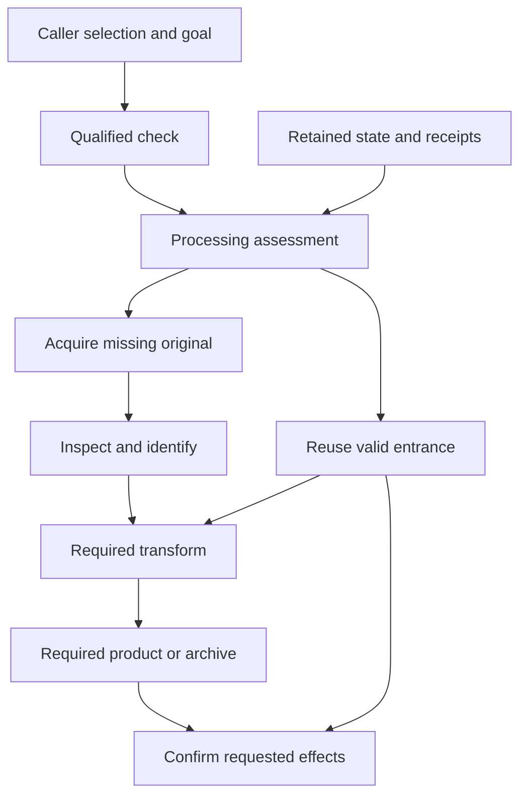

# Strategy Box: Selective Data Processing — Architecture and Implementation Design

**Date:** 2026-11-26. **Status:** proposed implementation design. **Scope:** commands, operations, data contracts, staged bytes, incremental processing evidence and domain integration. **Implementation claim scope:** Stratbox `55306c27b402895a4608a37d6210fa3a7d0ddbc6`. **Naming:** every API or file explicitly marked “new” is a proposal.

The recommended architecture extends the existing five owners: `capabilities` describes and prepares actions, `core` executes bounded technical work, `domains` supplies narrow publication and analytical knowledge, `shared` carries portable meaning, and `sdk` exposes discovery and invocation. Concrete table membership remains input from an external script/application or, later, a purposeful scenario/cascade. Standard commands and operations neither author nor hide that membership.

The principal additions are typed selection and work decisions, a journal-derived retained-state index, a sealed staged-byte carrier integrated with existing result ownership, qualified history construction, and focused physical-export/product contracts. This document specifies the proposed implementation down to files and acceptance cases. It does not implement the changes or claim full publisher-history coverage. The [functional model](strategy_box_selective_data_processing_functional_model_2026-11-26.md) defines the corresponding user-visible promises.

## Contents

1. Architecture decisions and current seams — preserve the executor and strengthen its contracts.
2. Data identities and dependency basis — distinguish logical assets, bytes, processing and effects.
3. Source and publication selection — explicit caller input and qualified resolved membership.
4. Publication feeds and physical inspection — raw form discovery without false semantic attribution.
5. Source checking and processing decisions — scoped evidence and a pure next-work assessment.
6. Journal facts and the retained-state index — durable lookup, replay and crash windows.
7. Sealed staged materials — bounded bytes and exact ownership at existing lifecycle seams.
8. Archive and DBF kernels — common physical algorithms with independent retention.
9. Command changes — existing actions to strengthen and justified new promises.
10. Operation graphs — reusable finite compositions and their acceptance rules.
11. Coverage, revision resolution and validation — meaningful histories and subsets.
12. Domain completion — specific CBR, Frank RG and Rosstat changes.
13. Caller and host integration — notebooks and recurring finite application passes.
14. File-level implementation map — existing and proposed owners.
15. Work packages — dependency-aware implementation sequence.
16. Verification and performance evidence — focused behavioral gates.
17. Design limits and rejected alternatives — keep the extension coherent.
18. Supporting references — exact implementation anchors and primary protocol evidence.

## 1. Preserve the existing execution structure

### 1.1. Decisions for this design

| Code | Decision | Consequence |
| --- | --- | --- |
| AD01 | Domain declarations describe supported sources; callers select the workload. | No table-ID preset, CBR collector mode or publisher-specific workflow enters standard commands/operations. |
| AD02 | Keep the existing `StrategyBox → preparation → ExecutionService` route. | New actions receive the same admission, limits, source checks, cancellation and effects as existing actions. |
| AD03 | Extend existing value and result ownership for sealed temporary files. | No parallel large-file executor or untracked path/generator output. |
| AD04 | Keep one persistent effect authority. | Storage helpers supply mechanisms; `context.effect` owns confirmed/uncertain command effects. |
| AD05 | Index qualified journal facts for retained-state lookup. | The index is a rebuildable projection within its retained evidence scope, not another authoritative success history. |
| AD06 | Make processing assessment pure. | It consumes explicit state and evidence and returns decisions; it performs no hidden fetch, write or scheduling. |
| AD07 | Keep strict merge and add explicit revision resolution. | History semantics are visible and ordinary merge never silently becomes last-write-wins. |
| AD08 | Preserve late entrances and existing bounded maps. | Retained originals, physical evidence and views can cut off upstream work. Mixed targets use bounded independent calls initially. |
| AD09 | Treat expected source coverage and requested completion separately. | Deliberate subsets have truthful success semantics. |
| AD10 | Keep the proposal finite. | No new scenarios/cascades, daemon, distributed queue or whole-system catalog redesign is required. |

### 1.2. Existing implementation is a foundation, not a blank slate

| Code | Existing seam | Extension required |
| --- | --- | --- |
| CS01 | `SourceAPI` and static `DomainCatalog` | Neutral discoverable publication facets, typed query and frozen selection. |
| CS02 | `PublicationListing`, `AssetSelection`, `issue.select` and `source.check` | Explicit query modes, scoped comparison, membership/alternative reports and precise empty semantics. |
| CS03 | `material.receive` and immutable content storage | Conditional revalidation, lightweight reference inspection and compatible downstream readers. |
| CS04 | Buffered archive/DBF commands and streaming ZIP helper | One reusable physical kernel with staged outputs and complete preservation evidence. |
| CS05 | `FileJournal` and `FileEffectState` | Accepted-value/source/basis facts and a checkpointed lookup projection. |
| CS06 | `RunResult`, owned-value accounting and bounded maps | Staged-file pins, live disk quota and richer keyed member outcomes. |
| CS07 | `observations.merge` and domain validators | Explicit revision policy, requested coverage and portable per-issue validation evidence. |
| CS08 | Existing CBR/Frank RG/Rosstat methods and products | Precise subject/date/geography selection and remaining physical/product obligations. |

These claims are bounded to the inspected code. Existing tests demonstrate specific mechanisms; they are not evidence of complete behavior on every historical publisher file. [I01–I08]

## 2. Identity must follow the question being answered

### 2.1. Keep distinct keys

| Code | Key | Proposed basis | Exclusions |
| --- | --- | --- | --- |
| ID01 | Logical asset | Source/feed ID, issue identity, asset identity, representation role where semantically relevant. | Download time and mutable path alone. |
| ID02 | Retained representation | Base method, exact locator/query semantics, body/form, admitted access/provider scope and representation-selecting fields, including applicable `Vary` evidence. | Plain URL-only matching; conditional control headers and execution limits. |
| ID03 | Byte revision | `ByteIdentity`: digest and size of the complete material. | ETag, filename and modification time as substitutes. |
| ID04 | Observation | Observation scope/ID, observation time, qualified evidence and source coordinates. | Content digest alone. |
| ID05 | Processing basis | Input identities and qualified uses, effective target/method/settings/references, selected observation context and build basis. | A global “downloaded” boolean. |
| ID06 | Representation basis | Accepted data/view identity plus rendering/encoding/member-name settings. | Destination path when it does not affect bytes. |
| ID07 | Destination effect | Provider/storage scope, destination transition, payload and conditional/idempotency policy. | Run ID as the only durable identity. |
| ID08 | Resolved selection | Effective query, exact ordered members and declaration/observation basis. | A predicate that can change membership while execution runs. |
| ID09 | Request attempt | Exact prepared request, including headers, timeout/limits, observation scope and attempt evidence. | Use as the sole key for matching an earlier retained representation. |

Existing `request_identity` already includes method, headers, body/form, access scope and execution options. Preserve that exact-request evidence. Introduce a separate representation-matching basis: adding `If-None-Match` or changing a timeout changes the prepared request without necessarily changing the selected representation. Conversely, different FNS date forms or representation-selecting/access fields can denote different content at the same endpoint. [I01]

Keep these bases typed and explicit. Matching rules must not discard relevant headers indiscriminately or persist secret header values in the journal; admitted scope identities and safe fingerprints carry the required distinctions.

### 2.2. Same bytes can serve different logical uses

A physical workbook can serve several series. A repeated byte identity under another issue can also change period interpretation. Physical decode may be reused while semantic interpretation remains distinct.

Use the existing `SourceCoordinate` and `SourceUse` relationships. Preserve both physical acquisition origin and each admitted semantic use. Do not replace the source attached to an acquisition receipt to make a new target pass validation.

A processing key must include issue/measurement context where that context affects interpretation. A bare digest match is insufficient for semantic reuse.

### 2.3. Distinguish observation chronology from accepted-result chronology

Retain the source observation used by an output, as well as the later time at which that output was accepted. An older observation finishing last must not automatically become the current source revision.

For observations A → B → A there are three observations, two content changes and two reusable byte identities. The initial first-seen state is not automatically another content change.

### 2.4. Use actual dependency fingerprints

Continue using bound method/settings identity and the Stratbox build basis. Add reference/content identities actually consumed by interpretation, calculations and products.

A dirty working tree or incompletely captured external dependency weakens durable reuse. The implementation should conservatively disable that reuse or include a sufficiently complete fingerprint. New per-command version counters and parallel schema-release registries are unnecessary.

## 3. Selection is typed caller input

### 3.1. Standardize a neutral publication descriptor

The common `PublicationSpec` and the CBR-specific `Publication` currently expose overlapping but different metadata. A small neutral descriptor should be authored once with the publication declaration and projected by the catalog.

Proposed fields:

| Code | Field | Meaning |
| --- | --- | --- |
| PD01 | `source_id`, `publisher_id`, `title` | Stable address and human identification. |
| PD02 | `issue_model` | Rolling, dated, publisher-defined or capture lifecycle. |
| PD03 | `delivery_mode` | Direct asset, index, API or local inventory. |
| PD04 | `artifact_category` | Statistical workbook, regulatory archive, publication document or page capture. |
| PD05 | `formats` | Declared representation alternatives. |
| PD06 | `family_ids` | Intrinsic subject/publication family relationships. |
| PD07 | `stage_support` | Qualified known bindings and their applicability; not a live-source availability claim. |
| PD08 | `calendar/revision_rule_ref` | Optional reference to reviewed source-specific ordering/expectation rules. |

Observation frequency remains in observation semantics; publication frequency can be separately declared when known. Neither determines the collector's membership.

Prefer a neutral field/protocol on the existing declaration over SDK `getattr` chains that guess publisher meanings. Existing intrinsic CBR fixed/rolling facts should be migrated into or explicitly projected through that contract. URLs and selection-independent source facts have one authored owner.

### 3.2. Proposed query and selection values

Add a focused `shared/data/selection.py`. Suggested contracts:

| Code | Value | Essential fields |
| --- | --- | --- |
| SV01 | `SourceQuery` | Exact includes/excludes, declared facet predicates, order, explicit all-selection flag where used. |
| SV02 | `SourceSelection` | Query identity, declaration basis, exact ordered source IDs, exclusions/errors and membership closure. |
| SV03 | `IssueQuery` | Mode, issues/range, date axis, representation preference, latest count, coverage intent and ambiguity policy. |
| SV04 | `SelectionReport` | Requested/observed/selected/missing/ambiguous/excluded members and reason codes. |
| SV05 | `ObservationQuery` | Typed dimensions, period rules, subjects/namespaces, metric selection and ordering. |
| SV06 | `MemberOutcome` | Stable member key, original ordinal, runtime outcome, stage availability, references, diagnostics and effect state. |

The source query must reject unknown fields. Its mode is explicit; a missing selector does not silently mean all sources.

Resolve inclusions and exclusions deterministically. A source omitted by policy is different from an explicitly requested source that cannot be found.

Bound query length, match count and report cardinality. Large reports use retained pages/sidecars; a command must not construct a huge JSON value merely because payload bytes are file-backed.

### 3.3. Put source resolution in the catalog/SDK

New `capabilities/catalog/selection.py` implements pure resolution over existing domain records. Extend `sdk/client.py::SourceAPI` with structured selection and bounded listing. Extend `sdk/machine.py` to project the same metadata and query contracts.

This does not require a command wrapper around every catalog read. The caller may resolve a selection, display it and then submit the selected finite calls.

The resolved selection is data, not a second registry. No source list is stored inside standard operation declarations.

### 3.4. Normalize publication selection over observed assets

Strengthen existing `command.issue.select` and domain publication methods.

For each candidate:

1. establish its qualified source/issue/asset coordinates;
2. filter using the declared query semantics;
3. group alternatives by logical coordinate;
4. distinguish representation alternatives from competing revisions;
5. apply an explicit supported preference or retain ambiguity;
6. return the selected set and a complete disposition report.

The current CBR selector checks ambiguity across the whole selected set in a way that can miss a duplicate issue when other dates are present. Grouping must occur before aggregate assessment. [I02]

A date range has an explicit axis and endpoint convention. A recommended ordinary date interval is inclusive `date_from/date_to` for calendar dates, with normalization captured in the query. Timestamps should use timezone-aware instants and an explicitly documented interval convention.

Expected-calendar membership is separate from actual observed candidates. Caller-controlled revisit windows can recheck recent issues or a bounded older range; their numeric defaults belong to the external request.

### 3.5. Preserve deliberate no-work and required nonempty inputs

Do not remove nonempty acquisition checks simply to make polling convenient. A required extraction still needs an admitted material.

A processing decision can legitimately return no work after proving fulfillment. An empty initial selection, an incomplete listing, a missing expected issue and an explicit caller-selected empty set remain separately qualified.

## 4. Reuse publication feeds for raw-form discovery

### 4.1. Add one intrinsic feed declaration

Use existing `FeedTarget` and `DomainCatalog.get(kind="feed")`. Add a proposed `cbr.reporting_forms.publications` descriptor under `DOMAIN.common["publications"]`.

The descriptor owns intrinsic publisher facts: official index route, allowed asset pattern, form-code/date syntax and source recognition. It does not own selected forms, chosen dates or a notebook preset.

Extend `DomainCatalog.__post_init__` to validate feed entry types, key/ID equality and uniqueness across target kinds. Feed lookup already exists; a new registry is unnecessary.

### 4.2. Proposed physical asset coordinates

A discovered form archive can carry:

```python
PublicationAsset(
    source_id="cbr.reporting_forms.publications",
    issue_id="2026-04-01",
    asset_id="form-0409101",
    locator=observed_official_locator,
    format="rar",
    metadata={
        "publisher": "cbr",
        "form_code": "101",
        "role": "regulatory_archive",
        "discovery": "observed_index",
        "known_series_id": "cbr.reporting_forms.f101",
    },
)
```

This is a proposed value example. `known_series_id` is an optional classification hint. Unknown observed three-digit forms omit that hint and can still be admitted for physical acquisition/export.

The index material identity and observation scope belong to the listing's lineage. Constructed future URLs must not be mislabeled as observed index entries.

### 4.3. Prove the relation to a semantic target

A known form's semantic declaration can identify exact membership:

- feed `cbr.reporting_forms.publications`;
- asset `form-0409101`;
- semantic target `cbr.reporting_forms.f101`.

The source-admission contract must match feed, asset, issue, material identity and reviewed relation, then perform the required physical/schema checks. It adds a series-specific qualified `SourceUse` while preserving the acquisition's feed use.

Do not add the feed ID to every form's unrestricted allowed-source set. That would admit form101 into form802 through their common feed.

Current scalar `source_id` checks in `SourceRequirement` and preparation must be adjusted deliberately to admit declared relational evidence. The same migration reaches `core/commands/_values.py::_material` and `domains/cbr/methods/actions/forms.py::extract`, which currently expect inline material and matching scalar source IDs. Separate carrier unwrapping, qualified-use admission and explicit byte materialization; retain a strict buffered helper for handlers that still require bytes. A caller-supplied metadata string cannot create source evidence, and a carrier must not be silently relabeled from feed to series. [I03]

### 4.4. Add a narrow technical material inspector

Proposed `command.material.inspect`:

| Property | Contract |
| --- | --- |
| Inputs | Buffered material or verified readable reference; bounded inspection policy. |
| Outputs | `MaterialInspection`: complete-material identity, carrier scope, observed media metadata, signature/envelope findings and evidence qualification. |
| Effects | No user-requested persistent write. |
| Resources | Bounded storage read, parsing and metadata memory as required by the carrier/format. |
| Provider use | Core-owned reading; no domain filesystem/network access. |

Extend `command.material.identify` to accept the original carrier plus this inspection and acquisition evidence. Domain methods consume the descriptor and validate attribution.

Every detected physical format must belong to the selected publication/target's admitted formats. A valid XLS or DBF body at an XLSX locator is a format mismatch even when its media type is generic binary content. Preserve transport assurance separately from byte integrity and source admission. In particular, a legitimately revalidated retained original needs its typed validation evidence path; the present CBR inline-body/2xx check cannot simply downgrade it to a caller assertion.

A ZIP prefix is insufficient to identify an XLSX workbook. A bounded central-directory inspection can check required workbook entries without reading every cell. The inspection must state whether it establishes signature, envelope recognition, exact integrity or semantic admission.

Never construct a `Material` from a prefix and attach a full-file digest. The prefix is inspection evidence about another object, not that object's bytes.

Reference-based `series.extract_any` also requires an explicit inspection step before format dispatch. Current `ExecutionService._structural` reads `material.data` and opens a buffered ZIP to choose a branch. Move physical inspection into the normal admitted command; structural dispatch consumes its descriptor and forwards the original readable carrier to the selected decoder. Extend the dispatch model/plan narrowly to keep selector evidence distinct from the forwarded input. The coordinator performs no provider I/O or hidden whole-file fallback.

### 4.5. Keep raw retention and accepted originals distinct

The existing receive action can remain an effectful network-to-immutable-storage closure:

`request.prepare → material.receive → material.inspect → material.identify`.

Raw retention may succeed before physical/source admission. If identification rejects an HTML error body, the raw blob can remain diagnostic evidence while the selected original-archive goal remains unfulfilled.

An operation's acceptance requires the confirmed retention receipt and the required identification result. It must not equate a raw storage receipt with an accepted XLSX publication.

## 5. Separate source checking from work assessment

### 5.1. Extend the existing source-check recipe

`operation.source.check` should expose qualified `listing`, `selection`, `assessment` and relevant evidence. Keep supplied listing, supplied index and local inventory entrances.

Branch preparation by declared delivery topology:

| Code | Topology | Finite check route and reusable output |
| --- | --- | --- |
| SC01 | Observed index/feed | Fetch the bounded index once, scan it, select candidates and assess the requested scope. Expose index/listing evidence for subsequent selections in the same observation. |
| SC02 | Direct rolling asset | Start from the declared candidate without inventing an observed remote listing. Metadata-only evidence may remain insufficient; a byte-level check explicitly acquires the asset and returns that same admitted carrier/reference for downstream work. |
| SC03 | Delivered local inventory | Read a provider-scoped inventory, freeze selected entries/identities and use the explicit file entrance. |

For SC02, passing the checked original into acquisition/extraction or retaining it after the check avoids a second GET for the same observation. Extend `material.fetch` with an explicit staged placement for this route when persistent original retention is not a requested goal; `material.receive` remains the explicit retained entrance. If the check only observed metadata, `processing.assess` can still require acquisition. The operation graph declares that work and its cost; a pure metadata method cannot hide it.

Request role is part of preparation. The current recipe supplies `role='index'`, but the CBR method can use a query's issue date to construct an archive URL while ignoring that role. Correct the binding: an index request targets the official index; date/form selection filters observed entries afterward. A direct constructed-asset request has its own explicit role and discovery qualification. Feed bindings must not infer a form code by splitting a feed ID at `.f`. [I02]

For several selected targets sharing one feed, the caller can supply one observed listing. If separate calls request physical sharing, bind a common explicit observation scope to their compatible requests. Current fetch reuse keys use `request.observation_id` or a run ID; merely opening one `StrategyBox` session does not guarantee one network request across calls. Keep separate logical source uses and accepted facts for every consumer. Incompatible request/access scopes remain separate work.

Make comparison scope explicit:

- whole observed feed;
- selected logical assets;
- representation validation;
- exact bytes;
- physical tables;
- interpreted observations.

The current recipe assesses a whole listing. That is useful for a feed check, but can let unrelated Minfin attachments affect a selected-table assessment. Scope must be intentional. [I02]

A transport failure does not automatically produce a downstream “unavailable” assessment: the current fetch→scan route stops. Preserve the failed-check outcome and qualified reason, or add a typed observation result with explicit branching before claiming a successful availability report. This design initially retains failed-check outcomes and records them in the member report; it does not weaken required material ports.

### 5.2. Bind validators to a retained representation

Add a typed `RetainedRepresentation` value containing the representation-matching basis from section 2.1, exact retained reference, validator fields, original request-attempt reference, observed time, assurance and applicable scope.

Extend existing request preparation and material fetch/receive contracts with this explicit input. Do not pass arbitrary retained bytes as an unchecked parameter.

HTTP `304` supplies no new body. Conditional validators and `Vary` matching concern the selected representation, and weak validation is not independent byte-equality proof. [EHTTP01, EHTTP02]

Design rules:

1. admit a retained representation only when its base representation, applicable selection fields and access/provider scope match; the exact conditional request hash may legitimately differ;
2. check the retained object's availability under its declared integrity policy;
3. for an eligible validation response, reuse that reference and record the validation observation;
4. if required bytes are unavailable, make a bounded unconditional retrieval;
5. when new bytes arrive, preserve the new observation even if their digest already exists;
6. keep byte-equality and validator-based assessments distinct;
7. preserve request-body/form identity for admitted read-only POST sources;
8. expose unsupported validation behavior explicitly.

The current streaming receive rejects `304`, while buffered fetch accepts retained material through options. This is a common contract gap, not a need for another downloader. [I04]

`RequestSpec` admits HEAD, but the current material fetch/receive handlers reject it. Do not make HEAD a presumed universal prerequisite. A dedicated inspect/probe promise can be added later if a concrete source and provider justify it.

### 5.3. Introduce a pure processing assessment

New `shared/data/processing.py` and `core/commands/processing.py` define `command.processing.assess`.

Proposed inputs:

| Code | Input | Meaning |
| --- | --- | --- |
| PA01 | `goal` | Required named result stages, selection, completion policy and destinations. |
| PA02 | `candidate` | Explicit qualified source observation/material evidence. |
| PA03 | `state` | Trusted retained-state snapshot with stream, actual applied-through checkpoint and coverage. |
| PA04 | `basis` | Effective processing/rendering dependencies for this target. |
| PA05 | `policy` | Freshness, integrity, revision and retry eligibility relevant to the decision. |
| PA06 | `evaluation_time` and observation bounds | Explicit instant for freshness/retry decisions, plus applicable observation cutoff; included in decision identity. |

Output: keyed `ProcessingDecision` entries with required stages, eligible retained entrances, reasons, unresolved evidence and exact basis. The result performs no work and does not read the clock. Evaluation time is distinct from source observation time and the projection cursor.

A goal is a query over required outcomes. It does not need to become a second persisted job object or workflow language.

Representative decision precedence:

1. unresolved required effect → reconcile;
2. insufficient projection/source evidence → obtain the missing evidence;
3. missing/invalid required original → acquire;
4. mismatched interpretation context or rules → reinterpret from a valid original;
5. missing/stale calculation → calculate from admitted inputs;
6. missing/stale representation → render/encode;
7. missing destination obligation → retain/materialize;
8. all requirements satisfied → reuse/no work.

An actual candidate can change a decision. For example, an unconditional retrieval may reveal bytes already retained; the next pure assessment can reuse downstream results.

### 5.4. Keep lookup explicit and mutable-state-aware

Proposed `command.source.state.read` reads the `source_state` provider for bounded keys, `stream_id` and `minimum_applied_through`. It returns a current state snapshot, actual applied-through cursor and coverage. The requested cursor is a minimum freshness requirement: state at position 150 satisfies a requirement of at least 100, but is not historical state as of position 100.

Exact historical as-of lookup would require a separately declared versioned projection/MVCC contract and retained versions. It is outside the first implementation. An observation cutoff used by processing policy does not manufacture that historical capability.

It is a mutable-state read: disable deterministic completed-result reuse, as for current mutable inventory reads. It must not claim to have caught up if it has merely queried an older projection.

Projection advancement is a bounded technical method invoked by the host/SDK through an explicit maintenance call. It can later earn a standard command if independent graph consumers need that promise. Avoid introducing an operation that only renames state.read or processing.assess.

## 6. Enrich accepted facts and project them durably

### 6.1. Extend journal payloads at the acceptance boundary

Current `_register_value` retains useful accepted-basis/source-use information in memory, while ordinary `output.accepted` facts mostly record capability/scope/output metadata. Persist a compact, safe projection of the accepted value. [I05]

Proposed accepted-output payload:

| Code | Field | Purpose |
| --- | --- | --- |
| JF01 | `accepted_value_id` and `value_identity` | Identify the actual admitted output. |
| JF02 | `value_kind` and `output_name` | Identify its usable stage/contract. |
| JF03 | `source_uses` or retained manifest reference | Preserve exact logical source/issue/asset relations. |
| JF04 | `processing_basis` | Bind input identities, target, method/settings/reference/build context. |
| JF05 | `selection_identity` and scoped coverage | State what the accepted output fulfills. |
| JF06 | `assessment` | Preserve scientific/physical qualifications and findings. |
| JF07 | `retained_reference/effect_ids` | Identify confirmed persistence where present. |
| JF08 | `observation_ref` | Tie later acceptance to the source observation it processed. |
| JF09 | `persistent` | Distinguish durable content from an in-memory or staged output. |

Use fixed portable data types and bounded metadata. Large manifests, row lists and encoded bytes are retained artifacts referenced by identity. Raw credentials, full authentication headers and arbitrary imported classes do not enter the journal.

Apply the same payload construction to direct command outputs, operation-scope outputs and shared-work logical consumers. A physical producer can serve several admitted source uses without erasing their logical contexts.

A retained-state projection may index an ephemeral accepted output for diagnosis, but it cannot advertise it as a restart entrance.

### 6.2. Project observations and accepted outputs separately

Proposed `core/observability/projections/source_state.py` interprets qualified accepted facts. `core/storage/source_state/` supplies a bounded memory provider and a persistent local provider.

A minimal logical schema is:

| Code | Indexed relation | Primary purpose |
| --- | --- | --- |
| ST01 | Journal position by stream | Applied-through cursor, checkpoint identity and coverage. |
| ST02 | Source observations by logical asset | Evidence/baseline identities, occurrence time and comparison basis. |
| ST03 | Accepted outputs by processing basis | Named output, source uses, qualifications and retained references. |
| ST04 | Retention/effect links | References to existing effect authority and known availability checks. |
| ST05 | Selection/member results | Exact fulfilled and unresolved membership for aggregate goals. |

Do not duplicate effect authority inside the projection. An indexed confirmed-effect link must refer to a competent receipt; uncertain effects remain subject to existing reconciliation.

Separate “last observed” from “last accepted dataset/product.” A failed interpretation of new bytes advances the observation history but not the successful processing basis.

### 6.3. Use the existing contiguous-page protocol

The global source-state projector consumes unfiltered `JournalPage` intervals. Current filtered pages can select a single run; such a page cannot advance a global projection while omitting other runs.

For each page:

1. verify stream identity, expected `after` cursor and contiguous scan coverage;
2. apply selected facts idempotently using stream/sequence identities;
3. commit projection rows and `scanned_through` atomically;
4. acknowledge the exact page to the registered journal consumer;
5. report the projection horizon.

A local SQLite provider is suitable for the first persistent implementation because the projection update and cursor can share one transaction. This is a proposed provider choice, not a requirement for domain code or a distributed guarantee.

Register the consumer before processing. If projection commit succeeds but journal acknowledgement is lost, replay is idempotent. If journal acknowledgement is behind the projection after restart, replay and acknowledge the required pages under the existing coverage checks.

### 6.4. Bound state growth and preserve recovery evidence

Keep current-state indexes compact and historical observation/result records segmented or archived by stream and logical/time scope. Use keyset pagination, bounded transactions and explicit retention/compaction. Avoid one growing JSON file containing every source and run.

Before pruning journal facts needed to rebuild the projection, retain an identified projection checkpoint and a documented continuation horizon. That checkpoint only covers this projection's recovery needs: all registered consumers and their retention obligations must still permit pruning. Cold journal archives remain readable; pruning removes coverage.

If neither facts nor an adequate checkpoint survive, return incomplete/unknown state. Re-observation and revalidation can rebuild a new baseline, but cannot reconstruct missing historical facts by assertion.

### 6.5. Crash windows and allowed recovery

| Code | Interruption point | Recovery |
| --- | --- | --- |
| CW01 | Before source observation accepted | Repeat the finite observation under a new or explicitly resumed scope. |
| CW02 | Raw bytes retained, identification incomplete | Inspect/identify the exact retained bytes; original goal remains pending. |
| CW03 | Persistent write occurred, acknowledgement uncertain | Use existing persisted intent and bounded destination reconciliation. |
| CW04 | Effect confirmed, acceptance event missing | Reconcile receipt/content and rerun the bounded acceptance path; do not invent an earlier fact. |
| CW05 | Event durable, projection not updated | Replay from the acknowledged cursor. |
| CW06 | Projection durable, journal acknowledgement missing | Idempotent replay/acknowledgement. |
| CW07 | Product accepted, named delivery failed | Reuse the product and retry/reconcile the destination effect only. |
| CW08 | Projection checkpoint/facts missing | Expose coverage loss and rebuild a qualified baseline. |

The result is controlled at-least-once observation/application with idempotent state updates and effect reconciliation. The design makes no universal exactly-once promise across unrelated stores.

## 7. Add one sealed staged-byte value to existing ownership

### 7.1. Choose a shared staged representation rather than repeated combined exporters

A direct effectful archive-retention command would be smaller for one archive task. The present scope also needs selected archive members, DBF CSV, large preservation sidecars and packaging of intermediate outputs. Combining each transform with its own persistent write would duplicate retention and reconciliation.

This design therefore chooses one narrowly scoped sealed staged value, integrated with the current service's ownership. The extra lifetime work is explicit and part of the acceptance gate.

### 7.2. Proposed carrier

A focused `shared/data/materials.py` can define:

```python
from dataclasses import dataclass
from typing import Mapping

@dataclass(frozen=True)
class StagedMaterialRef:
    stage_id: str
    provider_scope: str
    session_id: str
    identity: ByteIdentity
    media_type: str
    metadata: Mapping[str, object]
    lineage: tuple[object, ...]
    source_uses: tuple[SourceUse, ...]
```

This is a proposed type sketch, not a currently importable API. A stage ID is an opaque session-owned lookup token, not arbitrary path authority.

Freeze and validate nested metadata, lineage and source-use fields during construction/admission. A frozen dataclass only protects field assignment; a mutable dictionary or mutable item inside a tuple would still permit identity and admission evidence to change. Apply bounded schemas and the existing deep-immutability conventions.

The readable carrier set consists of buffered `Material`, `StagedMaterialRef` and `ImmutableMaterialRef`. An identified wrapper can carry any supported original form while preserving qualified source uses.

Do not globally widen every `MATERIAL` port before its actual handler supports the carrier. Introduce a separate readable-material port and migrate selected handlers deliberately. Buffered-only decoders can retain an explicit bounded materialization entrance.

### 7.3. Sealing establishes a complete object

A command obtains a private builder from a proposed `StagedValueStore` owned by `ExecutionService`. The builder accepts bounded writes and permits seeking where the format requires it.

Sealing:

1. flushes/closes the writer;
2. verifies the final complete size and digest;
3. records representation metadata;
4. makes the object immutable to ordinary consumers;
5. registers a provisional producer pin;
6. returns a descriptor eligible for output acceptance.

An interrupted builder is removed without entering accepted outputs. Temporary writes consume resource budgets, but do not by themselves establish a user-requested persistent effect.

### 7.4. Integrate pins at exact existing seams

| Code | Existing lifecycle point | Required staged-value behavior |
| --- | --- | --- |
| LV01 | `ExecutionService.submit` and actual-input admission | Validate session/scope and atomically pin supplied staged references before returning an admitted handle. |
| LV02 | `CommandContext` | Create builders, seal outputs and open bounded readers through the service owner. |
| LV03 | `_accept_outputs/_register_value` | Acquire accepted graph owners before releasing the provisional producer owner. |
| LV04 | Worker dispatch/settlement | Pin readable inputs until the physical worker has actually stopped. |
| LV05 | `_release_unused` | Release staged graph-output owners when unused values are cleared. |
| LV06 | Map/result collection assembly | Transfer/retain owners for the selected surviving members, including qualified partial results. |
| LV07 | `RunResult.__init__/close` | Root results own all reachable staged values and release them on close. |
| LV08 | Cancellation | Detach one consumer without deleting content still used by another. |
| LV09 | Session shutdown | Stop new work, settle workers, release service/cache owners and honor outstanding result ownership. |
| LV10 | Failed acceptance/admission | Release provisional/pinned stages on every failure path. |

Add one recursive staged-reference visitor beside existing `_size`, `_cells` and `_isolate`. Commands should not manually implement reference counting in every format handler.

Current `core/storage/temporary.py` provides local temporary-directory helpers; it is not a lease registry. Current `RunResult.close` releases ordinary values and charges; these new file-lifetime hooks are required implementation work. [I06]

### 7.5. Cross-call and close semantics

A staged descriptor is borrowed from an owning result. The caller keeps that result open until a consuming submission has been admitted, or retains the bytes first.

After successful admission, closing the producer result cannot invalidate the consumer. A copied descriptor alone does not acquire an independent lease. A later call using an expired descriptor must fail explicitly.

To preserve the existing independently owned-result promise, `box.close` stops work and releases service-owned resources but does not silently destroy a staged file still owned by an unclosed result. The staging manager remains in a drain-only state until the last result/read owner releases it. It accepts no new work then. If an alternative forced-close policy is introduced, its explicit invalidation semantics must be a separate opt-in contract.

Staged references are session-local. Persistent codecs and source-state lookup must not treat them as restored durable inputs. Explicit `artifact.commit` creates an `ImmutableMaterialRef` for that purpose.

Enforce that rule in `shared/data/values.py::_codec_types` and portable-tree validation/restoration. Its current module-wide dataclass discovery must not automatically admit `StagedMaterialRef` when portable inspection types from the same proposed module are added. Use an explicit portable-type allowlist and recursively reject staged references in encoded values, nested containers and attempted persistent snapshots, including caller-supplied type-admission paths. A journal projection may retain safe diagnostic identity/scope fields, never a restorable stage token.

### 7.6. Resource accounting and cache policy

Keep cumulative run-created temporary bytes distinct from session live staged bytes and live staged-object count. File descriptor/read-lease count also needs a bound.

Descriptor memory counts toward resident metadata; file payload size counts toward staged storage, not RAM. Admission reserves an initial bounded allowance and growth is charged before writes.

Logical `output_bytes` remains a separate limit. Current `ExecutionService._execute_command` charges `_size(outputs)`, which would count only the descriptor after this change. Stage-producing handlers and acceptance must account the complete content-sized output through `BudgetMeter.account_output`, with explicit stable output-unit keys and verified coverage aliases where the same obligation is represented again. Matching digests alone cannot merge independent destination obligations. Retain the difference between RAM, temporary storage, physical I/O and logical output; a small descriptor cannot bypass a large-output ceiling.

Avoid dependency deadlocks under live disk limits. A map may retain completed members for a later pack step; another member must not block indefinitely waiting for space that only that pack can release. Reserve a feasible aggregate bound before such a collection, fail early with a qualified resource outcome, or explicitly commit/release members incrementally and collect immutable references. Backpressure is allowed only when an independently runnable consumer can release capacity. A worker must not occupy the last slot while waiting on capacity or work whose progress depends on that same slot.

For the first implementation, disable completed-result caching for outputs containing staged references. Inflight sharing can remain valid with independently pinned consumers. Add completed staged caching only with explicit cache ownership, eviction and shared live-storage quotas.

Work equivalence uses complete content identity and encoding/processing basis, not random stage tokens. Scope/token checks are admission checks, not computational identity.

### 7.7. Recovery and cleanup

A process crash invalidates transient stage descriptors. Recovery starts from confirmed retained originals/intermediates or repeats a pure transformation.

The local staging backend can reclaim abandoned private session directories using its own ownership markers and locks. It must not scan or delete arbitrary caller directories. A long-lived transformation that needs restart checkpoints requests explicit immutable retention.

## 8. Reuse physical kernels and keep persistence outside encoders

### 8.1. One bounded reader adapter

Extend `core/commands/_storage.py` or add `core/storage/readable.py` with an internal context-managed reader:

- buffered material → bounded in-memory reader;
- staged reference → service-owned reader lease;
- immutable reference → provider-scoped reader with admitted identity/effect evidence.

The adapter supports chunked copying, exact identity scans and seekable access where the provider can supply it. It never resolves a caller-controlled location against an unrelated provider scope.

Use the adapter in archive encoding/extraction, material inspection, artifact commit, reconciliation, member verification and named copy.

Extend existing `command.material.read` with explicit `placement='buffered'|'staged'`. The buffered branch preserves a declared full-read limit. The staged branch opens an admitted provider-scoped local locator, copies in chunks, checks the expected source identity/state under the provider's guarantee, seals the complete copy and returns `ReadEvidence`. `operation.material.acquire_file` selects this entrance when requested; HTTP-only `material.receive` is not a substitute for a large local-file entrance.

A path and before/after stat values alone do not prove an atomic source snapshot. Require an admitted stable read/revision or a complete expected-content check sufficient for the requested assurance; otherwise qualify or reject the source-copy claim. The sealed output is stable after a successful copy. A decoder that still needs buffered bytes uses an explicit bounded materialization step.

A forged `ImmutableMaterialRef` dataclass does not establish confirmed retention. Admission/verification must validate its provider scope, receipt/intended object and required integrity evidence.

### 8.2. Extract the ZIP kernel from the existing streaming helper

Refactor useful mechanics in `core/formats/archives/store.py` into a destination-independent encoder:

```python
def encode_zip(
    members,
    sink,
    *,
    open_member,
    compression,
    limits,
    checkpoint,
    budget,
) -> ArchiveEncodingEvidence:
    ...
```

The encoder owns safe entry names, collision checks, deterministic ordering, fixed metadata policy where reproducibility is requested, chunked copying, expected member size/hash verification, Zip64, compression and encoded-output limits.

It does not commit the requested destination. `command.archive.pack` owns the selected placement and sealed representation; `command.artifact.commit` owns persistent retention.

The buffered and staged paths use the same kernel. There is no separate `archive.pack_large` and no publisher dispatch in the encoder.

### 8.3. Unify archive inventory and selected extraction

Proposed `command.archive.inspect` returns a bounded `ArchiveInventory`: names, entry kinds, available sizes, compression/encryption metadata, parent identity and inventory coverage. An explicit member selector is applied to this inventory.

Extend `command.archive.unpack` to extract selected members through the same readable interface, producing buffered or sealed outputs under a declared placement policy.

The common extraction layer owns:

- traversal/absolute-path rejection;
- Unicode/case-normalized naming collisions according to destination portability policy;
- symlink and nonregular-entry policy;
- member count, per-member and total unpacked limits;
- expansion limits and cancellation;
- selected-member dispositions;
- parent/member source lineage;
- complete selected-member verification.

RAR providers should expose an archive reader with inventory and member reads. Current `RarArchiveReader.open(...)` and the handler's expected `provider.unpack(...)` are different protocols. Reconcile that seam and apply selection consistently to ZIP and RAR. [I07]

Inspecting all archive names for safety does not require inflating all members. Unselected members retain an explicit disposition. Stronger “all members physically validated” assurance is a separate requested goal.

### 8.4. Complete the DBF physical parser

Refactor `core/formats/dbf_lossless.py` into shared header validation and bounded record iteration. Keep the existing buffered `decode_dbf` as a consumer of the same parser.

Forward `budget`, `max_records`, `max_cells` and encoding policy from `core/commands/decoding.py::dbf_decode` before records are allocated.

Extend `DbfEvidence` or a focused `DBFHeaderEvidence` with:

- original identity and dialect;
- raw header date;
- header/record geometry;
- language driver;
- effective encoding and its basis;
- field definitions/offsets;
- deletion evidence;
- EOF/truncation qualification.

The parser validates declared counts against the actual bounded input. It must not accept a malformed width/header merely because the output CSV writer can process a prefix.

### 8.5. Add the precise physical export command

New `command.dbf.export_csv` consumes readable DBF material and a typed preservation policy, then produces sealed CSV and preservation-evidence representations.

It preserves admitted lexical fields, row/field order, blanks, deleted-record policy and encoding decisions. Binary fields require dialect-specific rules and evidence; they are not relabeled lexical text.

For migration of the investigated notebook, the caller supplies this concrete preservation policy; it is not a global default for every DBF:

| Code | Setting | Initial explicit policy |
| --- | --- | --- |
| DP01 | Text encoding | CP866 with strict decoding; reviewed override keyed by form, reporting date and exact member path/name, recorded with its basis. |
| DP02 | Character fields | Remove only right-side fixed-width space/NUL padding; preserve leading spaces and the remaining text. |
| DP03 | `N/F/D/L` lexical fields | Remove only the declared fixed-width padding; preserve the remaining lexeme without float, date or boolean normalization. |
| DP04 | Records and order | Preserve physical field/record order and all records, including deleted ones; record exact one-based deleted-record ordinals. |
| DP05 | CSV representation | UTF-8, comma delimiter, double-quote quoting with `QUOTE_MINIMAL`, LF record terminators and original field names. |

Candidate historical binary mappings are signed little-endian `I/+` at reviewed widths 2/4/8, `Y` scaled by 10,000 with decimal arithmetic, `B/O` with a reviewed `.17g` representation, and `T/@` as exact hexadecimal bytes. These mappings require dialect/type/width fixtures before admission. Memo fields require the matching companion and an implemented contract; otherwise return unsupported. No single field letter establishes those semantics across all DBF dialects.

A large deletion ledger is streamed as a sidecar or exact ranges. Metadata identifies the CSV and source after their identities are known. The outer receipt identifies the final metadata; avoid self-referential hashes.

The command performs temporary encoding only. A new operation can retain the CSV and required evidence under one logical acceptance condition; their physical commits remain separate, and each receipt can be confirmed, failed or uncertain. The caller separately chooses whether to retain the original DBF/archive.

A generic “convert anything” action would hide the specific preservation promise and is unnecessary.

### 8.6. Stream persistent commit and all readback paths

Extend `artifact_commit` to read any admitted readable carrier into content-addressed storage under `context.effect`. Use staged/atomic create mechanics already owned by filestore; confirm exact destination identity without allocating all bytes.

Convert `artifact_reconcile` and `_verify_member` to bounded identity scans. They currently use full-buffer reads and would otherwise break the large-file guarantee during recovery or release assembly. [I08]

The older `StoredBytesReceipt` helper must not become a second authoritative command-effect path. Reuse its copy/hash/conditional-commit mechanics behind the existing authority and return one coherent `EffectReceipt`.

### 8.7. General named materialization

New `command.artifact.materialize` copies an accepted immutable/staged representation to a caller-selected readable filename or destination under an explicit write policy. It shares the bounded copy and conditional-write kernel with maintenance.

Its receipt states the actual destination guarantee. A mutable named file must not be mislabeled an immutable content object. The source reference remains independently reusable.

Before any named write or maintenance mutation, persist a typed effect intent through the existing effect authority. It records provider scope, destination, expected final digest/state, expected prior revision or create-only condition, selected source identity, conditional policy and a stable retained ancestor/reproduction basis where restart may require it. A temporary stage token alone is inadequate recovery input.

Extend existing `artifact.reconcile` and its shared provider checks to these intents, including named copy/move/delete. Current reconciliation is restricted to immutable-content references, and current maintenance lacks this structured intent. On a lost reply followed by restart, inspect the named destination/source under provider-qualified identity/revision guarantees. A verified current postcondition can fulfill the destination obligation; it does not by itself prove which actor performed an earlier write. Intervening conflicting changes preserve conflict/unknown instead of triggering blind overwrite or deletion.

If the expected destination is absent and retry is eligible, reconstruct the source from a retained ancestor before retrying a lost staged output. If neither a valid source nor the required proof survives, expose the unresolved obligation. Delete/move recovery requires the provider's admissible transition evidence; an absent path alone cannot identify the deleted original. Keep provider-specific unsupported reconciliation explicit.

## 9. Proposed command surface

A command is added only when its input/output promise is independently useful. Internal policy normalization, schema lookup and field iteration remain helpers.

| Code | Command | Status | Input → output and qualification |
| --- | --- | --- | --- |
| CMD01 | `command.issue.select` | Extend | Listing + typed query → exact assets, alternatives and scoped report. |
| CMD02 | `command.source.assess` | Extend | Candidate + baseline + comparison scope → qualified source assessment. |
| CMD03 | `command.source.state.read` | New | Bounded keys + stream/minimum cursor → current retained-state snapshot with actual coverage; mutable read. |
| CMD04 | `command.processing.assess` | New | Explicit goal/evidence/state/basis/policy/evaluation time → pure finite work decisions. |
| CMD05 | `command.material.fetch/receive` | Extend | Qualified retained representation and request → body/reference + evidence; correct validation semantics. |
| CMD06 | `command.material.inspect` | New | Readable original → bounded physical inspection descriptor. |
| CMD07 | `command.material.identify` | Extend | Carrier + inspection + acquisition/source evidence → qualified original use. |
| CMD08 | `command.archive.inspect` | New | Readable archive → bounded inventory with parent identity. |
| CMD09 | `command.archive.unpack/pack` | Extend | Selected member extraction / selected representations → completed bounded materials and evidence. |
| CMD10 | `command.dbf.decode` | Extend | Buffered/explicitly supported readable DBF → complete physical evidence with pre-allocation limits. |
| CMD11 | `command.dbf.export_csv` | New | Readable DBF + preservation policy → staged CSV/evidence outputs and physical assessment. |
| CMD12 | `command.artifact.commit/reconcile` | Extend | Readable output / typed uncertain-effect intent → confirmed immutable retention or provider-qualified reconciliation, including named transitions. |
| CMD13 | `command.artifact.materialize` | New | Accepted readable reference + destination policy → named destination receipt. |
| CMD14 | `command.observations.select` | New | Accepted dataset + typed observation query → selected dataset and scoped coverage. |
| CMD15 | `command.observations.resolve_revisions` | New | Candidate datasets + explicit vintage policy → admitted resolved observations and decision evidence. |
| CMD16 | `command.observations.merge/validate` | Extend | Compatible resolved values + expected scope/certificates → validated history and coverage. |
| CMD17 | `command.material.maintenance_plan/apply` | Extend | Inventory and caller policy → pinned plan; plan → per-action confirmed/pending/unknown results. |
| CMD18 | `command.material.read` | Extend | Provider-scoped locator + expected state + placement → buffered material or sealed copy with qualified read evidence. |

These names are proposed except the actions explicitly marked “extend.” Final implementation may group private helpers differently without changing the contract.

Declaring `ReadableMaterial` support is per handler. Unsupported combinations fail at preparation or actual-input admission, not after an unbounded fallback read.

Provider/resource requirements must follow actual placement and actions. A memory-only inspection must remain usable without a filestore. A stage-producing action must have available staging capacity. A retained-reference read must have the matching provider. Known requirements bind during preparation; requirements depending on actual continuation inputs are checked at normal admission.

## 10. Operation graphs add meaningful acceptance

### 10.1. Extend existing operations first

| Code | Operation | Required extension |
| --- | --- | --- |
| OP01 | `operation.source.check` | Topology-aware listing/direct-asset route; explicit request roles; scoped assessment; expose acquired candidate/listing for downstream reuse. |
| OP02 | `operation.material.acquire` and concrete entrances | Compatible buffered/staged/retained acquisition; `acquire_file` has a bounded local-copy path with physical/source admission and truthful evidence. |
| OP03 | `operation.material.receive` | Retained original goal: receive, inspect, identify, require confirmed retention and admission. |
| OP04 | `operation.series.acquire` | Bounded selected-asset acquisition with file references and keyed outcomes; exact selected membership. |
| OP05 | `operation.series.extract_any/archive/structured` | Accept supported readable entrances; descriptor-based format dispatch forwards the original carrier; generic selection and complete physical evidence. |
| OP06 | `operation.product.publish` | Declared product selection, retained/late entrances and required requested destination effects. |

Raw `command.material.receive` remains available for callers that explicitly want only the transport/retention boundary. Strengthening the operation does not hide that lower-level action.

### 10.2. Add only three focused composite promises

| Code | Proposed operation | Graph | Additional promise |
| --- | --- | --- | --- |
| OP07 | `operation.archive.publish` | Pack selected members → commit archive → optional named materialization. | Exact membership report and all requested retention/delivery obligations. |
| OP08 | `operation.dbf.export_csv` | Physical CSV/evidence export → separate required commits → typed references/receipts with normal scope acceptance. | Logically complete only when every required CSV/evidence receipt is confirmed; partial or uncertain commits remain resumable. |
| OP09 | `operation.observations.history` | Resolve revisions → merge compatible observations → validate/certify requested coverage. | A qualified requested history, including unresolved expected members. |

The CSV operation exposes available `csv_reference`, `evidence_reference` and the exporter's `physical_assessment` through normal graph outputs. Existing `CollectCall` can collect receipts; `RunResult.outcome`, scope acceptance and effect results establish whether required retention is fulfilled. A physical assessment never stands in for the overall operation outcome, and no new public “assemble receipt” command is needed. The operation can return a qualified partial result when some required retention failed, but cannot claim the complete export fulfilled. It does not need to package an archive internally. The caller combines its output references with any other selected products.

Do not add `operation.processing.plan` solely as a one-command wrapper. A future composition is justified only if it adds an independently useful state-read/revalidation/assessment acceptance promise.

### 10.3. Keep graph boundaries visible



The diagram describes possible dependencies, not a mandatory scenario. An original-only archive can omit semantic transforms. A rerendered product can start from a retained view. A no-work decision can return without entering the effect branch.

### 10.4. Preserve one target per current map template

The present compiler prepares a map child with one target. An external caller can submit bounded per-source operations in one session and use maps for each source's assets/issues.

Do not make a heterogeneous dynamic-target map a hidden prerequisite. If later introduced, it needs independent preparation, source-admission and boundedness evidence.

## 11. Implement coverage and histories as semantic contracts

### 11.1. Extend existing coverage types rather than create competing flags

Use `shared/data/coverage.py` and `shared/data/assessment.py`. Retain distinct axes for requested, materialized, validated, interpreted, output and missing coordinates.

Add a selected-scope relation with:

- parent dataset/listing identity;
- selector identity;
- exact selected membership or a retained membership manifest;
- parent-source coverage;
- satisfaction of the requested subset;
- qualified exclusions and unknowns.

A caller-declared complete `SnapshotCoverage` is an input assertion, not proof. Accepted coverage requires a competent validation/check result tied to the actual inputs.

`command.observations.select` and stored `dataset.query` should call one shared selection implementation. Product projection should use the same scope semantics instead of copying parent assessments blindly.

### 11.2. Preserve richer member outcomes

Extend current result-collection metadata with stable member keys and diagnostic/effect dispositions. Keep ordinal indexes for deterministic correspondence.

The runtime outcome can remain succeeded/partial/failed/cancelled/unknown; availability, policy exclusion and unmet requirement are separate fields. Preserve “not attempted” when a budget or prior dependency stops work.

Existing `all_selected` and `eligible_subset` map policies remain useful. Aggregate acceptance must account for the original selected membership, not only the outputs that survived.

### 11.3. Resolve revisions before merging

Proposed `RevisionPolicy` includes:

- exact observation grain;
- requested as-of/vintage intent;
- admissible revision-order evidence;
- equal-duplicate policy;
- conflicting-value policy;
- compatibility requirements for units, period, perimeter and reference meaning;
- source/observation cutoff;
- output and unresolved-candidate evidence.

The resolver can coalesce equal observations while preserving multiple source uses. A later local file modification time is not an automatic publisher revision order.

Separate stable `ObservationSemantics` from history membership. Current merge adds `source_issues` to semantics; migrate this membership into dedicated lineage/history metadata so incremental append remains composable. [I09]

### 11.4. Retain explicit validation evidence

Proposed `ValidationCertificate` records dataset/material identity, rule/method/build basis, validated coordinates, findings and assessment. It refers to competent accepted evidence or is re-established on restore.

The industry validator currently requires parser-native validation information; generic merge drops that object. The correction is to consume portable per-issue validation evidence and validate the assembled history's own obligations. Do not make `native` a mandatory persistent scientific authority. [I09]

A malicious or mistaken caller cannot bypass validation by constructing a certificate with `complete=True`. Admission checks its binding and authority, or treats it as a claim requiring validation.

### 11.5. Measurement context and input closure

Bind issue/reporting context before interpretation:

- 0105A debt uses its as-of reporting date;
- 0104A issuance uses the reviewed preceding-month measurement interval;
- form102 requires its reviewed reporting interval;
- publication/reporting-date filtering and measurement-period filtering remain separate.

Keep APK's five source components for selected output coordinates. Select independent subjects only after source/schema admission and before calculations where their declared topology permits it. Narrow output selection must not reduce coupled model inputs.

## 12. Complete the domain seams without embedding user tasks

### 12.1. CBR

| Code | Owner | Proposed change |
| --- | --- | --- |
| C01 | `domains/cbr/common/contracts.py` and `series/*.py` | Neutral intrinsic publication descriptors; exact known feed/form membership; no chosen-table preset. |
| C02 | `domains/cbr/methods/actions/publications.py` | Explicit index/asset request roles and feed bindings, typed grouped selection, scoped assessments, retained-evidence and format-complete identification. |
| C03 | Existing issue helpers; focused `common/calendars.py` if needed | Reviewed expectation/order/measurement rules consumed by explicit caller queries. |
| C04 | `methods/actions/forms.py` | Replace the scalar `extract` source gate with exact admitted feed/form/issue/material relations; complete DBF evidence and form102 measurement context. |
| C05 | `methods/actions/industries.py` | Portable source-validation evidence for histories. |
| C06 | `calculations/reporting_forms/methods.py` | Preserve reviewed six-form methods; consume explicit subject/reference selection and qualified inputs. |
| C07 | `products/actions.py` and `products/industry.py` | Ordered subjects/labels, historical geography policy and product content settings. |
| C08 | `series/reporting_forms.py` plus feed descriptor | Physical discovery of observed numeric forms independently of semantic model readiness. |

Reviewed form/date/member encoding exceptions may be domain data with an explicit basis; caller-supplied overrides carry their own disclosed basis. No exception silently becomes a global encoding rule. The selected form set and date bounds are caller data.

Reuse `shared/reference/banks/registry.py` and the existing selection resources when the caller explicitly chooses a reference-backed subject set. Preserve supplied order/labels without creating a notebook-specific selected-bank registry or a hidden default selection.

The existing 42 fixed XLSX records are discoverable facts. The old 41-member task or an expanded 42-member task is expressed only in external caller configuration.

### 12.2. Frank RG

Keep recognition and latest-publication rules in `domains/frank_rg/methods/publications.py`. They operate on an observed inventory and preserve ambiguities.

General maintenance adds copy support, exact planned source identities, conditional destinations, prerequisite receipt matching and resumable per-action results. It does not gain a hardcoded Frank RG cleanup mode.

The selected archive-members prerequisite matches the selected latest files. A stronger retention policy covering every older file to be removed must be an explicit caller requirement.

### 12.3. Rosstat

Reuse `domains/rosstat/methods/kep2.py` and `products.py`. Replace ad hoc product row replacement with the common selected-scope contract.

Expose presentation settings needed by the intended workbook: sheet/header labels, measure-block ordering, number formats, frozen panes and evidence-sheet policy. Preserve raw numerical precision and explicit missingness.

Duplicate output cells remain a diagnostic/rejection. Preserve reported indices unless the caller chooses `rosstat.index_growth`.

### 12.4. FNS and Minfin as generality gates

Use their existing methods to verify the common contracts:

- FNS: read-only POST request identity includes its date form; date/calendar semantics differ from CBR;
- Minfin: logical document identity survives attachment rename; a selected-table check is independent of unrelated listing changes.

No new economic methods in these domains are required for the notebook-support scope.

## 13. External scripts remain thin but explicit

### 13.1. Notebook responsibility

A notebook owns:

- installation/build selection and optional environment setup;
- caller-selected sources/forms/dates/subjects;
- output goals, destinations and presentation settings;
- one service/provider lifecycle;
- bounded submission across selected targets;
- readable progress/results and final download.

It should not own HTTP retry implementations, archive integrity, DBF parsers, source-update logic or financial formulas.

A requested disk download uses a confirmed named materialization receipt. A content-addressed store path is not automatically the user-facing filename.

### 13.2. Proposed orchestration sketch

The following is deliberately schematic: proposed query/goal APIs are not currently callable.

```python
selection = box.sources.select(caller_source_query)
state = read_state_for(selection, stream_id, minimum_applied_through)
evaluation_time = caller_supplied_evaluation_time

for source_id in bounded_selected_ids(selection):
    check = check_source(source_id, caller_issue_query[source_id])
    decision = assess_processing(
        caller_goal[source_id],
        check,
        state.for_source(source_id),
        effective_basis[source_id],
        evaluation_time=evaluation_time,
    )
    submit_required_finite_calls(box, decision)
```

The helper names describe external composition, not new mandatory library entry points. All actual actions use the same prepared commands/operations.

Keep intermediate `RunResult` owners open while their staged values are submitted downstream. Close results as soon as their ownership is no longer required; a historical loop must not accumulate all workbook bytes in memory.

### 13.3. Recurring host responsibility

The host owns wakeups, cadence, jitter/backoff, persisted user configurations, occurrence IDs and coalescing overlapping checks. The core owns finite actions and their evidence.

The first persistent profile can use one journal writer/coordinator with durable providers. Multiple independent application processes require an explicitly supported provider/coordination contract; an in-process lock is not a distributed guarantee.

A revisit policy may choose recent N issues, a time window or a bounded historical sweep. Those values belong to the host request. Checking only the newest issue cannot reveal revisions to older dates.

### 13.4. Snapshot archive versus delta archive

The caller selects the product mode. A snapshot uses all required selected references, including reused ones. A delta uses only explicitly qualifying transitions.

The work assessment can return no acquisition while archive membership still changes. This is why selection and source novelty cannot be combined into one global “download list” variable.

## 14. File-level implementation map

All paths in this section are relative to the repository root. “New” identifies a proposed owner; create it when its responsibility is implemented, rather than materializing empty packages.

### 14.1. Shared values, discovery and preparation

| Code | File | Status | Specific change |
| --- | --- | --- | --- |
| FM01 | `src/stratbox/shared/data/selection.py` | New | Typed source/issue/observation queries, frozen selections, member reports. |
| FM02 | `src/stratbox/shared/data/processing.py` | New | Processing goal, state snapshot, dependency basis and pure decision records. |
| FM03 | `src/stratbox/shared/data/materials.py` | New | Staged descriptor, inspection evidence and readable-carrier vocabulary. |
| FM04 | `src/stratbox/shared/data/history.py` | New | Revision decisions, history membership and validation-certificate values. |
| FM05 | `src/stratbox/shared/data/values.py` | Extend | Publication/material/DBF carriers; explicit portable-type admission; recursive rejection of staged values in persistent codecs/snapshots. |
| FM06 | `src/stratbox/shared/data/coverage.py` and `src/stratbox/shared/data/assessment.py` | Extend | Scoped completion, parent/subset relation and accepted coverage evidence. |
| FM07 | `src/stratbox/shared/data/source_context.py` | Extend only as needed | Reuse exact relational source/issue/asset/material uses. |
| FM08 | `src/stratbox/capabilities/model/domains.py` | Extend | Neutral publication descriptors and exact publication-membership declarations. |
| FM09 | `src/stratbox/capabilities/catalog/selection.py` | New | Pure query resolution over declared records. |
| FM10 | `src/stratbox/capabilities/catalog/domains.py` | Extend | Feed validation and one target namespace. |
| FM11 | `src/stratbox/capabilities/model/contracts.py` | Extend | Explicit readable ports, qualified feed-to-series relations and coverage predicates. |
| FM12 | `src/stratbox/capabilities/preparation/compilation.py`, `src/stratbox/capabilities/model/graph.py` and `src/stratbox/capabilities/plan/models.py` | Extend narrowly | Bind declared requirements; separate inspected dispatch selector from forwarded original carrier; retain existing target/map structure. |
| FM13 | `src/stratbox/sdk/client.py` and `src/stratbox/sdk/machine.py` | Extend | Structured bounded source selection and the same public metadata projection. |

### 14.2. Runtime, journal and storage

| Code | File | Status | Specific change |
| --- | --- | --- | --- |
| FM14 | `src/stratbox/core/storage/staged_values.py` | New | One session staging registry, sealing, pin/release and live storage limits. |
| FM15 | `src/stratbox/core/storage/readable.py` | New | Bounded readers/copy/identity scans across supported carriers. |
| FM16 | `src/stratbox/core/execution/context.py` | Extend | Stage-builder and admitted readable access. |
| FM17 | `src/stratbox/core/execution/owned_values.py` | Extend | Traverse staged descriptors and preserve their immutable token identity during isolation. |
| FM18 | `src/stratbox/core/execution/service.py` and `src/stratbox/core/limits.py::BudgetMeter` | Extend narrowly | Lifecycle pins and quotas; logical content-sized output accounting; descriptor-only dispatch; accepted facts and keyed outcomes. |
| FM19 | `src/stratbox/core/execution/results.py` | Extend | Result-owned stage pins and deterministic close behavior. |
| FM20 | `src/stratbox/core/observability/accepted_values.py` | New | Compact bounded accepted-value/source/effect event projections. |
| FM21 | `src/stratbox/core/observability/projections/source_state.py` | New | Idempotent qualified fact projection and checkpoint semantics. |
| FM22 | `src/stratbox/core/storage/source_state/ports.py`, `src/stratbox/core/storage/source_state/memory.py`, `src/stratbox/core/storage/source_state/sqlite.py` | New | Bounded lookup and transactional projection provider. |
| FM23 | `src/stratbox/core/observability/journal/stream.py` and `src/stratbox/shared/data/journal.py` | Extend only as required | Preserve contiguous pages, acknowledgement and retention; add only proven missing contracts. |
| FM24 | `src/stratbox/core/execution/effect_state.py` | Extend typed intents as needed | Persist recoverable named/maintenance intent before mutation; preserve existing effect authority independently of the source index. |
| FM25 | `src/stratbox/core/storage/filestore/ports.py` and `src/stratbox/core/storage/filestore/local.py` | Extend | Streamed immutable commit, bounded copy and provider-qualified destination transitions. |
| FM26 | `src/stratbox/core/storage/staging.py` | Refactor mechanics only | Share bounded hashing/conditional-write algorithms without creating a second command authority. |

### 14.3. Commands, operations and domain paths

| Code | File | Status | Specific change |
| --- | --- | --- | --- |
| FM27 | `src/stratbox/core/commands/publications.py` | Extend | Typed selection and comparison scope. |
| FM28 | `src/stratbox/core/commands/processing.py` | New | State-read handler and pure processing assessment. |
| FM29 | `src/stratbox/core/commands/materials.py` and `src/stratbox/core/commands/_values.py` | Extend | Explicit staged local/network acquisition, qualified read/validation evidence, bounded inspection; separate carrier unwrapping from buffered reads and source admission. |
| FM30 | `src/stratbox/core/commands/archives.py` | Extend | Inventory, selected extraction and shared staged/buffered packing. |
| FM31 | `src/stratbox/core/formats/archives/store.py` and `src/stratbox/core/formats/archives/members.py` | Refactor/extend | Destination-independent stream encoder and one archive-reader protocol. |
| FM32 | `src/stratbox/core/formats/dbf_lossless.py` | Extend | Header/record iteration, dialect admission, early limits and exact evidence. |
| FM33 | `src/stratbox/core/commands/decoding.py` | Extend | Complete DBF evidence and resource forwarding; explicit reference support where implemented. |
| FM34 | `src/stratbox/core/commands/tabular_export.py` | New | Narrow source-faithful DBF CSV representation. |
| FM35 | `src/stratbox/core/commands/artifacts.py` and `src/stratbox/core/commands/_storage.py` | Extend | Streamed commit/materialization/member verification; reconcile immutable references and named transition intents under provider guarantees. |
| FM36 | `src/stratbox/core/commands/observations.py` | Extend | Pure selection, revision resolution, history coverage and validation evidence. |
| FM37 | `src/stratbox/core/storage/datasets/stores.py` | Extend | Reuse the same observation query/coverage semantics. |
| FM38 | `src/stratbox/core/commands/maintenance.py` | Extend | Pinned plans, copy, prerequisite receipts, persisted typed intents and qualified per-action recovery. |
| FM39 | `src/stratbox/capabilities/commands/standard.py` | Extend | Exact new/updated command ports, resource claims, effects and reuse policies. |
| FM40 | `src/stratbox/capabilities/operations/standard.py` | Extend | Updated operation promises and the three focused new graphs. |
| FM41 | `src/stratbox/capabilities/preparation/recipes/source_check.py`, `src/stratbox/capabilities/preparation/recipes/acquisition.py`, `src/stratbox/capabilities/preparation/recipes/extraction.py`, `src/stratbox/capabilities/preparation/recipes/representations.py` | Extend | Topology/role-aware checks, reused candidate outputs, staged file entrance, inspected dispatch and required effects. |
| FM42 | `src/stratbox/capabilities/preparation/recipes/archives.py`, `src/stratbox/capabilities/preparation/recipes/physical_export.py`, `src/stratbox/capabilities/preparation/recipes/history.py` | New where justified | Focused composite recipes without publisher dispatch. |
| FM43 | `src/stratbox/domains/cbr/domain.py`, `src/stratbox/domains/cbr/common/contracts.py`, `src/stratbox/domains/cbr/series/reporting_forms.py` | Extend | Intrinsic feed/facets and exact form relationships. |
| FM44 | `src/stratbox/domains/cbr/methods/actions/publications.py`, `src/stratbox/domains/cbr/methods/actions/forms.py`, `src/stratbox/domains/cbr/methods/actions/industries.py` | Extend | Selection, retained identification, context and portable validation. |
| FM45 | `src/stratbox/domains/cbr/common/calendars.py` | New if existing issue helpers cannot own it cleanly | Reviewed calendar/measurement rules; no user-selected dates. |
| FM46 | `src/stratbox/domains/cbr/products/actions.py` and `src/stratbox/domains/cbr/products/industry.py` | Extend | Ordered selected subjects, history coverage and geography/presentation policy. |
| FM47 | `src/stratbox/domains/cbr/calculations/reporting_forms/methods.py` | Extend narrowly | Consume explicit subject/reference selection and measurement context while retaining reviewed form methods. |
| FM48 | `src/stratbox/shared/reference/banks/registry.py` and `src/stratbox/shared/reference/banks/_resources/selections/` | Reuse | Existing reference-backed bank identities, caller-chosen sets/order/labels; no new task registry. |
| FM49 | `src/stratbox/domains/frank_rg/methods/publications.py` | Extend narrowly | Frozen inventory selection and explained alternatives; no cleanup orchestration. |
| FM50 | `src/stratbox/domains/rosstat/methods/products.py` | Extend | Common subset coverage and explicit product settings. |
| FM51 | `src/stratbox/domains/fns/methods/publications.py` and `src/stratbox/domains/minfin/methods/publications.py` | Extend narrowly | Common query/comparison contract and neutral metadata projection. |

### 14.4. Verification and examples

| Code | Owner | Proposed evidence |
| --- | --- | --- |
| FM52 | `tests/capabilities_target/` | Selection, typed ports, required effects, late entrances and negative source relations. |
| FM53 | `tests/core_target/` | Staged ownership, quotas, replay, bounded readback and processing decisions. |
| FM54 | `tests/integration/standard_routes/` | Complete selected originals, DBF export, history and product routes. |
| FM55 | `tests/domains_target/cbr/` and existing CBR unit suites | Feed/form attribution, calendars, industry validation and historical references. |
| FM56 | `tests/domains_target/frank_rg/` and `tests/domains_target/rosstat/` | Delivered-file selection and monthly product contracts. |
| FM57 | `examples/` | Small external compositions with explicit selections and providers; no notebook-specific engine. |
| FM58 | Relevant package READMEs and maintained guides | Document implemented behavior only after corresponding gates pass. |

The map is an implementation allocation, not an instruction to refactor every listed file before a useful slice can ship.

## 15. Work packages and dependencies

| Code | Package | Depends on | Deliverable and completion gate |
| --- | --- | --- | --- |
| P01 | Caller-owned selection contracts | Existing catalog | Typed queries, exact membership and no embedded task lists. A01–A04. |
| P02 | Scoped outcomes and coverage | P01 | Consistent subset/partial/no-work reporting. A05–A08. |
| P03 | Staged readable values and bounded persistence | Existing execution/storage | Local-file entrance, lifecycle pins, quota progress, output budgets and recoverable effects. B01–B08, B14–B17. |
| P04 | Physical inspection and retained acquisition | P01, P03 | Qualified original/dispatch route; correct request roles, shared observation and representation validation. A09–A11, B09–B13, B18–B19. |
| P05 | Archive inventory and publication | P02–P04 | Selected ZIP/RAR members, common packing, named delivery and manifest. C01–C06. |
| P06 | DBF preservation/export | P03–P05 | Shared strict parser, explicit encoding/preservation policy, streamed CSV and evidence. C07–C14. |
| P07 | Qualified journal payloads and projection | P01–P04 | Persistent accepted state with atomic cursor/replay and pruning limits. D01–D07. |
| P08 | Pure processing assessment | P02, P07 | Stage-specific reuse/reprocess/reconcile decisions with explicit time and state freshness. D08–D14. |
| P09 | Histories and domain completion | P01–P02; P03 where files require it | Explicit revision, validation, measurement and product selection. E01–E09. |
| P10 | External notebook migration | Relevant packages above | Seven tasks express their meaningful behavior through standard actions. |
| P11 | Persistent host qualification | P07–P10 plus host providers | Restart, revisit, overlap and retention behavior under an actual deployment profile. |

P03 and P07 require careful design because they affect broad guarantees. Their implementation should remain narrowly scoped, with each lifecycle or durability claim tested at its boundary.

Useful vertical pilots:

1. one externally chosen rolling workbook through acquisition, inspection, retention and repeated validation;
2. two heterogeneous caller-selected sources with independent outcomes in one session;
3. a large local archive through staged packing, retained commit and reconciliation;
4. a DBF with deleted rows and high-precision lexemes through export and manifest;
5. a retained industry/escrow history through revision/coverage validation;
6. an offline Rosstat product and a selected-bank form report.

A small pilot demonstrates a contract; it does not certify every publisher history. Keep that distinction in release claims.

## 16. Verification should exercise failures and meaningful limits

### 16.1. Selection and completion

| Code | Case | Expected result |
| --- | --- | --- |
| A01 | External query selects rolling CBR workbooks | Exact caller-selected membership; no dated-source leakage. |
| A02 | New catalog entry during an active pass | Frozen pass unchanged; next resolution can include it. |
| A03 | Unknown ID/query field | Explicit rejection; no silent all-source fallback. |
| A04 | Conflicting candidate inside one issue among several dates | Coordinate-specific ambiguity. |
| A05 | Intentional bank/region/monthly subset | Requested scope complete, parent coverage separately qualified. |
| A06 | No remaining work | Qualified success distinct from missing initial material. |
| A07 | Required member unavailable, another member succeeds | Per-member outcomes retained; aggregate policy honored. |
| A08 | Budget exhaustion mid-collection | Exact attempted/not-attempted accounting; completed outputs preserved. |
| A09 | Form/date query enters source.check | Index role fetches the official index; constructed archive URLs are not observed-listing evidence. |
| A10 | Direct rolling asset needs a body check | Acquired candidate is exposed and reused downstream; one body acquisition per required observation unless a qualified retry is necessary. |
| A11 | Several targets share a feed observation | Supplied listing or compatible explicitly scoped requests permit one physical check with distinct logical facts; unrelated scopes are not merged. |

### 16.2. Bytes, ownership and effects

| Code | Case | Expected result |
| --- | --- | --- |
| B01 | A local 5 GiB fixture enters acquire_file, package, commit and reconcile | Chunked provider read and sealed copy; no full-file memory allocation anywhere on the reference path. |
| B02 | Producer result closes during admitted consumer read | Consumer pin preserves bytes. |
| B03 | One shared consumer cancels | Other consumers remain valid; physical work stops only when appropriate. |
| B04 | Stage seals but output acceptance fails | Provisional file and charges are released. |
| B05 | Session closes with an exported result | Declared result-lifetime contract honored. |
| B06 | Live staged-byte or object limit reached | Bounded admission/rejection; backpressure only with an independently progressing releaser. |
| B07 | Expired/cross-session/forged staged descriptor | Admission rejection. |
| B08 | Unknown immutable commit after lost reply | Bounded reconciliation; no blind duplicate write. |
| B09 | Matching retained representation and admitted validation response | Reuse reference with correct assurance. |
| B10 | Retained body missing or wrong provider scope | Reacquire/reject; no false cache reuse. |
| B11 | XLSX URL returns HTML, valid XLS or valid DBF | Every detected format is checked against target admission; raw retention remains distinct from an accepted XLSX original. |
| B12 | Feed form101 offered to form802 or hint altered | Exact relation rejection. |
| B13 | Unknown observed form | Physical acquisition accepted where format supports it; semantic readiness absent. |
| B14 | Named write loses acknowledgement; stage disappears; destination may change | Typed intent permits qualified reconciliation or retained-ancestor recovery; intervening changes prevent blind retry. |
| B15 | Nested staged value reaches value.encode/decode or a persistent snapshot | Recursive rejection even if portable sibling types or caller-supplied admission are present. |
| B16 | Staged CSV exceeds logical output limit while descriptor fits RAM | Output rejected by complete content-sized accounting; validated aliases avoid duplicate charging of the same obligation. |
| B17 | Map holds completed stages while a dependent pack awaits all members | Aggregate reservation, early failure or explicit incremental retention ensures termination; no quota dependency deadlock. |
| B18 | Initial GET and conditional GET have different request identities | Eligible representation still matches; changed representation/Vary or access scope rejects reuse. |
| B19 | Supported staged/retained XLSX, RAR and DBF enter extract_any | Inspection chooses a branch, original carrier is forwarded, and coordinator performs no filesystem reads or full-buffer fallback. |

### 16.3. Archives and physical tables

| Code | Case | Expected result |
| --- | --- | --- |
| C01 | Selected-member ZIP and RAR | Equivalent selection, limits and lineage. |
| C02 | Traversal, normalization collision or nonregular member | Rejection before unsafe extraction/publication. |
| C03 | Source changes during copy | No confirmed mixed/unproved archive. |
| C04 | Stored/deflated modes and Zip64 input | Declared settings preserved through one encoder. |
| C05 | Output directory inside nonrecursive source directory | No unintended recursive self-inclusion. |
| C06 | Archive receipt mismatches maintenance plan | Dependent mutation rejected. |
| C07 | DBF leading zeros, blank, Decimal text, D/L tokens | Declared lexical preservation. |
| C08 | Deleted records and millions of deletion positions | Exact bounded evidence and stable ordering. |
| C09 | Bad header/count/width or row/cell limit | Failure before large allocation or misleading output. |
| C10 | Binary DBF type in unsupported dialect | Qualified unsupported result, not guessed conversion. |
| C11 | Two source member paths map to one CSV name | Collision rejection. |
| C12 | CSV retained but metadata write fails | Partial export with resumable receipts, not complete success. |
| C13 | CP866 strict decoding fails and an override targets one exact member/date | Only the explicitly scoped override applies; encoding basis and preserved lexemes are reproducible. |
| C14 | A memo field lacks its companion or binary width/dialect is unreviewed | Qualified unsupported result; no guessed binary-to-text conversion. |

### 16.4. Journal and incremental work

| Code | Case | Expected result |
| --- | --- | --- |
| D01 | Qualified direct, composed and shared outputs | Equivalent accepted-value/source facts with logical scopes preserved. |
| D02 | Global projector receives filtered run page | Rejection or explicitly local projection; no global cursor advance. |
| D03 | Crash before/after projection transaction or acknowledgement | Idempotent replay and exact cursor continuity. |
| D04 | Journal segment archived | Bounded historical replay still possible. |
| D05 | Required facts pruned without adequate checkpoint | Explicit coverage loss. |
| D06 | New source observed but processing fails | Last observation advances; successful-output basis remains unchanged. |
| D07 | Observer drops progress | Durable decisions unaffected; replay remains available. |
| D08 | Bytes same, issue context or rule basis differs | Semantic reuse invalidated where meaning changes. |
| D09 | Dataset valid, product missing | Render from retained entrance without fetching source. |
| D10 | Product valid, destination new | Only destination obligation added. |
| D11 | A → B → A and slow older completion | Observation history preserved; current publication policy respected. |
| D12 | Historical revisit finds older revised issue | Selected affected work recomputed; latest-only shortcut does not hide the change. |
| D13 | Same evidence, policy and supplied evaluation time | Identical decision without a hidden clock read; a changed time can legitimately change freshness/retry eligibility. |
| D14 | Requested cursor is 100, actual projection is at 150 | Minimum freshness satisfied and actual cursor returned; result is not labeled historical state at 100. |

### 16.5. Scientific and product contracts

| Code | Case | Expected result |
| --- | --- | --- |
| E01 | Overlapping observations with equal values | Coalesce only under policy; preserve all provenance. |
| E02 | Conflicting observations without revision ordering | Explicit ambiguity. |
| E03 | History restored/extended after native parser object is gone | Portable validation and requested coverage remain valid. |
| E04 | APK plus total requested | Component closure and source-total route preserved. |
| E05 | Historical geography descriptors differ | Declared display/reconciliation policy; original context retained. |
| E06 | Form102 and group/bank namespaces | Correct interval and subject meaning. |
| E07 | Subject selection order/labels | Exact external policy reflected without changing registration identity. |
| E08 | Rosstat reported index and duplicate coordinate | Preserve index; reject duplicate-cell ambiguity. |
| E09 | FNS POST dates and Minfin rename | General request/logical identity contracts hold. |

### 16.6. Performance evidence

Measure peak resident memory, peak live staged bytes, number of open readers, physical request count, bytes transferred, bytes reread, projected rows/second and retained result growth.

The acceptance target for a reference-only archive/export path is memory bounded by configured buffers, metadata and bounded concurrency, rather than proportional to the sum of complete input files. ZIP directory metadata and DBF field metadata still scale within explicit entry/field limits.

Use increasing-size synthetic fixtures to expose accidental full reads, then representative real files to establish actual format applicability. A tiny fixture is inadequate evidence of large-file behavior.

Run relevant local verification during implementation. The present research-only change does not require product test execution or GitHub Actions.

## 17. Keep the architecture focused

### 17.1. Rejected alternatives

| Code | Alternative | Reason to reject for this scope |
| --- | --- | --- |
| RA01 | Hardcode the chosen CBR table list in an operation | Concrete task membership belongs to the caller. |
| RA02 | Add seven publisher/notebook workflow engines | Repeats common mechanics and bypasses standard composition. |
| RA03 | Treat an unchanged listing as unchanged asset bytes | Evidence does not support the stronger claim. |
| RA04 | Use one “downloaded” timestamp as completion | Cannot distinguish missing processing, changed rules or failed destinations. |
| RA05 | Use the UI observer as persistent state | Callback delivery is not durable accepted evidence. |
| RA06 | Raise archive memory limits to support large files | Enlarges allocation without completing a streaming path. |
| RA07 | Return open generators or raw temporary paths | Omits portable ownership, replay and admission guarantees. |
| RA08 | Let each encoder retain files through its own effect system | Duplicates receipt/recovery authority. |
| RA09 | Add hidden last-row-wins to merge | Erases revision and scientific compatibility decisions. |
| RA10 | Run a permanent polling loop in an operation | Mixes host lifetime with finite reusable work. |
| RA11 | Add a new source/profile/collector registry | Duplicates existing domain declarations. |
| RA12 | Require dynamic heterogeneous maps before notebook migration | Existing bounded per-target calls satisfy the workload. |

### 17.2. Explicit limits

The staged-value mechanism is a real runtime extension, not a documentation rename. The source-state index is durable only under a competent persistent provider and retained evidence. Conditional retrieval depends on actual publisher behavior. Historical scientific support depends on real publication evidence.

The design deliberately leaves presentation defaults, selected source lists, historical revisit windows and partial-output tolerances with the caller. Domain declarations own intrinsic publication/scientific facts. Standard operations enforce the requested contracts.

The implementation should end with one maintained owner for each mechanism and remove transitional adapters once consumers use the final contract. Backward compatibility with notebook imports is not an independent requirement.

## 18. Supporting references

Code anchors below identify the precise claims they support. All implementation claims refer to Stratbox `55306c27b402895a4608a37d6210fa3a7d0ddbc6`. The paths in this list are relative to `src/stratbox/` unless they begin with `tests/`.

- **[I01] Catalog and request identity:** `sdk/client.py::SourceAPI`, `capabilities/catalog/domains.py`, `capabilities/model/domains.py` and `shared/data/values.py::request_identity` establish the current discovery model and request-key fields.
- **[I02] Check/selection scope:** `capabilities/preparation/recipes/source_check.py`, `core/commands/publications.py` and `domains/cbr/methods/actions/publications.py` establish the present whole-listing assessment and selector behavior.
- **[I03] Qualified source relations:** `shared/data/source_context.py`, `capabilities/model/contracts.py::SourceRequirement` and `capabilities/preparation/compilation.py` establish source-use fields and the current scalar/relational admission boundaries.
- **[I04] Acquisition and validation:** `core/commands/materials.py::material_fetch/material_receive`, `core/network/contracts.py` and `tests/core_target/test_streaming.py` establish the streaming entrance and its current validation-response limit.
- **[I05] Accepted facts and durable state:** `core/execution/service.py::_fact/_settle/_register_value/_publish_scope_output`, `core/observability/journal/stream.py`, `shared/data/journal.py` and `core/execution/effect_state.py` establish current payload, cursor, retention and effect-state behavior.
- **[I06] Ownership seams:** `core/execution/owned_values.py`, `core/execution/results.py`, `core/execution/service.py::_release_unused` and `core/storage/temporary.py` establish existing value lifetimes and the absence of the proposed staging registry.
- **[I07] Archive mechanisms:** `core/commands/archives.py`, `core/formats/archives/store.py` and `core/formats/archives/members.py` establish buffered standard commands, the useful streamed ZIP kernel and the RAR protocol mismatch.
- **[I08] Persistence/readback boundaries:** `core/commands/artifacts.py`, `core/commands/_storage.py::_verify_member` and `core/storage/staging.py` establish current full-buffer verification and conditional storage mechanics.
- **[I09] History and validation:** `core/commands/observations.py::observations_merge` and `domains/cbr/methods/actions/industries.py::validate` establish strict semantic merge and native-validation composition limits.
- **[I10] Physical DBF evidence:** `core/formats/dbf_lossless.py`, `core/commands/decoding.py::dbf_decode` and `shared/data/values.py::DbfEvidence` establish dialect restrictions, parser limits and evidence loss at the current wrapper.
- **[I11] Concrete domain completion:** `domains/cbr/methods/actions/forms.py`, `domains/cbr/products/actions.py`, `domains/cbr/products/industry.py`, `domains/frank_rg/methods/publications.py`, `core/commands/maintenance.py` and `domains/rosstat/methods/products.py` establish the described subject, maintenance and product seams.
- **[I12] Cross-domain checks:** `domains/fns/methods/publications.py` and `domains/minfin/methods/publications.py` establish the POST/date and attachment/document cases used to qualify generality.
- **[I13] Existing composition tests:** `tests/capabilities_target/test_preparation.py`, `tests/capabilities_target/test_partial_and_effect_admission.py`, `tests/core_target/test_scheduling.py` and `tests/integration/standard_routes/test_source_lifecycle.py` provide scoped evidence for the current preparation, effects and finite source routes.

### Primary external protocol evidence

- **[EHTTP01]** [RFC 9110, sections 13.1.2 and 15.4.5](https://www.rfc-editor.org/rfc/rfc9110.html#section-13.1.2) supports conditional validation, weak entity-tag comparison and the bodyless nature of 304. It supports the bounded protocol claims in section 5.2; the proposed processing rules are Strategy Box design decisions.
- **[EHTTP02]** [RFC 9111, sections 4.1 and 4.3.4](https://www.rfc-editor.org/rfc/rfc9111.html#section-4.1) supports representation matching and updating an eligible retained response. It does not establish source-state durability or analytical completeness.
