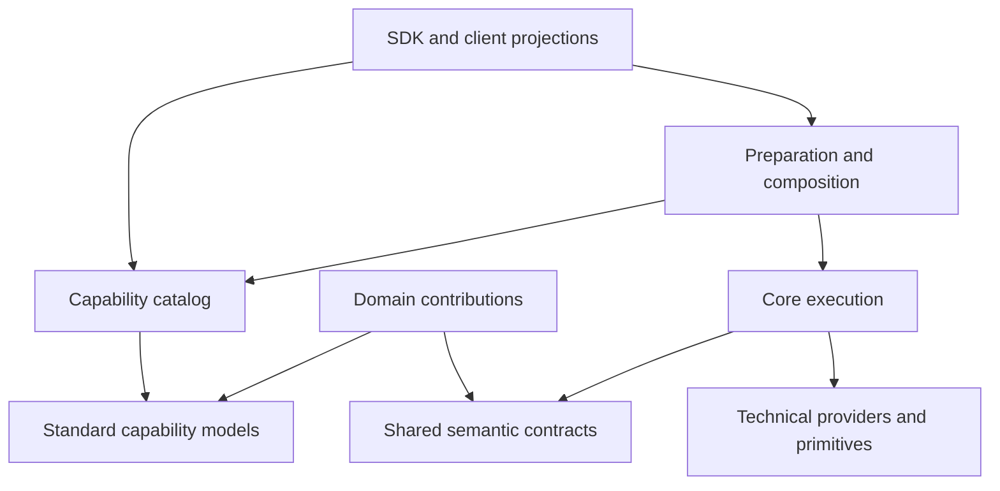

# Strategy Box: Architecture of Standard Commands and Domain Specifications

**Date:** 2026-11-26. **Status:** proposed target architecture and implementation-oriented design. **Scope:** Python package ownership, typed declarations, domain records, binding, executable composition, numerical inputs, resources, provenance and verification.

The target architecture has one authored ontology of standard commands and compositions, domain-owned knowledge that specializes command slots, and one preparation/execution path. The organizing object inside a publication domain is the continuing table `Series`; the organizing input for a numerical calculation is a selected `TimeSeries`, panel or coupled model input. These objects have different responsibilities and do not require matching registry entries. Every reusable fact has one authoring owner and is referenced wherever needed.

This document specifies a target rather than reporting implementation completion. File contents and API sketches illustrate contracts to implement; they are not executable claims about the installed library. The only independent release version is Stratbox's repository/package version. Exact source occurrences, fingerprints, state tokens and execution IDs remain evidence. The [functional companion](strategy_box_standard_commands_and_domain_specifications_functional_model_2026-11-26.md) defines the meaning and acceptance of these architectural choices.

## Contents

1. Dependency architecture — the owners and permitted import directions.
2. Package structure — concrete homes for definitions, knowledge and execution.
3. Core models — contracts, specifications, methods and targets.
4. Standard route and command catalog — one ontology and one definition owner.
5. Domain records — feeds, Series, shared knowledge and bindings.
6. File contents — a worked escrow declaration from shared facts to commands.
7. Resolution — deterministic binding, staged recognition and input agreement.
8. Composition and plan — logical purposes, physical work and required obligations.
9. Numerical calculations — direct series, table lifting and coupled models.
10. SORS — typed states, command graph and bounded iteration.
11. Execution integration — resource classes, sharing and value ownership.
12. Identities — reproducibility without component versioning.
13. Journals, effects and releases — common evidence and conditional publication.
14. Public APIs — direct calls, discovery and machine projections.
15. Architecture checks and acceptance — what must be proved locally.
16. Implementation sequence — semantic reconstruction and final ownership.
17. External references — the bounded technical foundations.

## 1. Dependency architecture: one direction for each responsibility

### 1.1. The standard model does not import a publisher



The bootstrap assembles standard declarations and domain contributions. That assembly edge is explicit and centralized; it does not authorize compiler or SDK business logic to branch on publisher identity. Domain methods can call technical primitives in their declared action scope. Standard definitions refer to typed method slots and lazy core handlers, rather than importing domain implementations.

| Code | Owner | Responsibility | Prohibited responsibility |
| --- | --- | --- | --- |
| O01 | `shared` | Values, data roles, provenance, periods, units, references and numerical data contracts. | Publisher dispatch, workflow execution or live clients. |
| O02 | `capabilities/model` | Callable kinds, graph AST, ports, target constraints, specification protocols and acceptance declarations. | Provider lifecycle or publisher-specific rules. |
| O03 | `capabilities/route` | Standard action families and permitted transitions/roles. | One pipeline per publisher or storage directory policy. |
| O04 | `capabilities/commands` | Authoritative standard command declarations. | Copied domain wrappers and concrete source URLs. |
| O05 | `capabilities/operations,scenarios,cascades` | Standard command graphs, purpose templates and coordination. | Sheet coordinates, native labels and source-format interpretation. |
| O06 | `domains/<domain>` | Series, feeds, method implementations, profiles, semantic dictionaries and analytical models. | Another executor, hidden save/notify pipeline or standard-definition mirror. |
| O07 | `composition` | Target resolution, specification binding, dependency closure and plan construction. | Scientific interpretation or requests to publisher sites. |
| O08 | `core` | Execution, resources, technical commands, effects and observation services. | Hard-coded publisher selection or source-specific financial formulas. |
| O09 | `sdk` | Thin invocation, discovery, controls and result projections. | Another catalog, business plan or direct method execution route. |

### 1.2. Domains specialize protocols rather than importing compositions

A domain contribution registers records and protocol implementations. A standard operation names a command and supplies a target/specification slot. Binding joins these declarations. The operation does not call `domains.cbr.*` or know which parser function was selected.

Ordinary core helpers such as decimal parsing, archive bounds and solver adapters remain Python functions. They become command implementations when an action needs an execution boundary. This keeps the public ontology smaller than the implementation function inventory.

The library stays usable in notebooks, hosted processes and platform applications. Environment-specific providers enter through neutral runtime interfaces. Desktop lifecycle, mobile lifecycle, deployment and actual protocol servers remain external application responsibilities.

## 2. Package structure: concrete target owners

### 2.1. Product packages

The following paths identify responsibilities. Files can be split when volume justifies it; their authority does not depend on a fixed count.

```text
src/stratbox/
    __init__.py
    shared/
        data/
            materials.py
            publications.py
            observations.py
            numerical.py
            products.py
            provenance.py
            qualification.py
        identity/
        time/
        reference/
    capabilities/
        model/
            contracts.py
            targets.py
            specifications.py
            domains.py
            definitions.py
            graph.py
            acceptance.py
            resources.py
        route/
            stages.py
            transitions.py
        commands/
            source.py
            material.py
            publication.py
            table.py
            observations.py
            calculations/
                arithmetic.py
                timeseries.py
                constraints.py
            products.py
            retention.py
        operations/
            source.py
            extracts.py
            calculations.py
            products.py
            releases.py
        scenarios/
            refresh.py
            analytical.py
        cascades/
            updates.py
            releases.py
        catalog/
            declarations.py
            snapshot.py
            descriptors.py
            validation.py
            generated/
    domains/
        cbr/
            domain.py
            catalog.py
            access/
                endpoints.py
                policies.py
            feeds/
                project_finance.py
                corporate_lending.py
            series/
                project_finance/
                    escrow.py
                corporate_lending/
                    debt.py
                    issuance.py
                reporting_forms/
            bindings/
                discovery.py
                tables.py
                alignment.py
                calculations.py
            profiles/
                discovery/
                layouts/
                interpretation/
                alignment/
                products/
            semantics/
                metrics.py
                periods.py
                units.py
                geography.py
            methods/
                discovery/
                tables/
                alignment/
            calculations/
                sors/
                    model.py
                    bindings.py
                    inputs.py
                    constraints.py
                    inheritance.py
                    certification.py
        fns/
        minfin/
        frank_rg/
        rosstat/
    composition/
        requests.py
        resolution.py
        binding.py
        preparation.py
        compiler.py
        plan.py
        explanation.py
    core/
        commands/
            source.py
            materials.py
            decoding.py
            interpretation.py
            calculations.py
            products.py
            retention.py
        execution/
            admission.py
            scheduling.py
            resources.py
            sharing.py
            values.py
            acceptance.py
            effects.py
            session.py
        network/
        storage/
        formats/
        numerical/
        observability/
        notifications/
        runtime/
    sdk/
        bootstrap.py
        client.py
        discovery.py
        machine.py
```

This listing is a package map, rather than a prescribed creation of empty modules. The same domain ownership pattern applies to the other four domains. A source with simple requirements can have fewer files while retaining the same typed roles.

### 2.2. Supporting owners

| Code | Path | Responsibility |
| --- | --- | --- |
| P01 | `tests/contracts/commands/` | Standard command invariants and method conformance. |
| P02 | `tests/domains/<domain>/` | Realistic source/layout and calculation semantics. |
| P03 | `tests/composition/` | Binding, closure, recipe variants and numerical lifting. |
| P04 | `tests/execution/` | Resource, sharing, cancellation, effects and ownership behavior. |
| P05 | `tests/integration/` | End-to-end publication and analytical purposes. |
| P06 | `tests/fixtures/` | Synthetic and retained publisher evidence with distinct provenance. |
| P07 | `scripts/` | Local architecture, catalog, package and relevant acceptance checks. |
| P08 | `docs/` | Maintained self-contained product specifications and usage. |
| P09 | `_mw/` | Research and implementation evidence; separate from runtime authority. |

One new top-level `ontology` package is unnecessary: `capabilities/route` and standard command declarations together are the explicit executable ontology. A generated table can project that ontology for inspection. It must not become another manually maintained definition source.

## 3. Core models: declarations that connect meaning and implementation

### 3.1. Targets distinguish source selection from numerical data

| Code | Target | Identifies | Applicable examples |
| --- | --- | --- | --- |
| T01 | `FeedTarget` | A publication channel. | Scan a shared index. |
| T02 | `SeriesTarget` | A continuing table Series. | Extract escrow observations. |
| T03 | `CalculationTarget` | A named analytical method/model and treatment. | SORS reconstruction or seasonal adjustment. |
| T04 | `ProductTarget` | A product specification. | Regional lending workbook. |
| T05 | Explicit value input | Already supplied material, observations, time series or model. | Adjust one database-selected history. |

T05 does not need a new Series record. Its calculation contract still requires units, period meaning, grain and evidence. A method can be selected explicitly or by a reviewed general calculation profile, independently of publisher identity.

### 3.2. Shared data and callable contracts

Illustrative declarations in `capabilities/model/contracts.py`:

```python
@dataclass(frozen=True)
class SourceRequirement:
    series_ids: frozenset[str]
    issue_policy: str
    attribution: str

@dataclass(frozen=True)
class PortContract:
    type_id: str
    role: str | None
    predicates: tuple[str, ...]
    source: SourceRequirement | None = None

@dataclass(frozen=True)
class SpecificationSlot:
    name: str
    protocol_id: str
    required: bool = True

@dataclass(frozen=True)
class CommandDefinition:
    id: str
    inputs: Mapping[str, PortContract]
    outputs: Mapping[str, PortContract]
    parameters: Mapping[str, ParameterDefinition]
    slots: tuple[SpecificationSlot, ...]
    implementation: str
    work: WorkContract
    effects: EffectContract
    acceptance: AcceptanceContract
    reuse: ReuseContract
```

The sketches use ordinary dataclasses and typed protocols; surrounding imports and utility declarations are omitted. Authored mappings must be normalized to immutable values during catalog admission. `frozen=True` alone does not freeze a nested mutable mapping.

`type_id` identifies the semantic value contract, without a schema-version field. Runtime type, required columns, units, periods and scientific predicates supplement nominal identity. Type names alone cannot establish that a population stock is an index.

### 3.3. Specification protocols are narrow and command-specific

| Code | Protocol | Required knowledge/result |
| --- | --- | --- |
| SP01 | `RequestBuilder` | Request envelope and access requirements from an explicit locator context. |
| SP02 | `PublicationScanner` | Qualified issue/asset listing from supplied index evidence. |
| SP03 | `UpdateAssessor` | Comparison scope, baseline requirements and qualified assessment. |
| SP04 | `TableExtractor` | Physical table selection and structural coverage. |
| SP05 | `TableInterpreter` | Series-local observations and semantic findings. |
| SP06 | `ObservationAligner` | Admitted mappings and integrated grain. |
| SP07 | `NumericalMethod` family | A method-specific numerical input/output promise. |
| SP08 | `ViewPreparer` | Product content and qualification from accepted data. |

For example, `TableInterpreter.interpret(table, spec, context)` receives a `TableInterpretationSpec`, not an arbitrary domain dictionary. Its result includes a typed dataset, coverage and findings. Its context exposes only the services permitted by the command's effect contract.

Protocol implementations are lazy method references with declared supported input conditions and backend requirements. A method reference is resolved through registered code, rather than an import path supplied inside a data artifact.

### 3.4. Bound commands retain exact decisions

```python
@dataclass(frozen=True)
class BoundCommand:
    command_id: str
    target: Target | None
    method_id: str | None
    specification: EffectiveSpecification | None
    input_contracts: Mapping[str, PortContract]
    output_contracts: Mapping[str, PortContract]
    source_requirements: tuple[SourceRequirement, ...]
    resources: ResourceClaim
    effects: EffectContract
    acceptance: AcceptanceContract
    dependency_fingerprint: str
```

Preparation fixes B01–B06 from the functional model. Input values can remain future references in the plan, but the applicable constraints and the source of each unresolved decision are explicit. Interpretation cannot silently resolve a different Series after admission.

## 4. Standard route and command catalog: one authored action language

### 4.1. The route indexes actions without duplicating them

`capabilities/route/stages.py` defines semantic stage IDs such as `inspect`, `acquire`, `decode`, `interpret`, `align`, `calculate`, `prepare`, `render`, `retain` and `release`. `transitions.py` declares admissible role transitions and relevant command families.

A command has one action identity and can participate in several route roles. `command.material.fetch` can acquire an index for inspection or acquire a workbook for extraction. Stage membership is navigation and planning information. It is not the source of scheduler resource claims.

| Code | Standard command | Inputs → result | Specification owner |
| --- | --- | --- | --- |
| CMD01 | `command.request.prepare` | Locator context → request envelope. | Domain request binding or explicit general request. |
| CMD02 | `command.material.fetch` | Request envelope → exact material and source observation. | Standard transport options plus referenced access policy. |
| CMD03 | `command.publication.scan` | Index evidence → qualified issue/asset listing. | Feed binding. |
| CMD04 | `command.issue.select` | Listing and occurrence request → selected asset uses. | Series occurrence/selection policy. |
| CMD05 | `command.source.assess` | Observed evidence and baseline → change assessment. | Series/feed assessment policy. |
| CMD06 | `command.workbook.decode` | Material and decode options → physical workbook evidence. | General format requirements. |
| CMD07 | `command.table.extract` | Physical evidence → selected physical tables. | Domain layout/extraction binding. |
| CMD08 | `command.table.interpret` | Tables → Series-local observations. | Domain interpretation binding. |
| CMD09 | `command.observations.align` | Observations → integrated observations. | Mapping and reference specification. |
| CMD10 | `command.timeseries.prepare` | Observations and selection → numerical history. | Numerical grain/calendar specification. |
| CMD11 | `command.timeseries.adjust` | Numerical history → adjustment result. | General or specialized analytical treatment. |
| CMD12 | `command.view.prepare` | Accepted data → analytical view. | Product specification. |
| CMD13 | `command.product.render` | View → encoded product. | Format/style parameters. |
| CMD14 | `command.artifact.commit` | Encoded value and destination → immutable reference/receipt. | Standard storage contract. |

CMD11 is complemented by specific commands for validation, diagnostics, arithmetic and constraint modeling. The catalog grows when a new functional concept or distinct promise appears, not whenever another source uses the same action.

### 4.2. Command definitions contain execution-relevant meaning

Illustrative content of `capabilities/commands/table.py`:

```python
INTERPRET = CommandDefinition(
    id="command.table.interpret",
    inputs={"table": PHYSICAL_TABLE_PORT},
    outputs={"dataset": SOURCE_DATASET_PORT, "assessment": ASSESSMENT_PORT},
    parameters={},
    slots=(SpecificationSlot("interpretation", "table.interpreter"),),
    implementation="stratbox.core.commands.interpretation:interpret_table",
    work=WorkContract(kind="semantic", base={"cpu": 1}),
    effects=EffectContract.none(),
    acceptance=AcceptanceContract(
        checks=("source_agreement", "semantic_schema", "coverage", "qualification")
    ),
    reuse=ReuseContract.pure_if_method_declares(),
)
```

This declaration contains neither a publisher name nor a workbook layout. `core.commands.interpretation` validates the bound spec, calls the selected registered `TableInterpreter`, validates its result and returns the named outputs. It does not choose a method by inspecting a domain prefix.

### 4.3. Canonical declaration ownership

| Code | Artifact | Authoritative owner | Derived projection |
| --- | --- | --- | --- |
| A01 | Standard command | Typed declaration in `capabilities/commands`. | Catalog descriptor and documentation table. |
| A02 | Operation/scenario/cascade | Typed graph in its capability package. | Explain plan and machine descriptor. |
| A03 | Domain fact/profile | Domain declaration or referenced package resource. | Effective specification and generated discovery index. |
| A04 | Method registration | Domain/technical contribution with protocol and locator. | Lazy method index. |
| A05 | Readiness evidence | Scoped verification record. | Coverage report. |

Use Python as the initial canonical declaration format for typed code-adjacent definitions. Large dictionaries/layout data can use validated JSON or another data format where appropriate. A Python declaration and a YAML record must never independently author the same command or Series facts. Generated projections are checked for freshness and carry their origin fingerprint.

## 5. Domain records: referenced facts instead of repeated pipelines

### 5.1. The domain contribution is declarative

Illustrative content of `domains/cbr/domain.py`:

```python
DOMAIN = DomainDefinition(
    id="cbr",
    title="Bank of Russia",
    series_packages=("stratbox.domains.cbr.series",),
    feed_packages=("stratbox.domains.cbr.feeds",),
    binding_packages=("stratbox.domains.cbr.bindings",),
    method_packages=("stratbox.domains.cbr.methods",),
    calculation_packages=("stratbox.domains.cbr.calculations",),
)
```

`catalog.py` explicitly collects that domain's declarations and registers lazy methods. It verifies unique IDs and references. It contains no duplicate endpoint list or imperative source-routing chain. Package traversal for discovery uses admitted descriptors or a generated index; arbitrary import side effects do not register runtime definitions.

### 5.2. Series declaration fields

| Code | Field group | Typical contents |
| --- | --- | --- |
| SR01 | Identity | Stable ID, domain, title and table family. |
| SR02 | Publication linkage | Feed reference, issue selection policy and asset role rules. |
| SR03 | Source semantics | Grain, metric dictionary, periods, units, perimeter and native status tokens. |
| SR04 | Representations | Supported asset/media and layout conditions. |
| SR05 | Binding references | Applicable command/specification references. |
| SR06 | Calculations | Eligible input roles or model references with applicability conditions. |
| SR07 | Products | Reusable product-specification references. |
| SR08 | Support | Exact supported conditions and independent readiness evidence references. |

A global Series catalog is a generated/indexed view over these domain owners. Monthly occurrence inventories belong to a source observation store. They do not mutate the authored Series declaration.

### 5.3. Explicit reuse hierarchy

Use references for domain access, feed, layout family, semantic dictionary, mapping and calculation treatment. Each command binding selects the required references. The resolver produces a command-specific immutable effective object.

A family can provide a reusable binding template with mandatory typed slots. A Series applies it by supplying its declared differences. This is explicit typed construction, not arbitrary inheritance with undocumented precedence.

| Code | Conflict | Resolution |
| --- | --- | --- |
| CF01 | Same endpoint ID, different authored URL | Catalog admission fails: one fact has competing owners. |
| CF02 | Two layouts match equally | Binding is ambiguous until evidence or explicit method choice distinguishes them. |
| CF03 | Series unit differs from profile unit | Reject, or require a declared conversion specification. |
| CF04 | User changes selection dates | Allowed within the invocation contract; factual publication semantics remain intact. |
| CF05 | User changes stock into flow through an override | Reject semantic contradiction. |
| CF06 | Shared mapping has an unresolved native code | Preserve unresolved mapping/coverage; do not guess equivalence. |

## 6. File contents: escrow from shared facts to bound interpretation

### 6.1. Shared access and publication channel

The examples below intentionally omit unverified workbook coordinates. Exact layout declarations must be supported by actual reviewed material.

`domains/cbr/access/endpoints.py` owns publisher addresses:

```python
CBR_SITE = Endpoint(id="cbr.site", base_url="https://www.cbr.ru")
PROJECT_FINANCE_INDEX = Endpoint(
    id="cbr.project_finance.index",
    base_ref="cbr.site",
    path_ref="cbr.project_finance.index_path",
)
```

The referenced path is authored once in an endpoint resource after verification. Its use in several profiles is a reference, rather than copied URL text. `access/policies.py` declares request restrictions, compatible runtime resource key and transport limits. It does not construct a global live HTTP client at import time.

`domains/cbr/feeds/project_finance.py` owns the publication channel:

```python
PROJECT_FINANCE = FeedSpec(
    id="cbr.project_finance",
    endpoint_ref="cbr.project_finance.index",
    access_ref="cbr.public_statistics",
    request_binding_ref="cbr.project_finance.index_request",
    scan_binding_ref="cbr.project_finance.scan",
)
```

### 6.2. The single continuing Series record

`domains/cbr/series/project_finance/escrow.py`:

```python
ESCROW = SeriesSpec(
    id="cbr.project_finance.escrow",
    domain_id="cbr",
    feed_ref="cbr.project_finance",
    occurrence_ref="cbr.project_finance.reporting_date",
    asset_selection_ref="cbr.escrow.assets",
    semantics_ref="cbr.escrow.observations",
    bindings=(
        "cbr.escrow.select_issue",
        "cbr.escrow.assess_update",
        "cbr.escrow.extract_table",
        "cbr.escrow.interpret_table",
        "cbr.escrow.align",
    ),
    calculation_roles=("comparable_level_changes",),
    products=("cbr.escrow.regional_table",),
)
```

The exact support set is a reviewed declaration alongside these bindings. `calculation_roles` advertises potential model input roles; it does not certify every possible calculation on all escrow metrics.

### 6.3. Bindings select methods and referenced facts

`domains/cbr/bindings/tables.py`:

```python
ESCROW_INTERPRET = CommandBinding(
    id="cbr.escrow.interpret_table",
    command_id="command.table.interpret",
    target=SeriesSelector(exact="cbr.project_finance.escrow"),
    applicability=AllOf(
        RepresentationIs("workbook"),
        LayoutMatches("cbr.escrow.reviewed_layout"),
    ),
    method_ref="cbr.escrow.table_interpreter",
    specification=TableInterpretationSpec(
        layout_ref="cbr.escrow.reviewed_layout",
        fields_ref="cbr.escrow.fields",
        periods_ref="cbr.project_finance.periods",
        units_ref="cbr.escrow.units",
        statuses_ref="cbr.statistical_value_tokens",
    ),
    output_schema_ref="cbr.escrow.observations",
)
```

`profiles/layouts/escrow.py` owns reviewed selectors and recognition predicates. `semantics/metrics.py` owns escrow measure definitions; source statuses shared by several CBR tables have one shared owner. `methods/tables/escrow.py` implements `TableInterpreter`. Several layout bindings can reference that implementation if they satisfy its structural requirements.

An HTML historical asset can have another layout and method binding under the same continuing Series when its table meaning is compatible. Its absence remains a support gap; it cannot be concealed by declaring workbook support alone as full history.

### 6.4. Standard operation graph contains the reusable procedure

`capabilities/operations/extracts.py` illustrates a supplied-original variant:

```python
EXTRACT_WORKBOOK_SERIES = OperationDefinition(
    id="operation.series.extract_workbook",
    inputs={"original": IDENTIFIED_ORIGINAL_PORT},
    parameters={"target": SERIES_TARGET_PARAMETER},
    body=GraphBody(
        calls=(
            Call("decode", "command.workbook.decode", inputs={
                "material": InputRef("original.material")
            }),
            Call("select", "command.table.extract", inputs={
                "workbook": OutputRef("decode", "workbook")
            }, binding=TargetRef("target")),
            Call("interpret", "command.table.interpret", inputs={
                "table": OutputRef("select", "table")
            }, binding=TargetRef("target")),
            Call("validate", "command.observations.validate", inputs={
                "dataset": OutputRef("interpret", "dataset")
            }, binding=TargetRef("target")),
        ),
        outputs={"dataset": OutputRef("validate", "dataset")},
        required_checks=("validate",),
    ),
    acceptance=QUALIFIED_SOURCE_EXTRACT_ACCEPTANCE,
)
```

The graph uses no CBR implementation detail. Preparation carries original asset/source-use evidence into target constraints for select, interpret and validate. Physical decoding remains source-neutral. A caller supplying already decoded evidence uses the compatible graph variant starting at table selection.

Source discovery and acquisition are upstream operations. A refresh scenario composes them with this extraction operation. This prevents an interpreter from silently fetching different material when a supplied workbook is unsupported.

### 6.5. What changes for another Series

For a compatible new table, add its Series record, semantic dictionary entries and applicable binding references. Reuse access, feed, decoder, shared layout method and standard operation. A genuinely new layout adds reviewed structural knowledge and, if needed, a new method implementation. A genuinely new action promise adds a standard capability definition and conformance tests.

The decision is driven by the changed responsibility. It is not “one table means another copy of the pipeline.”

## 7. Resolution: deterministic specialization and actual input agreement

### 7.1. Initial binding algorithm

| Code | Step | Result or rejection |
| --- | --- | --- |
| BR01 | Resolve the exact callable and its requested outputs/effects. | Standard definition or unknown capability. |
| BR02 | Resolve opaque target identity. | Domain/feed/Series/model record or unknown target. |
| BR03 | Assess supplied input evidence. | Known source/issue/material facts or explicit attribution state. |
| BR04 | Collect declared candidates for each command slot. | Referenced binding set; no arbitrary registry scan inside a handler. |
| BR05 | Evaluate applicability against known facts. | Applicable, rejected or deferred candidates with reasons. |
| BR06 | Resolve exact method/spec references. | One compatible choice or missing/ambiguous binding. |
| BR07 | Normalize referenced facts and allowed parameters. | Immutable effective specification and dependency fingerprint. |
| BR08 | Validate target/input/output source requirements. | Agreement or source-context conflict. |
| BR09 | Combine base and method resource/effect contracts. | Admissible bound work; no reduced mandatory claims. |
| BR10 | Freeze the chosen binding in the prepared plan. | Inspectable `BoundCommand` and acceptance obligations. |

Preparation reports conflicts before expensive execution where the necessary facts already exist. A known B original cannot fulfill an A-only contract. A shared asset membership relation can prove that one original supports both A and B.

### 7.2. Staged recognition is explicit

Layout recognition often requires decoding. The initial plan contains the standard decode and a deferred interpretation slot. Recognition returns structural evidence. The coordinator runs the same binding procedure for the continuation and admits the selected commands through the same resource path.

The plan explanation distinguishes `resolved`, `deferred_until_evidence` and `unsupported`. Deferred selection is bounded by declared candidates and expansion limits. Repeated recognition cannot create unbounded alternatives or silently change the target.

### 7.3. Binding checks repeat at appropriate boundaries

| Code | Boundary | Required check |
| --- | --- | --- |
| BP01 | Supplied input admission | Actual evidence satisfies the prepared input contract. |
| BP02 | Dynamic continuation admission | New evidence supports the selected binding and target. |
| BP03 | Method result acceptance | Output schema, source uses, units, periods and coverage satisfy the bound promise. |
| BP04 | Operation acceptance | Requested functional result and checks are satisfied. |
| BP05 | Scenario/cascade acceptance | Required purposes, membership and effects are satisfied. |

Runtime provenance checks do not simply compare a caller's label with itself. They compare selected target requirements with the independently retained input/output evidence. Unknown provenance remains qualified rather than upgraded by convenience naming.

## 8. Composition and plan: visible command work and retained logical purposes

### 8.1. Three representations serve different consumers

| Code | Representation | Owns |
| --- | --- | --- |
| PL01 | Authored capability graph | Human-readable standard procedure and input/output references. |
| PL02 | Prepared logical plan | Bound targets/specifications, scopes, acceptance and obligations. |
| PL03 | Physical work plan | Eligible shared producers, resource claims, values and effects. |

Lowering never erases operation, scenario or cascade boundaries. Each logical scope retains named outputs, required checks, required effects and completion assessment. One physical producer can feed several logical uses.

### 8.2. Closure starts at requested results and obligations

Dependency closure includes selected outputs, required checks, required completion and effects. A save can remain required even when its receipt has no data consumer. Supplying a valid retained view eliminates upstream calculation; a different destination adds a new effect without invalidating the view.

Closure determines which optional backends are actually needed. A local workbook extraction should not fail because an unrelated PDF or solver backend is absent. Resolution of unused branches must not impose unavailable-provider errors.

### 8.3. Recipes express topology rather than publisher dispatch

Standard recipe variants include direct asset, index-selected asset, bounded archive members, multi-asset input bundle and already supplied data. Domain records declare the necessary capabilities and data relationships. Preparation selects a compatible recipe and binds its slots.

If a new topology is real, author an inspectable standard graph. Do not add another `if publisher == ...` branch in compiler, SDK or global graph builder. A target-specific product can select known Series IDs, but its source details still resolve through command bindings.

## 9. Numerical calculations: direct histories, whole tables and coupled inputs

### 9.1. Numerical contracts live separately from publication declarations

Illustrative `shared/data/numerical.py`:

```python
@dataclass(frozen=True)
class TimeSeries:
    coordinates: NumericalCoordinates
    periods: tuple[Period, ...]
    values: tuple[QualifiedNumber, ...]
    frequency: str
    measure_kind: str
    unit: Unit
    calendar: CalendarSpec
    provenance: DerivationBasis

@dataclass(frozen=True)
class CalculationContract:
    input_topology: str
    required_semantics: tuple[str, ...]
    admissible_missingness: str
    required_diagnostics: tuple[str, ...]
    output_qualifications: tuple[str, ...]
```

Numerical coordinates identify the selected metric/entity/dimensions/perimeter. Two different publication Series can contribute to one admitted numerical history only through explicit comparability and alignment. One publication Series can produce thousands of numerical histories without thousands of source declarations.

### 9.2. Database-to-calculation route

The standard route is:

1. `command.dataset.query` applies typed filters/projection to a database snapshot or provider reference.
2. `command.timeseries.prepare` selects value/time coordinates and enforces a unique remaining grain.
3. A calculation operation validates applicability, executes a specific numerical method and qualifies its diagnostics.
4. Output assembly returns derived observations and their source/query basis.
5. Optional product/retention operations handle representation and effects.

For example, filters can select one metric, region, currency and portfolio perimeter. The query carries an observation window and exact retained snapshot identity or source-query observation evidence. Provider pagination is bounded and preserves the declared query scope. A query against a changing database needs an explicit snapshot/coherence policy before the result can claim one analytical basis.

No acquisition or publisher parser is required if the database result already satisfies the numerical input contract. A caller-provided in-memory history follows the same numerical path.

### 9.3. Whole-table application lifts the numerical operation

`operation.calculation.apply_table` uses a declared `SeriesPartitionSpec`:

```python
SeriesPartitionSpec(
    time_coordinate="period",
    value_coordinate="value",
    group_by=("metric", "region", "currency", "perimeter"),
    metadata_from=("unit", "measure_kind", "calendar"),
    completion="all_selected",
    coherence="independent",
)
```

The field names are illustrative. The actual dataset contract supplies them. For wide tables the partition spec identifies the time axis, value columns and each column's semantics. An all-numeric table without period/grain metadata does not automatically satisfy this contract.

The operation freezes selected units, constructs numerical histories, maps an independently applicable calculation with bounded concurrency and joins accepted results. It returns a `CalculationBatchResult` containing per-unit outputs and status/diagnostics, plus expected and observed membership.

| Code | Completion policy | Consequence |
| --- | --- | --- |
| CP01 | `all_selected` | Any required unsuitable, failed or missing unit prevents a complete-table success. |
| CP02 | `eligible_subset` | Every excluded unit is reported with a reason; accepted outputs retain partial coverage. |
| CP03 | Explicit required/optional units | Required units govern completion; optional outcomes remain visible. |

This lift is graph structure around a numerical command. It does not add publisher-specific adjustment commands or an unbounded loop inside a handler. Result ordering is deterministic by frozen membership rather than task completion order.

The table-level calculation specification separately declares cross-unit coherence: `independent`, `indirect_from_components` or `reconciled`. Independent adjustment of national, district and regional histories establishes each estimate and its diagnostics, not preservation of their sum relationships. Indirect adjustment requires reviewed nonoverlapping membership, compatible units/periods and an aggregation rule; reconciliation requires an explicit numerical method and constraints. Their dependent aggregation/reconciliation commands follow the independent estimates in the graph. Reported totals and directly/indirectly adjusted totals retain distinct derivations. A table result can claim full selected-unit coverage while claiming no aggregate coherence.

### 9.4. Coupled models cannot be mapped independently

Calculation contracts declare `single_series`, `independent_series` or `coupled` input topology. Some seasonal methods are univariate; others need a coupled panel. SORS generally uses coupled regional/industry/publication relationships, including a single-date cross-section.

A coupled method receives a validated `ModelInputBundle`. Partitioning it per column is invalid unless its model explicitly declares those partitions independent. Requested output filters apply after necessary inference. The input-scope resolver and output projector have separate responsibilities.

### 9.5. Seasonal adjustment command composition

`operation.timeseries.adjust` contains prepare/validate, adjustment estimation, diagnostics and qualified output assembly. `command.timeseries.adjust` contains the bounded numerical estimation procedure itself. General statistical implementations belong in reusable numerical code; domain treatment supplies measure semantics, compatible histories and reviewed defaults.

Diagnostics remain named outputs, and acceptance can require selected findings. Exact input history and treatment accompany adjusted/trend/seasonal components. Official Census guidance supports retaining residual-seasonality and stability diagnostics, including the effect of extending input history. [X03]

## 10. SORS: meaningful states and bounded scientific iteration

### 10.1. Domain model and numerical machinery have different homes

| Code | Responsibility | Target owner |
| --- | --- | --- |
| SO01 | SORS input roles, portfolio scopes, equations and rounding/inheritance rules | `domains/cbr/calculations/sors`. |
| SO02 | Source extraction and field interpretation | CBR Series methods/profiles bound to standard source commands. |
| SO03 | Generic linear model, numerical bounds and solver adapter | `core/numerical` where independently reusable. |
| SO04 | Standard constraint/bounds/feasibility command definitions | `capabilities/commands/calculations/constraints.py`. |
| SO05 | Reconstruction operation graph and iteration structure | `capabilities/operations/calculations.py`. |
| SO06 | Regional/industry projection, rendering and saving | Standard product operations with bound product specs. |

A `CalculationTarget` selects the SORS model once. Participating Series refer to model input roles rather than copying the model into each source record.

### 10.2. Typed states provide restart and acceptance boundaries

| Code | State | Required content |
| --- | --- | --- |
| SS01 | `ModelInputBundle` | Pinned occurrences/materials, typed observations, exact role membership and references. |
| SS02 | `ConstraintGraph` | Quantities, equations, intervals, source coordinates and semantic model basis. |
| SS03 | `InferenceState` | Bounds, accepted/provisional facts, derivations, conflicts and state fingerprint. |
| SS04 | `CompiledProblem` | Numerical model, variable mapping and the SS02/SS03 basis. |
| SS05 | `FeasibilityAssessment` | Status, solver evidence, tolerances and exact problem basis. |
| SS06 | `OptimizationResult` | Per-target bounds, attainment/proof status and exact feasible basis. |
| SS07 | `CertifiedValues` | Exact/rounded/inherited/reconstructed categories and unresolved intervals. |

After inference state changes, solver work that depends on prior bounds cannot be reused merely because its model target has the same name. The state fingerprint and exact compiled-problem basis are dependencies.

### 10.3. Iteration is a bounded composition construct

Illustrative graph structure:

```python
RepeatUntil(
    id="deterministic_closure",
    state=InputRef("inference_state"),
    body=GraphBody(
        calls=(
            Call("propagate", "command.bounds.propagate"),
            Call("inherit", "command.facts.inherit"),
            Call("reconcile", "command.facts.reconcile"),
        ),
        outputs={"state": OutputRef("reconcile", "state")},
    ),
    stop=PredicateRef("sors.no_relevant_state_change"),
    limits=IterationLimits(max_passes=1000, elapsed_seconds=600),
    on_limit="incomplete",
)
```

The numerical limits are illustrative invocation settings, rather than recommended methodological defaults. The actual body carries explicit state references, command bindings and input/output contracts.

Each pass lowers to an acyclic sequence. The coordinator decides whether to admit another pass after accepted state and stopping assessment exist. Initial and continuing work obey identical resource, cancellation and effect rules. Ordinary graph cycles remain invalid. A finite fold over known items cannot substitute for unknown-until-convergence iteration without an explicit stopping contract.

Iteration records pass ID, old/new scientific state, accepted derivations, stopping findings and remaining limits. Durable continuation additionally requires provider-retained checkpoints; an in-memory callback does not establish persistence.

### 10.4. Global feasibility and output certification remain mandatory

The restoration graph reaches deterministic closure, compiles/checks global feasibility, performs eligible optimization, reconciles new facts and repeats required closure/feasibility before final certification. It never promotes a timed-out optimization result into a proven exact value.

Strict and relaxed analytical treatments remain different effective specifications. Publication precision, numeric tolerance, inherited facts and arithmetic residuals retain their qualifications. A small output projection preserves the complete necessary model inputs.

## 11. Execution integration: resources, physical identity and value ownership

### 11.1. Resource contracts are independent of route-stage labels

| Code | Work class | Mandatory base claim | Typical additional claim |
| --- | --- | --- | --- |
| W01 | `network` | Endpoint/provider request capacity. | In-flight response bytes and staging space. |
| W02 | `storage_read` | Storage I/O capacity. | Read-byte window. |
| W03 | `archive` | Decode/CPU capacity. | Compressed/unpacked/member limits. |
| W04 | `decode` | Parse capacity. | Memory, cells, pages and decoder backend. |
| W05 | `semantic` | CPU or admitted semantic worker capacity. | Observation count and dictionary footprint. |
| W06 | `calculate` | CPU capacity. | Model memory and numerical backend. |
| W07 | `solver` | CPU and solver capacity. | Solver memory, elapsed time and numerical backend availability. |
| W08 | `render` | Rendering capacity. | Encoded bytes and format backend. |
| W09 | `storage_write` | Write capacity and effect coordination. | Staging bytes and conditional-write support. |

A command's mandatory claim and method-specific requirements combine monotonically. Binding cannot lower a decode claim to zero. Empty stage metadata must never make a heavy parser look like a cost-free inspection action.

Bound estimates account for actual input size when available. Estimates and limits have different meanings: an estimate helps scheduling; a supported runtime limit constrains behavior. Arbitrary third-party numerical code may require a host process boundary for hard memory/termination guarantees. The library reports the provider guarantee it actually has.

### 11.2. Share live resources separately from work

An HTTP resource key includes runtime provider, access context, compatible policy and observation requirements where relevant. It selects a client/pool. Opening and cleanup belong to the session resource manager.

A request work identity includes method, exact target URL syntax and query order, relevant headers/body, representation options, access context, observation/freshness policy and retained-validator basis. Preserve reserved/escaped syntax and repeated query parameters. Normalization is allowed only for equivalences established by the request contract; sorting query parameters or decoding reserved characters is not a general equivalence rule. A connection-pool origin key can separately normalize proven origin equivalences without changing request identity. Read-only POST requests require explicit semantics; a method name alone cannot determine whether work is shareable.

A decode identity includes material digest, selected member/representation, decode options and implementation/build dependency. Its logical source uses remain separate. An interpretation identity additionally includes effective semantic specification, Series requirement and relevant reference contents.

### 11.3. Logical uses survive physical sharing

| Code | Physical owner | Logical owner |
| --- | --- | --- |
| SH01 | One index response. | Several Series discovery uses, each with observation/coverage facts. |
| SH02 | One workbook decode. | Several table interpretations and a readable representation. |
| SH03 | One pure numerical result. | Several products/scenario outputs satisfying their own contracts. |
| SH04 | One retained immutable byte object. | Distinct save/publication obligations and destination receipts. |

Effects do not disappear through physical value reuse. Writing the same bytes to two destinations remains two obligations. A provider may internally deduplicate storage while returning the required distinct receipts.

Mutable dataframes need copy-on-write or owned copies before mutation. Reference counting/leases account for downstream consumers, retained result handles and effects. Completion of a run does not free memory still owned by a live result handle. Cancellation detaches a logical consumer and releases its leases; shared producer cancellation follows the remaining demand.

## 12. Identities: exact evidence with one release lifecycle

### 12.1. Eliminate independent component-version fields

| Code | Object | Identification approach |
| --- | --- | --- |
| ID01 | Stratbox implementation | One package/repository release version and exact build/commit identity. |
| ID02 | Command, contract, profile, method or binding | Stable descriptive ID and computed declaration/dependency fingerprint. |
| ID03 | Reference dictionary | Semantic identity, effective dates where meaningful and exact content fingerprint. |
| ID04 | Historical source layout | Explicit date/structure applicability; no profile release counter. |
| ID05 | Source issue/material | Publication facts, observation ID and exact material digest. |
| ID06 | Calculation | Input basis, effective treatment and implementation dependency fingerprint. |
| ID07 | Mutable provider state | Opaque state token used as a concurrency precondition. |

Do not add `schema_version`, `definition_revision`, `profile_version`, `rules_version`, `method_version`, per-event release numbers or component compatibility matrices. Artifact descriptors follow the current library contract. Historical formats are supported through explicit known readers or regenerated from originals when needed; preserving every old internal format is not an independent compatibility obligation.

External backend identity can be recorded as observed execution-environment evidence when it affects numerical reproducibility. It does not become another Stratbox-managed release lifecycle.

### 12.2. Fingerprint construction is explicit and canonical

A dependency fingerprint covers the relevant standard definition, effective spec, method identity, implementation/build identity and exact reference content. A work identity also covers actual inputs and semantic parameters. Canonical serialization preserves decimals, ordering rules, missingness and significant distinctions; it rejects unstable object representations.

Do not include unrelated whole-domain configuration in a command key. A change to an unused product style should not invalidate workbook interpretation. Conversely, omitting a referenced period or unit rule would permit unsafe reuse.

The conservative default includes exact Stratbox build identity, invalidating computational reuse across builds. Selective cross-build reuse is an optimization admitted only with a proven dependency footprint. Development builds need an exact working-source fingerprint or disabled durable result reuse.

### 12.3. Logical transitions and content identities differ

The update assessor compares a candidate observation with an identified predecessor and comparison scope. A → B → A has two transitions even if its final content digest equals the initial one. Notification deduplication can reference the transition identity, while material storage can deduplicate identical bytes.

Storage compare-and-set uses `expected_token` or an expected-state fingerprint. That token is not a public semantic version. It protects against replacing a newer current pointer merely because an older task finished later.

## 13. Journals, effects and releases: common evidence contracts

### 13.1. Journal facts are produced by the execution path

| Code | Fact | Required correlation |
| --- | --- | --- |
| J01 | Command admitted/started/finished | Run, logical invocation, physical work and attempt. |
| J02 | Named output accepted | Callable kind/scope, output name, value identity, coverage and qualification. |
| J03 | Source assessment | Series/feed, observation, predecessor, comparison scope and outcome. |
| J04 | Effect outcome | Effect authority, destination/provider scope and receipt/uncertainty. |
| J05 | Composition completion | Operation/scenario/cascade obligations and outcome. |
| J06 | Numerical unit outcome | Calculation treatment, unit coordinates, input basis and diagnostics. |

Journal storage partitions by function/run/time or another bounded key. Result payloads use retained references rather than embedding large workbooks or numerical arrays in every event. Cursors support subscription recovery without scanning an unbounded monolithic file.

Domain methods return findings and proposed domain facts. The common acceptance path qualifies and journals them. A method does not directly emit a completion claim or send a notification.

### 13.2. Notification dispatch uses retained facts

Subscriptions select J02–J06 by callable kind, scope, target, outcome, output and fact predicates. They create dispatch intents with deduplication keys and independent attempt/receipt state. Delivery uncertainty is reconciled according to channel capabilities.

All four callable kinds remain subscribable. Shared physical execution emits independent logical acceptance/completion facts as needed. A source-transition notification can deduplicate across those logical scopes when policy explicitly selects that business event.

Completion notifications run after completion facts exist. A task can require delivery about an earlier accepted output, but cannot depend on its own not-yet-existing terminal event.

### 13.3. Accepted lineage, storage receipt and release basis are distinct

`AcceptedMember` should combine:

```python
@dataclass(frozen=True)
class AcceptedMember:
    value_ref: AcceptedValueRef
    derivation: VerifiedDerivationBasis
    material_ref: ImmutableMaterialRef
    retention_receipt: ConfirmedEffectReceipt
```

The release assembler verifies that the encoded material is derived from the accepted value, that the derivation uses the required pinned inputs, and that the retained object matches the material identity. Neither caller-supplied labels nor matching arbitrary dictionaries establish these relations.

W3C PROV-DM distinguishes data entities, generating activities and derivation relationships; this supports retaining those relations separately. The release's concrete coherence checks are local architectural requirements. [X02]

### 13.4. Immutable members and conditional publication

The release graph validates required member acceptance and actual lineage, verifies confirmed immutable retention, builds the manifest and conditionally publishes its current pointer. The manifest records content identities, actual derivation basis and exact membership.

An immutable reference requires a real store guarantee: retained content-addressed objects or equivalent provider support. A hash written beside an overwriteable path can detect mismatch but cannot preserve bytes. Pointer compare-and-set protects publication order; it does not protect member contents.

For a simple file provider, immutable content can be retained under digest-derived object paths with controlled creation and cleanup, while a separate manifest/current pointer is conditionally updated. The provider must state whether its atomicity and retention guarantees are sufficient. If that guarantee is unavailable, the release reports the reduced delivery scope.

An uncertain member write prevents a confirmed complete-release claim. Accepted data members can remain usable independently. Unknown publication outcome is reconciled by effect identity and expected state before another pointer write.

## 14. Public APIs: the same capabilities for every consumer

### 14.1. Direct commands and compositions

Illustrative client calls:

```python
box.invoke(
    "command.table.interpret",
    target=SeriesTarget("cbr.project_finance.escrow"),
    inputs={"table": retained_physical_table},
)

box.invoke(
    "scenario.series.refresh",
    target=SeriesTarget("cbr.project_finance.escrow"),
    parameters={"periods": requested_periods},
    goals={"extract": REQUIRED, "retained_extract": REQUIRED},
)

box.invoke(
    "operation.timeseries.adjust",
    target=CalculationTarget("seasonal_adjustment"),
    inputs={"series": queried_history},
    parameters={"treatment": selected_treatment},
)

box.invoke(
    "operation.calculation.apply_table",
    target=CalculationTarget("seasonal_adjustment"),
    inputs={"table": retained_panel},
    parameters={"partition": partition_spec, "completion": "all_selected"},
)
```

The facade normalizes calls to one request model. It prepares through the canonical catalog and submits to the same session. Invocation names and signatures here are target sketches to refine against the final type design.

### 14.2. Discovery exposes meaningful distinctions

Discovery returns the command's action, input/output contracts, target/specification requirements, applicable numerical topology, effects, resource class and readiness scope. Series discovery returns its domain-owned facts and bindings. A plan explanation names selected methods/specifications and deferred decisions without requiring consumers to import domain modules.

Metadata discovery must work without loading heavy optional parsers, numerical packages or network clients. Explicit package manifests or a generated descriptor index serve this purpose. Runtime execution lazily loads the selected admitted implementation.

### 14.3. Machine clients receive bounded projections

Machine descriptors, previews, references and controls project the same catalog and run service. Large values are retained behind bounded handles. A query can return one numerical series or bounded table partitions; a calculation can consume those handles without re-downloading source material.

The platform adapter owns protocol transport and session authentication. Library contracts own the meanings of invocation, acceptance, value references and result lifetime. An interface declaration alone does not prove a working long-lived server or application recovery system.

## 15. Architecture checks and acceptance: prove behavior at the right boundary

### 15.1. Structural rules to enforce locally

| Code | Rule | Verification |
| --- | --- | --- |
| V01 | One authored definition per standard callable ID. | Catalog uniqueness and origin check. |
| V02 | Standard definitions import no publisher implementation. | Import-boundary checker. |
| V03 | Compiler and SDK contain no publisher routing logic. | Boundary check plus reviewed exception-free target resolution. |
| V04 | Domain contributions own Series, methods/specs and bindings. | Reference/owner validation and generated-index consistency. |
| V05 | Each command has a work/effect/acceptance contract. | Definition admission. |
| V06 | Bindings satisfy the command's slot protocol. | Method and effective-spec conformance. |
| V07 | Requested target agrees with actual inputs and outputs. | Admission and result acceptance checks. |
| V08 | Numerical topology is explicit. | Contract and table-lifting validation. |
| V09 | No independently managed component-version fields. | Authored model/schema and descriptor checks. |
| V10 | Required effects/checks survive closure. | Prepared-plan assertions and behavioral cases. |
| V11 | Initial and dynamic commands share admission. | Runtime integration cases. |
| V12 | Packaged records, layouts and references are available lazily. | Installed-wheel metadata and relevant invocation checks. |

Checks inspect meaningful ownership and contracts. They should not freeze every internal filename or treat substring absence as proof of semantic correctness.

### 15.2. Readiness is multidimensional

Each readiness record binds Series/goal, exact input conditions, selected method/specification, promised outputs and actual evidence. It records applicability, implementation availability, composability, verification scope and current environment availability separately.

| Code | Evidence case | What it establishes |
| --- | --- | --- |
| EV01 | Catalog ID resolves. | Definition/reference integrity. |
| EV02 | Typed graph composes. | Contract-level connectivity. |
| EV03 | Synthetic workbook fixture passes. | The specified synthetic behavior, not every publisher layout. |
| EV04 | Retained publisher workbook passes reviewed assertions. | Interpretation of that declared material/layout/scope. |
| EV05 | Live acquisition succeeds. | One actual access observation, not economic interpretation completeness. |
| EV06 | Backend unavailable. | Environment limitation, independent of existing fixture evidence. |
| EV07 | Financial fields extracted without a reviewed formula model. | Field-extraction support, with model calculation still open. |
| EV08 | An index-only calculation rejects population levels. | Correct leaf applicability; the population calculation goal remains unsupported. |

The coverage report must not reduce these facts to `all referenced IDs exist`. Nor should it force one generic calculation entry into every source's route.

### 15.3. Behavioral tests required by the semantic reconstruction

| Code | Scenario | Expected result |
| --- | --- | --- |
| BT01 | A-target request receives a known B original. | Source-context conflict before accepted interpretation. |
| BT02 | Two table Series share the same physical workbook. | One eligible decode, distinct interpretation and logical source uses. |
| BT03 | Shared endpoint reused by several feeds/Series. | One authored fact; compatible pool reuse; request sharing only when observation identity agrees. |
| BT04 | Actual domain parser and solver with `parse=1`, `cpu=1`, `solver=1`. | Category bounds hold with more than one general worker. |
| BT05 | Dynamic layout binding introduces another parser. | Same resource and source-contract admission. |
| BT06 | Retained observations flow from a database query to one calculation. | No network acquisition or publication parser. |
| BT07 | Seasonal adjustment applies to a full table. | Frozen per-series membership, bounded map and complete unit-status accounting. |
| BT08 | Table includes insufficient histories or incompatible semantics. | Explicit strict-all failure or qualified-subset result according to policy. |
| BT09 | Coupled SORS target is projected to one region. | Full required input bundle and constraints remain intact. |
| BT10 | Inference hits pass/time limits. | No convergence or exactness claim; qualified intermediate diagnostics remain. |
| BT11 | State changes after a feasibility result. | Stale dependent solver work is invalidated. |
| BT12 | One shared consumer cancels. | Other consumer and retained values remain valid. |
| BT13 | Source unchanged, interpretation spec changed. | Recompute the required dependent result. |
| BT14 | Release caller asserts false member input basis. | Actual lineage blocks coherent publication. |
| BT15 | Provider replaces a mutable member after verification. | Immutable-reference requirement blocks the guarantee, or reader detects mismatch; pointer CAS alone is insufficient. |
| BT16 | Unknown save or delivery outcome. | Preserve uncertainty, reconcile and avoid blind duplicate effects. |
| BT17 | Notification subscribes to every callable kind. | Journal facts preserve the exact logical scope even with shared work. |
| BT18 | Rerender accepted view with a new destination. | Render and save closure only; independent destination obligation. |
| BT19 | Source issue changes during a release. | Frozen basis remains stable or an explicit new invocation is prepared. |
| BT20 | Dirty implementation build reuses old durable result. | Exact build fingerprint or conservative reuse rejection. |
| BT21 | Optional unrelated backend is absent. | A supplied valid input route still works without unused backend admission. |
| BT22 | Whole-table calculation has zero eligible units. | No complete-table success unless the explicitly requested empty selection contract is satisfied. |
| BT23 | Exact URL query order/escaping differs without an equivalence rule. | Requests remain distinct even if their connection-pool origin is shared. |
| BT24 | Seasonal table contains aggregates and constituents. | Independent estimates promise no sum identity; indirect/reconciled policy requires admitted membership or explicit constraints. |

The reconstruction warrants these tests because it changes executable semantics. Research-file publication itself requires document validation, rather than running the product suite and presenting unchanged tests as new implementation evidence.

## 16. Implementation sequence: establish one final owner per concept

### 16.1. Reclassify the functional surface before moving wrappers

Every existing callable receives a semantic destination: standard command, composed operation, purpose scenario, cascade, domain method/specification or internal helper. Equivalent actions share one definition. Distinct scientific promises retain their own contracts. The disposition records preserve useful algorithms and evidence without preserving every old entry point.

The final target has no second authored operation registry, no copied command/operation pair generated from each former declaration, and no public route invoking a method outside the common execution service. Removal follows verified replacement of the meaningful behavior.

### 16.2. Recommended implementation increments

| Code | Increment | Concrete completion condition |
| --- | --- | --- |
| M01 | Admit the action/target/specification models. | Command slots, source requirements, numerical topology and resource classes validate independently of domains. |
| M02 | Establish route and standard command owners. | Definitions classify by meaning; no source-specific wrapper generator supplies their authority. |
| M03 | Rebuild domain knowledge references. | One Series record per continuing table identity, shared access/feed/dictionary owners and deterministic bindings. |
| M04 | Complete supplied-original extraction and source-check pilots. | Standard graphs handle real compatible fixtures with provenance agreement and resource claims. |
| M05 | Expose physical work consistently. | Eligible request/decode sharing is observed across several logical consumers. |
| M06 | Complete database/numerical contracts and table lifting. | Single queried series and complete-table calculation use the same numerical method contract. |
| M07 | Refactor SORS calculation boundaries. | Typed states and meaningful commands preserve convergence, feasibility and qualifications. |
| M08 | Move remaining domain routes onto the model. | Actual supported layouts and analytical scopes have scoped evidence; gaps remain visible. |
| M09 | Complete coherent release and journal integration. | Basis derived from accepted lineage, immutable members, correct logical facts and reconciled effects. |
| M10 | Consolidate client and packaging owners. | One public invocation path and installed package supplies the exact records, methods and contracts. |

These increments express implementation dependencies rather than additional component versions or another release train. Work can proceed on the existing main branch with coherent commits and relevant local verification. No separate branch, PR or remote workflow run is required by this architecture.

### 16.3. Universal corrections and scientific completion are separate work

Source-input agreement, resource classification, visible physical work, effective-spec ownership and lineage-based release acceptance can be corrected through the general model. Missing historical parsers, reviewed financial formulas, document mappings and unavailable publisher layouts require actual subject research and material. The system represents those obligations honestly; structural uniformity does not discharge them.

The public SDK should stabilize around this final semantic model after the core target/specification and numerical boundaries are demonstrated. Documentation describes implemented guarantees only at their verified scope. The architectural target remains self-contained and independent of research provenance.

## 17. External references

| Code | Primary source | Specific supported claim |
| --- | --- | --- |
| X01 | [RFC 9110: HTTP Semantics, §§8.8, 13 and 15.4.5](https://www.rfc-editor.org/rfc/rfc9110.html) | Selected-representation validators and conditional-response semantics constrain request identity and retained-body use. Applies to §§7 and 11; the binding and scheduler design is a local proposal. |
| X02 | [W3C PROV-DM](https://www.w3.org/TR/prov-dm/) | Entity, activity and derivation are separate concepts, supporting explicit accepted lineage and member derivation in §13.3. |
| X03 | [US Census Bureau: Seasonal Adjustment Questions and Answers, question 13](https://www.census.gov/data/software/x13as/seasonal-adjustment-questions-answers.html) | Residual-seasonality and stability diagnostics, including changes as input history grows, motivate named diagnostic outputs and retained estimation basis in §9.5. |
