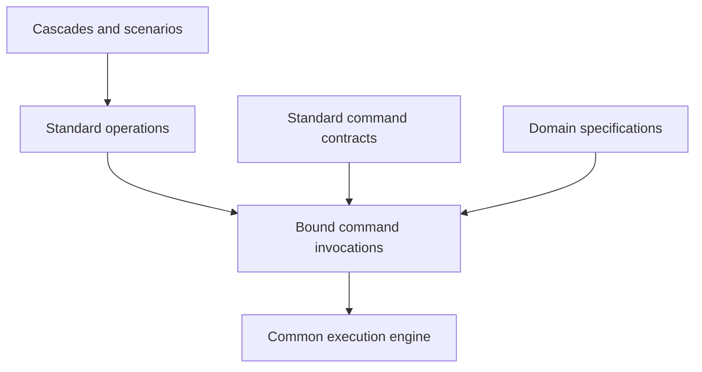
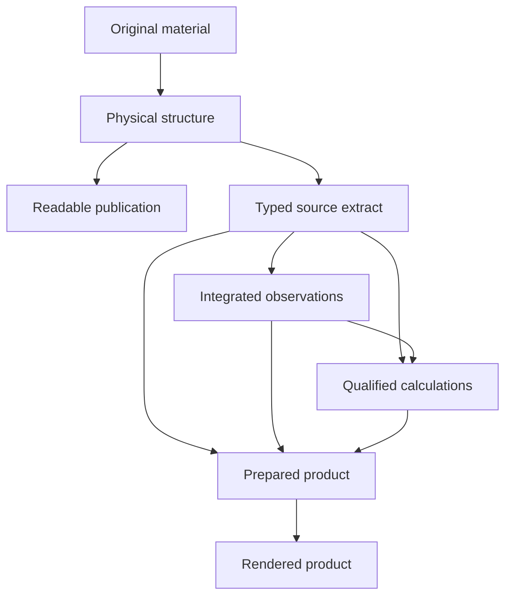
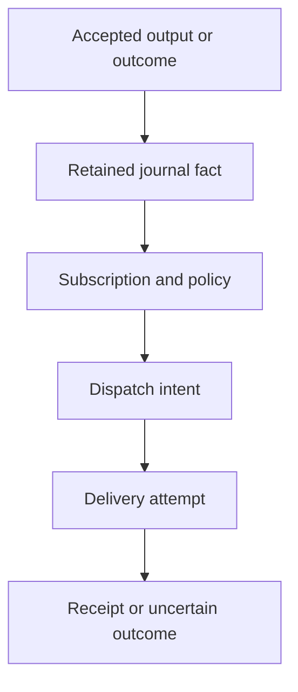

# Strategy Box: Standard Commands, Domain Specifications and the Meaning of the Data Route

**Date:** 2026-11-26. **Status:** research proposal for the target functional model. **Scope:** command ontology, recurring statistical series, domain knowledge, composition, calculations, execution evidence and acceptance.

The recommended organizing principle is **one standard language of actions, specialized through explicit domain specifications**. The data-processing route defines the available action families and their relationships. Commands express those actions; operations establish reusable functional results; scenarios accomplish a purpose; cascades coordinate purposes. Domains describe the publications, table series, interpretation rules and analytical models to which the actions apply. A command invocation connects the action and its applicable specification without transferring publisher knowledge into the composition.

This document defines the proposed behavior, including boundary conditions and acceptance examples. It is a design result, rather than a statement that every described route is implemented or scientifically verified. The only independently managed release version belongs to Stratbox itself. Source occurrences, exact content identities and execution evidence remain distinguishable facts. The [architectural companion](strategy_box_standard_commands_and_domain_specifications_architecture_2026-11-26.md) specifies the corresponding packages, declarations, binding procedures and runtime contracts.

## Contents

1. The central decision — a standard action language with explicit specialization.
2. The entities — commands, compositions, series, publications and values.
3. The data route — action families and legitimate alternative paths.
4. Command boundaries — what belongs to one action and what requires composition.
5. Domain knowledge — single ownership and reusable specifications.
6. Binding — selecting the exact meaning of a command invocation.
7. Inputs and results — contracts, provenance, qualification and coverage.
8. Operations, scenarios and cascades — composition without publisher implementation details.
9. Shared execution — resources, physical work and logical consumers.
10. Updates and reuse — observation, processing need and retention.
11. Calculations — explicit analytical actions within the common route.
12. SORS — meaningful decomposition and scientifically ordered iteration.
13. Seasonal adjustment — history, model treatment and derived observations.
14. Publication, journals and notifications — evidence of completed obligations.
15. Readiness — applicable capabilities and proof of their actual behavior.
16. Worked routes — escrow, shared publications and regional analytics.
17. Design alternatives and acceptance — counterexamples and completion conditions.
18. External references — limited technical foundations for specific provisions.

## 1. The central decision: standardize actions before specializing sources

### 1.1. The command layer joins two independent directions

The command ontology is the common seam between executable composition and domain knowledge:

An operation can invoke `command.table.interpret` for several publishers. Each invocation receives the applicable interpretation specification. The operation knows the required result and dependencies. The domain knows the table layout, field meaning, publication calendar and permissible interpretation. The engine knows how to schedule, execute, retain and observe the work.

The standard layer is authored independently of the list of existing functions. A source-specific function becomes an implementation method, a reusable specification, a true command, a composite operation or an internal helper according to its responsibility. Automatically creating a command and a one-command operation around every function does not establish this ontology.

### 1.2. Responsibilities have separate owners

| Code | Responsibility | Owns | Receives from another owner |
| --- | --- | --- | --- |
| F01 | Technical core | Transport, formats, storage, numerical primitives, scheduling, value lifetime, effects and journals. | Concrete admitted requests, resource claims and typed work. |
| F02 | Standard capability model | Command meanings, contracts, operation graphs, scenario templates and cascade rules. | Explicit targets and command-compatible specifications. |
| F03 | Domain model | Series, feeds, source semantics, profiles, specialized methods and analytical models. | Standard command protocols and shared value contracts. |
| F04 | Preparation | Resolve targets, bind specifications, establish dependency closure and compile admitted work. | Capability definitions, domain contributions and actual input evidence. |
| F05 | Application boundary | User choices, schedules, providers, destinations and platform lifecycle. | The same discoverable, callable library capabilities. |

F01 and F02 are separate responsibilities inside the same library. Standard action meaning should remain visible in a dedicated package even when a command implementation is a short call to a core primitive.

## 2. The entities: action identity, recurring series and observed material

### 2.1. Four callable kinds retain different promises

| Code | Kind | Defining question | Typical example |
| --- | --- | --- | --- |
| K01 | Command | Which independently useful action is performed on explicit inputs? | Decode a workbook; assess update evidence; solve a feasible model. |
| K02 | Operation | Which standardized functional result is established by a command graph? | Check a source; obtain a qualified extract; reconstruct observations. |
| K03 | Scenario | Which user purpose is accomplished through operations? | Refresh one selected statistical series for a period range. |
| K04 | Cascade | Which independently meaningful scenarios must be coordinated? | Prepare and publish a regional analytical release. |

A command can be called directly. An operation can contain one command when it adds a meaningful acceptance boundary, required check or reusable result promise. A one-command operation created solely to reproduce the same name and outputs adds little value. The number of definitions is an outcome of the model, rather than a target metric.

Operations contain commands and, where useful, previously defined operations. Scenarios compose operations; cascades compose scenarios. Composition operators express branching, bounded mapping, joins and qualified iteration. They are structural constructs, rather than a fifth callable kind.

### 2.2. A recurring table series has one declaration

| Code | Entity | Meaning | Example |
| --- | --- | --- | --- |
| E01 | Domain | Publisher-specific knowledge and responsibility. | Bank of Russia statistical publications. |
| E02 | Feed | A recurring publication channel or index shared by series. | A landing page listing project-finance publications. |
| E03 | Publication issue | An identifiable dated publication occurrence. | A monthly release with a stated reporting date. |
| E04 | Asset | A published representation or member of an issue. | XLSX workbook, HTML page, ZIP member or PDF. |
| E05 | Table series | A continuing logical table or coherent recurring table set. | The continuing escrow table, across monthly releases. |
| E06 | Series occurrence | The use of a publication issue and asset for one table series. | Escrow observations for one reporting date. |
| E07 | Material | Exact acquired or supplied bytes and acquisition evidence. | The body returned by one HTTP observation. |
| E08 | Numerical time series | Ordered observations at a fixed analytical grain. | Escrow balance for one region, unit and perimeter over time. |
| E09 | Processing family | A declared compatibility set for a method or profile. | Several tables sharing a reviewed layout interpreter. |

The term `Series` below means E05. `TimeSeries` means E08. This distinction prevents the recurring-publication registry from becoming a registry of every numerical column or every downloaded month.

One workbook can carry several Series. One Series can need several assets in one issue. One feed can distribute many Series. A coherent table containing several indicators can remain one Series. Separate Series are justified by independent table identity, semantics, publication rules, support or lifecycle, rather than by file count alone.

The Series declaration is static knowledge. Observed monthly occurrences and acquired materials are runtime records. Creating another specification record for every month would duplicate the continuing rules.

### 2.3. Definitions, bindings and invocations are distinct

| Code | Entity | Meaning |
| --- | --- | --- |
| B01 | Command definition | Stable action ID, input/output shape, accepted outcomes, work class, effects and specification protocol. |
| B02 | Specification | Declarative facts and rules needed by a particular action. |
| B03 | Method | An implementation of the command's typed procedure protocol. |
| B04 | Binding rule | Applicable target and conditions selecting B02 and B03 for B01. |
| B05 | Effective specification | Fully resolved immutable command-specific configuration, including referenced facts. |
| B06 | Bound invocation | Definition, effective specification, method, actual inputs, parameters and execution obligations. |

A dictionary of region names is knowledge. An extractor using that dictionary is a method. The assignment of the dictionary and extractor to the escrow interpretation command is a binding. The particular execution on a supplied workbook is an invocation.

## 3. The data route: a graph of standardized action families

### 3.1. The reference route defines available transitions

| Code | Route family | Responsibility | Representative commands |
| --- | --- | --- | --- |
| R01 | Locate | Establish where publication evidence or a requested asset can be obtained. | `request.prepare`, `issue.select`. |
| R02 | Inspect | Interpret availability, observed occurrence and update evidence. | `publication.scan`, `source.assess`. |
| R03 | Acquire | Obtain explicit material under a request and access policy. | `material.fetch`, `material.read`. |
| R04 | Decode | Expose physical structure and bounded containers. | `archive.unpack`, `workbook.decode`, `document.decode`. |
| R05 | Readable | Produce a faithful inspection representation. | `publication.transcribe`. |
| R06 | Extract | Select physical tables, fields and source structure. | `table.extract`. |
| R07 | Interpret | Assign series-local field meaning, periods, units and value status. | `table.interpret`, `observations.validate`. |
| R08 | Align | Establish shared addressing and admitted semantic correspondence. | `observations.align`. |
| R09 | Calculate | Produce derived values under a stated analytical method. | `calculate.change`, `calculate.ratio`, `timeseries.adjust`, constraint commands. |
| R10 | Prepare | Select and arrange a product's analytical content. | `view.prepare`. |
| R11 | Render | Encode an accepted view or readable representation. | `product.render`, `value.encode`. |
| R12 | Retain | Save or ingest an explicit result with an effect receipt. | `artifact.commit`, `dataset.ingest`. |
| R13 | Release | Establish a coherent published set of immutable members. | `release.assemble`, `release.publish`. |

The prefix `command.` is omitted in this table for readability. The identifiers describe proposed responsibilities, rather than an assertion about existing API names.

The route is a standardized action graph. It does not prescribe one linear pipeline, one mandatory download, one file format or one storage hierarchy. Checking a source often acquires a small index before it can inspect publication evidence. A material-fetch command can therefore participate in inspection of an index and later acquisition of a workbook. Its resource class remains network I/O in both uses.

### 3.2. Data roles and route actions are different dimensions

| Code | Data role | Established use |
| --- | --- | --- |
| A01 | `originals` | Exact source material with a declared acquisition boundary. |
| A02 | `readable` | Faithful inspection of source content, structure and context. |
| A03 | `extracts` | Typed observations under a Series-local semantic contract. |
| A04 | `integrated` | Shared addressing and qualified cross-series relationships. |
| A05 | `products` | Selected analytical outputs, reports, workbooks or service results. |

Calculation is an action family. Derived status is a qualification of its output. It does not create a compulsory sixth storage rung. Validation, comparison, encoding and retention can attach at several data roles.

A native publisher CSV can retain its original byte identity and also satisfy an extract contract after interpretation and validation. Such admission establishes a second qualified use; it need not duplicate the bytes. A CSV written after modifying values is a distinct derived material.

### 3.3. Legitimate routes preserve the same contracts

Existing material permits entry at M. A retained extract permits entry at X. A retained integrated dataset permits entry at I. An accepted view permits rerendering without acquisition or calculation. Source-local work can consume X directly. Cross-source analytics requires the necessary comparability and addressing whether integration is persistent or performed in memory.

## 4. Command boundaries: a useful action with an explicit contract

### 4.1. A command is semantically bounded, rather than instruction-sized

A command has one independently useful action, explicit inputs, meaningful outputs and an assessable result. Workbook decoding is a command even though its implementation executes many loops and library calls. Scalar addition inside a financial formula is usually an implementation primitive. A formula evaluation can be a command when it produces a reusable, qualified analytical result.

Split an implementation when the intermediate boundary has a real consumer, distinct applicability, reusable expensive work, independent resource class, useful recovery point, separate effect or independently meaningful acceptance. Avoid splitting merely because there is another Python function.

| Code | Candidate | Classification and reason |
| --- | --- | --- |
| G01 | HTTP request execution | Command: observable I/O, independent limits and material evidence. |
| G02 | Find an asset link in supplied index evidence | Command or method within `publication.scan`: pure interpretation with a typed listing result. |
| G03 | Download, decode, calculate, save and notify | Scenario or cascade: multiple outputs, resources and external obligations. |
| G04 | Decode workbook and select one publisher's indicators | Separate physical decoding and domain interpretation when either work can be reused. |
| G05 | One inner iteration of an optimizer | Internal primitive unless its state and result are independently useful. |
| G06 | Compute certified bounds for selected model quantities | Command: explicit model, targets, solver evidence and acceptance. |
| G07 | Open an ordinary pooled HTTP client | Managed resource lifecycle; a command is justified only when preparation itself has a meaningful result, expiry or failure contract. |

### 4.2. The standard contract limits specialization

`command.table.interpret` promises a typed interpretation of supplied physical evidence. Its domain method can know sheet names, headers, footnotes and native units. It cannot silently download a replacement workbook, save a product or send a message. Those actions require explicit graph nodes and obligations.

A method can strengthen the contract and report narrower supported scope. It cannot relabel partial coverage as complete, replace source A with source B, or treat an unsupported layout as an empty successful table.

One universal `execute_domain_action(name, dict)` would hide the actual action language. A command-specific protocol such as `TableInterpreter` is different: it establishes admissible inputs, outputs, effects and scientific responsibility even when several implementations satisfy it.

### 4.3. Shared domain procedures remain methods or specifications

Common domain behavior can be reused across many Series without becoming a copied command definition. Examples include parsing a CBR publication date, constructing a read-only FNS request, resolving territorial labels and interpreting a shared workbook header layout.

A reusable method becomes a separate visible command when it crosses an independently useful action boundary. Otherwise several command bindings can reference that method. The decision follows functional responsibility, rather than whether its implementation sits in a domain package.

## 5. Domain knowledge: one owner per fact and one record per Series

### 5.1. The domain owns a graph of referenced knowledge

| Code | Domain record | Owns once | Referenced by |
| --- | --- | --- | --- |
| D01 | Access policy | Publisher access requirements and request restrictions. | Feeds and request specifications. |
| D02 | Endpoint | Base address or concrete index address. | Feed and asset-locator rules. |
| D03 | Feed | Publication-channel identity and listing semantics. | Series declarations and discovery bindings. |
| D04 | Layout profile | Anchors, structural selectors and applicability predicates. | Extraction and interpretation bindings. |
| D05 | Semantic dictionary | Native metric meanings, dimensions, units and status tokens. | Interpretation, validation, alignment and calculations. |
| D06 | Method implementation | Publisher-specific procedure satisfying a standard command protocol. | Binding rules for compatible Series. |
| D07 | Calculation model | Input roles, admissible measures, equations, tolerances and scientific acceptance. | Calculation bindings and analytical scenarios. |
| D08 | Product specification | Content, projections, labels and analytical presentation rules. | Product-preparation bindings. |
| D09 | Series declaration | Continuing identity and references to applicable records. | Selection, binding and coverage assessment. |

A Series record points to common knowledge rather than copying complete profiles under every command. Distinct command specifications can reference the same period dictionary or geographic mapping. The common object remains the authority.

### 5.2. A Series declaration is a coherent entry point

The continuing escrow Series declares its stable ID, feed, expected occurrence model, observation grain, semantic dictionary, applicable representations and command-binding references. Its discovery binding references the shared feed index. Its interpretation binding references an escrow layout and field dictionary. Its alignment binding references admitted geographic and metric correspondence. Its calculation eligibility references supported methods and their input predicates.

The declaration contains neither an accumulated list of downloaded files nor a copy of every monthly observation. Runtime occurrence records point back to it.

### 5.3. Reuse follows typed composition

Recommended knowledge reuse is explicit:

1. Domain policy supplies shared access facts.
2. Feed supplies publication-channel facts.
3. A profile supplies one compatible procedure's structural rules.
4. A Series binding supplies its exact references and declared differences.
5. An invocation supplies allowed user choices, such as periods and requested projection.

These layers fill different typed slots. They are not a general permission to recursively merge dictionaries. A stock measure cannot become a flow by a late `kind` override. A quarterly publication cannot become monthly by changing a parameter. A changed unit requires an explicit conversion with evidence.

Where an override is useful, its field, permitted scope and validation rule are declared by the slot owner. The effective specification records the final value and contributing references. Ambiguous or conflicting factual definitions fail preparation.

### 5.4. Multi-Series calculations have their own model record

SORS is a model over several inputs, not a property copied into every participating Series. Its calculation model declares input roles and relationships once. Series can advertise eligibility for those roles. The model binds its own commands using `CalculationTarget`, while source commands bind using `SeriesTarget` or `FeedTarget`.

Similarly, a regional report's product specification can reference several domains. The report composition selects its targets and contracts; each source's details remain in that source's domain.

## 6. Binding: resolve exact specifications before the action executes

### 6.1. Resolution joins the requested action and verified context

| Code | Resolution input | Purpose |
| --- | --- | --- |
| Q01 | Standard command ID | Fix the meaning and specification protocol. |
| Q02 | Target identity | Select a feed, Series, analytical model or product. |
| Q03 | Actual input evidence | Establish source, issue, material identity and known structure. |
| Q04 | Applicability context | Representation, observation period, layout evidence and semantic scope. |
| Q05 | Explicit method choice, if allowed | Resolve a meaningful analytical alternative. |
| Q06 | Runtime availability | Establish that required execution providers exist. |

The resolver follows explicit references and applicability predicates. Exactly one applicable binding is selected unless the request explicitly names an alternative. Zero candidates yields a precise unsupported or unavailable outcome. Several unresolved candidates yield ambiguity. Import order, alphabetical names and dotted-name depth provide no semantic priority.

### 6.2. Some context becomes known only after acquisition

A source can change its workbook layout without changing its URL. Preparation can resolve discovery and acquisition before the layout is known. After decoding, a declared recognition boundary produces evidence for the interpretation binding. The continuation is prepared and admitted through the same resolver and executor.

This is staged binding, rather than a hidden parser choosing arbitrary fallbacks. The prepared plan makes the unresolved slot and its admissible continuation visible. The chosen interpretation specification is fixed before interpretation runs. Resource claims, source constraints and output acceptance remain mandatory for the continuation.

### 6.3. Binding must agree with actual input provenance

Selecting Series A and supplying an identified original for Series B is a contradiction even when both accept the same parser. Correctly reporting B in the result's lineage does not fulfill the request for A.

The target contract therefore checks requested target, selected binding, supplied input evidence and accepted output together. A publication package known to contain both A and B can legitimately support both; compatibility is established through an explicit asset-membership relation.

For an unattributed user file, the caller can provide an attribution claim and the command can assess structural evidence. The result distinguishes verified attribution, caller assertion and unresolved identity. Relabeling known conflicting provenance is never an attribution operation.

## 7. Inputs and results: meaning accompanies values

### 7.1. Every command declares its invocation contract

| Code | Contract facet | Required content |
| --- | --- | --- |
| C01 | Inputs | Named typed values, admissible data roles and required evidence. |
| C02 | Parameters | User-controlled decisions with types and allowed ranges. |
| C03 | Specification slot | The narrow command-specific protocol supplied by binding. |
| C04 | Applicability | Source, representation, period, grain, units and coverage predicates. |
| C05 | Outputs | Named typed values and their established meaning. |
| C06 | Acceptance | Checks and evidence needed to accept each output and completion. |
| C07 | Resources | Work class, provider needs, limits and dynamic estimates. |
| C08 | Effects | Possible I/O and externally visible obligations. |
| C09 | Reuse | Conditions for physical sharing and completed-result reuse. |
| C10 | Diagnostics | Unsupported, partial, indeterminate and failure outcomes. |

The implementation receives only the effective specification needed for that command. Giving every handler an unrestricted domain registry or whole Series record reintroduces hidden dependencies.

### 7.2. Result acceptance has several independent facets

| Code | Facet | Example |
| --- | --- | --- |
| V01 | Execution outcome | The decoder finished or failed. |
| V02 | Structural coverage | Which sheets, rows, indicators and periods were processed. |
| V03 | Semantic qualification | Published, reconstructed, inferred, converted or unresolved. |
| V04 | Provenance | Actual source material, issue, selected rules and derivation inputs. |
| V05 | Effect outcome | Save confirmed, failed or uncertain. |
| V06 | Task acceptance | The requested functional result and required obligations were satisfied. |

Successful workbook decoding establishes physical evidence. It does not establish interpretation of every table. Interpretation of eleven reviewed indicators establishes those indicators' coverage. It does not establish the remainder of the workbook. An unsupported layout is different from a valid publication containing no selected observations.

The value itself may remain usable after a later optional render or notification fails. Required output, required effect and overall task completion are evaluated according to their separate contracts.

### 7.3. Economic semantics constrain composition

Observation contracts preserve stock versus flow, monthly versus year-to-date accumulation, reporting date versus publication date, unit and scale, population perimeter, territorial identity and value status. Missing, withheld, published dash, exact zero and zero at reporting precision have different meanings.

`calculate.change` declares which difference or rate it computes and requires compatible inputs. A generic percentage-index conversion is applicable to percentage indices. Population levels require an appropriate level-change calculation. Unsupported inputs should be rejected; that rejection still means the population route lacks the requested calculation capability.

Published-field extraction for a reporting form and a reviewed financial model derived from that form are separate capabilities. Generic arithmetic does not supply missing financial definitions.

## 8. Compositions: standard graphs carry purpose without publisher internals

### 8.1. Operations own standardized result promises

`operation.source.check` composes request preparation, index acquisition, publication scanning, occurrence selection and evidence assessment as required by the input contract. It returns availability and change evidence. A command-level indeterminate assessment can be a successfully completed check.

`operation.series.extract` consumes an identified original or compatible physical evidence, decodes only where needed, extracts and interprets the selected table, and validates the typed result. Supplying the original eliminates live source acquisition. Its acceptance includes the Series constraint and exact requested coverage.

`operation.series.acquire` accepts an asset request and returns validated material. Preservation is an explicit further operation when requested. A convenient capture scenario can require both acquisition and retention.

### 8.2. Scenarios select targets and goals

A refresh scenario can select the escrow Series and a period range, request an extract and require saving it. It calls standard operation IDs. It does not contain landing-page URLs, sheet names, source aliases, native status tokens or date-parsing rules.

A task-specific scenario can name particular Series or calculation models as opaque targets. Source identity in a request is useful selection. Publisher implementation details inside the scenario are coupling.

Distinct source layouts usually alter bindings. A genuine change in route topology can select a declared standard recipe variant: archive versus direct workbook, single asset versus several dependent assets, index lookup versus a direct known occurrence. The recipe uses visible standard commands and typed domain slots. It must not be an arbitrary domain-owned runner concealed behind one leaf.

### 8.3. Cascades preserve independent goals and membership

A cascade has a frozen selected membership for one invocation, required and optional scenarios, dependencies, output ownership and an explicit completion policy. It can discover a bounded membership before freezing it. A newly published source occurrence during execution does not silently change a pinned release.

Two member scenarios can share physical work while keeping separate outputs and outcomes. Optional source unavailability can permit an explicitly incomplete preview. A required source gap prevents a complete-release claim.

Coherent analytical acceptance and public release are separate obligations. A cascade can accept mutually compatible in-memory results without publishing them. A release scenario adds confirmed immutable members and conditional publication.

### 8.4. Every public entry uses one execution model

Direct commands, operations, scenarios, cascades and temporary user graphs enter the same catalog, binding, preparation, admission and execution path. A notebook's convenience method cannot bypass acceptance and resource accounting. Machine discovery exposes the same contracts. The actual platform server, scheduling and long-lived application persistence belong to their external application owners.

## 9. Shared execution: reuse facts, work and resources at their proper boundaries

### 9.1. Three meanings of “use CBR access once”

| Code | Shared object | Correct meaning |
| --- | --- | --- |
| S01 | Domain access policy | One authored definition reused by relevant bindings. |
| S02 | Live HTTP resource | One compatible managed client/pool scope, potentially many requests and connections. |
| S03 | Physical index observation | One fetch for equivalent request, access and freshness conditions, consumed by several Series. |

These are independent. A shared client does not automatically deduplicate requests. Shared request bytes do not automatically imply shared source attribution. Distinct workbook URLs normally require distinct exchanges even when they use the same pool.

The resource manager owns opening, reuse, limits and cleanup of ordinary clients. A domain supplies request and access policy. A meaningful authentication or preparation step with an expiring outcome can be explicit work, but routine connection management should not appear as a copied command in every Series.

### 9.2. Separate physical decoding from semantic use

One material can feed a readable publication, escrow interpretation and another table interpretation. Equivalent physical decoding can run once. Each consumer then applies its own specification and acceptance.

Physical workbook evidence should identify bytes and decoder conditions without embedding the selected Series as its intrinsic identity. Source-use records attach a Series/issue/asset relationship separately. Otherwise two interpretations of identical physical material become unnecessarily distinct decode work.

Different formula representations, coverage requirements, decoder configuration or access/freshness requirements can make apparently similar work ineligible for sharing. A pure method's claim is reviewed and explicit. Effects are not shared merely because their input values match.

### 9.3. Resource semantics belong to the action

Every command has a resource class: network, storage read/write, archive, decode, semantic processing, numerical computation, solver or rendering. Binding adds implementation-specific requirements and estimates. It cannot erase mandatory base claims.

The scheduler admits actual bound commands, including dynamically prepared continuations, using the same claims. Global worker limits and per-class limits express different constraints. A worker bound of eight does not imply `parse=1` or `solver=1`.

Cancelled consumers release their claims on shared results. They do not cancel a producer still required by another consumer. Accepted values stay owned until their result handles, downstream consumers and retention obligations release them. Sharing a mutable dataframe requires immutable access or an explicit copy policy.

## 10. Updates and reuse: separate source facts from work decisions

### 10.1. A source check has qualified outcomes

| Code | Outcome | Established fact |
| --- | --- | --- |
| U01 | `new_issue` | A newly identified publication occurrence exists relative to the baseline. |
| U02 | `changed` | Comparable evidence establishes a material or semantic change. |
| U03 | `unchanged` | The stated comparison scope and evidence support no change. |
| U04 | `absent` | The checked scope establishes absence under the specified discovery rules. |
| U05 | `indeterminate` | Available evidence cannot settle the requested comparison. |
| U06 | `unavailable` | The observation could not be completed under current access conditions. |

The assessment records what was compared: index metadata, HTTP representation, exact bytes or typed observations. A changed index need not imply changed table values. An unchanged URL proves little about its current content.

HTTP validators belong to a selected representation. A 304 response refers to an applicable retained representation and supplies no new body; a consumer that lacks that body cannot decode the 304 as an original. These constraints follow RFC 9110 §§8.8, 13 and 15.4.5. [X01]

### 10.2. Processing need is a separate assessment

An unchanged source can require reinterpretation after a rule correction, integration after a mapping correction, or retention to a new destination. An existing extract can satisfy an extraction goal while a missing product still requires calculation and rendering.

The work planner evaluates requested outputs, exact input identities, effective specification content, Stratbox build identity and existing accepted results. It does not equate source novelty with all downstream readiness.

### 10.3. One repository version; factual identities remain

| Code | Keep | Purpose |
| --- | --- | --- |
| I01 | Stratbox release version and repository commit/build identity | Identify the library implementation. |
| I02 | Stable command, Series, method and profile IDs | Address one concept or declaration. |
| I03 | Effective specification and reference-content digests | Identify exact rules and dictionary contents used. |
| I04 | Publication dates, periods, issue IDs and material digests | Identify actual source facts. |
| I05 | Observation, transition, run, attempt and effect IDs | Distinguish actual events and obligations. |
| I06 | Opaque provider state token | Express a conditional-write precondition. |

Commands, contracts, schemas, methods, profiles, bindings and dictionaries have no separately managed release counters or compatibility negotiation. Historical layouts use factual applicability conditions such as dates and structural evidence. A changed meaning can receive a genuinely different descriptive ID; an ID suffix used solely to imitate `v2` would recreate the rejected lifecycle.

Fingerprints are computed evidence, rather than manually maintained component versions. A baseline transition A → B → A contains two changes even when the final material digest repeats. A content digest alone cannot identify that transition history.

Cross-build reuse defaults to conservative invalidation. More selective reuse can use exact dependency fingerprints when its sufficiency is established. Dirty working trees require an exact build/source fingerprint or disabled durable reuse; the package release string alone is insufficient.

## 11. Calculations: first-class actions inside the common route

### 11.1. Calculations consume semantic data, rather than filenames

A calculation command receives observations, a model, a quantity graph or a prepared numerical time series. Its specification defines input roles, dimensions, admissible measures, units, period relationships, methodology and diagnostics. The chosen method implements that mathematical responsibility.

Source-processing commands and numerical commands have different primary targets. The former act on publication evidence, files, workbooks and tables. The latter act on selected numerical data inside those tables or obtained independently from a database. A numerical time series is not required to have its own recurring-publication `Series` declaration.

| Code | Calculation family | Required semantic distinction |
| --- | --- | --- |
| N01 | Level differences and growth | Comparable levels, periods and perimeters. |
| N02 | Index transformation | Published index definition and base. |
| N03 | Ratios and shares | Numerator, denominator, population and zero policy. |
| N04 | Accumulated-flow conversion | Consistent year-to-date periods and reset boundaries. |
| N05 | Financial models | Reviewed source fields, equations and reporting semantics. |
| N06 | Reconstruction | Constraints, precision, feasibility and evidence of identified values. |
| N07 | Seasonal adjustment | Compatible history, frequency, calendar, model treatment and diagnostics. |

These families can share numerical primitives while retaining different command contracts. A generic `calculate` dispatcher with an unrestricted dictionary cannot express their different promises adequately.

### 11.2. Calculation does not require a persistent integrated database

An in-memory extract can satisfy a source-local calculation contract. Cross-source work requires explicit alignment and comparability. The output preserves source observations separately from derived values and records the actual derivation basis.

The requested output scope and necessary input scope can differ. A one-region SORS product can need national and district constraints. A twelve-month seasonal-adjustment product can need a longer history. Preparation expands the necessary inputs from the model's declared requirements.

### 11.3. Individual time series and complete tables use the same calculation contract

| Code | Numerical input | Meaning of calculation |
| --- | --- | --- |
| NU01 | `TimeSeries` | One ordered sequence at a fixed indicator, entity, unit and perimeter. |
| NU02 | `TimeSeriesSet` | Explicit independent series selected from a table or database. |
| NU03 | `Panel` | A table of related observations across dimensions and periods, with declared grain. |
| NU04 | `ModelInputs` | A coupled set whose constraints or estimation require joint treatment. |

A database query can select metric, region, currency, perimeter and date range, yielding observations. `timeseries.prepare` checks that the remaining dimensions identify one numerical series. The chosen numerical command then operates without any source download, workbook parsing or publisher binding. Necessary units, calendar and value qualifications accompany the values.

Applying seasonal adjustment to a complete table is a lifted operation: discover numerical-series groups at the table's declared grain, prepare each history, validate applicability, apply the same adjustment contract to each eligible group, and assemble results with per-group diagnostics. This is a bounded map over independent calculation units. A wide table requires explicit time-column and value-column metadata; a long table requires grouping and time-coordinate metadata. Numeric column type alone cannot identify a time series.

The request declares whether every selected series must succeed or an explicitly qualified eligible subset is acceptable. The coverage result accounts for every selected unit as accepted, inapplicable, failed, cancelled or unresolved. Empty output cannot stand for successful adjustment of the whole table. A table containing two incompatible currencies or both monthly flows and accumulated flows is partitioned and checked according to its semantic metadata.

Table lifting belongs to an operation or scenario around the numerical command. It does not require another publisher-specific adjustment implementation or a command copy for every column. Concurrency is controlled by the common resource/admission machinery; a whole table is not handed to an unbounded internal loop.

Whole-table coverage and cross-series coherence are separate promises. Adjusting constituent regions, districts and a national total independently does not establish that their adjusted values satisfy the original aggregation identities. A table-level specification therefore chooses direct independent estimation, indirect aggregation from admitted nonoverlapping components, or a reviewed reconciliation/coupled method. Only the latter policies can promise the corresponding admitted aggregate constraints. Original reported totals remain separately identifiable, and a complete unit-status report alone cannot prove additive coherence.

### 11.4. Independent series mapping and coupled modeling remain distinct

A calculation declares an input topology: `single_series`, `independent_series` or `coupled`. Independent seasonal estimates can be mapped over a table; a multivariate method can instead require joint input. SORS reconstruction generally uses coupled cross-sectional constraints and can work on one reporting-date slice. It is not intrinsically a temporal estimation method and need not receive a historical sequence.

Selecting one regional output does not authorize dropping the other inputs of a coupled model. Conversely, an ordinary calculation of one queried numerical series should not require the publisher's complete workbook. The declared numerical contract determines the necessary scope in each case.

## 12. SORS: split meaningful calculations and preserve scientific order

### 12.1. Recommended callable boundaries

| Code | Standard action or operation | Input | Accepted result |
| --- | --- | --- | --- |
| SC01 | Prepare model inputs | Identified extracts and pinned source bundle. | Complete semantic input roles and validated scopes. |
| SC02 | `constraints.build` | Prepared observations, classification and SORS equations. | Quantity/constraint graph with source-coordinate evidence. |
| SC03 | `bounds.propagate` | Graph, admitted facts and bound state. | Tightened bounds, conflicts and derivations. |
| SC04 | `facts.inherit` | Publication hierarchy, zero evidence and current facts. | Candidate directly inherited publication facts with proofs. |
| SC05 | `facts.reconcile` | Candidate facts, current bounds and rounding policy. | Consistent next scientific state or explicit conflict. |
| SC06 | `model.compile` | Constraint graph and accepted bound state. | Solver problem and exact variable/constraint mapping. |
| SC07 | `model.feasibility` | Compiled problem and solver treatment. | Feasible, infeasible or unresolved assessment with evidence. |
| SC08 | `bounds.optimize` | Feasible model and explicit target quantities. | Qualified extrema or unresolved target statuses. |
| SC09 | `values.certify` | Bounds, feasibility and publication precision. | Identified values distinguished from unresolved intervals. |
| SC10 | `observations.assemble` | Certified values and source basis. | Derived observations, coverage and diagnostics. |
| SC11 | Product operations | Retained derived observations and projection. | Regional/industry CSV, workbook or analytical view. |

Each row is justified by a distinct scientific result, reusable state or execution responsibility. Matrix assembly subroutines and solver inner loops remain implementation details. Generic constraint and solver infrastructure can live in the technical core where it is genuinely reusable. SORS portfolio scopes, classification relationships, publication equations and inheritance rules remain domain knowledge.

### 12.2. Iteration has an explicit scientific contract

The restoration operation first reaches deterministic closure over bound propagation, published-precision facts and inheritance. It then performs a global feasibility gate. Optimization produces further candidates, which return through reconciliation and deterministic closure before another optimization wave. Final certification requires the relevant feasibility and convergence evidence.

Two representation choices are legitimate:

| Code | Choice | Appropriate condition |
| --- | --- | --- |
| IT01 | A bounded fixed-point command | The whole closure is one useful action and independent iteration state has no consumer. Internal passes remain observable. |
| IT02 | A bounded iteration composition | Individual passes need independent admission, retained states, restart or reuse. Each pass invokes the explicit commands above. |

The target decomposition should support IT02 where these consumers exist. IT01 remains semantically honest only when its contract declares the full closure, limits and convergence assessment; callbacks naming hidden stages do not create independent commands.

Iteration state has a fingerprint, pass identity, derivation ledger and stopping predicate. A stop requires the declared absence of relevant new facts and bound changes. Hitting an iteration, time or memory limit produces incomplete or failed completion according to policy. It never proves convergence. A continuation unrolls an acyclic pass through the common admission path; arbitrary feedback edges in the ordinary graph remain invalid.

### 12.3. Qualifications survive the split

| Code | Distinction | Required behavior |
| --- | --- | --- |
| SQ01 | Published zero versus exact zero | Preserve the applicable precision interval. |
| SQ02 | Direct inheritance versus arithmetic residual | Retain different derivation evidence. |
| SQ03 | Narrow interval versus unique rounding bucket versus exact point | Return the actual established category. |
| SQ04 | Candidate versus globally feasible fact | Keep provisional status until required feasibility succeeds. |
| SQ05 | Solver timeout versus certified extremum | Keep unresolved status when the proof is insufficient. |
| SQ06 | Strict method versus relaxed tolerance scenario | Preserve distinct model treatment and output qualification. |
| SQ07 | Narrow output projection versus coupled model inputs | Keep all required constraints before projecting the result. |

Structural decomposition improves executability and visibility. It does not itself prove that the reconstruction methodology or its treatment of numerical tolerances is correct.

## 13. Seasonal adjustment: another calculation route, with its own inputs

### 13.1. The operation works over a compatible numerical history

The proposed operation prepares a `TimeSeries`, validates frequency and period continuity, applies calendar and missingness treatment, estimates an adjustment, evaluates diagnostics and assembles derived observations. Rendering and saving remain downstream actions.

| Code | Command responsibility | Result |
| --- | --- | --- |
| SA01 | `timeseries.prepare` | Ordered compatible history and explicit missingness/coverage. |
| SA02 | `timeseries.validate` | Applicability findings for frequency, measure and treatment. |
| SA03 | `timeseries.adjust` | Adjusted series and declared components/model evidence. |
| SA04 | `timeseries.diagnose` | Residual-seasonality, stability and other configured diagnostic findings. |
| SA05 | `observations.assemble` | Qualified derived observations linked to exact history and treatment. |

Stock/flow meaning, frequency, calendar, outlier treatment and selected estimation method belong to the calculation specification. They are explicit analytical decisions. A family-level default can be reused by many Series, while a user-selected alternative is recorded in the effective treatment.

Official Census guidance treats adjustment quality as a diagnostic question including remaining seasonality and stability when additional observations arrive. This supports separate diagnostic outputs and an explicit input-history basis; it does not establish that any chosen method is suitable for every Series. [X03]

### 13.2. The source and the estimate coexist

Adjusted observations do not overwrite published observations. Adding another period can change estimates for earlier periods. A new estimation therefore records the exact history, input material identities and treatment rather than presenting itself as a replacement source extract.

An insufficient history or incompatible frequency yields an explicit applicability outcome. A regional panel is partitioned at a semantic grain that preserves units, perimeter and calendar; it is not partitioned into isolated monthly files for estimation.

## 14. Publication, journals and notifications: evidence follows actual work

### 14.1. A release derives its basis from accepted members

A coherent release requires compatible pinned inputs, accepted member results, verified lineage, confirmed retention of immutable members and a manifest referencing those members. Matching two caller-supplied descriptions of input identities does not establish actual derivation.

The release assembler derives each member's source basis from its accepted result. It verifies compatibility with the pinned release basis and required membership. A store receipt establishes a storage effect; it does not independently prove the scientific lineage of its bytes.

Conditional publication of a pointer coordinates the visible release. It does not freeze mutable member paths. Members require immutable content references and a provider retention guarantee. A digest can detect replacement at read time, while continued availability still depends on retaining the referenced content.

The distinction between entities, generating activities and derivations in W3C PROV-DM supports retaining these relationships explicitly. The concrete release contract and its acceptance rules are Stratbox design choices. [X02]

### 14.2. Journals precede notifications

Every callable kind can produce journal facts for named output acceptance, completion and effects. Subscriptions can target a command, operation, scenario or cascade. Domain methods report qualified facts to the common result path; they do not send messages directly.

Physical sharing preserves logical facts for every participating invocation. Source-transition identity can deduplicate one business notification when two scenarios observe the same transition. Deduplication policy must not erase their independent execution outcomes.

A notification failure does not retroactively invalidate an accepted dataset. A required delivery can be an independent task obligation. A root task cannot wait inside itself for its own terminal notification; a post-completion observer or an earlier accepted-output event supplies the proper temporal boundary.

Unknown write or delivery outcome is preserved and reconciled before a potentially duplicating retry. Journal durability, effect confirmation, dispatch acknowledgement and channel delivery remain separate guarantees.

## 15. Readiness: applicability, implementation and scientific evidence

### 15.1. Readiness is a structured assessment

| Code | Axis | Values or examples |
| --- | --- | --- |
| RD01 | Applicability | Applicable; inapplicable with a scientific reason; undecided. |
| RD02 | Definition readiness | Declared; exact binding resolved; graph composes; implementation missing. |
| RD03 | Verification | Structural checks; synthetic fixture; retained publisher material; live acquisition observation. |
| RD04 | Scientific scope | Exact layouts, periods, indicators, territorial coverage and model assumptions verified. |
| RD05 | Environment | Available providers; unavailable access/backend; external prerequisite. |

These axes avoid a misleading single ladder. A reviewed retained workbook can establish interpretation behavior while the live website is unavailable. A live download can succeed while its economic interpretation remains unverified. A synthetic fixture can establish scheduler behavior while proving little about a historical publisher layout.

### 15.2. Coverage binds a goal to an actual result promise

A coverage record identifies Series, action/goal, applicable binding, effective specification, supported input conditions, required output meaning and verification evidence. A registered command ID alone establishes discovery, rather than a working route.

Calculations are selected by admissible goals and input semantics. There is no requirement to attach an arbitrary calculation to every Series. A Series supporting level changes can lack seasonal adjustment; another can support only source extraction. Missing reviewed interpretation is a gap, rather than scientific inapplicability.

The complete applicable domain contour remains the target. An unavailable publisher material or missing reviewed financial model stays an explicit open obligation. A better command ontology cannot manufacture those scientific inputs.

## 16. Worked routes: concrete behavior under the common model

### 16.1. Escrow update and extraction

The scenario receives `SeriesTarget(cbr.project_finance.escrow)`, requested periods, a baseline and a destination policy. Identifiers and dates here illustrate the design, rather than a claim about a particular publication layout.

1. Bind shared CBR access and the project-finance feed.
2. Prepare and fetch the index request under the selected observation scope.
3. Scan publication evidence and select the relevant issue/assets.
4. Assess novelty against the qualified baseline. Preserve indeterminate outcomes.
5. Fetch required workbook material. Preserve the exact original only when that effect is requested.
6. Decode its physical structure, select the escrow table and bind its recognized layout.
7. Interpret reporting periods, regions, measures, units and status tokens through the escrow specifications.
8. Validate the Series constraint, requested scope and source evidence.
9. Return the accepted extract. Align, calculate, prepare a product or retain it according to requested goals.
10. Journal outputs, source facts and effects. Subscriptions consume those facts independently.

Changing only the destination can reuse the accepted extract and create a new retention obligation. Supplying a retained original starts at step 6. Requesting only a source check ends after step 4.

### 16.2. Several Series share one publication asset

Two Series reference a common feed and one workbook. Their index observation and workbook acquisition share work when request and freshness requirements agree. Physical decoding is shared independently of their Series labels. Their table selection, interpretation and coverage acceptance remain independent.

If the second Series uses a different representation of formulas, its decoding requirements can require separate work. If one interpretation fails, the other's accepted result remains available. Cancelling one consumer preserves work still needed by the other.

### 16.3. Regional analytical release

The cascade selects bank lending, bank offices, FNS organizations and population Series, plus an explicit territorial/period comparability policy. Each member refreshes or reuses accepted observations through standard scenarios. A subsequent analytical scenario aligns admitted territories, selects compatible observation dates, computes reviewed indicators and prepares products.

Population stocks and registration events retain distinct meanings. District and national aggregates are not summed with their constituents. A reporting-date policy can permit deliberately different source dates; the release records that policy instead of claiming that all sources were published simultaneously.

The release scenario requires immutable members and verified lineage against the pinned basis. Missing required population observations block the full release; an explicitly requested partial preview can still succeed with its exact gap assessment. New source publication during the run belongs to a later refresh unless the current invocation explicitly restarts its pinned basis.

## 17. Design alternatives and acceptance conditions

### 17.1. Rejected shortcuts and bounded alternatives

| Code | Design | Assessment |
| --- | --- | --- |
| AL01 | Keep source-specific command IDs for equivalent actions everywhere | Preserves the catalog's old boundaries; common composition still needs source dispatch. |
| AL02 | One universal command with an action string and unrestricted parameters | Hides action-specific contracts, resources and acceptance. |
| AL03 | Copy a complete configuration beneath every Series/command | Duplicates shared facts and increases inconsistent maintenance. |
| AL04 | One enormous mutable domain object passed to every method | Hides dependencies and makes reuse identity unreliable. |
| AL05 | Typed command slots, referenced shared records and exact binding | Recommended: explicit responsibility with reusable knowledge. |
| AL06 | Make every numerical primitive public | Adds composition noise without independent functional value. |
| AL07 | A bounded scientifically meaningful closure command | Valid when the complete closure is the actual public action. |
| AL08 | Standard recipe variants selected by capabilities | Valid for real topology differences when their command graphs remain visible. |

### 17.2. Acceptance situations for the proposed model

| Code | Situation | Required observable behavior |
| --- | --- | --- |
| AC01 | Add a compatible Series to an existing feed/layout family. | Add a Series declaration and bindings/references; standard operation and scenario code stays unchanged. |
| AC02 | Change one shared endpoint declaration. | Every referencing binding uses it; no copied URL remains authoritative. |
| AC03 | Supply an identified B original to an A extraction request. | Reject the conflict before interpretation acceptance. |
| AC04 | Supply unattributed material. | Preserve assertion/recognition status and apply the declared attribution policy. |
| AC05 | One workbook serves two Series and a readable product. | One eligible decode; independent semantic results and source uses. |
| AC06 | Equivalent URL requests have incompatible access or freshness conditions. | Separate observation/work scopes. |
| AC07 | An index is unchanged but the interpretation rules changed. | Recompute the dependent interpretation when requested. |
| AC08 | Source check receives insufficient update evidence. | Successful check with indeterminate assessment, rather than false unchanged. |
| AC09 | Population observations reach an index-only calculation. | Reject applicability; do not count the route as a population calculation. |
| AC10 | A source-specific method needs acquisition while interpreting a supplied table. | Reject undeclared I/O or require an explicit additional graph node. |
| AC11 | Real parsers and a solver run with category limits of one. | Respect decode/CPU/solver claims independently of worker count. |
| AC12 | A dynamic layout continuation is introduced. | Resolve, validate and admit it through the same path. |
| AC13 | Two consumers share work and one cancels. | Keep the producer and value while the remaining consumer needs them. |
| AC14 | A one-region SORS projection is requested. | Retain the full required coupled input model before projection. |
| AC15 | A SORS pass limit is reached before convergence. | Report incomplete/failed completion and retain usable qualified diagnostics. |
| AC16 | An optimization target times out. | No certified extremum or exact value is inferred from that timeout. |
| AC17 | Seasonal adjustment receives isolated monthly files. | Assemble and qualify a compatible numerical history before estimation. |
| AC18 | A new observation changes earlier seasonal estimates. | Create a distinct derivation basis and preserve published values. |
| AC19 | Two release members claim a common source basis but actual lineage differs. | Reject coherent publication. |
| AC20 | A member path is mutable after verification. | Require immutable member retention or decline the coherent-release guarantee. |
| AC21 | A notification delivery outcome is unknown. | Preserve uncertainty and reconcile without invalidating the accepted data. |
| AC22 | Direct command and composed operation invoke equivalent work. | Use the same admission, value acceptance and journal machinery. |
| AC23 | A new library release changes command implementation. | Use the single Stratbox build identity; no component-version maintenance is required. |
| AC24 | A reviewed subset of a large publication succeeds. | Return exact subset coverage and retain remaining gaps. |
| AC25 | A required save receipt has no requested data consumer. | Keep the save in dependency closure as a required effect. |
| AC26 | A retained accepted view is rerendered. | Require rendering and requested retention only. |
| AC27 | A source returns from bytes A through B to A. | Preserve both observed transitions while reusing eligible physical bytes. |
| AC28 | A financial form has extracted fields but lacks a reviewed model. | Report extraction support and an open analytical-model obligation separately. |
| AC29 | The ordinary live source is unavailable, but a retained publisher fixture exists. | Preserve interpretation evidence and environment unavailability as separate facts. |
| AC30 | A public client submits a temporary graph. | Apply the same target constraints, typed slots, effects and resource rules. |
| AC31 | A database query selects one numerical series. | Prepare its semantic history and calculate without publication acquisition or a separate source-Series registration. |
| AC32 | Seasonal adjustment is requested for an entire table. | Group at the declared grain, admit bounded independent estimates and report every selected group's outcome. |
| AC33 | A whole-table request includes unsuitable histories. | Enforce strict-all or qualified-subset policy explicitly; preserve per-group reasons. |
| AC34 | A coupled method receives an independently partitioned table. | Require the declared model input topology; do not substitute a per-column map. |
| AC35 | A seasonally adjusted table includes totals and constituents. | Enforce the declared independent/indirect/reconciled policy; unit coverage alone establishes no aggregate identity. |

### 17.3. The proposed completion criterion

The model is complete when a composition can express its intended result using standard actions and explicit targets; each domain can supply all required source knowledge once through typed references; preparation proves the compatibility of requested purpose, selected specifications and actual evidence; and execution preserves the promised results, resource bounds, provenance and obligations.

Scientific completeness remains scoped to reviewed source material and calculation methods. That scope is visible in the same model instead of being inferred from the number of registered routes.

## 18. External references

| Code | Primary source | Specific supported claim |
| --- | --- | --- |
| X01 | [RFC 9110: HTTP Semantics, §§8.8, 13, 15.4.5](https://www.rfc-editor.org/rfc/rfc9110.html) | Validators refer to a selected representation; conditional requests have defined semantics; a 304 response has no body. Used in §10.1. |
| X02 | [W3C PROV-DM](https://www.w3.org/TR/prov-dm/) | Entities, activities and derivation relationships are distinct provenance concepts. Used to motivate explicit derivation evidence in §14.1; the proposed release guarantees are local design choices. |
| X03 | [US Census Bureau: Seasonal Adjustment Questions and Answers, question 13](https://www.census.gov/data/software/x13as/seasonal-adjustment-questions-answers.html) | Seasonal-adjustment quality assessment includes residual seasonality and stability as more observations arrive. Used in §13.1. |
